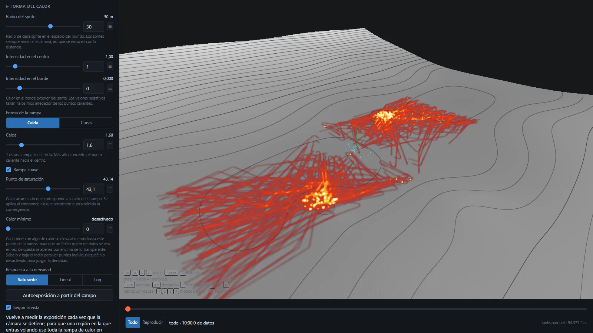
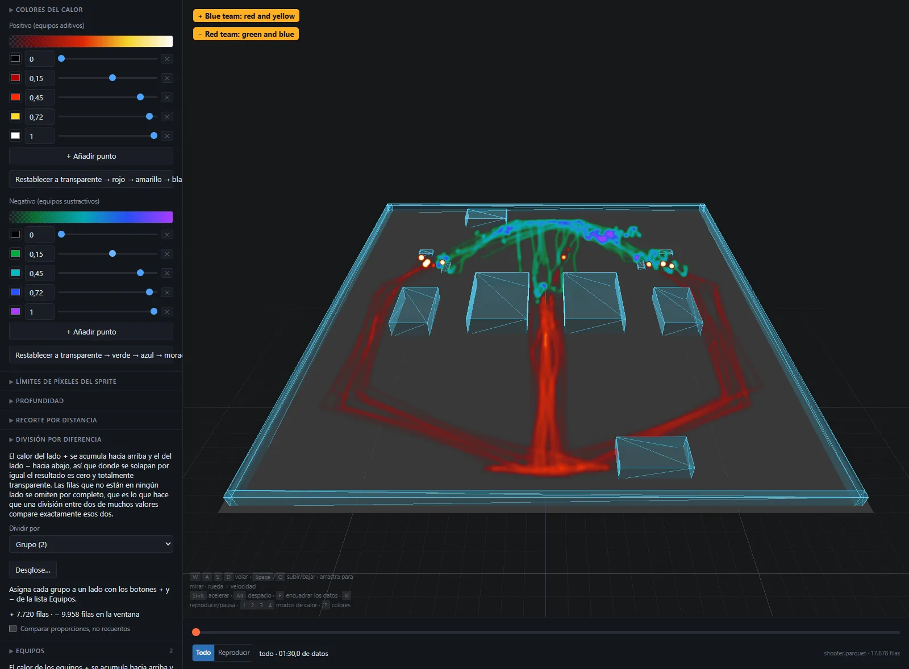
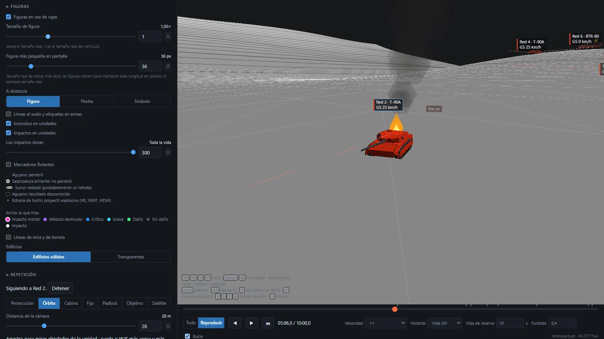
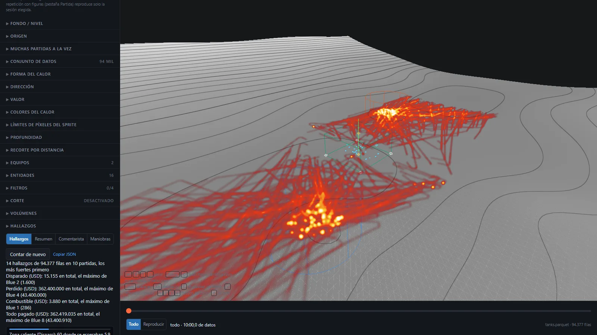
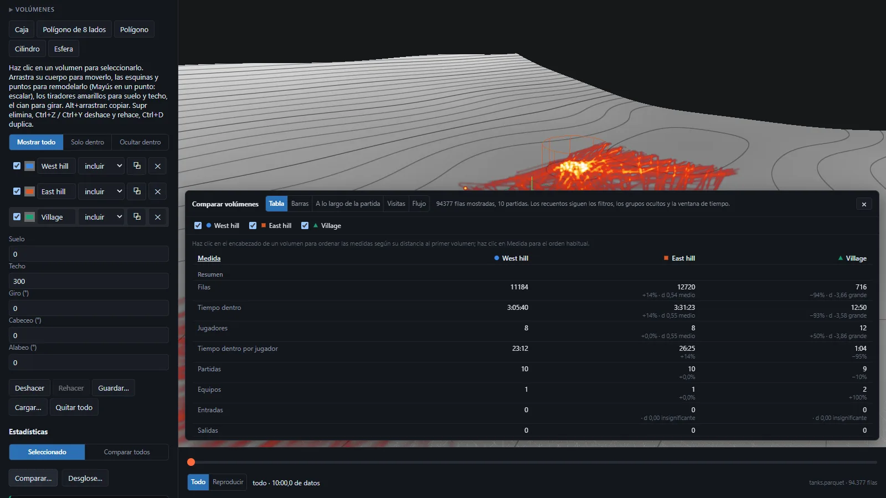
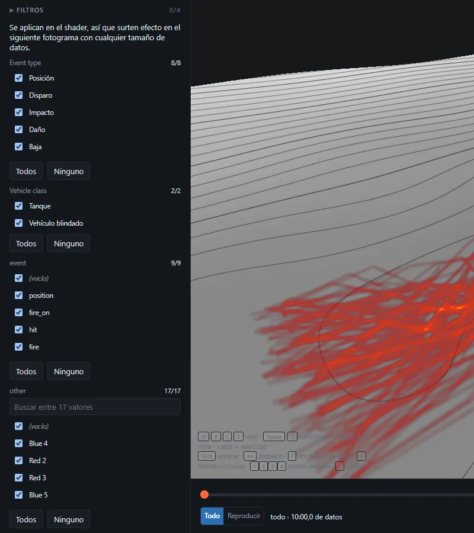
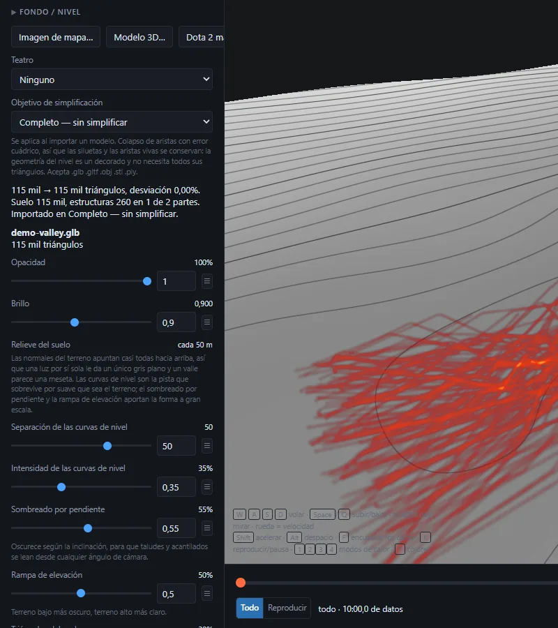

# 3DHeat

3DHeat muestra dónde ocurrieron las cosas en un juego - por dónde fueron los jugadores, dónde lucharon y dónde cayeron - como colores brillantes por los que puedes volar, o como pequeñas figuras 3D que repiten la partida.

Carga posiciones - CSV, Parquet, grabaciones de Tacview, repeticiones convertidas, un solo archivo, una carpeta o miles de partidas - y verlas como un **mapa de calor por el que puedes volar**, como **figuras que repiten la partida**, como líneas a lo largo de las rutas que siguió la gente, o como una población frente a otra. Encuentra por sí solo lo que destaca, y funciona por completo en tu navegador: no se sube nada a ningún sitio. 3DHeat y todas sus herramientas son gratuitas y de código abierto bajo la [licencia MIT](https://github.com/Holdi601/3DHeat/blob/main/LICENSE).



**¿Es tu primera vez aquí?** Genera los [datos de demostración](demo-data.md) y sigue sus siete pasos. Todas las imágenes de este sitio se hicieron con ellos.

## Qué hace {#what-it-does}

| | |
|---|---|
|  | **[Modos de calor](heat-modes.md)** - calor, [diferencia](difference.md) (rojo donde un bando estuvo más, verde-azul donde estuvo más el otro), [calor por equipo](team-heat.md), [calor de línea](line-heat.md); [calor direccional](directional-heat.md) con cuñas, campos de flechas y gráficos polares; calor [ponderado por valor](value-weighting.md): lo que cuestan las armas, los vehículos y el combustible. |
|  | **[Repetición de partida](match-replay.md)** - cada unidad como la [figura](figures.md) de lo que es, símbolos OTAN o rusos a distancia, misiles y trazadores, marcas de impacto, restos, incendios, torretas, objetivos, cámaras al estilo de Tacview y pantalla táctica; [muchas partidas a la vez](many-matches.md). |
|  | **[Hallazgos](insights.md)** - posiciones fuertes, terreno mortal, trampas de aparición, cuellos de botella y jugadores destacados, encontrados y ordenados con las pruebas; un resumen escrito, opcionalmente redactado por una IA de tu elección; un narrador para una partida; la [lente de conocimiento](knowledge.md). |
|  | **[Volúmenes](volumes.md)** - dibuja cajas, prismas, cilindros y esferas, filtra por ellos, cuenta lo que ocurre dentro, expórtalo y compara lugares uno al lado del otro; [desglose](breakdown.md) de quién y qué funciona mejor en un lugar. |
|  | **[Filtros](filters.md)** - por tipo de evento, jugador o IA, clase de vehículo, valor, cualquier columna, en la tarjeta gráfica con cualquier tamaño de datos. |
|  | **[Niveles](levels.md)** - imágenes de mapa, niveles 3D hechos con las [herramientas de datos](#related-repositories), simplificación, el [fondo del mundo](world-backdrop.md) con terreno real para datos de vuelo. |

Además: la pestaña [Análisis de carrera](race-analysis.md) para vueltas de juegos de carreras, la pestaña [Partida](match-analysis.md) para resúmenes de Counter-Strike 2, el [Tablero táctico](tactics-board.md) para planes sobre un nivel, [análisis de impactos](hit-analysis.md) por vehículo, [análisis masivo](mass-analysis.md) de miles de partidas, [trayectorias de cámara y vídeo](camera-path-and-video.md), [40 idiomas](languages.md), [unidades métricas o imperiales](settings.md).

## Las pestañas {#the-tabs}

Las pestañas están en la parte superior de la barra lateral, debajo del nombre, las unidades y el menú de idioma.

| Pestaña | Para qué sirve |
|---|---|
| **Mapa de calor** | Cualquier tabla de posiciones: los modos de calor, la superposición de figuras, filtros, volúmenes, hallazgos, niveles, medición y vídeo. |
| **Análisis de carrera** | Dos o más vueltas de un mismo circuito: dónde se pierde tiempo, por qué y qué cambiar. |
| **Partida** | La repetición por figuras de una partida, y los resúmenes de partida de Counter-Strike 2. |
| **Táctica** | Planes sobre un nivel: figuras, rutas, utilidad lanzada, zonas y notas en pasos que se reproducen. |
| **Vehículos** | Dónde fue impactada cada unidad, por quién y con qué. |

## Instalar y ejecutar {#install-and-run}

### Windows, la forma fácil {#windows-the-easy-way}

La raíz del repositorio contiene tres archivos por lotes.

| Archivo | Qué hace |
|---|---|
| `start.bat` | Inicia el visor. Encuentra Node.js aunque no esté en `PATH` (busca en `%ProgramFiles%\nodejs`, `%ProgramFiles(x86)%\nodejs` y `%LOCALAPPDATA%\Programs\nodejs`), y si Node.js falta ofrece instalar la versión LTS con `winget install -e --id OpenJS.NodeJS.LTS`. En la primera ejecución pregunta antes de descargar las dependencias (unos 300 MB en `node_modules\` dentro de la carpeta, nada en todo el sistema). Se niega a arrancar si algo ya escucha en el puerto 5273, y te indica `restart.bat` en su lugar. Cuando la carpeta es un repositorio git sin cambios locales y existe una versión más nueva, pregunta si quieres actualizar (Y/N; sin respuesta en 60 s se queda esta versión; véase [Actualizaciones](updates.md)). Después ejecuta el servidor de desarrollo en `http://127.0.0.1:5273/` y abre el navegador. **La ventana es el servidor**: déjala abierta; ciérrala o pulsa Ctrl+C para detenerlo. |
| `restart.bat` | Ejecuta `stop.bat quiet` y después `start.bat`. Solo hace falta tras cambiar `vite.config.ts`, añadir una dependencia, o cuando el servidor se ha bloqueado - los cambios en el código se recargan en caliente. |
| `stop.bat` | Detiene lo que escuche en el puerto 5273, por el id de proceso encontrado con `netstat`, nunca por el nombre de imagen, así que otros procesos de Node.js del equipo no se tocan. Espera unos dos segundos a que se libere el socket. Con el argumento `quiet` no se detiene al final. |

### A mano (cualquier sistema) {#by-hand-any-os}


```bash
git clone --recursive https://github.com/Holdi601/3DHeat.git
cd 3DHeat
npm install
npm run dev      # http://127.0.0.1:5273
```

La carpeta `exporters/` contiene las herramientas de datos separadas como submódulos de git, cada una su propio repositorio; tras un clon normal ejecuta `git submodule update --init`. El propio visor no las necesita para ejecutarse. `exporters/ext/` contiene los convertidores opcionales (War Thunder, World of Tanks, World of Warships, repeticiones de Squad; mapas de DCS e IL-2), separados para que un problema con uno de ellos no afecte a nada más.

Nada de esto trae datos de juegos: los niveles, mapas y grabaciones se generan en tu propio equipo con las herramientas, a partir de juegos que tienes.

### Scripts de npm {#npm-scripts}

| Script | Qué ejecuta |
|---|---|
| `npm run dev` | El servidor de desarrollo de Vite en el puerto 5273, vinculado a `127.0.0.1`. |
| `npm run build` | Comprobación de tipos (`tsc --noEmit`) y un paquete de producción en `dist/`. |
| `npm run preview` | Sirve el paquete de producción. |
| `npm run typecheck` | Solo la comprobación de tipos. |
| `npm test` / `npm run test:watch` | Pruebas unitarias y de integración (vitest). |
| `npm run smoke` | Maneja la aplicación real en Chromium sin interfaz y comprueba que el lienzo tiene píxeles con color de datos; las capturas van a `tools/.smoke/`. Requiere que el servidor de desarrollo esté en marcha. |
| `npm run smoke:f16` | La misma batería con `?heat=f16`, forzando la ruta de acumulación en media precisión (véase [Acumulación en media precisión](half-float-accumulation.md)). |
| `npm run bench` | Prueba de rendimiento de carga, escribe `tools/.smoke/ingest-bench.json`. |
| `npm run test:heavy` | Pruebas que necesitan archivos de datos reales grandes; se saltan solas si faltan los archivos. |
| `npm run inspect -- <file.parquet>` | Muestra el esquema de un archivo Parquet y algunas filas (`tools/inspect-parquet.mjs`). |

### Lo que añade el servidor de desarrollo {#what-the-dev-server-adds}

El visor es una página web estática, pero el servidor de desarrollo (véase `vite.config.ts`) añade dos rutas locales que una publicación estática de `dist/` no tiene:

- `/__host/memory` informa de la RAM instalada y libre del equipo y, cuando puede leerla, de la memoria de la tarjeta gráfica (con `nvidia-smi`, o en Windows desde la entrada del registro del adaptador de pantalla). Esto permite que los [presupuestos de memoria](memory-and-budgets.md) usen cifras reales en vez de las estimaciones limitadas del navegador.
- `/__heat3d/update` comprueba si la copia local está atrasada y puede avanzarla ([Actualizaciones](updates.md)).

El servidor se vincula solo a `127.0.0.1`, así que ninguna de las dos rutas es accesible desde la red. Ábrelo como `http://127.0.0.1:5273`: `localhost` puede resolverse al bucle de retorno IPv6 `::1`, donde no escucha nada. No envía cabeceras de aislamiento de origen cruzado (COOP/COEP): nada en el visor usa `SharedArrayBuffer`, y los trabajadores pasan sus datos por transferencia, que no lo necesita.

## Requisitos de navegador y GPU {#browser-and-gpu-requirements}

- **Un navegador con WebGPU o WebGL2.** Primero se prueba WebGPU (Chrome y Edge lo tienen); sin él se usa el motor WebGL2. WebGL2 debe ofrecer `EXT_color_buffer_float` (dibujar en texturas de coma flotante), si no el visor muestra «No se puede inicializar el renderizador.». Véase [Los dos motores](backends.md). El visor se desarrolla y prueba en Chromium; los demás navegadores no están verificados.
- **Aceleración por hardware activada.** Cuando el navegador dibuja en la CPU (SwiftShader, llvmpipe, el Microsoft Basic Render Driver y similares) aparece una franja roja en la parte superior de la barra lateral que lo indica y cómo solucionarlo. Véase [Detección de renderizado por software](software-rendering.md).
- **Una GPU dedicada ayuda, pero no es obligatoria.** Ambos motores piden el adaptador de alto rendimiento. La cantidad de datos que puede guardarse en la GPU es un presupuesto que puedes ver y cambiar ([Memoria y presupuestos](memory-and-budgets.md)).
- **Las funciones opcionales** usan otras API del navegador: el renderizado de vídeo necesita WebCodecs `VideoEncoder` con VP9 o VP8 ([Trayectoria de cámara y vídeo](camera-path-and-video.md)); la simplificación de malla de los niveles necesita WebAssembly; soltar carpetas usa la API File and Directory Entries; la biblioteca de niveles usa IndexedDB; los mandos usan la API Gamepad.

## Mapa de la documentación {#documentation-map}

**Empezar**: [Datos de demostración](demo-data.md) · [Cargar datos](getting-data-in.md) ([cargar archivos](loading-files.md), [asignación de columnas](column-mapping.md), [ejes, unidades y tiempo](axes-units-and-time.md), [sesiones, personas y grupos](sessions-persons-groups.md), [Tacview](tacview-acmi.md), [convertidores](converters.md), [.3dheat](container.md), [memoria y presupuestos](memory-and-budgets.md))

**Ver**: [Modos de calor](heat-modes.md) ([calor](heat.md), [forma del sprite](sprite-shape.md), [color y exposición](colour-and-exposure.md), [profundidad y descarte](depth-and-culling.md), [diferencia](difference.md), [calor por equipo](team-heat.md), [calor de línea](line-heat.md), [repetición en caja](box-replay.md), [calor direccional](directional-heat.md), [ponderación de valores](value-weighting.md)) · [Línea de tiempo](timeline.md) · [Niveles](levels.md) ([imágenes de mapa](map-images.md), [niveles 3D](model-levels.md), [apariencia](level-appearance.md), [biblioteca](level-library.md), [fondo del mundo](world-backdrop.md), [sus fuentes](world-backdrop-sources.md)) · [Cámara](camera.md) ([mando](gamepad.md), [teclas](keyboard-reference.md)) · [Trayectoria de cámara y vídeo](camera-path-and-video.md)

**Analizar**: [Filtros y herramientas](filters-and-tools.md) ([filtros](filters.md), [equipos](teams-list.md), [entidades](entities.md), [corte](slice.md), [medir](measure.md), [volúmenes](volumes.md), [desglose](breakdown.md)) · [Hallazgos](insights.md) ([lente de conocimiento](knowledge.md)) · [Análisis masivo](mass-analysis.md)

**Repetición**: [Repetición de partida](match-replay.md) · [Muchas partidas a la vez](many-matches.md) · [Figuras](figures.md) ([en las figuras superpuestas](figure-replay.md), [créditos](figure-credits.md)) · [Paridad con Tacview](tacview-parity.md) · [Análisis de impactos](hit-analysis.md)

**Otras pestañas**: [Análisis de carrera](race-analysis.md) ([el método](race-analytics.md), [otros juegos](other-games.md)) · [Análisis de partida](match-analysis.md) · [Tablero táctico](tactics-board.md) ([velocidades](tactics-speeds.md))

**El visor**: [Glosario](glossary.md) · [Ajustes, unidades y teclas](settings.md) · [Idiomas](languages.md) · [Actualizaciones](updates.md) · [Detalles del renderizado](rendering-internals.md) ([motores](backends.md), [acumulación](accumulation.md), [muestreo y presupuestos](sampling-and-budgets.md), [media precisión](half-float-accumulation.md), [memoria de GPU](gpu-memory.md), [renderizado por software](software-rendering.md), [rendimiento y estadísticas](performance-and-stats.md)) · [Formatos de datos](data-formats.md) · [Referencia](reference.md) · [Mantenimiento de la documentación](maintaining.md)

## Repositorios relacionados {#related-repositories}

El visor lee datos; estas herramientas los generan. Cada una es un repositorio público propio (MIT) con su propia documentación. Ninguna trae datos de juegos: los niveles, mapas y grabaciones se generan en tu propio equipo, a partir de juegos que tienes.

| Repositorio | Qué hace | Para qué sirve | Documentación |
|---|---|---|---|
| [3DHeat-GameFiles](https://github.com/Holdi601/3DHeat-GameFiles) | Extrae circuitos y niveles de los archivos que traen los juegos (Forza Horizon, BeamNG, Assetto Corsa Rally; lectores de Unreal, Unity, Frostbite y Source 2) como glTF | un nivel 3D bajo tu calor o tu repetición | [sitio](https://holdi601.github.io/3DHeat-GameFiles/) |
| [3DHeat-GameCapture](https://github.com/Holdi601/3DHeat-GameCapture) | Registra la telemetría de vueltas de las interfaces que publican los juegos de carreras, y reconstruye niveles a partir de vídeo de juego | vueltas para Análisis de carrera; un nivel donde no se pueden leer archivos | [sitio](https://holdi601.github.io/3DHeat-GameCapture/) |
| [3DHeat-UnrealExporter](https://github.com/Holdi601/3DHeat-UnrealExporter) | Complemento del editor de Unreal que exporta un nivel como un único archivo glTF | niveles de tus propios proyectos de Unreal | [sitio](https://holdi601.github.io/3DHeat-UnrealExporter/) |
| [3DHeat-CS2](https://github.com/Holdi601/3DHeat-CS2) | Demos de Counter-Strike 2 a tablas de calor y resúmenes de partida; mapas de CS2 a geometría | calor de CS2, repeticiones y la pestaña Partida | [sitio](https://holdi601.github.io/3DHeat-CS2/) |
| [3DHeat-Watcher](https://github.com/Holdi601/3DHeat-Watcher) | Registra tu juego en segundo plano a partir de lo que publican los juegos: telemetría, integraciones de estado de juego, registros, repeticiones | tus propias estadísticas sin hacer nada a mano | [sitio](https://holdi601.github.io/3DHeat-Watcher/) |
| [3DHeat-Ext-WarThunder](https://github.com/Holdi601/3DHeat-Ext-WarThunder) | Repeticiones de War Thunder (`.wrpl`) a tablas: trayectorias aéreas y terrestres, disparos, impactos, bajas, torretas, objetivos | repeticiones de War Thunder, marcas de impacto y hallazgos | [sitio](https://holdi601.github.io/3DHeat-Ext-WarThunder/) |
| [3DHeat-Ext-WoT](https://github.com/Holdi601/3DHeat-Ext-WoT) | Repeticiones de World of Tanks a tablas: la posición de cada vehículo, muertes y bajas | calor y repeticiones de World of Tanks | [sitio](https://holdi601.github.io/3DHeat-Ext-WoT/) |
| [3DHeat-Ext-WoWs](https://github.com/Holdi601/3DHeat-Ext-WoWs) | Repeticiones de World of Warships a tablas: la posición de cada barco y los hundimientos | calor y repeticiones de World of Warships | [sitio](https://holdi601.github.io/3DHeat-Ext-WoWs/) |
| [3DHeat-Ext-Squad](https://github.com/Holdi601/3DHeat-Ext-Squad) | Demos de servidores de Squad a tablas: la posición, equipo y escuadra de cada jugador | calor y repeticiones de Squad | [sitio](https://holdi601.github.io/3DHeat-Ext-Squad/) |
| [3DHeat-Ext-DCS](https://github.com/Holdi601/3DHeat-Ext-DCS) | Terrenos de DCS World de tu propia instalación a niveles: suelo, carreteras, pueblos, aeródromos, campos, agua | DCS y grabaciones de Tacview sobre su terreno real | [sitio](https://holdi601.github.io/3DHeat-Ext-DCS/) |
| [3DHeat-Ext-IL2](https://github.com/Holdi601/3DHeat-Ext-IL2) | Mapas de IL-2 Great Battles a niveles | grabaciones de IL-2 sobre su mapa | [sitio](https://holdi601.github.io/3DHeat-Ext-IL2/) |

## Estructura del código, brevemente {#source-layout-briefly}

| Carpeta | Contenido |
|---|---|
| [`src/data/`](https://github.com/Holdi601/3DHeat/tree/main/src/data) | Selección de archivos, carga de CSV y Parquet, asignación automática, validación, modelo de memoria, constructor de conjuntos de datos, lectura de modelos, clasificación, simplificación, biblioteca de niveles |
| [`src/render/`](https://github.com/Holdi601/3DHeat/tree/main/src/render) | El bucle de fotogramas (`engine.ts`), muestreo, ambos motores, cámara, mando, medición, trayectoria de cámara, grabación de vídeo |
| [`src/state/`](https://github.com/Holdi601/3DHeat/tree/main/src/state) | El estado de la aplicación (`store.ts`) con todos los valores por defecto, los tipos del dominio (`types.ts`), la curva del sprite |
| [`src/ui/`](https://github.com/Holdi601/3DHeat/tree/main/src/ui) | Los paneles de la barra lateral, la línea de tiempo, las superposiciones |
| [`src/race/`](https://github.com/Holdi601/3DHeat/tree/main/src/race), [`src/match/`](https://github.com/Holdi601/3DHeat/tree/main/src/match) | Las pestañas Análisis de carrera y Partida |
| [`src/i18n/`](https://github.com/Holdi601/3DHeat/tree/main/src/i18n) | Traducciones |
| [`src/insights/`](https://github.com/Holdi601/3DHeat/tree/main/src/insights) | Hallazgos: detectores, resumen, narrador, proveedores de IA, la lente de conocimiento |
| [`src/mass/`](https://github.com/Holdi601/3DHeat/tree/main/src/mass) | Análisis masivo de muchas partidas |
| [`src/volumes/`](https://github.com/Holdi601/3DHeat/tree/main/src/volumes) | Volúmenes, sus estadísticas, exportación y comparación |
| [`src/breakdown/`](https://github.com/Holdi601/3DHeat/tree/main/src/breakdown) | Desglose y factores |
| [`src/overlay/`](https://github.com/Holdi601/3DHeat/tree/main/src/overlay) | La superposición de muchas partidas |
| [`src/figures/`](https://github.com/Holdi601/3DHeat/tree/main/src/figures) | El catálogo de figuras y su constructor |
| [`src/vehicle/`](https://github.com/Holdi601/3DHeat/tree/main/src/vehicle) | Análisis de impactos (pestaña Vehículos) |
| [`src/tactics/`](https://github.com/Holdi601/3DHeat/tree/main/src/tactics) | El tablero táctico |
| [`src/world/`](https://github.com/Holdi601/3DHeat/tree/main/src/world) | El fondo del mundo |
| [`src/units/`](https://github.com/Holdi601/3DHeat/tree/main/src/units) | Unidades de medida |
