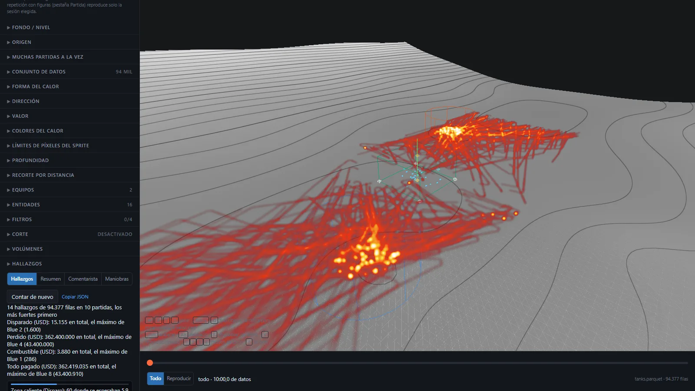
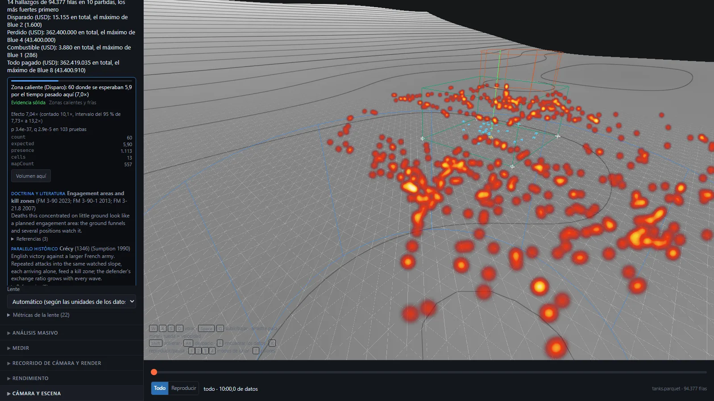
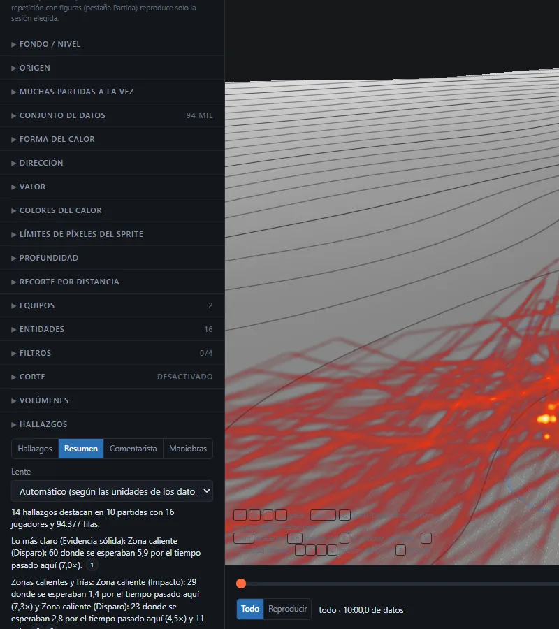
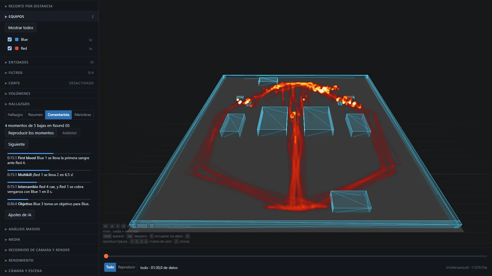

# Hallazgos

**Hallazgos** busca en los datos cargados lo que destaca - posiciones fuertes, terreno mortal, trampas de aparición, puntos de estrangulamiento, jugadores muy por encima de sus iguales - y te lo cuenta, lo más fuerte primero, con las pruebas. Úsalo para entender en un minuto dónde se ganó o se perdió una partida. Después puede escribir un resumen, y en una sola repetición puede actuar como comentarista que salta a los momentos importantes.

Todo se cuenta en tu navegador. Nada sale de tu equipo salvo que actives una IA externa (véase [IA externa](#external-ai)).

La sección **Hallazgos** está en la barra lateral de las pestañas Mapa de calor y Partida. Tiene tres pestañas: **Hallazgos**, **Resumen** y **Comentarista**.

## Hallazgos {#findings}

1. Carga datos y abre **Hallazgos**. Pulsa **Buscar hallazgos** («Contando… n %» muestra el progreso).
2. Lee la lista. Cada hallazgo tiene una barra de fuerza, una frase, lo sólidas que son las pruebas (*Pruebas sólidas*, *Buenas pruebas* o *Algunas pruebas*), qué detector lo encontró, y la clase de vehículo cuando importa.
3. **Pulsa un hallazgo**: el visor aplica sus filtros, lleva la cámara al lugar y salta al momento, y abre los detalles: el efecto con su intervalo del 95 %, los valores p y q, las pruebas contadas, y **Volumen aquí**, que dibuja un [volumen](volumes.md) alrededor del lugar.
4. **Restaurar filtros** devuelve tus filtros. **Copiar JSON** copia el informe completo.

El conteo usa los filtros actuales, los grupos ocultos y la partida elegida sobre todo el rango de tiempo. Cuando cambias los filtros después, una nota lo indica; pulsa **Contar de nuevo**.

Las líneas de arriba de la lista (por ejemplo, los totales de dinero) resumen todos los datos antes de los hallazgos.

### Los detectores {#the-detectors}

| Detector | Qué encuentra | Necesita en los datos |
|---|---|---|
| **Posiciones de poder** | Lugares con probabilidades de baja frente a muerte mucho mejores que el resto del mapa, y *terreno seguro* donde muere poca gente por el tiempo pasado | eventos de baja y de muerte |
| **Zonas calientes y frías** | Lugares donde un tipo de evento (disparos, impactos, capturas ...) ocurre mucho más o menos de lo que predice el tiempo pasado allí | una columna de eventos |
| **Terreno abierto y cobertura** | Muertes en campo abierto frente a geometría cercana del nivel, y lentitud frente a movimiento rápido | muertes; un nivel 3D para la parte de geometría |
| **Spawns** | Spawns fuertes, trampas de aparición, spawns seguros, tiempo hasta el primer contacto | tiempo y personas |
| **Clase por lugar** | Una clase de vehículo, o jugadores frente a IA, que rinde mucho mejor o peor en una zona | bajas más una columna de clase de vehículo o de jugador/IA |
| **Jugadores** | Jugadores que matan o mueren mucho más o menos que otros de su misma clase | personas y bajas |
| **Cuellos de botella y flancos** | Puntos de estrangulamiento (muchos más cruces que el terreno alrededor) y rutas de flanqueo (poco usadas, pero que llevan a bajas) | personas |
| **Valor** | *Terreno costoso* y *Terreno rentable* | [columnas de valor](value-weighting.md) |

Los detectores que no pueden ejecutarse con los datos aparecen al final con el motivo.

### Cómo se ordenan los hallazgos {#how-findings-are-ranked}

Cada lugar o grupo se contrasta con el resto del mapa (pruebas binomiales exactas o de tasa). La tasa de falsos descubrimientos se mantiene en un 5 % (Benjamini-Hochberg). El azar puede parecer un patrón; esto mantiene bajas las falsas alarmas: entre los hallazgos mostrados, se espera que como mucho uno de cada veinte sea azar. Los efectos con pocos eventos se acercan a «sin efecto» antes de ordenar. Se listan como máximo 60 hallazgos, y cada detector tiene algunos lugares entre los primeros.

## Resumen {#debrief}

La pestaña **Resumen** redacta los hallazgos en un texto breve: una introducción, el hallazgo más claro, uno para la táctica, uno para el equilibrio, el resto agrupado por detector, y cuántos se apoyan en pruebas más débiles. Cada párrafo tiene botones numerados que muestran sus hallazgos. **Copiar texto** lo copia.

El narrador integrado funciona sin conexión, en tu idioma. El selector **Lente** de encima (véase [La lente de conocimiento](knowledge.md)) decide qué bibliografía citan los párrafos.

### IA externa {#external-ai}

**Ajustes de IA** permite que un modelo de IA de tu elección redacte el resumen:

| Ajuste | Significado |
|---|---|
| **Proveedor** | Anthropic (Claude), OpenAI (ChatGPT), OpenRouter, Ollama (local), LM Studio (local), servidor llama.cpp (local), o cualquier punto de conexión compatible con OpenAI |
| **URL base**, **Modelo** | Los rellena el proveedor; **Listar modelos** consulta al servidor |
| **Clave de API** | Se envía solo a la URL base. Nunca se registra, nunca se guarda en vistas, exportaciones o archivos `.3dheat`. La mayoría de los servidores locales no la necesitan. |
| **Recordar la clave en este navegador** | Desactivado por defecto: la clave se olvida al cerrar la página |
| **Usar una IA externa** | Desactivado por defecto |
| **Enviar nombres de jugadores** | Desactivado por defecto: los jugadores se envían como P1, P2 ... |

Después escribe una pregunta opcional y pulsa **Escribir con IA**. Solo se envían los hallazgos y sus cifras - nunca las filas de tus datos. La respuesta aparece en directo; los hallazgos citados se convierten en botones.

## Comentarista {#caster}

Para **una partida** (elige una si hay varias cargadas), el **Comentarista** encuentra los momentos que merecen verse: primera sangre, multibajas, intercambios, clutches, cambios de objetivo, remontadas, jugadores destacados, disparos largos.

- Pulsa un momento: la vista pasa a la repetición, salta justo antes, vuela hasta allí y sigue al jugador.
- **Reproducir los momentos** reproduce cada uno hasta su final y pasa al siguiente; **Anterior** / **Siguiente** avanzan por ellos.
- Con una IA externa activada, **Comentarios de la IA** redacta un comentario a partir de la lista de momentos (tipos, tiempos, nombres o seudónimos, equipos, clases, distancias).

Necesita personas y eventos de baja/muerte (o de captura); una columna `other`/`victim` hace posibles los intercambios y los disparos largos.

## La lente de conocimiento {#knowledge-lens}

Un hallazgo puede leerse a través de una **lente** de conocimiento establecido: doctrina militar, combate aéreo y naval, operaciones urbanas, diseño de juegos y deportes electrónicos (o *Auto*, elegido por las unidades de los datos). Un hallazgo abierto muestra entonces la entrada más cercana de **doctrina y bibliografía** y un **paralelo histórico**, con referencias, y **Métricas de la lente** calcula medidas de esa bibliografía sobre los datos (ajustes de Lanchester, razones de intercambio, razones de fuerza, campos de tiro, terreno clave, intercambios, iniciativa). El resumen y la petición a la IA las incluyen. Todo sobre ello: [La lente de conocimiento](knowledge.md).

Las métricas de la lente también miden cómo se comportan los jugadores como multitud y como grupo - alineación y deambulación, arreo por rutas, carriles y estelas, aglomeración, líderes y seguidores, rezagados, el punto de ruptura bajo pérdidas, el riesgo tras una vida perdida, rachas, acuerdo en compras y la respuesta al fuego recibido - cada una frente a su propio modelo nulo: [Comportamiento colectivo](collective-behaviour.md).

## Datos que hacen que los hallazgos funcionen {#data-that-makes-insights-work}

- posiciones con una columna de **tiempo**, de **persona** y de **equipo**;
- una columna de **evento** con bajas y muertes (`kill`, `death`), y otros (`hit`, `fire`, `capture` ...);
- una columna de **otra parte** (`other`, `victim`) para intercambios y direcciones;
- una columna de **vehículo** o **tipo** para las clases; una columna `ai` para jugadores frente a IA;
- una columna de **sesión** / **partida** / **ronda** cuando hay varias partidas.

Los [datos de demostración](demo-data.md) los tienen todos.
