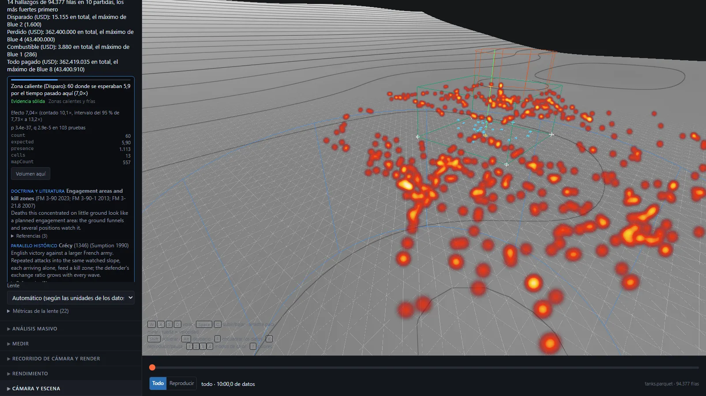

# La lente de conocimiento

Cuando [Hallazgos](insights.md) encuentra algo, esta parte lo explica con ideas de la historia militar, el diseño de juegos y el análisis
deportivo, y nombra el libro o el artículo del que viene. Úsala para aprender *por qué* importa un patrón, no solo que existe.

## Pruébalo {#try-it}

1. Carga datos y abre **Hallazgos**, luego pulsa **Buscar hallazgos**.
2. Haz clic en un hallazgo para abrirlo.
3. Lee **Doctrina y literatura** y **Paralelo histórico**; las referencias completas están plegadas debajo.
4. Cambia la **Lente** (por ejemplo a *Doctrina militar*) para leer el mismo hallazgo a través de otro cuerpo de literatura.

## Cómo funciona {#how-it-works}

El panel de Hallazgos juzga sus hallazgos como lo haría un analista profesional: a través de la doctrina militar y la
investigación de operaciones, los combates históricos, y la literatura de diseño de juegos, diseño de niveles y analítica.
Lo hace sin conexión, a partir de una base de conocimiento seleccionada dentro del visor, y entrega el mismo material a un
modelo externo cuando alguien escribe el resumen.

## Lo que muestra el panel {#what-the-panel-shows}

- **Lente** elige el cuerpo de literatura con el que se leen los hallazgos: *Auto* (elegido según los tipos de unidades de los
  datos: aviones, barcos, vehículos terrestres, infantería), *Doctrina militar*, *Combate aéreo*, *Naval*, *Urbano*,
  *Diseño de juegos y equilibrio*, *Deportes electrónicos*. Las entradas fuera de la lente elegida se dejan fuera.
- Cada hallazgo abierto muestra su entrada más cercana de **doctrina y literatura** y su **paralelo histórico** más cercano,
  con las referencias completas plegadas debajo.
- **Métricas de la lente** lista las medidas del análisis de operaciones calculadas sobre las mismas filas (abajo), cada una
  con lo que significa y su literatura.
- El **Resumen** añade líneas para los hallazgos principales y las métricas de la lente: "Doctrina y literatura: ..." y
  "Paralelo histórico: ...", cada una con citas autor-año y las referencias plegadas debajo.
- **Escribir con IA** envía las entradas más relevantes (resumen, lección, los hallazgos a los que se refieren, referencias
  completas) junto con el informe, y pide al modelo que las cite por id - `{concept.lanchester-square}` - y que no use otras
  fuentes.

Las etiquetas están traducidas; el conocimiento en sí está en inglés.

## Métricas de la lente {#lens-metrics}

Se calculan en el worker de hallazgos, en la misma pasada sobre las filas que los detectores (`src/insights/lensMetrics.ts`).
Cada una se deja fuera cuando los datos no pueden sostenerla.

| Métrica | Qué mide | Necesita |
|---|---|---|
| Ajuste de Lanchester | Las pérdidas de cada bando por cada 20 s, ajustadas por la fuerza viva de ambos bandos (Poisson, errores de casi-verosimilitud); los exponentes de la fuerza enemiga y propia, contrastados con la ley del cuadrado (fuego dirigido) y la ley lineal (fuego de área) | tiempo, equipos, bajas y muertes |
| Razón de intercambio | Bajas por muerte, por bando y por lugar; la proporción de muertes en el terreno más mortífero que ocupa el 5 % del tiempo, frente a la proporción que da el azar con ese número de muertes; Gini de las muertes frente al tiempo; I de Moran de las tasas de muerte | bajas y muertes |
| Razón de fuerza local | Unidades amigas y enemigas vivas dentro del alcance de combate de cada baja (alcance fijado por los datos: dos veces la distancia mediana al enemigo más cercano); la proporción de bajas del bando localmente superior, y su exceso sobre lo que predicen solo los números | tiempo, equipos, personas |
| Campos de tiro | Campos de visión de los lugares de bajas más concurridos sobre una superficie de obstrucción 2,5D (geometría del nivel hasta la altura de un muro, o el suelo recorrido), frente al lugar medio, y la correlación de rangos entre la vista y la proporción de bajas | posiciones; un nivel cargado lo afina; no para el aire |
| Estado de energía | Energía específica (altura más la altura que la velocidad podría comprar) de los asesinos aéreos y de las víctimas aéreas, comparada con el estadístico de Mann-Whitney | clases de aviones, tiempo, altitud |
| Terreno clave | Con qué frecuencia un lugar está entre los tres lugares de bajas más concurridos de una partida | varias partidas |
| Apoyo mutuo (intercambios) | Muertes respondidas por una baja de un compañero dentro del alcance de combate y en 5 s | tiempo, equipos |
| Primer golpe | Enfrentamientos - bajas agrupadas por partida, por 20 s de calma y por tres alcances de combate de distancia - ganados por el bando que anotó primero | tiempo, equipos |
| Modelo de andanada | La ecuación de andanada de Hughes ajustada a periodos de 20 s de barcos en contacto: barcos puestos fuera de combate por barco atacante, y salvados por barco defensor; un ajuste de Lanchester solo con barcos | clases de barcos, tiempo, equipos |
| Eficacia de combate | Bajas por unidad-hora en acción de cada bando y la razón entre los dos mayores (un valor de eficacia de combate en el sentido de Dupuy) con su intervalo del 95 %, y la proporción de bajas de cada bando con números locales iguales | tiempo, equipos |
| Alcances de combate | Distancia al enemigo más cercano en las bajas, en los lanzamientos y en el primer disparo de cada vida (detección hasta combate), por tipo de unidad | tiempo, equipos; lanzamientos donde los datos los tienen |
| Cadena de muerte | Segundos desde el último lanzamiento del asesino hasta la baja, y desde su primer disparo del combate hasta la baja | tiempo; lanzamientos o eventos de disparo |
| Concentración o dispersión | En cada periodo de 20 s, la dispersión de los dos bandos mayores y la proporción de bajas que se lleva el más compacto | tiempo, equipos |
| Salidas | Por bando: salidas (despegues, o apariciones de aviones), aterrizajes, aviones perdidos y bajas por avión; tasa de pérdida y bajas por salida | clases de aviones; despegues o apariciones |

Los datos con rondas añaden las medidas de combate cercano y de deporte electrónico - probabilidad de ganar la ronda, valor de
las acciones, duelos de apertura, intercambios, quien avanza frente a quien mantiene, puntería, fuego cruzado, utilidad,
ventaja numérica, remontadas, preparaciones, después de la colocación, embudos fatales y el impacto de cada jugador: véase
[Combate cercano y rondas](close-quarters.md).

Las pistas y los equipos añaden las medidas de comportamiento colectivo de la ciencia de multitudes, el movimiento colectivo,
la economía del comportamiento y la psicología militar - alineación y vueltas en círculo, arreo de rutas, carriles y estelas,
aglomeración, líderes y seguidores, rezagados, el punto de quiebre, el riesgo tras las bajas, rachas, acuerdo de compra y
supresión, cada una frente a su propio modelo nulo: véase [Comportamiento colectivo](collective-behaviour.md).

Las armas, los señuelos y los edificios no cuentan como unidades. Cuando las filas de armas nombran su unidad lanzadora (una
columna `Shooter` o `Launcher`, como tienen los datos derivados de Tacview), el lanzamiento se atribuye a esa unidad, emparejado
por su nombre o por su id de objeto.

## Cómo los hallazgos encuentran la literatura {#how-findings-meet-the-literature}

Las entradas y los hallazgos se encuentran a través de una **taxonomía de patrones** (`src/insights/knowledge/patterns.ts`):
concentración, superioridad local, fuego dirigido y de área, puntos de estrangulamiento, zonas de muerte, campos de tiro,
pendiente inversa, flanqueo, apoyo mutuo, ventaja de energía, presión de aparición, equilibrio y así sucesivamente. Cada tipo de
detector y cada métrica de la lente dice qué patrones muestran sus números (`src/insights/lens.ts`); cada entrada de
conocimiento dice a qué patrones se refiere, con un peso. La relevancia de una entrada para un hallazgo es el solapamiento
ponderado, escalado según lo bien que encaja el dominio de la entrada (tierra, aire, mar, urbano) con los datos y según la propia
fuerza del hallazgo. La razón mostrada es el número del hallazgo en una frase, seguido de la lección de la entrada.

## Catálogo {#catalogue}

Cada patrón, concepto, método, caso histórico, principio de diseño y estudio, con la bibliografía: véase el
[Catálogo de conocimiento](knowledge-catalogue.md).

## Para desarrolladores {#for-developers}

### Añadir entradas {#adding-entries}

1. Elige el archivo según el tipo: `concepts.ts` y `concepts-more.ts`, `methods.ts`, `cases.ts`, `cases-land.ts`,
   `cases-air-sea.ts`, `cases-esports.ts`, `design.ts` (principios de diseño) o `studies.ts` en `src/insights/knowledge/`.
2. Dale un id nuevo `<tipo>.<slug>` (nunca reutilices uno), sus lentes, dominios, y los patrones a los que se refiere con
   pesos de 0 a 1. Añade un patrón a `patterns.ts` solo cuando un hallazgo pueda mostrarlo, y asígnalo desde un hallazgo o una
   métrica en `lens.ts`.
3. Escribe el resumen y la lección **con tus propias palabras**. Citas solo de obras de dominio público (`pd: true` en la
   referencia), y breves.
4. Cita: añade cualquier obra nueva a `refs.ts` con autores, año, título y editorial (revista con volumen y páginas); una URL o
   un DOI cuando exista un registro público.
5. Ejecuta `npx vitest run src/insights/lens.test.ts` (ids únicos, patrones conocidos, referencias resueltas, citas de dominio
   público, casos con fecha y resultado) y `node tools/knowledge-doc.mjs` para actualizar el [catálogo](knowledge-catalogue.md).
