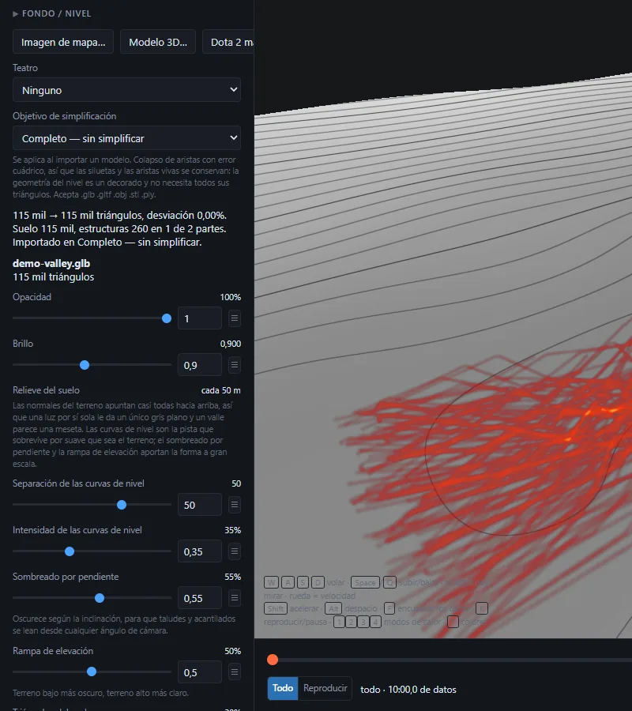

# Niveles y geometría de fondo

Un nivel es el lugar 3D donde ocurrió el juego - un mapa, un pueblo, un circuito. Ponlo detrás de tus datos y podrás ver *dónde* está el calor. El panel **Fondo / nivel** (véase el [Glosario](glossary.md) para «nivel») te da tres tipos de contexto:

- una **imagen de mapa**, georreferenciada con dos anclas - véase [Imágenes de mapa](map-images.md);
- un **nivel 3D** - `.glb`, `.gltf`, `.obj`, `.stl` o `.ply` - dividido en suelo, estructuras y agua, y simplificado al importar - véanse [Niveles 3D](model-levels.md) y [Apariencia del nivel](level-appearance.md);
- un **fondo del mundo** - para una grabación que indica dónde está en la Tierra (un archivo ACMI de Tacview), el terreno real, carreteras, agua, aeródromos y edificios, descargado de datos abiertos - véase [Fondo del mundo](world-backdrop.md).

Sin nada cargado, la escena está oscura con una cuadrícula y ejes de colores (**Cuadrícula** y **Ejes** en [Cámara y escena](camera.md)), y el panel dice *Nada cargado - la escena muestra una cuadrícula y ejes. Añade una imagen de mapa o una malla de nivel para dar contexto al calor.*

El nivel lo comparten las tres pestañas: un circuito cargado en la pestaña Análisis de carrera es el mismo nivel que muestra el mapa de calor.

## Poner un nivel detrás de tus datos {#put-a-level-behind-your-data}

1. Carga primero tus datos ([Cargar datos](getting-data-in.md)), para que el nivel se ajuste a ellos.
2. Abre **Fondo / nivel** en la barra lateral.
3. Pulsa **Imagen de mapa…** para una imagen o **Modelo 3D…** para un nivel 3D, y elige el archivo. Para una grabación del mundo real, usa **Fondo del mundo real** o **Teatro**.
4. Espera a que termine la línea de progreso. Un modelo grande se simplifica primero (véase **Objetivo de simplificación** abajo).
5. Pulsa **F** en la vista para encuadrar todo. Usa **Opacidad** y **Brillo** hasta que el calor destaque sobre el nivel.
6. Pulsa **Guardar en la biblioteca** si vas a usar el nivel otra vez ([Biblioteca de niveles](level-library.md)).

## Qué hace un nivel por el calor {#what-a-level-does-for-the-heat}

- **Oculta**: los datos detrás de él se atenúan según la superficie, y los datos detrás del terreno quedan ocultos ([Profundidad y descarte](depth-and-culling.md)). Sin nivel, no hay oclusión.
- Lo **corta** el [Corte](slice.md) y, con *Cortar también el nivel*, el [recorte por distancia](depth-and-culling.md#distance-culling), junto con el calor.
- Es lo único que difumina la [profundidad de campo](camera.md#depth-of-field), además de la cuadrícula y las cajas.
- Un nivel 3D **amplía el plano lejano de la cámara** cuando es más grande que los datos: el cercano y el lejano se calibran a partir del conjunto de datos, y un mapa exportado de varios kilómetros quedaría todo detrás del plano lejano y dejaría una vista vacía. El plano lejano pasa a ser 3 × la extensión horizontal del nivel cuando es mayor, el plano cercano se mueve con él (al menos lejano / 100.000) para mantener la precisión de profundidad de la que depende la oclusión, y la velocidad de vuelo sube a al menos extensión / 12. Solo se amplía, nunca se reduce.

## El panel, de arriba abajo {#the-panel-top-to-bottom}

| Parte | Detalles |
|---|---|
| **Imagen de mapa…**, **Modelo 3D…** | Carga uno; sustituye al nivel actual. |
| **Fondo del mundo real**, **Olvidar teselas** | Solo para un conjunto de datos con referencia geográfica: construye el lugar real debajo como nivel, o borra las teselas descargadas. [Fondo del mundo](world-backdrop.md) |
| **Objetivo de simplificación** | El presupuesto de triángulos para la siguiente importación de modelo: *Completo - sin simplificar* (por defecto), *Alto - 8M*, *Medio - 3M*, *Bajo - 800k*, *Silueta - 100k*. [Niveles 3D](model-levels.md#simplification) |
| Progreso y **Cancelar** | Mientras se decodifica o importa. |
| Nota de importación | Triángulos antes y después, la división en suelo / estructuras / agua, el nivel de detalle usado. |
| Nombre y tamaño | `ancho×alto px · x × z m/px` para una imagen, `N triángulos (de M)` para un modelo. |
| **Opacidad**, **Brillo** | Para los dos tipos. |
| Controles de imagen | **Desaturar**, **Invertir norte/sur**, **Colocación** (dos anclas), **Ajustar a los límites de los datos**, **Elevación**. [Imágenes de mapa](map-images.md) |
| Controles de modelo | Relieve del suelo, agua, triángulos del suelo, malla de alambre, textura, color capturado, estructuras, clasificación de partes. [Apariencia del nivel](level-appearance.md) |
| **Guardar en la biblioteca**, **Quitar** | [Biblioteca de niveles](level-library.md); Quitar descarga el nivel. |
| **Biblioteca** | Niveles guardados en este navegador. [Biblioteca de niveles](level-library.md) |

## Páginas de esta sección {#pages-in-this-section}

- [Imágenes de mapa](map-images.md)
- [Niveles 3D](model-levels.md) - formatos, partes, clasificación, simplificación, texturas
- [Apariencia del nivel](level-appearance.md) - cada control de un nivel 3D
- [Biblioteca de niveles](level-library.md)
- [Fondo del mundo](world-backdrop.md) - el mundo real bajo una grabación, desde datos abiertos

Cómo sacar niveles de juegos y motores es tarea de las herramientas de exportación separadas (véase el [README](https://github.com/Holdi601/3DHeat/blob/main/README.md) del repositorio); el contrato al que escriben se resume en [Niveles 3D](model-levels.md#the-exporter-contract).
