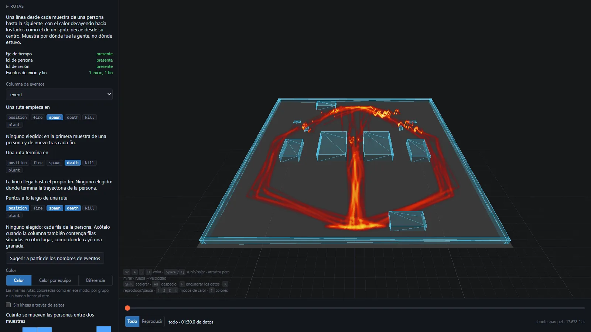

# Calor de línea

El calor muestra dónde estaba la gente. Las **líneas** muestran los caminos por los
que anduvo.

**Líneas** (tecla 4) es el calor de línea: una línea desde cada muestra de una
[persona](glossary.md) hasta la siguiente, extendida con la misma caída que tiene un
[sprite](glossary.md) - a lo ancho de la línea en lugar de alrededor de un punto. Muestra
por dónde *fue* la gente y no dónde estaba: un pasillo recorrido una sola vez se ve tanto
como una sala en la que se acampó, y las muestras dispersas de un jugador rápido se unen
en una ruta continua en lugar de un rastro de puntos. Necesita una columna de persona y una
columna de tiempo.

## Cómo se usa {#how-to-use-it}

1. Pulsa `4` (o elige **Líneas** en la barra de modos).
2. Abre **Rutas** y revisa la lista verde: el eje de tiempo y el id de persona deben estar
   presentes.
3. Pulsa **Sugerir a partir de los nombres de eventos** para rellenar dónde empiezan y
   terminan las rutas.
4. Lee la línea de estadísticas: "N rutas, M de ellas llegan a un final".
5. Si las líneas saltan de un lado a otro del mapa, ajusta el **Paso más largo** (véase
   [El límite de saltos](#the-jump-limit)).

Una línea solo tiene sentido entre un principio y un final, así que el panel **Rutas**
dice qué acota una ruta. Todo lo que va desde [Las reglas de una ruta](#the-rules-of-a-route)
en adelante es detalle que puedes saltarte.

## El panel Rutas {#the-routes-panel}

Se muestra encima de los paneles de calor en el modo Líneas.

### Qué tienen los datos {#what-the-data-has}

Una lista de comprobación, en verde cuando está presente y en ámbar cuando no:

| Línea | Estados |
|---|---|
| **Eje de tiempo** | *presente* / *falta - necesario* |
| **Id. de persona** | *presente* / *falta - necesario* |
| **Id. de sesión** | *presente* / *ninguna - todas las filas son una sola sesión* |
| **Eventos de inicio y fin** | *N inicios, M finales* / *ninguno elegido - pistas completas* (verde solo con una columna de eventos y al menos un inicio y un final) |

### Controles {#controls}

| Control | Significado |
|---|---|
| **Columna de eventos** | Una columna de categoría cuyos valores son eventos (aparición, muerte, posición, ...). *Ninguna - pistas completas*: la pista de cada persona en cada sesión es una ruta, cortada donde la pista tiene un hueco. Solo se ofrecen las columnas conservadas para filtrar al cargar. |
| **Una ruta empieza en** | Valores de evento que comienzan una ruta (aparición, reaparición, despliegue). Ninguno elegido: una ruta empieza en la primera muestra de una persona, y de nuevo tras cada final. |
| **Una ruta termina en** | Valores de evento que terminan una ruta (muerte, extracción, teletransporte). La línea llega hasta la propia fila final. Ninguno elegido: una ruta termina donde termina la pista de la persona. |
| **Puntos a lo largo de una ruta** | Valores de evento cuyas filas están a lo largo de la ruta. Ninguno elegido: cada fila de la persona. Acótalo cuando la columna también tiene filas colocadas en otro sitio, como donde cayó una granada. |
| **Sugerir a partir de los nombres de eventos** | Rellena las tres listas a partir de los nombres de los valores (abajo). |
| **Color** | *Calor*, *Calor por equipo* o *Diferencia*. Las mismas rutas con la coloración de ese modo: cada grupo en su propio tono, o un bando contra el otro, con la lista de grupos, la división y las rampas funcionando como en esos modos. Por defecto *Calor*. Calor por equipo y diferencia necesitan una columna de grupo. |
| **Sin líneas a través de saltos** / **Paso más largo** | La siguiente muestra de una persona a más distancia que esta es una reaparición, un teletransporte o una caída, y no un lugar al que fue; así que ninguna línea une las dos. Se rellena al cargar cuando los datos muestran un hueco claro (abajo), y queda desactivado cuando no. Funciona con o sin columna de eventos. |
| Línea de estadísticas | `N rutas, M de ellas llegan a un final, K segmentos`, que se actualiza varias veces por segundo. |

Cada lista es una fila de fichas de alternancia, una por valor, la más frecuente primero;
al pasar el ratón sobre una ficha aparece su número de filas. Se ofrecen 120 valores como
máximo (*N valores más no mostrados*).

Si eliges otra columna de eventos, se aplica la sugerencia cuando esa sugerencia elige esa
misma columna, y en caso contrario empieza con listas vacías.

### La sugerencia {#the-suggestion}

En cada carga, y al pulsar **Sugerir a partir de los nombres de eventos** ([`suggestLineSettings`](https://github.com/Holdi601/3DHeat/blob/main/src/data/lines.ts)):

- **Columna de eventos:** la primera columna de categoría conservada llamada `event`,
  `eventname` o `eventtype`; si no, `kind`, `type` o `action`; si no, cualquiera que contenga
  *event*, *kind*, *action* o *type*.
- **Inicios:** valores que contienen *spawn, deploy, join, enter, start, begin, respawn,
  revive, land/landed/landing, drop* - salvo que también coincidan con una palabra de final.
- **Finales:** valores que contienen *death, died, dead, kill/killed, eliminat…, extract,
  evac, teleport, leave, left, disconnect, quit, exit, end, finish, downed* - excepto los
  valores `kill` y `kills` (un abatido es algo que hace el que mata, no el final de su ruta).
- **Puntos:** valores que son exactamente *position, location, player location, move,
  movement, tick, sample* o *pos*; cuando se encuentra alguno, los inicios y los finales se
  añaden también a los puntos. Cuando no se encuentra ninguno, los puntos quedan vacíos
  (cada fila).

### El límite de saltos {#the-jump-limit}

Donde la gente salta, las longitudes de los pasos caen en dos grupos con casi nada entre
ellos: lo que recorre una persona entre dos muestras, y el ancho del mapa. Al cargar
([`suggestMaxJump`](https://github.com/Holdi601/3DHeat/blob/main/src/data/lines.ts)) los
pasos se cuentan por cada duplicación de su longitud al cuadrado, hasta 16 millones, y el
límite va en medio del primer rango por encima de la mediana que tenga al menos una
duplicación de longitud de ancho, que tenga menos del 0,02 % de los pasos por intervalo y
que tenga pasos más allá. Sin ese rango no se corta nada, pues no habría forma de distinguir
un salto de un coche rápido; activar el límite a mano empieza entonces en una décima parte
de la diagonal de los datos.

El gráfico sobre el límite muestra lo largos que son realmente los pasos, con una línea en el
límite: las barras a la derecha no se dibujan. Los dos ejes son logarítmicos, porque los saltos
pueden ser una centésima parte de los pasos y mil veces más largos. Pasa el ratón sobre una
barra para ver su rango y su proporción; haz clic en el gráfico para poner el límite allí. Debajo,
la proporción de pasos por encima del límite.

## Las reglas de una ruta {#the-rules-of-a-route}

Las filas se recorren en orden temporal, por persona ([`buildLines`](https://github.com/Holdi601/3DHeat/blob/main/src/data/lines.ts)):

1. Las filas de un [nombre compartido](sessions-persons-groups.md#names-worn-by-several-things-at-once)
   se saltan por completo.
2. Con puntos elegidos, una fila que no es ni inicio, ni final, ni punto se salta.
3. Las filas se siguen por persona y por sesión, así que una persona cuyas sesiones se
   entrelazan en el orden temporal tiene una ruta en cada una. Una ruta se cierra cuando la fila
   anterior no tuvo sucesora (su [duración de vida](sessions-persons-groups.md#person) es
   "ninguna"): una ruta nunca cruza un límite de sesión ni un hueco que la carga haya decidido
   que no tiene muestra siguiente. Qué ruta ocupa cada fila se calcula una vez y se guarda, 4
   bytes por fila, así que cambiar el paso más largo no repite esa parte.
4. Una fila de **inicio** cierra cualquier ruta abierta y abre una nueva allí.
5. Con inicios elegidos, una fila fuera de una ruta se ignora. Sin inicios, cualquier fila que no
   sea final y esté fuera de una ruta abre una.
6. Cualquier otra fila dentro de una ruta añade un **segmento** desde la fila anterior de la ruta
   hasta esta.
7. Una fila de **final** que prolonga una ruta la cierra tras su segmento; esa ruta cuenta como
   *que llega a un final*.
8. Un paso más largo que el **Paso más largo** cierra la ruta donde estaba, y una nueva ruta empieza
   en el extremo lejano, salvo que esa fila sea un final. No se dibuja ninguna línea a través de él, y
   la línea de estadísticas lo cuenta.

Cada segmento se guarda en su fila *final*, así que los segmentos siguen en orden temporal, y la
[línea de tiempo](timeline.md), el muestreador, los [filtros](filters.md), la visibilidad de los grupos
y el signo de la diferencia funcionan con ellos igual que con los puntos. Un filtro se aplica, por tanto,
a la fila en la que termina un segmento.

## Reproducción {#playback}

En modo **Todo** cada ruta se dibuja completa. En modo **Reproducir** cada persona es un punto que se
mueve entre sus muestras, dibujando su ruta detrás de ella:

- un segmento que empieza después del cabezal de reproducción no se dibuja;
- el segmento en el que va la persona a mitad de camino se dibuja hasta su posición interpolada, con un
  remate de extremo en la cabeza;
- el calor se desvanece sobre la **cola**: con el historial *Acumulado* la cola no tiene límite y toda la
  ruta hasta ese momento permanece; con *Ventana* se desvanece del todo a lo largo de la *Duración*
  (30 s por defecto). Con *Duración de vida* la cola también es la *Duración*, y en el modo Líneas la línea
  de tiempo muestra la caja de *Duración* también para ese historial (en lugar de *Vida de reserva* y
  *Desvanecer*, que el calor de línea no usa).

Mientras se reproduce, cada cuadro se dibuja completo en lugar de acumularse, porque las cabezas se mueven
en cada cuadro y un promedio móvil convertiría cada una en una estela.

## Para desarrolladores {#for-developers}

### Memoria {#memory}

Las rutas se construyen en el hilo principal al entrar en el modo Líneas (o al cambiar los ajustes de ruta)
y se liberan al salir: 5 bytes por fila en memoria y 8 bytes por fila en la GPU (la posición inicial de cada
segmento, cuantizada a 16 bits por eje dentro de la caja envolvente de los datos, y sus banderas).

### Cómo se dibuja una línea {#how-a-line-is-drawn}

Ambos backends dibujan cada segmento desde su fila final como **18 vértices** ([`lineHeatVs`](https://github.com/Holdi601/3DHeat/blob/main/src/render/webgl2/shaders.ts)
y su gemelo en WGSL):

- La semianchura en cada extremo es el [radio del sprite](sprite-shape.md#sprite-radius) a la distancia de
  ese extremo, con los límites en píxeles aplicados. Una línea más estrecha de 2,5 px se dibuja con 2,5 px de
  ancho y su calor se reduce en la misma proporción, así que las líneas finas ni desaparecen ni se aclaran.
- El calor cae **a lo ancho** de la línea con la misma rampa que un sprite: caída o curva, intensidad en el
  centro y en el borde.
- Los remates redondeados se dibujan **solo** donde empieza o termina una ruta, para que las uniones entre
  segmentos consecutivos no formen una sarta de cuentas.
- La geometría se construye en espacio de pantalla y se interpola linealmente allí, así que la caída se
  mantiene centrada en la línea sea cual sea su profundidad. Un segmento que cruza el plano cercano se corta
  ahí en lugar de descartarse.

El calor de puntos y el de línea depositan cantidades de calor muy distintas por fila, así que la saturación
se vuelve a medir al cambiar entre ellos ([Color y exposición](colour-and-exposure.md#auto-exposure)).
