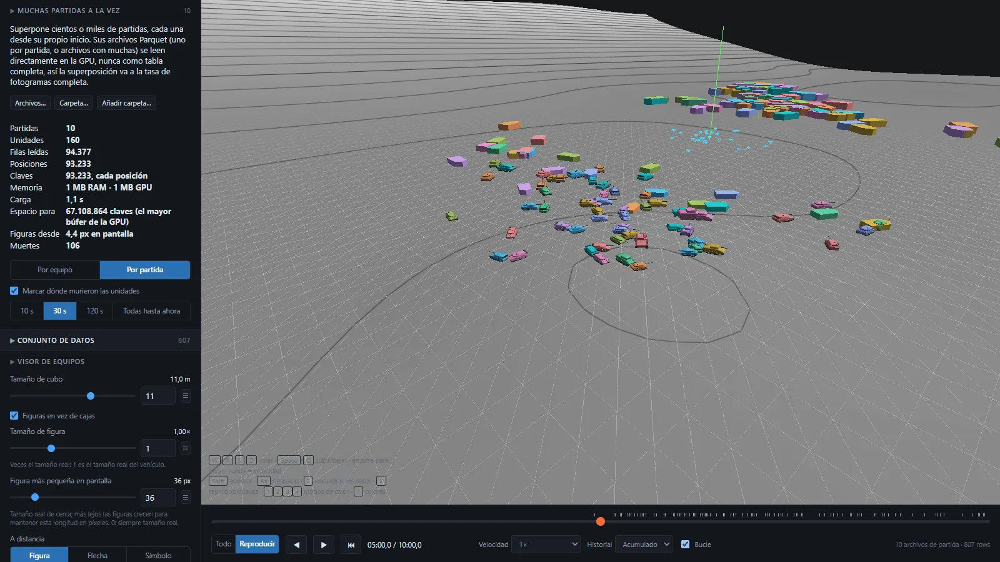

# Muchas partidas a la vez

**Muchas partidas a la vez** reproduce muchas partidas superpuestas, así que ve dónde suelen ir los jugadores de cada partida. Úselo para comparar cientos o miles de partidas en una sola imagen.

Cada partida empieza en su propio comienzo, y sus unidades se mueven como figuras. Los archivos pasan directamente a la tarjeta gráfica y no se construye ninguna tabla completa, así que se reproduce con fluidez donde una carga normal se quedaría sin memoria.

## Cómo se usa {#how-to-use-it}

1. Abra **Muchas partidas a la vez** en la barra lateral de Mapa de calor.
2. Pulse **Archivos…** (elija muchos archivos), **Carpeta…** (una carpeta y sus subcarpetas) o **Añadir carpeta…** (añadir a lo que ya está cargado).
3. El visor cambia a la superposición de figuras y empieza en el comienzo. Pulse **Reproducir**.

Cada archivo es una partida (o contiene varias). Funcionan los archivos Parquet y los contenedores [`.3dheat`](container.md). Un archivo necesita columnas de posición, tiempo y unidad; las columnas de nombre, tipo y bando se conservan. Los demás archivos, y los archivos auxiliares de los convertidores (vuelo, mensajes, eventos, chat, objetivos), se omiten. Para una tabla normal, véase [Cargar datos](getting-data-in.md).

## Ajustes {#settings}

| Ajuste | Qué hace |
|---|---|
| **Por equipo** / **Por partida** | Colorea por bando, o un color por partida. |
| **Marcar dónde murieron las unidades** | Una marca donde murió cada unidad, durante 10 s, 30 s, 120 s, o todas hasta el momento. |

El panel muestra cuántas partidas, unidades, filas y posiciones se leyeron, la memoria usada y el tiempo de carga. *Espacio para* es cuántas posiciones más podría aceptar aún la tarjeta gráfica. *Figuras desde* es el tamaño en pantalla por debajo del cual una unidad se dibuja como un pequeño dardo en lugar de su figura.

El aspecto de las figuras usa los mismos controles que la [repetición de partida](match-replay.md#figures): **Tamaño de figura**, **Figura más pequeña en pantalla** y **A distancia**.

## Consejos {#tips}

- Cuando todo no cabría en memoria, las posiciones se aclaran (solo se conserva una posición cada pocos metros) y el panel lo indica.
- Los modos de calor también funcionan con los datos de la superposición.
- Para estadísticas sobre miles de partidas sin dibujarlas, véase [Análisis masivo](mass-analysis.md).
