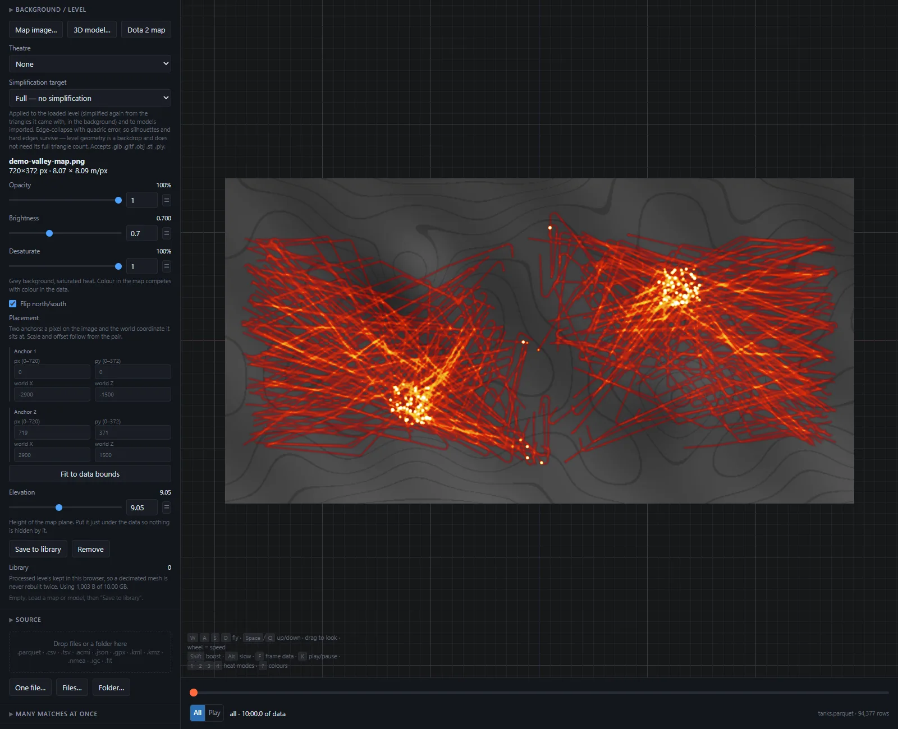

# Imágenes de mapa

Una imagen de mapa es una imagen plana (un minimapa, una foto de satélite, un plano de planta) que se pone debajo de tus datos para que veas dónde está el calor. Le indicas al visor dónde va la imagen fijando dos puntos de ella a dos lugares del mundo (los «anclajes»).

## Cargar y colocar una imagen de mapa {#load-and-place-a-map-image}

1. Carga primero tus datos ([Cómo meter datos](getting-data-in.md)).
2. En **Fondo / nivel**, pulsa **Imagen de mapa…** y elige la imagen. Se estira sobre la zona de los datos.
3. Pulsa **Ajustar a los límites de los datos** si la imagen se ha movido. El anclaje 1 va a la esquina superior izquierda de la imagen, y el anclaje 2 a su esquina inferior derecha, en los bordes de los datos.
4. Si el calor no coincide con la imagen, elige dos puntos de referencia que estén lejos entre sí (por ejemplo, dos esquinas opuestas de un edificio o dos cruces). Lee el píxel de cada uno en la imagen y su posición en el mundo (pasa el ratón con la [regla](measure.md) para leer **X** y **Z**).
5. Escríbelos en **Colocación**: para el **Anclaje 1**, el **px** y el **py** del punto de referencia, y **X del mundo** y **Z del mundo**; lo mismo para el **Anclaje 2**.
6. Comprueba: una trayectoria o un punto caliente que sabes que está sobre una carretera debería estar ahora sobre esa carretera. Ajusta los números hasta que lo esté.



Los dos puntos de referencia deben diferir tanto en la columna de píxeles como en la fila de píxeles; si no, el panel dice *Los dos anclajes comparten una fila o columna de píxeles*.

## Carga {#loading}

Cualquier formato de imagen que el navegador pueda decodificar. Una imagen cuyo lado mayor supera los **8192 px** se reduce a 8192 (el lado más grande que se pide a la GPU que mantenga), y el panel dice *Reducida de W×H a w×h*.

Al cargarla, la imagen se estira sobre los límites X-Z del conjunto de datos (o ±1000 unidades sin conjunto de datos), con el norte arriba, a la Y más baja de los datos. Los valores por defecto son **Opacidad** 100 %, **Brillo** 0,7, **Desaturar** 100 % e **Invertir norte/sur** activado: desaturada y atenuada, porque el trabajo del fondo es ayudarte a localizar un punto caliente, no competir con él.

## Controles {#controls}

| Control | Por defecto | Rango | Significado |
|---|---|---|---|
| **Opacidad** | 100 % | 0-100 % | |
| **Brillo** | 0,7 | 0-2 (tirador 64) | |
| **Desaturar** | 100 % | 0-100 % | Fondo gris, calor saturado. El color del mapa compite con el color de los datos. |
| **Invertir norte/sur** | activado | | Qué fila de la imagen es la Z máxima del mundo. Al cambiarlo con un conjunto de datos cargado, también vuelve a ajustar los anclajes a los límites de los datos. |
| **Colocación**: Anclaje 1, Anclaje 2 | las esquinas de la imagen sobre los límites de los datos | | Cada anclaje es un píxel de la imagen: **px** (desde la izquierda, de 0 al ancho) y **py** (desde arriba, de 0 al alto), y la coordenada del mundo donde cae, **X del mundo** y **Z del mundo**. La escala y el desplazamiento se deducen del par. |
| **Ajustar a los límites de los datos** | | | Pone el anclaje 1 en la esquina superior izquierda de la imagen y el anclaje 2 en la inferior derecha, en los límites X-Z de los datos. Es un punto de partida para una colocación exacta. Necesita un conjunto de datos. |
| **Elevación** | la Y más baja de los datos | de la Y mínima de los datos - 500 a la Y máxima + 500 (tirador Y máxima + 100.000) | Altura del plano del mapa. Ponlo justo por debajo de los datos para que no los tape. |

La línea del nombre muestra `ancho×alto px · x × z m/px`, el tamaño en el mundo de un píxel en cada eje.

## En la escena {#in-the-scene}

La imagen es un único cuadrilátero con textura a la elevación. Con opacidad completa escribe profundidad, así que participa en la [oclusión](depth-and-culling.md) como suelo; con una opacidad inferior al 100 % se mezcla y no escribe profundidad, así que no oculta nada. La [regla](measure.md) mide sobre su plano. La [biblioteca de niveles](level-library.md) guarda un nivel de imagen con sus anclajes.

## Mapa de Dota 2 {#dota-2-map}

**Mapa de Dota 2**, junto a **Imagen de mapa…**, descarga el dibujo del mapa actual de Dota 2 que [OpenDota](https://www.opendota.com) muestra en sus páginas de partida, y lo coloca bajo las tablas que el [Watcher](https://github.com/Holdi601/3DHeat-Watcher) escribe a partir de repeticiones de Dota 2 ([`dotaMap.ts`](https://github.com/Holdi601/3DHeat/blob/main/src/tactics/dotaMap.ts)). La imagen se descarga de opendota.com al pulsar el botón, y no forma parte de 3DHeat; se toma el dibujo del parche más reciente de la propia lista de OpenDota, y el dibujo del 7.40 cuando no se puede leer la lista.

| | |
|---|---|
| Origen | `opendota.com/assets/images/dota2/map/detailed_<patch>.webp`, 900×900 px |
| Colocación | La calibración de OpenDota: la imagen abarca las unidades del mundo de Dota de -8192 a 8064 en ambos ejes (celdas de 128 unidades, de la 64 a la 191), con el norte arriba. Con los ejes de la tabla de repetición (Z vertical, Y invertida), eso es X del mundo de -8192 a 8064 y Z del mundo de -8064 a 8192. Unas 18 unidades por píxel. |
| Elevación | 0. Los héroes están a una altura de 0 a unos 600. |
| Aspecto | Brillo 0,8, desaturar 50 %. |

Comprobado con la repetición de una partida pública del parche 7.40: la trayectoria de cada héroe sigue los carriles dibujados, y las torres, cuarteles y ancestros que coloca la repetición caen sobre las bases dibujadas. La vista **Superior** muestra el mapa con el norte en la parte inferior de la pantalla, como hace con cualquier tabla de Z vertical con Y invertida.

El dibujo es de OpenDota, del mapa de Valve; Valve no respalda a 3DHeat.

### El mapa 3D {#the-3d-map}

Con Dota 2 instalado, la herramienta aparte [3DHeat Dota](https://holdi601.github.io/3DHeat-Ext-Dota/) (`heat3d-dota-maps level -o dota.glb`; el comando [`dota-map`](https://holdi601.github.io/3DHeat-Watcher/dota-map.html) del Watcher también la ejecuta) crea el mapa en 3D a partir de los propios archivos del juego: terreno, acantilados, agua, árboles y edificios, en las unidades y los ejes de las tablas de las repeticiones. Carga el archivo una vez con **Modelo 3D…**: el visor lo reconoce por sus partes (`ground:terrain`, `structure:tower`, `structure:ancient`, `structure:tree`; `isDotaLevel` en `dotaMap.ts`), lo guarda en el acto en la [biblioteca de niveles](level-library.md), sustituyendo uno anterior, y lo indica. A partir de entonces, **Mapa de Dota 2** carga ese mapa 3D de la biblioteca en lugar de descargar el dibujo; si no hay ninguno en la biblioteca, descarga el dibujo y explica cómo crear el mapa 3D. El archivo sale de tu propia instalación y se queda en tu equipo.

## Para desarrolladores {#for-developers}

### Cómo colocan los anclajes la imagen {#how-the-anchors-place-the-image}

De [`mapQuadFromAnchors`](https://github.com/Holdi601/3DHeat/blob/main/src/render/level.ts), con los anclajes *a* y *b*:

```
scaleX = (b.worldX - a.worldX) / (b.px - a.px)
scaleZ = (b.worldZ - a.worldZ) / (b.py - a.py)
pixel (0, 0) sits at  (a.worldX - a.px × scaleX,  a.worldZ - a.py × scaleZ)
```

Dos anclajes fijan la escala y el desplazamiento de cada eje por separado, así que un mapa puede estirarse de forma distinta en X y en Z, pero no girar. Los anclajes deben diferir en **ambas** coordenadas de píxel; cuando comparten una fila o una columna no se puede deducir ninguna escala, el mapa no se dibuja, y el panel dice *Los dos anclajes comparten una fila o columna de píxeles*.
