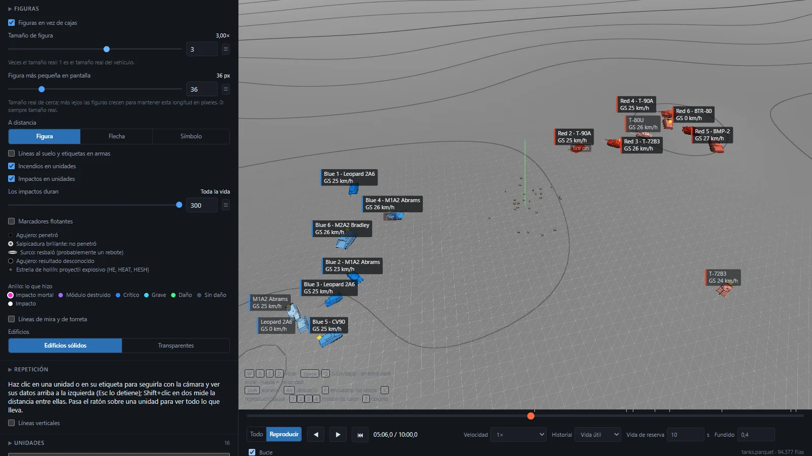
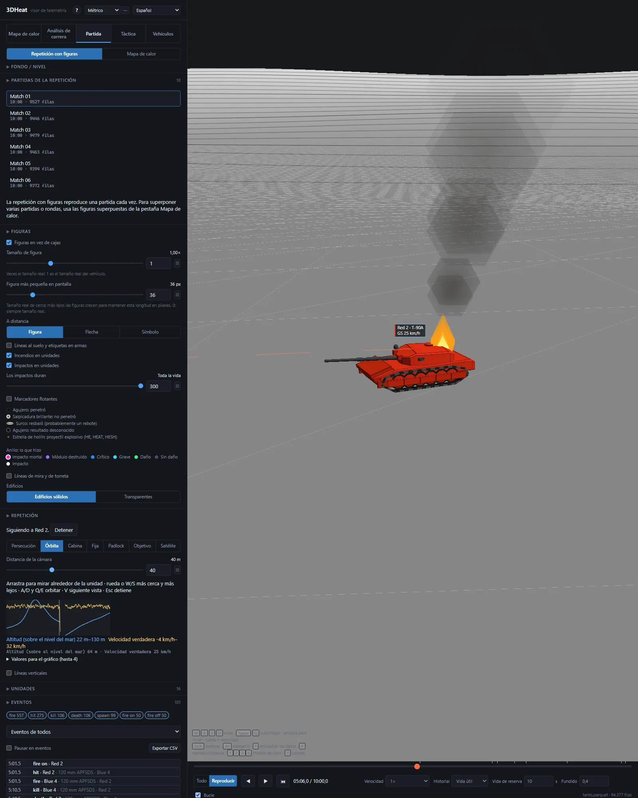
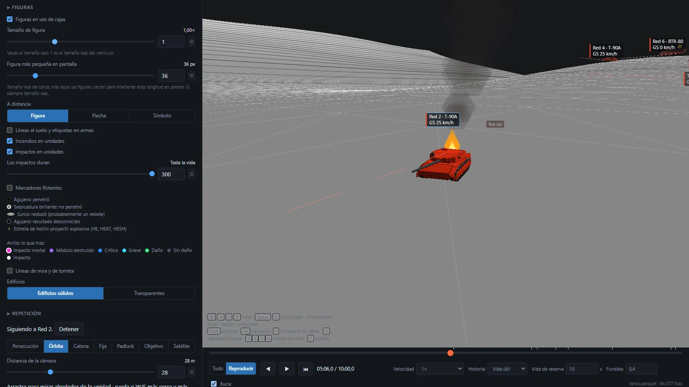
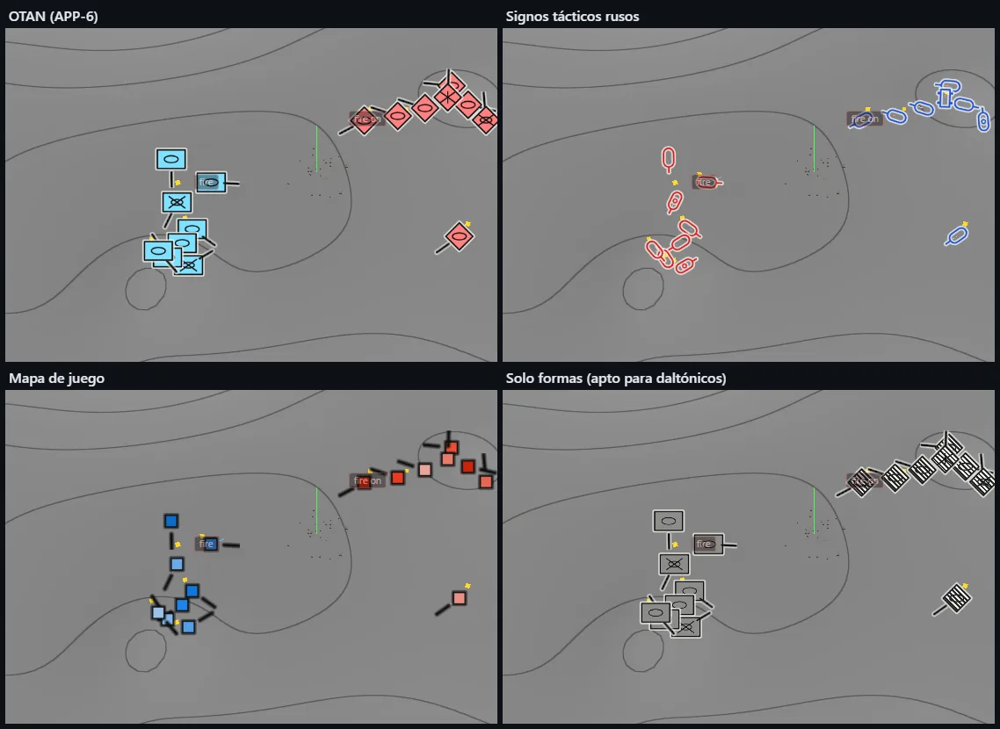
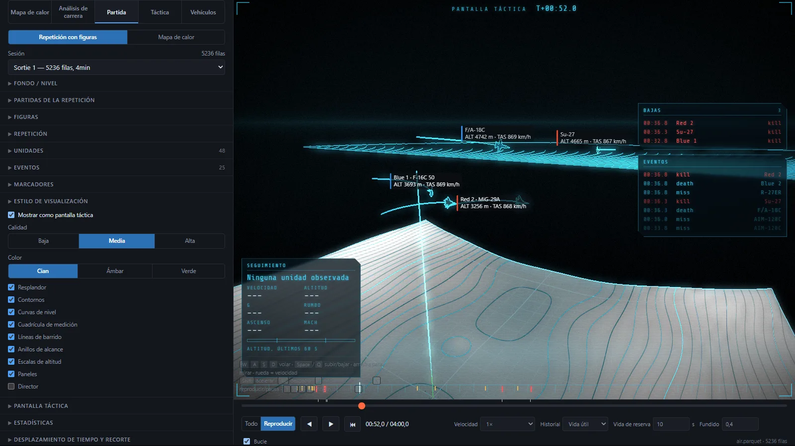
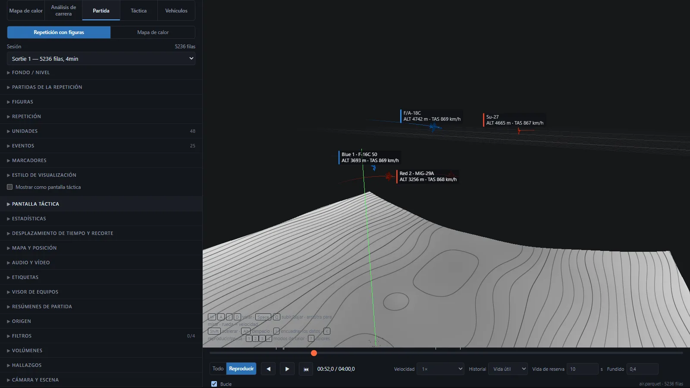

# Repetición de partida

La repetición es una película de la partida en la que cada jugador se dibuja como lo que conducía. Úsala para volver a ver un combate, seguir a una unidad y ver quién alcanzó a quién.

Los disparos, impactos, fuegos y restos se dibujan sobre las unidades y los objetivos del nivel. Las cámaras, las etiquetas y una pantalla táctica te ayudan a leer el combate. ¿Conoces Tacview? [Paridad con Tacview](tacview-parity.md) muestra dónde está cada una de sus herramientas.

## Empezar una repetición {#start-a-replay}

1. Carga una grabación con **Fuente → Archivos…** o soltándola en el panel Fuente (cualquier tabla con una columna de **persona** y otra de **tiempo**, un archivo de Tacview, una repetición convertida, una partida [`.3dheat`](container.md)). Mira [Cargar datos](getting-data-in.md).
2. Abre la pestaña **Partida** y elige **Repetición con figuras**, o elige **Figuras superpuestas** en la barra de modos de la pestaña Mapa de calor.
3. En **Partidas de la repetición** elige una partida, todas a la vez, o varias.
4. Pulsa **Reproducir** en la línea de tiempo (o `K`). Arrastra la línea de tiempo para saltar.

Las figuras sustituyen a las cajas en cada unidad cuyo nombre o tipo se conoce (mira [Figuras](figures.md)). Los datos sin columna de nombre o de tipo se dibujan como soldados.

## Figuras {#figures}

| Ajuste (sección **Figuras**) | Por defecto | Qué hace |
|---|---|---|
| **Figuras en vez de cajas** | activado | Desactivado dibuja cajas simples. |
| **Tamaño de figura** (veces el tamaño real) | 1 | 1 es el tamaño real; de 0,25 a 20 veces (escala logarítmica). Uno mayor ayuda desde lejos. |
| **Figura más pequeña en pantalla** | 36 px | Las figuras lejanas crecen para seguir midiendo esto, de 0 a 200 px; 0 mantiene el tamaño real. |
| **A distancia**: Figura, Flecha, Símbolo | Figura | En qué se convierte una unidad lejana. |
| **Símbolos** | OTAN (APP-6) | OTAN (APP-6), signos tácticos rusos, iconos de **Mapa de juego**, o **Solo formas (apto para daltónicos)**. |
| **Tamaño del símbolo**, **Mi bando**, **Hostil / Neutral**, **Marcas de rumbo** | 28 px (12 a 64), automático, hostil, activado | Cómo se ven los símbolos y qué bando es el propio. |
| **Líneas verticales** | activado | Una línea desde cada unidad hasta el suelo, para leer las alturas en 3D. |
| **Líneas al suelo y etiquetas en armas** | desactivado | Líneas al suelo y etiquetas en misiles y bombas. |
| **Incendios en unidades** | activado | Llamas desde que una unidad arde hasta que se apaga. |
| **Impactos en unidades** | activado | Marcas donde dieron los disparos (abajo). **Los impactos duran**: de 1 a 300 segundos, o **Toda la vida**. **Marcadores flotantes**: marcas dibujadas sobre la superficie. |
| **Líneas de mira y de torreta** | desactivado | Discontinuas: hacia donde mira el jugador; continuas: hacia donde apunta el cañón. |
| **Edificios** | sólidos | Edificios sólidos o transparentes, cuando el nivel los pinta. |

### Símbolos a distancia {#symbols-at-a-distance}

Cuando una unidad sería más pequeña que **Figura más pequeña en pantalla**, puede convertirse en un símbolo que siga siendo legible. La forma indica el tipo (por ejemplo, una caja redondeada con una marca de orugas para un blindado); el color indica el bando. Abre el menú **Símbolos** para cambiar el estilo.

### Marcas de impacto, restos y fuegos {#hit-marks-wrecks-and-fires}

- Las **marcas de impacto** se colocan sobre la superficie que alcanzó el disparo, a la escala de la figura. Su aspecto indica lo que pasó: un agujero (atravesó), una salpicadura brillante (no atravesó), un surco (rebotó), una estrella de hollín (proyectil explosivo). Un anillo de color indica lo que hizo: disparo mortal, módulo destruido, crítico, grave, daño, sin daño, impacto. Pasa el ratón sobre una marca para ver el nombre de la ronda.
- Una unidad destruida se dibuja **carbonizada** como resto desde su muerte hasta que reaparece o se quita; su símbolo aparece tachado.
- Los **fuegos** arden en una unidad desde que se incendia hasta que se apaga.
- Las **torretas** giran hacia donde los datos dicen que apunta el cañón (o, sin ese dato, hacia donde mira el jugador).

### Armas, señuelos y trazadores {#weapons-decoys-and-tracers}

Con **Armas, disparos e impactos** activado (sección Visor de equipos): los misiles, cohetes, bombas y torpedos vuelan como sus propias figuras con una estela de humo; las balas y los proyectiles son trazadores; los impactos y explosiones destellan. Un trazador dibujado **con trazos** se dedujo de un impacto, porque los datos no tenían el disparo. Las bengalas y el chaff se dibujan como señuelos; se ocultan de la lista de unidades salvo que esté marcado *Señuelos y proyectiles*.

## Cámaras {#cameras}

Haz clic en una unidad o en su etiqueta para **seguirla**; la sección **Repetición** ofrece **Persecución**, **Órbita**, **Cabina** (con una pantalla de cabeza alta, `H`), **Fija**, **Padlock**, **Objetivo** y **Satélite**. `V` las recorre, y **Distancia de la cámara** fija a qué distancia. Esc para.

- **Vista de dos unidades**: elige un **Objetivo** (o Ctrl/Alt+clic en una unidad) para mirarlo desde la unidad seguida; **Intercambiar** las cambia de sitio.
- **Medida**: Shift+clic en dos unidades para ver el rumbo, la distancia y la diferencia de altura entre ellas.
- **Mapa 2D** (`M`): vista de esquina o completa, con estelas y nombres.
- **Marcadores** (`B`): guarda el momento y la cámara; también aparecen en la lista las bajas, muertes y marcas propias de la grabación.
- **Eventos**: cada evento en orden de tiempo; un clic salta hasta él. `Re Pág` / `Av Pág` saltan entre eventos; **Pausar en eventos** se detiene en cada uno.

## Pantalla táctica {#tactical-display}

La sección **Pantalla táctica** dibuja, sin unidad alguna, las seleccionadas, todas, o un tipo (aeronaves, terrestres, barcos, armas): vectores de velocidad y la trayectoria por delante, líneas de morro y de sustentación, conos de radar, bloqueos, enlaces de datos, zonas y líneas de enfrentamiento, líneas de visión, hacia dónde miran los jugadores (conos de visión), la puntería de las torretas y la cámara grabada.

### Estilo de pantalla {#display-style}

`T` (o el interruptor **Mostrar como pantalla táctica**) cambia el aspecto a un estilo de pantalla de radar: brillo, contornos, líneas de nivel, una cuadrícula de medida, líneas de barrido, anillos de alcance, escalas de altitud, paneles con bajas y eventos, y un **Director** que mueve la cámara a los eventos por sí solo.

## Objetivos {#objectives}

Cuando una partida trae sus objetivos, la sección **Objetivos** los dibuja sobre el nivel: zonas de captura (con su dueño y el progreso de captura), puntos de aparición, aeródromos, áreas y objetivos de bombardeo, cada capa con su interruptor, y con etiquetas. Se ven a través del suelo. Cuando hay varios modos de juego cargados, **Modo** filtra las partidas por modo. Los objetivos vienen del archivo de partida de un conversor, junto a la grabación o dentro de un contenedor [`.3dheat`](container.md).

## Etiquetas y estadísticas {#labels-and-statistics}

- **Etiquetas**: reglas por tipo (**Seleccionadas**, **Aeronaves**, **Terrestres**, **Barcos**, **Armas**, **IA**): se muestran o no, qué valores, y una **Prioridad** para decidir quién obtiene el espacio cuando las etiquetas se solapan. **Separar las etiquetas** mueve una etiqueta junto a su unidad cuando taparía otra, y la deja fuera cuando no hay sitio. **Tamaño de las etiquetas** va del 60 al 250 %. **Volver a nombre, vehículo, altitud y velocidad** restablece las reglas.
  - Las unidades terrestres empiezan con nombre, vehículo y velocidad.
  - Las aeronaves empiezan con nombre, vehículo, altitud y velocidad.
  - Los barcos empiezan con nombre, vehículo, velocidad y rumbo.
  - Pasa el ratón sobre una unidad para ver todos los valores que tiene.
- **Estadísticas**: por equipo y unidad: bajas, muertes, disparos, impactos, proporción de impactos, despegues, aterrizajes, tiempo en el aire, velocidad máxima, altura y G, distancia. Exportación a CSV.
- **Gráficos**: los valores de una unidad a lo largo del tiempo, dos unidades comparadas, o un valor frente a otro.

## Muchas partidas a la vez {#many-matches-at-once}

Para superponer cientos o miles de partidas, mira [Muchas partidas a la vez](many-matches.md). Detalles de las figuras (humo, fuego y otros efectos temporizados): [Figuras en el modo de figuras superpuestas](figure-replay.md). Lista de funciones de Tacview: [Paridad con Tacview](tacview-parity.md), una página hija de esta.
