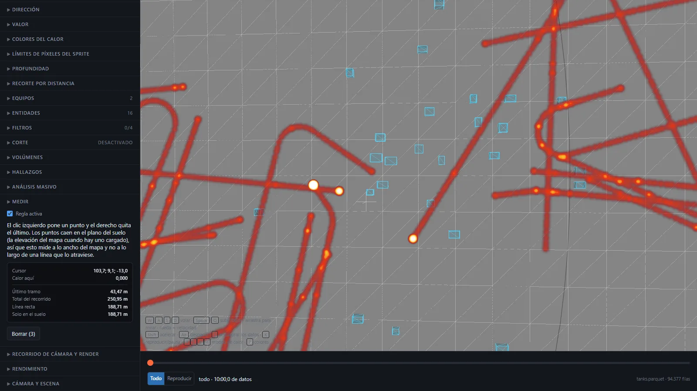

# Medir

La **Medida** convierte el ratón en una regla y le dice lo concurrido que está el punto bajo el cursor. Úsela para saber a qué distancia están dos lugares, o cuánto tráfico tiene un punto.

## Pruébelo {#try-it}

1. Abra **Medida** en la barra lateral y marque **Regla activa**.
2. Haga clic izquierdo en tres lugares del mapa. Cada clic deja un punto.
3. Lea **Total del recorrido** (la longitud de todo el trayecto) y **Último tramo** (la última etapa).
4. Haga clic derecho para quitar el último punto, o pulse **Borrar (3)** para quitarlos todos.

| Acción | Efecto |
|---|---|
| Clic izquierdo | Deja un punto donde el cursor toca el plano del suelo. Un clic que se movió más de 4 píxeles entre la pulsación y la suelta es un arrastre de cámara, no un punto. |
| Clic derecho | Quita el último punto. |
| Mover | La posición del cursor y el calor bajo él se actualizan en vivo. |

La cámara sigue funcionando mientras la regla está activa: arrastrar sigue mirando alrededor, las teclas siguen volando. Mientras la regla está activa, recoge todos los clics, así que [elegir con clic](camera.md#click-to-pick) espera a que se desactive.

**El plano del suelo** es la elevación del [mapa de imagen](map-images.md) cuando hay una imagen de mapa cargada; si no, la Y más baja del conjunto de datos (0 sin ella). Los puntos caen sobre él, así que la regla mide a lo ancho del mapa, no a lo largo de una línea que lo atraviesa. Con un nivel 3D, el plano sigue siendo la Y más baja del conjunto de datos, no la superficie del nivel; para un punto sobre la superficie real, desactive la regla y haga clic en él ([elegir con clic](camera.md#click-to-pick)), que lee las coordenadas de los triángulos propios del nivel.

## Lecturas {#readouts}

| Línea | Significado |
|---|---|
| **Cursor** | X, Y, Z del mundo del punto bajo el cursor, sobre el plano. |
| **Calor aquí** | Cuánto calor hay en el píxel del cursor. Un número mayor significa más tráfico en ese punto. Es el valor que recibe la rampa de color antes de que el punto de saturación lo divida, así que puede compararlo con el [Punto de saturación](colour-and-exposure.md#saturation-point). |
| **Último tramo** | Distancia desde el último punto hasta el cursor (o entre los dos últimos puntos). |
| **Total del recorrido** | Longitud de la polilínea que pasa por cada punto y el cursor. |
| **Línea recta** | Distancia en 3D desde el primer punto hasta el cursor (o el último punto). |
| **Solo en el suelo** | Lo mismo, solo en X y Z. |
| **Borrar (N)** | Quita todos los puntos. |

Las distancias se muestran en centímetros por debajo de 1 unidad, en metros por debajo de 1.000 y en kilómetros por encima, suponiendo que una unidad del mundo es un metro ([Ejes, unidades y tiempo](axes-units-and-time.md#unit-scale)). Las coordenadas son del mundo, incluso cuando un eje está [invertido para mostrar](camera.md#invert-world-axis).

Los puntos y la línea entre ellos se dibujan como una superposición en la vista, con tamaño según el espaciado de la cuadrícula. Los puntos de la regla no se guardan en las vistas; permanecen cuando carga otros datos.

## Para desarrolladores {#for-developers}

**Calor aquí** se lee de la GPU como máximo cada 120 ms, porque una lectura de un solo píxel detiene el cauce. Usa el mismo camino que `engine.readHeatProbe()`: se divide entre la ganancia con la que se escribió el fotograma, así que en la ruta de acumulación en media precisión (`?heat=f16`) está en las mismas unidades que en un destino de 32 bits ([Acumulación en media precisión](half-float-accumulation.md)).
