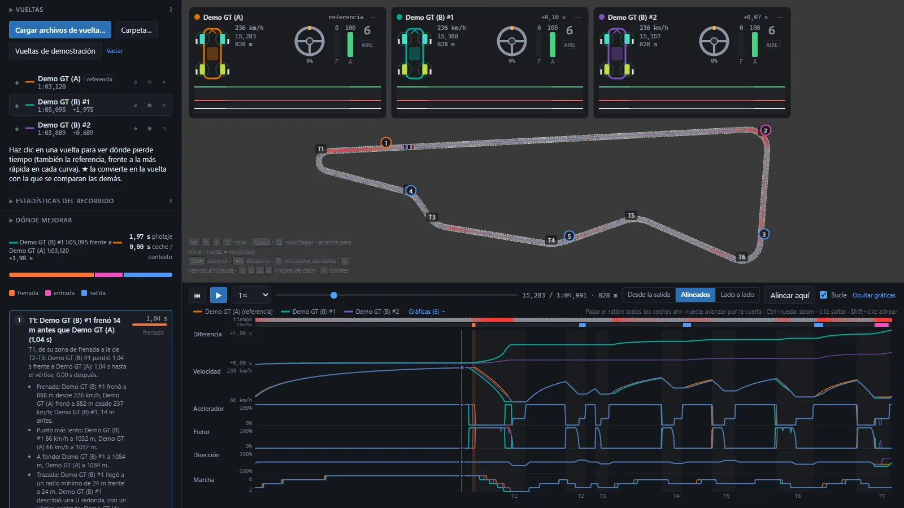

# Análisis de carrera

Condujiste el mismo circuito dos veces. La pestaña **Análisis de carrera** reproduce las dos vueltas juntas en
3D, muestra dónde fue más lenta una de ellas y te dice por qué. ¿Aún no tienes vueltas? Pulsa **Vueltas de
demostración**.

La pestaña compara dos o más vueltas de un mismo recorrido. Comparte el lienzo, la cámara y el modelo del
recorrido cargado (**Fondo / nivel**) con el mapa de calor; todo lo demás es propio: su propia barra lateral y su
propia barra bajo la vista. Palabras como *vuelta*, *referencia* y *vértice* están en el [glosario](glossary.md).

Esta página es el mapa de la pestaña. Cada parte tiene su propia página:

| Página | Qué cubre |
|---|---|
| [Cargar vueltas](race-loading-laps.md) | cada formato de archivo, carpetas y recorridos, nombres de coche, vueltas de demostración, la lista de vueltas, referencia y enfoque |
| [Repetición y la escena 3D](race-replay-and-scene.md) | la barra de transporte, los tres modos de repetición, alinear coches, la cámara de persecución, líneas, mapas, coches, etiquetas, mundos reflejados |
| [Gráficos y HUD](race-charts-and-hud.md) | los gráficos de distancia, el selector de gráficos, pasar el ratón y el zoom, las tarjetas de coche, la tabla de canales |
| [Eventos de control del coche](race-control-events.md) | bloqueos, patinaje de ruedas, sobreviraje, trompos, subviraje, golpes, choques, ABS/control de tracción, freno de mano, aire - cómo se detecta cada uno, con cada umbral |
| [Análisis curva a curva](race-corner-analysis.md) | alineación por distancia, curvas y segmentos, la cuenta de tiempo de una curva, cada causa y el orden en que se prueban, la forma de la trazada y el consejo |
| [Perfiles de coche y comparación](race-car-profiles.md) | lo que puede hacer cada coche, medido en sus vueltas; *Coches comparados*; lo que decide el coche en cada curva |
| [Estadísticas del recorrido](race-course-statistics.md) | muchas vueltas de un mismo recorrido: errores por curva y por tipo, el mapa de errores, la exportación al mapa de calor, límites de rendimiento |
| [Análisis de carrera: el método](race-analytics.md) | la investigación detrás de las reglas, con sus fuentes |
| [Otros juegos de carreras](other-games.md) | lo que hace el visor con las vueltas de cada juego: deslizamiento y derrape calculados donde un juego no los envía, mundos reflejados, los canales extra |

## La pantalla {#the-screen}

**Barra lateral**, de arriba abajo (las secciones se pueden plegar):

1. **Vueltas** - cargar, listar, mostrar/ocultar, referencia, enfoque, persecución.
   Véase [Cargar vueltas](race-loading-laps.md).
2. **Estadísticas del recorrido** - solo desde tres vueltas cargadas.
   Véase [Estadísticas del recorrido](race-course-statistics.md).
3. **Dónde mejorar** - los hallazgos de la vuelta enfocada, curva a curva.
   Véase [Análisis curva a curva](race-corner-analysis.md).
4. **Curva a curva** (o *Curva a curva - clase X* con varias clases) - la vuelta más rápida por cada curva y su
   trazada. Se muestra con dos o más vueltas.
5. **Control del coche** - los bloqueos, derrapes, empujes y golpes de la vuelta enfocada.
   Véase [Eventos de control del coche](race-control-events.md).
6. **Coches comparados** (o **El coche** con uno solo) - véase
   [Perfiles de coche y comparación](race-car-profiles.md).
7. **Vista** - qué mapa se pinta sobre la pista y qué se dibuja.
   Véase [Repetición y la escena 3D](race-replay-and-scene.md).
8. Los paneles compartidos **Nivel** y **Cámara y escena** (modelo del recorrido, inversión de ejes, cámara) - se
   documentan con el mapa de calor y con [Cámara](camera.md).

**La vista** muestra el recorrido, las líneas recorridas, el mapa, los coches, las etiquetas fijadas a la pista y
hasta seis tarjetas de coche arriba a la izquierda (véase [Gráficos y HUD](race-charts-and-hud.md)). Sin vueltas
cargadas dice "No hay vueltas cargadas - suelta aquí dos o más archivos de vuelta, o carga las vueltas de
demostración desde la barra lateral."

**La barra bajo la vista** contiene el transporte de la repetición y, salvo que esté oculto, los gráficos de distancia.

## Inicio rápido {#quick-start}

1. Abre la pestaña **Análisis de carrera** (junto a **Mapa de calor**, arriba de la barra lateral).
2. Carga vueltas. Pulsa **Vueltas de demostración** para ver lo que hace la pestaña con tres vueltas inventadas.
   Para tus propias vueltas, grábalas primero ([formatos de archivo y grabadoras](race-loading-laps.md#file-formats)),
   luego pulsa **Cargar archivos de vuelta…** o **Carpeta…**, o suelta archivos o carpetas sobre la vista.
3. La vuelta completa más rápida pasa a ser la referencia; la otra vuelta más lenta queda enfocada. Haz clic en
   cualquier vuelta de la lista para enfocarla; ★ convierte una vuelta en la referencia.
4. Lee **Dónde mejorar**. Haz clic en un hallazgo: los coches se alinean 40 m antes, la cámara lo encuadra, la
   repetición lo reproduce y se abren las mediciones.
5. Pasa el ratón sobre los gráficos para llevar cada coche a ese metro; Mayús+clic para alinearlos allí.

## Teclado {#keyboard}

Mientras la pestaña Carrera está abierta:

| Tecla | Hace |
|---|---|
| **K** | reproduce / pausa la repetición |
| **Inicio** | vuelve al inicio de la repetición |
| teclas numéricas | nada (en el mapa de calor cambian de modo) |

Las teclas escritas en un campo de texto o en un desplegable se ignoran. Las teclas de cámara funcionan como en el
mapa de calor (**W A S D**, **Espacio** arriba, **Q** abajo, **Mayús** más rápido, **Alt** más lento, ratón para
mirar; todo en [Cámara](camera.md)); **F** encuadra las vueltas cargadas (como lo hace cargar vueltas).

## Muchas vueltas {#many-laps}

- Todas las vueltas cargadas se analizan y se cuentan; decenas tardan uno o dos segundos.
- Más allá de **8** vueltas (`SHOW_ALL_UP_TO`), las vueltas añadidas solo se dibujan cuando son la referencia, la
  vuelta enfocada o la mejor vuelta de la clase de la vuelta enfocada. *Mostrar todos* / *Solo las que se miran*
  cambian eso.
- Más allá de **10** coches visibles (`PLAIN_PAST`), las vueltas que no se miran (ni la enfocada, ni el coche
  perseguido, ni la referencia) se dibujan con líneas adelgazadas a un punto cada 6 m en lugar de cada 1,5 m, y con
  coches sin detalle.
- Los gráficos dibujan como máximo **8** vueltas; el HUD muestra como máximo **6** tarjetas.
- Las estadísticas del recorrido aparecen desde **3** vueltas.

Detalles: [Estadísticas del recorrido](race-course-statistics.md#performance-with-many-laps).

## Ajustes de vista por defecto {#default-view-settings}

| Ajuste | Por defecto |
|---|---|
| Mapa | Mapa de tiempos |
| Líneas recorridas, Coches, Neumáticos y suspensión, Etiquetas, Pista desde las vueltas | activados |
| Todos los valores en las tarjetas | desactivado |
| Tamaño del coche | 1× |
| Gráficos | visibles |
| Modo de repetición | Desde la línea |
| Velocidad de repetición | 1× |
| Bucle | activado |

Nada de esto se guarda; al recargar se empieza con los valores por defecto. Lo que se recuerda en el navegador: el
idioma, y los nombres de coche aprendidos de los archivos de vuelta (véase [Cargar vueltas](race-loading-laps.md#car-names)).

## Para desarrolladores {#for-developers}

### Qué pasa al cargar vueltas {#what-happens-when-laps-are-loaded}

Cada vez que cambia el conjunto de vueltas, la referencia o el idioma, se rehace el análisis completo (`analyse` en
[`src/race/analysis.ts`](https://github.com/Holdi601/3DHeat/blob/main/src/race/analysis.ts)):

1. A cada vuelta se le añaden canales derivados allí donde el juego no los envía: ángulo de deriva, deslizamiento de
   rueda a partir de las velocidades de rueda, en el aire, terreno suelto, velocidad de guiñada
   ([`derive.ts`](https://github.com/Holdi601/3DHeat/blob/main/src/race/derive.ts)).
2. Se elige la referencia y cada vuelta se proyecta sobre su trayectoria y se remuestrea cada 2 m
   ([`align.ts`](https://github.com/Holdi601/3DHeat/blob/main/src/race/align.ts)).
3. Se calcula a partir de las vueltas si el mundo del juego está reflejado
   ([`handedness.ts`](https://github.com/Holdi601/3DHeat/blob/main/src/race/handedness.ts)).
4. Las curvas se encuentran sobre la referencia, y se agrupan en segmentos desde una zona de frenada hasta la
   siguiente ([`segments.ts`](https://github.com/Holdi601/3DHeat/blob/main/src/race/segments.ts)).
5. Por coche: su envolvente (agarre, frenada, tracción por velocidad), su perfil, sus curvas de neumático
   ([`envelope.ts`](https://github.com/Holdi601/3DHeat/blob/main/src/race/envelope.ts),
   [`profile.ts`](https://github.com/Holdi601/3DHeat/blob/main/src/race/profile.ts),
   [`control.ts`](https://github.com/Holdi601/3DHeat/blob/main/src/race/control.ts)).
6. Por vuelta y segmento: lo que hizo (punto de frenada, punto más lento, acelerador a fondo, ...) y la trazada que
   siguió ([`line.ts`](https://github.com/Holdi601/3DHeat/blob/main/src/race/line.ts)).
7. Por vuelta: sus eventos de control del coche, cada uno comparado con la vuelta con la que se compara allí.
8. Por vuelta y segmento: la cuenta de tiempo frente a su vuelta de comparación y el hallazgo en palabras.
9. El mapa de tiempos y el mapa de causas de cada vuelta.

Los textos se producen en el idioma actual; cambiar de idioma vuelve a ejecutar el análisis (y renombra las vueltas
de demostración). Un fallo del análisis se muestra bajo los botones **Vueltas** como un error, y las vueltas siguen
cargadas.

### Archivos de código {#source-files}

| Archivo | Función |
|---|---|
| `src/race/adapters.ts`, `ibt.ts` | lectura de archivos de vuelta |
| `src/race/lap.ts`, `carNames.ts`, `synthetic.ts` | el tipo de vuelta, los nombres, las vueltas de demostración |
| `src/race/derive.ts`, `handedness.ts` | canales derivados, mundos reflejados |
| `src/race/align.ts`, `segments.ts`, `line.ts` | eje de distancia, curvas, trazadas |
| `src/race/analysis.ts` | curvas comparadas, causas, hallazgos |
| `src/race/envelope.ts`, `profile.ts` | lo que puede hacer un coche |
| `src/race/control.ts`, `impacts.ts` | control del coche, golpes y choques |
| `src/race/stats.ts` | muchas vueltas |
| `src/race/replay.ts`, `scene.ts`, `glyph.ts`, `geometry.ts` | repetición y dibujo |
| `src/race/schema.ts`, `graphs.ts` | la tabla de canales, las filas de los gráficos |
| `src/ui/race/*` | la barra lateral, los gráficos, el HUD, las etiquetas |
| `src/state/raceStore.ts` | el estado de la pestaña y el reloj de la repetición |
