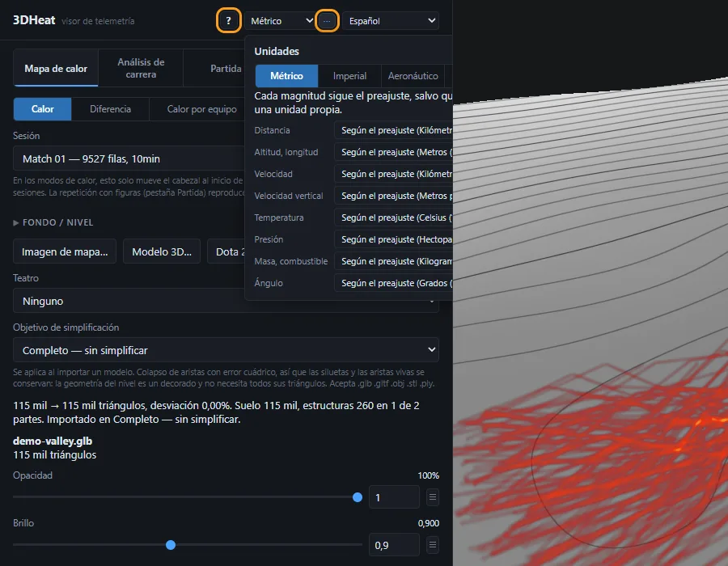
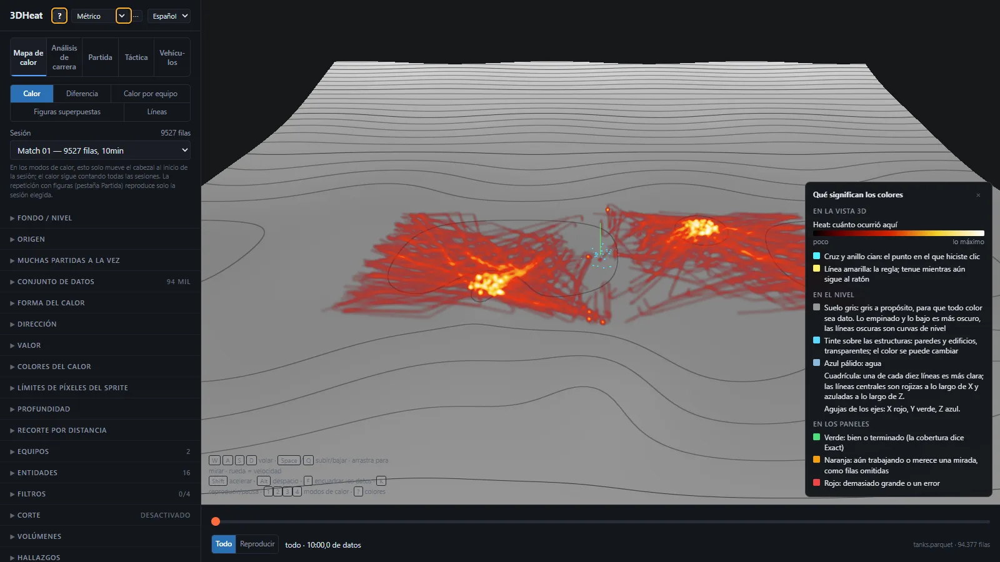
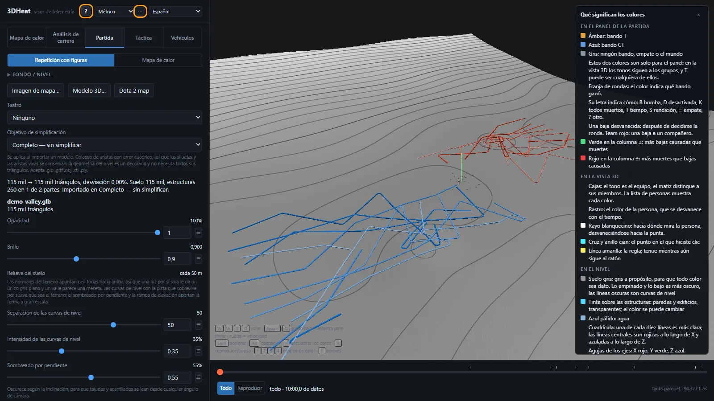

# Ajustes, unidades y teclas

Los pequeños controles de la parte superior de la barra lateral cambian cómo se comunica contigo el visor: el idioma, las unidades (metros o pies, km/h o nudos) y un modo de ayuda que explica los colores. Tus elecciones se recuerdan en tu navegador.

## La cabecera {#the-header}

En la parte superior de la barra lateral:

| Control | Qué hace |
|---|---|
| **?** | Modo de ayuda: qué significa cada color (también `?` o `F1`) |
| Menú **Unidades** | Métrico, Imperial, Aeronáutico o Náutico |
| Botón **...** junto a **Unidades** | Abre «Elige una unidad para cada magnitud»: un menú desplegable por magnitud |
| Menú **Idioma** | El idioma del visor: [40 idiomas](languages.md), o el del navegador |

Los números que escribas en una casilla pueden usar punto o coma (`0.35` o `0,35`). El visor acepta ambos y muestra los números como los escribe el idioma del visor.

## Unidades {#units}

1. Elige un preajuste en el menú **Unidades**. Todas las magnitudes cambian a la vez.
2. Para cambiar solo una magnitud, pulsa el botón **...** junto a ella y elige una unidad para esa magnitud. El menú muestra entonces un `*` tras el preajuste.
3. Una magnitud que no has fijado sigue al preajuste. Elige «Según el preajuste» para volver atrás.

| Magnitud | Métrico (por defecto) | Imperial | Aeronáutico | Náutico |
|---|---|---|---|---|
| Distancia | km | mi | NM | NM |
| Altitud, longitud | m | ft | ft | m |
| Velocidad | km/h | mph | kt | kt |
| Velocidad vertical | m/s | ft/min | ft/min | m/s |
| Temperatura | °C | °F | °C | °C |
| Presión | hPa | inHg | hPa | hPa |
| Masa, combustible | kg, l | lb, gal | lb, gal | t, m³ |
| Ángulo | grados | grados | grados | grados |

Otras unidades que puedes elegir para una magnitud: distancia km, mi, NM; velocidad km/h, m/s, kt, mph; velocidad vertical m/s, ft/min, m/min; temperatura °C, °F, K; presión hPa, inHg, mmHg, psi; masa kg, lb, t; ángulo grados o milésimas de la OTAN (6400 por círculo). Las unidades son las mismas en todo el visor: etiquetas, tarjetas, gráficos, estadísticas.

## Modo de ayuda {#help-mode}

Pulsa `?` o `F1`, o haz clic en el botón **?**. Muestra *Qué significan los colores*: leyendas para la vista 3D, las escalas de calor, los colores de equipo, los colores del nivel, los colores de estado de los paneles, el panel de partida y la vista de carrera. Permanece activo hasta que lo desactives. En la pestaña Partida también explica los colores del panel de partida.

## Lo que recuerda el navegador {#what-the-browser-remembers}

Estos ajustes se guardan en tu navegador entre visitas (no se envía nada a ningún sitio):

- el idioma, las unidades y el modo de ayuda;
- los ajustes de figuras, símbolos, etiquetas, cámara y pantalla táctica de la repetición;
- la velocidad de reproducción y la inversión de espejo;
- los marcadores por grabación, los volúmenes por conjunto de datos, las capas de objetivos;
- los ajustes de IA externa (la clave solo si marcas *Recordar*).

Los ajustes de calor, los filtros y el modo empiezan de cero con cada carga. La lista completa, generada: [Ajustes guardados](ref-settings-storage.md).

## Teclas que el visor retiene del navegador {#keys-the-viewer-keeps-from-the-browser}

Una sesión con datos grandes tarda en cargarse, así que el visor evita que el navegador la descarte por accidente:

- `Ctrl`/`Cmd` + letras que imprimirían, guardarían, abrirían, recargarían, cerrarían o abrirían ventanas nuevas no hacen nada fuera de los cuadros de texto; `F1`, `F3`, `F5`, `F6` y `F7` no hacen nada.
- Cerrar o recargar la pestaña con datos o un nivel cargados pide confirmación antes.
- En pantalla completa, el visor bloquea las teclas que usa (W, T, N, S, R, P, Q, Esc), para que el navegador no se las quede.

La lista exacta: [Teclas del navegador](ref-browser-keys.md). Todas las teclas propias del visor: [Referencia de teclado y ratón](keyboard-reference.md).
