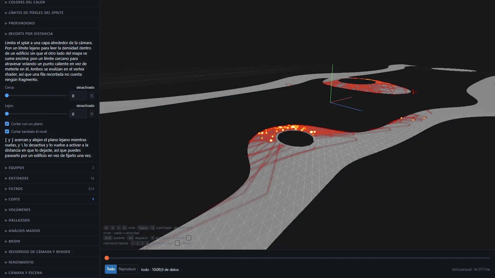

# Corte

El **Corte** corta el mundo como una porción de tarta, para que pueda mirar dentro de los edificios. Úselo cuando los muros tapan el calor que le interesa, por ejemplo para ver una planta de un edificio.

## Pruébelo {#try-it}

1. Cargue un nivel y algunos datos, y abra **Corte**.
2. Marque **Cortar el mundo**. El eje es **Altura**.
3. Arrastre **Posición** arriba y abajo: la losa se mueve por el nivel.
4. Ponga **Grosor** fino para ver una planta, o ancho para «todo lo que está por debajo de aquí».
5. Deje **Fuera de la losa** en 0 para quitar el resto, o súbalo para conservar un rastro tenue.



La losa corta **la geometría del nivel y los puntos de datos a la vez**: cortar solo el nivel dejaría el calor flotando donde estaba su edificio. Es el complemento de la [oclusión por profundidad](depth-and-culling.md): una vez que el nivel oculta bien lo que tiene detrás, el interior de un edificio también queda oculto. El panel se muestra cuando hay algo que cortar (un conjunto de datos o un nivel 3D); su cabecera muestra el eje cuando está activado, y *off* si no.

```
side view         Position = where the slab is
 ----------       Thickness = how tall the slab is
 | floor 3 |
 |=========|  <--- slab (kept)
 | floor 2 |  <--- outside: removed (or faint)
 | floor 1 |
 ----------
```

## Controles {#controls}

| Control | Por defecto | Significado |
|---|---|---|
| **Cortar el mundo** | desactivado | Activa la losa. Mientras la posición siga en su valor inicial 0 y el grosor en su valor inicial 500, al activarla los lleva al centro del eje y a un 15 % de su extensión. |
| Eje | **Altura** | *Altura* (Y), *X* o *Z*. Al cambiar de eje, la losa pasa al centro del nuevo eje. |
| **Posición** | el centro | Centro de la losa, en unidades del mundo, a lo largo de la extensión del eje (500 pasos). |
| **Grosor** | 15 % de la extensión | Desde 1/500 de la extensión hasta el doble de la extensión, en pasos logarítmicos. Muestra *más allá del mundo* cuando es tan ancho como la extensión: un lado llega entonces más allá del mundo y es un corte simple, no una losa. |
| **Fuera de la losa** | 0, *quitado* | Cuánto de lo que queda fuera sigue visible, de 0 a 100 %. Un rastro tenue de lo que se cortó suele ser más fácil de leer que quitarlo del todo. |
| **Cortar también los puntos de datos** | activado | Desactivado deja el calor entero, así que se ve a través del corte; útil para ver lo que hay encima y debajo de la losa. |

La extensión de un eje es la del nivel 3D cuando hay uno cargado; si no, la del conjunto de datos.

El Corte es independiente del [descarte por distancia](depth-and-culling.md#distance-culling), que corta en la dirección de la vista y no en un eje del mundo; los dos se combinan. Cualquier cambio en los ajustes de corte reinicia la acumulación de calor.

## Para desarrolladores {#for-developers}

La losa se prueba con la posición en el mundo de cada fila en el shader de vértices: una fila fuera de ella tiene su aportación multiplicada por el valor de *Fuera*, así que con 0 se rechaza antes de dibujar ningún fragmento. Los shaders del nivel aplican la misma prueba a cada fragmento del suelo, las estructuras y el agua.
