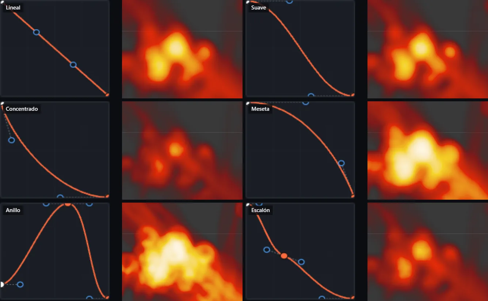

# Forma del sprite

Cada fila se dibuja como un sprite redondo que siempre mira a la cámara. Su tamaño y el perfil desde su centro hasta el borde (la **rampa**) deciden si un punto caliente se ve como un punto nítido, una nube suave, un disco o un anillo. Estos controles están en las secciones **Forma del calor** y **Límites de píxeles del sprite** de la barra lateral, y se aplican a [Calor](heat.md), [Diferencia](difference.md), [Calor por equipo](team-heat.md) y, como semianchura de una línea, [Calor de línea](line-heat.md).

Cambiar cualquiera de ellos reinicia la acumulación (el campo tiene que volver a dibujarse con la nueva forma).

Piensa en cada punto como una mancha suave de luz. Una mancha pequeña muestra puntos sueltos; una grande une a los vecinos en una nube. La forma decide lo suave que es el borde.



## Radio del sprite {#sprite-radius}

El radio del sprite en **unidades del mundo** (etiquetadas como metros). Por defecto 6, y en cada carga la extensión horizontal de los datos / 120: lo bastante grande para que las muestras vecinas a lo largo de una ruta se unan en una banda en lugar de verse como un hilo fino. Deslizador logarítmico de 0,05 a 2000; el tirador llega hasta 50.000.


Lo que está lejos se ve más pequeño, así que un sprite se encoge en pantalla con la distancia. Con la proyección paralela es igual en todas partes, y esa es una de las razones por las que la vista paralela es la adecuada para comparar puntos calientes ([Cámara](camera.md#projection)).

## Límites de píxeles {#pixel-clamps}

**Límites de píxeles del sprite** (cerrados por defecto) acotan el radio en pantalla después de la conversión de arriba.

| Control | Por defecto | Rango (tirador) | Por qué |
|---|---|---|---|
| **Radio mínimo en píxeles** | 1 px | 0-16 (512) | Evita que los datos lejanos desaparezcan por debajo de un píxel. |
| **Radio máximo en píxeles** | 96 px | 2-1024, logarítmico (8192) | El guardián del sobredibujado. Un sprite que cubre N píxeles cuesta N operaciones de mezcla, así que un radio sin límite cerca de la cámara es lo que convierte un fotograma rápido en uno lento. Por encima de la altura de la vista deja de limitar nada. |

**Misma densidad con cualquier zoom** (en la sección Forma del calor, activado por defecto) funciona con los límites. Un sprite que un límite agranda (de lejos) o reduce (de cerca) conserva el calor que sumaría a su tamaño real, así que un color significa el mismo número de filas por área de suelo con cualquier zoom. Desactivado, un sprite limitado suma todo su peso con su tamaño limitado, y la imagen cambia al volar hacia ella.

## Intensidad en el centro y en el borde {#centre-and-edge-intensity}

El calor que un sprite suma en su centro exacto (**Intensidad en el centro**, por defecto 1, 0-10, tirador 1000) y en su borde (**Intensidad en el borde**, por defecto 0, -2-10, tirador 1000). El valor de la rampa *t* (1 en el centro, 0 en el borde, dado forma por la caída o la curva de abajo) mezcla entre ambos (la fórmula está en [Para desarrolladores](#for-developers)).

Una **intensidad negativa en el borde** hace que el borde reste, lo que talla un halo frío alrededor de cada punto caliente y afila los grupos entre sí. La visibilidad incluye la [oclusión](depth-and-culling.md) y el [corte](slice.md); el desvanecimiento es el de [Vida útil](timeline.md#history); el signo es ±1 en [Diferencia](difference.md).

## Forma de la rampa: caída o curva {#ramp-shape-falloff-or-curve}

**Forma de la rampa** cambia entre dos formas de dar forma a *t* a lo largo del sprite. Con *d* la distancia desde el centro (0) hasta el borde (1):

### Caída {#falloff}

Se muestra cuando está seleccionada *Caída* (por defecto).

- **Caída** (por defecto 1,6, 0,1-8, tirador 64): `t = (1 - d) ^ caída`. 1 es una rampa lineal recta; un valor mayor atrae el calor hacia el centro y concentra el punto caliente; por debajo de 1 lo aplana en un disco.
- **Rampa suave** (por defecto activado): aplica una curva en S (smoothstep) a *t*, así que el sprite se desvanece en su borde en lugar de terminar en un contorno visible.

### El editor de curvas {#the-curve-editor}

Se muestra cuando está seleccionada *Curva*. Es una sección transversal literal de un sprite: la distancia desde el centro a través (*centro* a la izquierda, *borde* a la derecha), y el calor hacia arriba. La curva es una Bézier cúbica por tramos que pasa por puntos de control, cada uno con dos tiradores.

| Acción | Efecto |
|---|---|
| Doble clic en la gráfica | Añade un punto a esa distancia (se mantiene entre 0,02 y 0,98), sobre la curva y con la pendiente de la curva en ese punto, así que añadirlo no cambia nada hasta que lo arrastras. |
| Arrastrar un punto | Lo mueve. Las alturas se mantienen entre 0 y 1. |
| Arrastrar un círculo pequeño | Dobla el tramo junto a él (mueve ese tirador). |
| Alt+clic o clic derecho en un punto | Lo quita. Los dos extremos no se pueden quitar. |
| Un botón de preajuste | Sustituye la curva por el preajuste. |

Los extremos quedan fijos en el centro y en el borde; su altura sigue siendo tuya.

**Preajustes** ([`curve.ts`](https://github.com/Holdi601/3DHeat/blob/main/src/state/curve.ts)):

| Preajuste | Forma | Uso |
|---|---|---|
| **Lineal** | Recta de 1 a 0 | Igual que *Caída* 1 con *Rampa suave* desactivado. |
| **Suave** | Curva en S | La curva por defecto; lo que da *Rampa suave* con caída 1. |
| **Concentrado** | Un núcleo empinado, una cola larga y tenue | Datos dispersos. |
| **Meseta** | Plana, y luego una caída rápida | Se lee como un disco en lugar de una mancha. |
| **Anillo** | 0,15 en el centro, 1 al 62 % del radio, 0 en el borde | Un sprite hueco: muestra dónde pasan las rutas en lugar de dónde se detienen. |
| **Escalón** | Caída en dos etapas, 0,45 al 35 % | Separa un núcleo denso de sus alrededores. |

## Aplanar sobre el plano del suelo {#flatten-onto-ground-plane}

**Aplanar sobre el plano del suelo** (por defecto desactivado) ignora la altura de cada fila y dibuja todo el calor a una sola altura: la Y más baja del conjunto de datos, el clásico mapa de calor 2D. Con él activado, la oclusión por profundidad y *Ocultar tras el terreno* se desactivan (cada punto quedaría exactamente sobre la superficie contra la que se prueba), y la sección Profundidad lo indica.

## Para desarrolladores {#for-developers}

### Fórmulas {#formulas}

Radio en pantalla en píxeles: `radio × P[1][1] / w × altura de la vista / 2`, donde `P` es la matriz de proyección y `w` es la profundidad de vista del punto.

El calor que suma un sprite:

```
heat added = mix(edge, centre, t) × sample weight × sign × fade × visibility
```

### La curva {#the-curve}

Los tiradores se limitan horizontalmente a su propio tramo, así que la curva siempre es una función de la distancia: arrastrar un tirador mucho más allá del siguiente punto lo aplana contra él en lugar de plegar la curva hacia atrás, lo que haría que el resultado dependiera de la raíz que encontrara un solver.

### Cómo se dibuja la curva {#how-the-curve-is-drawn}

La curva se hornea en una tabla de 256 entradas cada vez que cambia, se sube como textura de coma flotante de 16 bits, y se muestrea por fragmento con filtrado lineal y un desplazamiento de medio texel para que los dos extremos queden exactos. Resolver una Bézier para x necesita iteración, algo que no tiene sitio en el shader más caliente del programa, y además una consulta a la tabla cuesta menos que el `pow()` que usa la caída. 16 bits y no 8 porque con 8 bits aparecen bandas en cuanto se suman miles de sprites; la coma flotante de media precisión de 16 bits admite filtrado en WebGL2 básico, mientras que la de 32 bits necesita una extensión.
