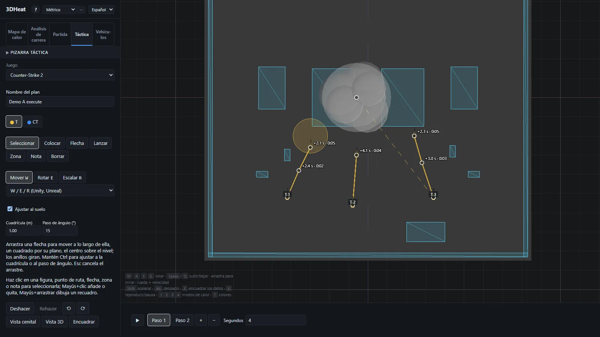

# Pizarra táctica

La pestaña **Táctica** es una pizarra de dibujo para un plan de equipo: pones
pequeñas figuras sobre un mapa, dibujas flechas de hacia dónde van y pulsas
reproducir para verlo ocurrir. Úsala para planear una ronda o un ataque antes de
jugar. Comparte el lienzo, la cámara y el [nivel](levels.md) con las otras
pestañas, y nada más; un plan no son datos y no dibuja calor.

## Tu primer plan {#your-first-plan}

1. Abre la pestaña **Táctica**. Elige el **Juego** (por ejemplo Counter-Strike 2)
   y, para Valorant, pulsa **Cargar mapas de Valorant** y elige un **Mapa**. O
   carga antes un [nivel](levels.md).
2. Elige un **Bando** (define el color) y pulsa **Vista cenital**.
3. Elige **Lugar**, escoge una figura en **Figuras** (usa **Buscar figuras** para
   encontrar una) y haz clic en el mapa. Coloca dos o tres.
4. Elige **Flecha**, haz clic en una figura, haz clic en el camino que debe
   seguir y pulsa **Enter** para terminar la flecha.
5. Pulsa **+** bajo la vista para añadir el paso 2. Cada figura empieza donde
   terminó su flecha. Dibuja más flechas allí.
6. Pulsa **▶** (o `K`) para reproducir el plan desde el paso mostrado hasta el
   final.
7. Pon un nombre al plan en **Nombre del plan** y pulsa **Guardar**.

## Empezar un plan {#starting-a-plan}

| Control | Qué hace |
|---|---|
| **Juego** | Elige los bandos y las figuras que ofrece la paleta: Counter-Strike 2 (T, CT; jugadores y utilidades), Valorant (Atacantes, Defensores; jugadores y habilidades genéricas), Battlefield, Squad, Arma (infantería, vehículos terrestres, aeronaves, barcos), DCS / War Thunder / IL-2 (cazas, aviones de hélice, helicópteros, defensa antiaérea, tierra, barcos, armas) y Otro. Un plan que ya tiene figuras conserva sus bandos cuando cambias de juego. |
| **Nombre del plan** | El nombre con el que se guarda el plan. |
| **Mapa**, **Cargar mapas de Valorant** | Con Valorant elegido: **Cargar mapas de Valorant** obtiene la lista de mapas de [valorant-api.com](https://valorant-api.com); **Mapa** pone entonces el minimapa del mapa elegido como nivel, encuadrado desde arriba. La imagen se descarga al elegirla y nunca se incluye en el programa. El aviso de Riot se muestra mientras está en pantalla (véase más abajo). |
| **Bando** | El bando al que pertenece la siguiente figura, flecha o área; toma el color del bando. |

Sin nivel, la pizarra es el plano liso del suelo. Carga un nivel en **Nivel**
para planear sobre un mapa real: un mapa de CS2 exportado con la herramienta de
CS2, un nivel de la biblioteca o una imagen de mapa.

## Herramientas {#tools}

| Herramienta | Clic | Notas |
|---|---|---|
| **Seleccionar** | Una figura, un punto de paso, una flecha, un área o una nota la selecciona. | Mayús+clic añade o quita; Mayús+arrastrar dibuja un recuadro alrededor de lo que se añade. La selección obtiene un control de transformación (véase más abajo); `Delete` o `Backspace` la borra. `M` mueve la figura seleccionada al siguiente clic. |
| **Lugar** | Coloca la figura elegida. | La figura se elige en la paleta **Figuras** (con **Buscar figuras**). Sin nada seleccionado, `R` gira la siguiente figura 15° antes de colocarla (`Mayús+R` en sentido contrario). |
| **Flecha** | Cada clic añade un punto; Enter, un doble clic o un clic derecho la terminan; Esc la descarta. | **Mover**, **Atacar** (punta más ancha) o **Vigilar** (una línea fina a la altura de los ojos). Una flecha que empieza en una figura es la ruta de esa figura en este paso: al reproducirse, la figura la recorre, y el paso siguiente empieza donde terminó. |
| **Lanzar** | El lanzador, y luego dónde cae. | Un arco discontinuo entre uno y otro, y la utilidad elegida (humo, destello, molotov, ...) aparece donde cae y permanece desde este paso en adelante. |
| **Área** | El centro, y luego el borde. | Un disco en el color del bando. |
| **Nota** | Dónde va la nota; pide su texto. | Se muestra como un alfiler, y su texto encima. |
| **Borrar** | Una figura, flecha, área o nota. | La quita desde este paso en adelante; en su primer paso, la quita del todo. |

**Deshacer** y **Rehacer** (`Ctrl+Z`; `Ctrl+Y` o `Ctrl+Mayús+Z`) recorren cada
cambio. Una línea bajo el plan muestra cuántas figuras, flechas y pasos tiene.
**Vista cenital** mira directamente hacia abajo (ortográfica), **Vista 3D** vuelve
a la perspectiva, **Fotograma** encuadra el plan, o el nivel cuando el plan está
vacío.

**Tamaño de figura** escala todas las figuras de la pizarra; 1× es el tamaño real,
que desde muy arriba son unos pocos píxeles para una persona.

## Mover, girar y escalar {#moving-turning-and-scaling}

Todo lo de la pizarra se puede mover como en un editor 3D: figuras, utilidades,
marcadores, puntos de paso sueltos y flechas completas, áreas y notas. Lo
seleccionado obtiene un control en su centro:

| Modo | Teclas | Asas |
|---|---|---|
| **Mover** | W (o G) | Una flecha por eje (X rojo, Y verde y hacia arriba, Z azul) se mueve a lo largo de él; un cuadrado se mueve en su plano; el centro se mueve sobre el nivel bajo el puntero. |
| **Rotar** | E (o R) | Un anillo por eje gira alrededor de él. Los anillos de una figura sola son su guiñada, cabeceo y alabeo; un grupo gira alrededor de los ejes del mundo, en torno a su centro. |
| **Escalar** | R (o S) | Separa o junta la selección desde su centro a lo largo de un eje o en todas direcciones; el radio de un área crece con ella. |

**Claves** cambia entre W / E / R (Unity, Unreal) y G / R / S (Blender); las teclas
eligen el modo solo cuando algo está seleccionado, y mueven la cámara en caso
contrario. Así, `R` significa **Escalar** con las teclas W / E / R y **Rotar** con
las teclas G / R / S cuando hay algo seleccionado, y gira la siguiente figura a
colocar cuando no lo hay. Todas las teclas de la pizarra están en la [referencia
de teclado](keyboard-reference.md#tactics-board). Mantén **Ctrl** mientras arrastras
para ajustar un movimiento a la **Cuadrícula** (metros) o un giro al **Paso de
ángulo**. **Ajustar al suelo** (activado por defecto) pone a las personas,
vehículos, marcadores, puntos de paso y áreas movidos sobre la superficie del
nivel; los aviones y helicópteros mantienen su altura, y un arrastre a lo largo de
la flecha Y nunca se ajusta. Arrastrar un asa nunca mueve la cámara. **Esc** cancela
un arrastre, y cada cambio es un paso de Deshacer.

Los puntos de paso se muestran como puntos sobre las flechas del paso mostrado:
haz clic en uno para seleccionarlo, arrástralo para moverlo, pulsa Delete para
quitarlo. La sección **Seleccionadas** muestra el lugar de la selección en metros,
la guiñada, el cabeceo y el alabeo de una figura en grados y el radio de un área,
cada uno para escribirlo.

## Cronometraje {#timing}

La ruta de una figura tiene tiempo: cada tramo tarda su longitud sobre el nivel -
muestreada sobre la superficie cada un par de metros, así que una colina o unas
escaleras entre dos puntos cuentan - a la velocidad del **modo** de movimiento de
esa figura en ese juego, más cualquier **espera** en un punto de paso. La
infantería se arrastra, se agacha, camina (en silencio), corre o sprinta; los
vehículos y barcos se arrastran, van con cautela, normal o a toda prisa; los
aviones y helicópteros vuelan lento, de crucero, en velocidad de combate o al
máximo. Un modo que el juego no tiene (CS2 no tiene sprint) toma el más cercano
que sí tiene. Cómo frena una pendiente depende del juego: en CS2 y Valorant solo
cuenta la distancia horizontal, como en los juegos; los simuladores militares
frenan a la infantería cuesta arriba (la función de caminata de Tobler) y a los
vehículos según la pendiente.

Las velocidades salen de tablas por juego con sus fuentes (véase [Velocidades de
movimiento](tactics-speeds.md)): CS2 según el arma empuñada, tomada de las
definiciones de armas del juego; Valorant según el arma; Battlefield, Squad, Arma
y los juegos aéreos según el tipo y la clase del vehículo. **Se mueve como** elige
el perfil de una figura (un arma, un tipo de vehículo); **Propia (m/s)** sustituye
cualquier modo para esa figura. Los modos se nombran como los muestra la pizarra:
*Arrastrarse*, *Agachado*, *Caminar (silencioso)*, *Correr*, *Sprint*; *Cautela*,
*Normal*, *Prisa*; *Lento*, *Crucero*, *Combate*, *Máximo*.

Cada punto de paso muestra el tiempo desde el anterior y el tiempo desde el inicio
del plan ("+3,9 s · 0:12"). La ruta de la figura seleccionada enumera cada tramo
con su modo, longitud y tiempo, la espera y la llegada. **Llegadas** bajo
**Cronometraje** pone cada figura con ruta en una sola línea de tiempo, la primera
llegada arriba. Con **Reproducir en tiempo real** (activado por defecto), un paso
dura hasta que llega la ruta más lenta y cada figura se mueve a su propia velocidad;
**Segundos** es entonces la duración mínima del paso. **Unidades del nivel por
metro** indica en qué unidades está el nivel: 39,37 para los mapas de CS2 (unidades
del juego), 1 para los mapas en metros.

## Comparar con datos de partidas {#compare-with-match-data}

**Cargar archivos de partida…** lee las tablas de partidas de CS2 del mapa (los
archivos Parquet de la herramienta de CS2, tantos como se quiera; solo las columnas
necesarias, en segundo plano); **Usar datos cargados** toma los datos cargados en
el visor. Entonces:

- **Llegada más temprana en el mapa** colorea el mapa según el tiempo desde el
  inicio de la ronda en que un jugador llegó por primera vez a cada punto - el
  botón **Más rápido** muestra el más veloz de todas las rondas, **Típico
  (mediana)** la ronda del medio - de verde temprano a rojo tarde, para un bando o
  para los dos. Muestra lo que es posible y cuándo.
- La ruta seleccionada se compara con lo que lograron los jugadores desde su inicio
  (o desde el inicio de la ronda) hasta su final, cada final como un disco del radio
  elegido: "Más rápido observado 14,2 s, p10 15,0 s, mediana 18,3 s en 41
  recorridos; tu plan 15,1 s".
- Las velocidades a las que se movieron realmente los jugadores - corriendo,
  caminando, agachados, de las columnas de caminar y agacharse de las tablas - en
  m/s.

## Pasos {#steps}

La barra bajo la vista contiene los pasos. Un plan empieza con uno; **+** añade
uno, y cada figura empieza en él donde terminó su ruta en el último paso; **−**
quita el que se muestra. **Segundos** es cuánto dura el paso mostrado al
reproducirse. **▶** (K) reproduce desde el paso mostrado hasta el final: las
figuras con ruta la recorren, las figuras movidas a un nuevo lugar en el paso
siguiente se deslizan hasta allí, y el resto se queda quieto. Mientras se muestra
un paso, el lugar de cada figura en el paso siguiente se dibuja como un fantasma
tenue, y las flechas del último paso aparecen levemente bajo las de este.

## Guardar {#saving}

La sección **Archivo** tiene **Guardar**, **Open** y **Vaciar**. **Guardar** escribe
el plan como `<nombre>.h3dplan.json` (JSON sencillo: bandos, pasos, figuras con un
lugar por paso, flechas, áreas, notas); **Open** lo vuelve a leer. Un archivo de
otra versión, o que no es un plan, se rechaza indicando el motivo. **Vaciar**
deja el plan vacío; Deshacer lo devuelve.

## Figuras {#figures}

Cada figura la construye el propio visor: formas sencillas a la medida publicada de
un tipo, con los rasgos que lo distinguen de sus vecinos - las ruedas de rodadura y
la torreta de un tanque, los cañones, misiles y radares de un vehículo de defensa
antiaérea, el perfil de ala, la cola y los motores de un avión, los rotores y las
alas cortas de un helicóptero. Nada se toma de un juego. Un diseño que inventó un
juego se muestra como la figura genérica de su clase. Véase [Figuras](figures.md#which-figure-a-unit-gets)
para saber cómo los datos encuentran su figura.

## Aviso de Riot {#riots-notice}

Los mapas de Valorant se muestran bajo la política "Legal Jibber Jabber" de Riot
Games, que permite a los proyectos comunitarios gratuitos usarlos y pide este aviso
dondequiera que aparezcan: *3DHeat se creó bajo la política "Legal Jibber Jabber"
de Riot Games, con recursos propiedad de Riot Games. Riot Games no respalda ni
patrocina este proyecto.* Las habilidades de la pizarra son formas genéricas, no
el arte de Riot.
