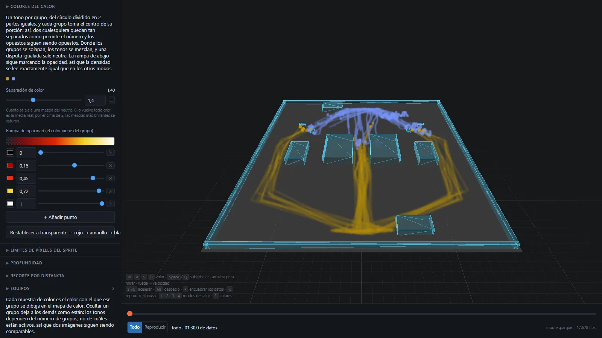

# Calor por equipo

El calor por equipo muestra dónde estuvo cada equipo, cada uno en su propio color. Donde los equipos se solapan, los colores se mezclan.

**Calor por equipo** (tecla 3) es el campo de densidad de [Calor](heat.md) con cada [grupo](glossary.md) con su propio tono. Donde los grupos se solapan, sus tonos se mezclan; un enfrentamiento parejo sale neutro. La opacidad sigue llevando la densidad exactamente igual que en los demás modos, así que la imagen responde a *cuánto* y *de quién* a la vez. Necesita una columna de grupo.

No es la [superposición de figuras](box-replay.md): esta dibuja una figura por persona; esto es un campo de calor coloreado por la misma columna.

## Cómo se usa {#how-to-use-it}

1. Pulsa `3` (o elige **Calor por equipo** en la barra de modos).
2. Abre **Colores del calor**. Las muestras indican el color de cada grupo; pasa el ratón sobre una muestra para ver el nombre del equipo.
3. Si todo se ve gris, sube la **Separación de color**.
4. Desmarca un grupo en la [lista de Equipos](teams-list.md) para quitarlo; los demás colores se quedan donde estaban.

## Controles {#controls}

En la sección **Colores del calor**:

| Control | Por defecto | Significado |
|---|---|---|
| Muestras | | El color de cada grupo, para los primeros 12 grupos; después *+N más*. Pasa el ratón para ver el nombre del grupo y el color. |
| **Separación de color** | 1,4 | Cuánto se aleja una mezcla del neutro, 0-4. 0 deja todo gris; 1 es el promedio real; por encima de unos 2 las mezclas más brillantes salen del rango visualizable y se recortan por canal, lo que desplaza su tono. |
| **Rampa de opacidad (el color viene del grupo)** | la rampa de calor por defecto | Aquí solo se usa el **alfa** de la rampa: transparente donde no hay nada, opaco arriba. Sus colores se ignoran. |

Todos los demás controles de calor - forma, saturación, respuesta, calor mínimo, profundidad, recorte - funcionan como en [Calor](heat.md).

La [lista de Equipos](teams-list.md) muestra en este modo el color de calor por equipo de cada grupo como su muestra. Ocultar un grupo deja el color de los demás donde estaba: los tonos vienen del número total de grupos, no de lo que esté activado, así que dos imágenes siguen siendo comparables.

## La paleta {#the-palette}

De [`colors.ts`](https://github.com/Holdi601/3DHeat/blob/main/src/render/colors.ts):

- Los colores viven en el **plano de color Oklab** con luminosidad fija (0,7) y croma fijo (0,115), así que cada grupo tiene el mismo brillo y un grupo rojo no parece más caliente que uno azul.
- Con *n* grupos, el círculo de tonos se divide en *n* partes iguales, y el grupo *i* toma el **centro** de su parte, `(i + 0,5) / n` de vuelta. Dos grupos cualesquiera están tan separados como permite el número, y los opuestos siguen opuestos sea cual sea el número.
- Se usan como máximo **16** tonos distintos. Con más grupos, los ids se colocan por mitades sucesivas (ids con los bits invertidos: 0, ½, ¼, ¾, ⅛, …) para que los ids vecinos no compartan tono; los grupos a partir del 16 necesariamente comparten.
- Un grupo cuya etiqueta significa «sin grupo» - `0`, vacío, `none`, `unknown`, `null` o `-1`, sin distinguir mayúsculas - se dibuja **gris neutro** en lugar de tomar una porción del círculo. Solo se trata así la primera etiqueta de ese tipo de la lista de grupos.

La separación por defecto es 1,4 y no 1 porque, con 1, una mezcla de cinco tonos repartidos por igual *es* gris: correcto e ilegible. Un poco por encima de 1 mantiene honestos los empates y hace visible un reparto 60/40.

## Cómo funciona {#how-it-works}

El destino de calor tiene cuatro canales en este modo. Cada sprite suma su densidad *v* al primer canal y *v* × las coordenadas Oklab *a* y *b* del grupo al segundo y al tercero. Al componer, la mezcla del píxel es el promedio ponderado por densidad: *a* = G / R, *b* = B / R, escalado por la separación de color y convertido a sRGB con la luminosidad de la paleta. Dividir por la densidad acumulada mantiene el tono independiente de cuántos datos haya, y por eso todos los controles de densidad siguen actuando solo sobre la opacidad.

El destino de cuatro canales cuesta cuatro veces la memoria de GPU del destino de calor de un solo canal con la misma resolución.
