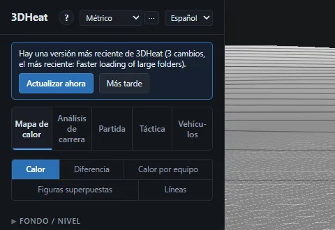

# Actualizaciones

El visor te avisa cuando existe una versión más nueva, y se actualiza solo cuando tú lo confirmas. Nada se cambia en tu equipo sin tu respuesta.

## Actualizar el visor {#update-the-viewer}

1. **En la página.** Cuando existe una versión más nueva, aparece un cuadro debajo del nombre, en la parte superior de la barra lateral: «Hay una versión más nueva de 3DHeat disponible». Pulsa **Actualizar ahora**. La página se recarga sola al terminar. **Más tarde** oculta el cuadro hasta que recargues la página.
2. **Si dice que ejecutes restart.bat**, cierra la ventana del servidor (la ventana negra que abrió `start.bat`) y haz doble clic en `restart.bat`.
3. **Al iniciar el visor.** `start.bat` también comprueba. Si existe una versión más nueva pregunta **Update now? [Y/N]** (el script está en inglés). Pulsa `Y` para actualizar. Pulsa `N`, o espera 60 segundos sin responder, para iniciar la versión que tienes.



Una copia con cambios propios nunca se actualiza por ti; el cuadro solo indica que hay una actualización esperando, y pide confirmar o guardar tus cambios (commit o stash) y ejecutar `git pull`. Una copia que no se instaló con git (un archivo zip, por ejemplo) no muestra nada.

Cómo funciona la comprobación, paso a paso:

```
página ---(tras 4 s, y luego cada 6 h)---> servidor de desarrollo ---> git fetch
   ¿atrasada?  no  -> no se muestra nada
               sí  -> ¿tus cambios o commits propios?  sí -> solo te avisa
                                                       no -> [Actualizar ahora] -> git pull
                                                             -> recargar, o "ejecuta restart.bat"
```

## Las reglas de seguridad {#the-safety-rules}

- **Solo avance rápido** (`git pull --ff-only`): una actualización nunca fusiona, rebasa ni reescribe nada.
- **Sin cambios locales**: una copia con cambios sin confirmar en archivos controlados (`git status --porcelain --untracked-files=no` no vacío) nunca se actualiza automáticamente - el trabajo de alguien no es algo que una actualización deba sobrescribir. Solo se le indica que hay una actualización esperando. Los archivos sin controlar (datos, exportaciones) no cuentan como cambios.
- **Sin commits locales**: una copia con commits que el origen no tiene («divergida») no se actualiza - un avance rápido no puede llevarla, y fusionar es tarea de `git pull` a mano. La página y `start.bat` lo dicen con las mismas palabras, y `start.bat` inicia la versión que hay allí.
- **Solo desde la propia página**: la petición de actualización del servidor de desarrollo debe llevar una cabecera personalizada y, cuando el navegador envía un `Origin`, venir del propio host del servidor (véase abajo).
- Solo se actualiza una copia de git con una rama de origen; cualquier otra cosa (una copia sin `.git`, sin git instalado, una versión estática) se deja en paz y no dice nada.

## Qué hace start.bat {#what-startbat-does}

`start.bat` (haz doble clic; la ventana es el servidor) hace, en orden:

1. Busca Node.js - en `PATH`, o en `%ProgramFiles%\nodejs`, `%ProgramFiles(x86)%\nodejs` o `%LOCALAPPDATA%\Programs\nodejs` - y ofrece instalarlo con `winget install -e --id OpenJS.NodeJS.LTS` cuando falta (se pregunta, Y/N; después hay que reabrir la ventana para que Windows tome el nuevo `PATH`).
2. **Actualizaciones**, cuando git está instalado y la carpeta tiene `.git`:
   - `git fetch --quiet` (sin red o sin origen: se omite en silencio);
   - cuenta `git rev-list --count HEAD..@{u}`; nada atrasado: no dice nada;
   - cambios locales: muestra «A newer version of 3DHeat is available (N changes), but this copy has local changes, so it is not updated. Commit or stash them, then run git pull.» - y arranca la versión que hay;
   - commits propios (`git rev-list --count @{u}..HEAD` distinto de 0): muestra «A newer version of 3DHeat is available (N changes), but this copy has commits of its own that the newest version does not, so it is not updated. Update it with git pull.» - y arranca la versión que hay;
   - en otro caso, «A newer version of 3DHeat is available (N changes).» y la pregunta **Update now? [Y/N]**. `N`, o no responder en 60 segundos, imprime «Not updated; starting the version you have.» y arranca la versión que hay. Con `Y`: «Updating...», indica si cambian `package.json` o `package-lock.json`, ejecuta `git pull --ff-only` (si aun así falla - por la red, por ejemplo: «The update did not go through; starting the version you have.»), después `git submodule update --init` (las herramientas fijadas, véase [Mantenimiento de la documentación](maintaining.md#the-tools-under-exporters)), luego `npm install` cuando cambian los archivos del paquete y existe `node_modules`, y «Updated.»
3. Se niega a iniciar un segundo servidor: cuando algo ya escucha en el puerto **5273** lo indica y remite a `restart.bat` / `stop.bat`.
4. En la primera ejecución (sin `node_modules`), pregunta antes de descargar las dependencias (unos 300 MB en `node_modules\`, nada en todo el sistema).
5. Inicia el servidor de desarrollo en `127.0.0.1:5273` (`--strictPort`) y abre el navegador cuando está listo.

`restart.bat` detiene el servidor (por puerto) y vuelve a ejecutar `start.bat`, así que hace la misma pregunta. `stop.bat` solo lo detiene.

## Para desarrolladores {#for-developers}

### Mientras se ejecuta: la ruta de actualización {#while-it-runs-the-update-route}

El servidor de desarrollo (el plugin de Vite `heat3d-self-update` en `vite.config.ts`) sirve `/__heat3d/update`. Solo existe en el servidor de desarrollo: no en una versión estática ni en `vite preview`.

**`GET /__heat3d/update`** responde si la copia va atrasada:

```json
{ "checkout": true, "upstream": "origin/main", "behind": 3, "ahead": 0, "dirty": false, "latest": "the newest commit's subject" }
```

- `checkout: false` cuando la carpeta no es una copia de git;
- ejecuta `git fetch --quiet` **como máximo cada 30 minutos** (las consultas intermedias responden con lo último que se trajo);
- `behind` / `ahead` salen de `git rev-list --count HEAD..@{u}` / `@{u}..HEAD`, `dirty` de `git status --porcelain --untracked-files=no`, `latest` es el asunto del commit más reciente del origen;
- sin rama de origen, `upstream: null` y `behind: 0`.

**`POST /__heat3d/update/apply`** pone la copia al día:

1. Rechazado con `403 { ok: false, reason: "forbidden" }` salvo que la petición lleve la cabecera `X-Heat3d-Update: 1` y, cuando trae un `Origin`, que el host de ese origen sea el `Host` de la petición. Un formulario de otro sitio no puede enviar una cabecera personalizada sin una comprobación previa de CORS, y este servidor nunca la concede.
2. Nada que hacer (no es una copia, no hay origen, no está atrasada): `{ ok: true, updated: false }`.
3. Cambios locales: `{ ok: false, reason: "dirty" }`; commits locales: `{ ok: false, reason: "diverged" }`.
4. Si no, anota los archivos que cambian (`git diff --name-only HEAD @{u}`), ejecuta `git pull --ff-only` (límite de 2 min), `git submodule update --init` (los fallos se ignoran), `npm install` cuando cambian `package.json` o `package-lock.json` (límite de 15 min), y responde `{ ok: true, updated: true, restart }`. `restart` indica por qué el servidor en marcha no puede recoger la actualización: `"dependencies"` cuando se reinstalaron las dependencias, `"config"` cuando solo cambió un archivo `vite.config`, y `false` cuando no hace falta reiniciar.
5. Un comando de git o de npm que falla responde `{ ok: false, reason: "<el error, hasta 300 caracteres>" }`.

Las respuestas son JSON con `Cache-Control: no-store`. El servidor escucha solo en `127.0.0.1`, así que la ruta no es accesible desde la red.

### El aviso en la página {#the-notice-in-the-page}

`UpdateBanner`, debajo del nombre en la parte superior de la barra lateral:

- Pregunta a la ruta **4 segundos** después de cargar la página (no en los primeros segundos: la página tiene un conjunto de datos que cargar y una GPU que iniciar) y de nuevo **cada 6 horas** mientras la página siga abierta.
- No muestra **nada** cuando no existe esa ruta (una versión estática), la carpeta no es una copia de git o nada es más reciente: un aviso en cada inicio es algo que la gente aprende a ignorar.
- Atrasada, sin cambios locales: «Hay una versión más reciente de 3DHeat (N cambios, el más reciente: asunto).», con **Actualizar ahora** y **Más tarde** (*Más tarde* oculta el aviso hasta recargar la página).
- Atrasada, con cambios locales: la misma frase y «Esta copia tiene cambios locales, así que no se actualiza automáticamente; haz commit o stash de ellos y luego ejecuta git pull.», sin botón.
- **Actualizar ahora** envía la petición a `/apply` («Actualizando…»). Después:
  - «Actualizado. La página se recarga.», y recarga 1,5 s después (el servidor ya sirve los archivos nuevos);
  - cuando se reinstalaron las dependencias: «Actualizado. Sus dependencias cambiaron: cierra la ventana del servidor y ejecuta **restart.bat** para terminar.»;
  - cuando solo cambió la configuración del servidor: «Actualizado. La configuración del servidor cambió: cierra la ventana del servidor y ejecuta **restart.bat** para terminar.»;
  - si al final no hay nada que traer (`updated: false`: la copia se puso al día entretanto, por ejemplo con `start.bat`): «Nada que actualizar: esta copia ya es la versión más reciente.», y sin recargar;
  - rechazado: la frase de *cambios locales*, o «Esta copia tiene commits propios que la versión más reciente no tiene; actualízala con git pull.», o «La actualización no se completó: <motivo>».
