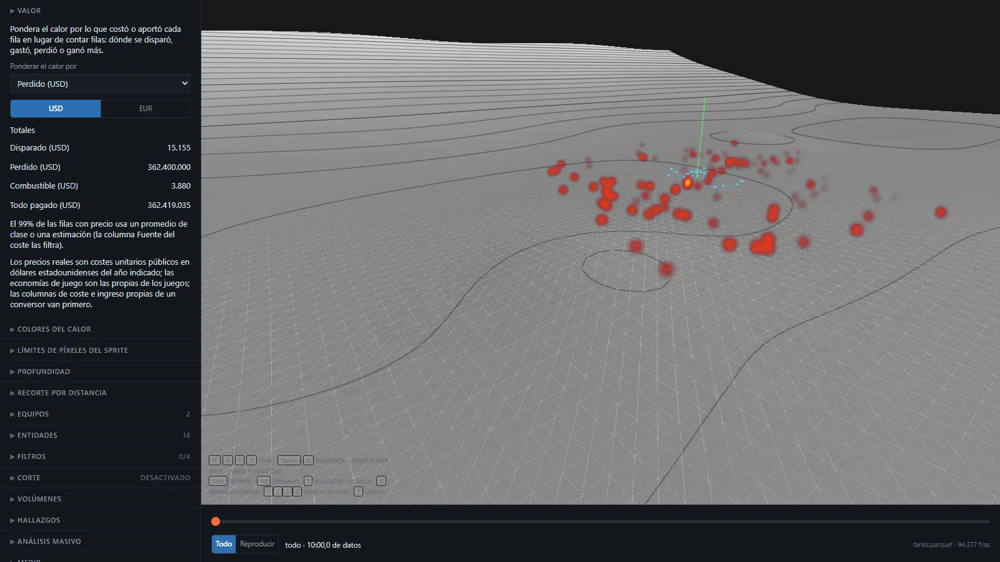

# Ponderación de valores

Cada disparo, munición, vehículo perdido y litro de combustible tiene un precio. El visor calcula cuánto costó o cuánto ganó cada fila, y puede ponderar el calor por ello, así que el mapa muestra **adónde fue el dinero** en lugar de dónde están las filas.

## Cómo se usa {#how-to-use-it}

1. Cargue datos con eventos (disparos, muertes, bajas) y nombres de vehículos o armas.
2. Abra **Valor** en la barra lateral de Calor.
3. Elija **Ponderar el calor por**, por ejemplo *Perdido (USD)*. Ahora el calor suma el precio de cada fila en lugar de 1.
4. Lea **Totales**: la suma de cada columna de valor para lo que se muestra (se aplican los filtros y la ventana de tiempo).
5. Cuando los precios son dinero real, aparece un interruptor **USD / EUR**.

Elija la primera entrada en blanco del menú para volver a contar filas.

## Qué se puede ponderar {#what-can-be-weighed}

Las columnas de valor se añaden al cargar, una por tipo y moneda:

| Tipo | Filas en las que cae | Cómo se valora |
|---|---|---|
| **Disparado** | disparos y lanzamientos | el arma; si no, un promedio para el tipo de munición |
| **Gastado** | compras, apariciones | columnas de dinero del juego (por ejemplo, el menú de compra de un shooter) |
| **Perdido** | muertes, destrucciones | el vehículo propio; si no, el promedio de su clase |
| **Destruido** | bajas | el vehículo objetivo |
| **Daño causado** | impactos | una parte del valor del objetivo |
| **Combustible** | posiciones | combustible usado, de una columna de combustible o estimado a partir de la clase y el tiempo |
| **Todo pagado** | | disparado + gastado + perdido + combustible |
| **Ganado** | recompensas | las columnas de recompensa propias del juego (`earn_…`) |
| **Neto** | | ganado menos pagado; se dibuja como calor con signo (rampa positiva donde se ganó más, negativa donde se pagó más) |

Los nombres de columna son `cost_<tipo>_<moneda>`, `earn_<moneda>` y `net_<moneda>`. Un convertidor que conoce la moneda propia del juego (por ejemplo, un convertidor de repeticiones que escribe en créditos del juego) prevalece sobre las tablas de precios integradas.

## Las tablas de precios {#the-price-tables}

| Tabla | Moneda |
|---|---|
| Militar real: misiles, bombas, munición, contramedidas, aviones, helicópteros, vehículos terrestres, buques, combustible | USD (EUR = USD × 0,92, el `EUR_PER_USD` fijo de [`cost.ts`](https://github.com/Holdi601/3DHeat/blob/main/src/data/cost.ts); no es un tipo de cambio en vivo) |
| Menús de compra de shooters y recompensas por baja | los créditos del juego |
| Juegos de tanques y de barcos | los créditos del juego |
| Juegos de estrategia (varios recursos) | una columna por recurso más una combinada |
| Juegos de guerra | puntos |

El juego se reconoce por los nombres de los datos. Los precios reales vienen de fuentes públicas (documentos presupuestarios, enciclopedias) o se marcan como estimaciones; no están ajustados por inflación. La lista generada de tablas está en [Tablas de valores](ref-value-tables.md).

## Estimaciones {#estimates}

La columna de categoría adicional **Fuente del coste** indica cómo se valoró cada fila: `table`, `class average`, `estimate` o `none`. La sección Valor muestra qué proporción de las filas valoradas son promedios o estimaciones. Para quedarse solo con las filas valoradas exactamente, desmarque *estimate* y *class average* en **Fuente del coste** en [Filtros](filters.md).

## Dónde más aparece el valor {#where-else-value-shows}

- [Hallazgos](insights.md): los hallazgos *Costly ground* y *Earning ground*.
- [Desglose](breakdown.md): Ganado, Perdido y Neto por equipo, jugador o arma.
- [Volúmenes y comparación](volumes.md): columnas de valor en las estadísticas y en la comparación.
