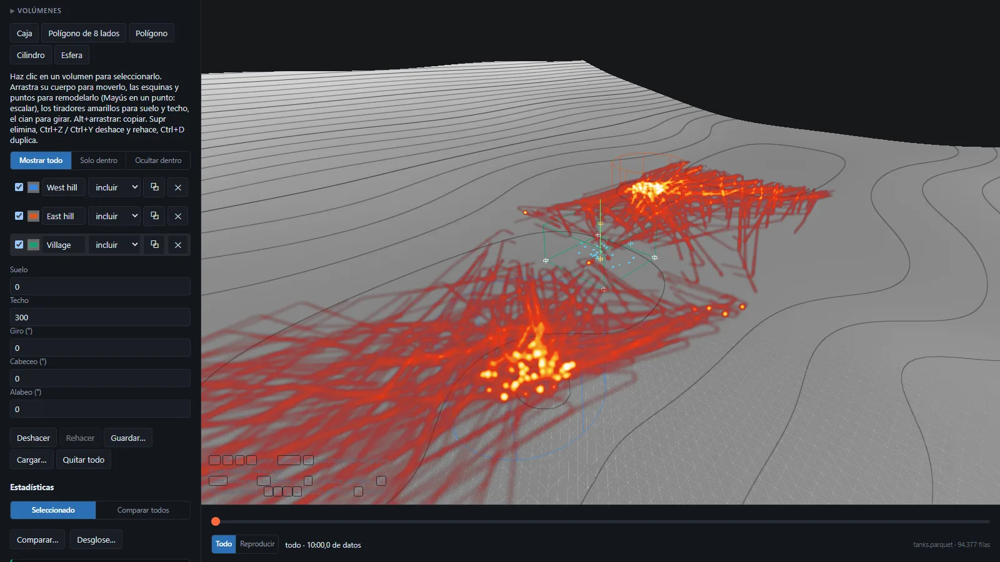
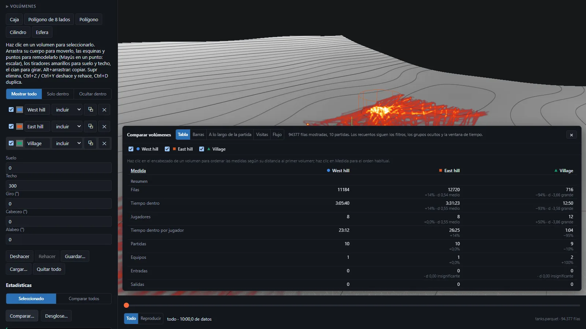
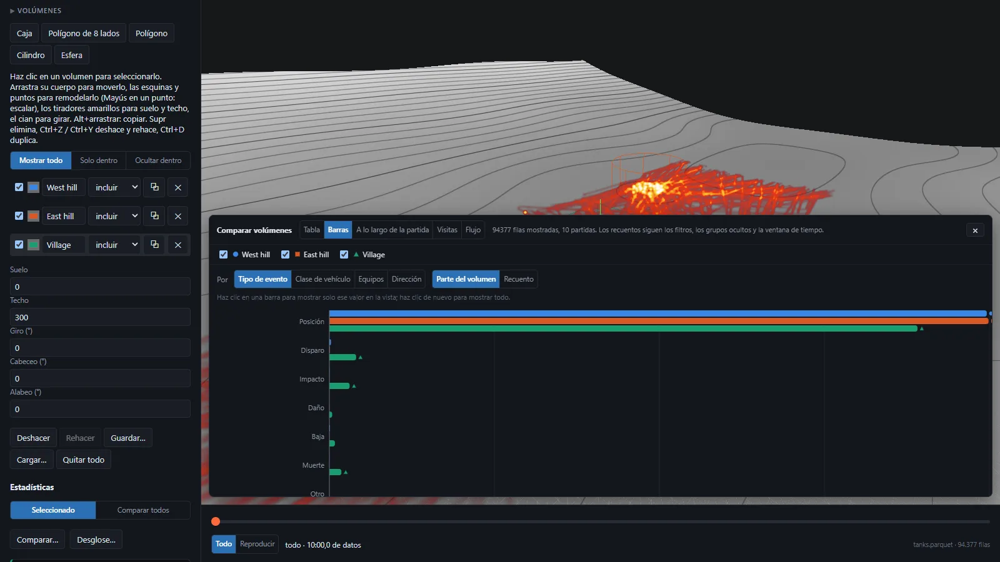

# Volúmenes y comparación

Un **volumen** es una caja invisible (o un cilindro, o una esfera) que dibujas alrededor de un lugar, para preguntar: ¿qué pasó aquí dentro? Úsalo para contar bajas en un puente, para comparar dos colinas, o para mostrar solo la actividad de una zona.

```
 vista desde arriba       Dibujas una forma ->  el visor cuenta
 +------------+           lo que hay dentro:
 |   ( A )    |            filas, jugadores, bajas, tiempo ...
 |        [B] |           Compara A con B, uno al lado del otro.
 +------------+
```



Los volúmenes miden lo que pasa dentro, filtran la vista hasta ellos, exportan sus filas y pueden compararse uno al lado del otro. Véase también el [glosario](glossary.md) para fila, persona y partida.

## Dibujar un volumen {#draw-a-volume}

1. Abre **Volúmenes** en la barra lateral.
2. Elige una herramienta y dibuja en la vista 3D o en el mapa 2D. El suelo y el techo parten de los datos de debajo. Esc cancela.
3. Pulsa el volumen para seleccionarlo; aparecen sus **Estadísticas**.

| Herramienta | Cómo se dibuja |
|---|---|
| **Caja** | Arrastra un rectángulo (Shift: un cuadrado). Un clic coloca una caja por defecto. |
| **n-gon** | Arrastra desde el centro (Shift lo mantiene regular). *Esquinas* fija n, de 3 a 64 (por defecto 8, así que el botón dice **8-gon**). |
| **Polígono** | Pulsa las esquinas; cierra con doble clic, Enter o un clic en la primera esquina. Backspace elimina la última esquina. |
| **Cilindro** | Arrastra el radio. |
| **Esfera** | Arrastra el radio; descansa sobre el suelo. |

## Editar {#edit}

- Pulsa un volumen para seleccionarlo. Arrastra su cuerpo para moverlo, las esquinas para cambiar su forma (Shift sobre una esquina escala).
- Los tiradores **amarillos** fijan suelo y techo, el tirador **cian** lo gira.
- Alt + arrastrar copia, Del elimina, Ctrl+Z / Ctrl+Y deshacen y rehacen, Ctrl+D duplica. **Quitar todo** borra todos los volúmenes.
- Valores exactos: Suelo, Techo, Giro / Cabeceo / Alabeo (cajas), Radio (esferas, cilindros).

Cada fila de volumen tiene una casilla de mostrar, un color, un nombre, **incluir** o **excluir**, duplicar y eliminar. Los volúmenes se guardan en el navegador para cada conjunto de datos, y **Guardar…** / **Cargar…** escriben y leen un archivo `volumes.json`.

## Filtrar la vista {#filter-the-view}

| Filtro | Efecto |
|---|---|
| **Mostrar todos** (por defecto) | Los volúmenes solo miden. |
| **Solo dentro** | El calor, la repetición y el [análisis de impactos](hit-analysis.md) dibujan solo lo que está dentro de los volúmenes incluidos y fuera de los excluidos. |
| **Ocultar dentro** | Lo contrario. |

El filtro de GPU admite hasta 8 volúmenes con 64 puntos de contorno en total; una «!» marca un volumen que lo supera. Las estadísticas y la exportación lo siguen contando.

## Estadísticas {#statistics}

El área de **Estadísticas** sigue los filtros, la ventana de tiempo y los grupos ocultos. *Seleccionado* muestra el volumen elegido, *Comparar todos* pone cada volumen uno al lado del otro. Muestra:

- **Filas dentro (mostradas)** y **Filas dentro (todos los datos)**, **Jugadores**, **Equipos**, **Partidas**, **Tiempo dentro**, **Entradas / salidas**, **Calor máximo**, **Calor medio**, **Volumen / huella** y un histograma de **Cuándo**;
- **Tasa de victoria**, cuando los datos dicen quién ganó ([columnas de resultado](data-formats.md#outcome-columns)): de las rondas con un jugador dentro, contando la ronda de cada jugador una vez, la proporción que ganó su lado, atraída 4 rondas hacia la tasa sobre todo lo mostrado, como hace el [desglose](breakdown.md), con las rondas ganadas y jugadas y esa tasa global;
- por columna: categorías con **Lift** (proporción dentro dividida entre la proporción en todos los datos mostrados), y números con rango, mediana y percentiles 5 y 95.

**Estadísticas como CSV / JSON** las guarda. **Exportar los datos de dentro** escribe las filas de dentro en CSV o Parquet (*Solo las filas mostradas* activado por defecto), de un volumen o de todos, con una columna que indica qué volumen contiene cada fila.

## Comparar volúmenes {#compare-volumes}

Con dos o más volúmenes visibles, pulsa **Comparar…**.

1. Dibuja tres volúmenes, por ejemplo Colina oeste, Colina este y Pueblo.
2. Pulsa **Comparar…** bajo Estadísticas.
3. En **Tabla**, lee la diferencia de cada valor respecto al primer volumen.
4. Cambia a **Barras** para ver las proporciones como barras.



| Vista | Muestra |
|---|---|
| **Tabla** | Filas, tiempo dentro, jugadores, partidas, equipos, entradas, salidas, visitas, duración de visitas, bajas, muertes, bajas por muerte, bajas por minuto, tiempo por jugador, columnas de valor; agrupadas por eventos, clase de vehículo, jugador o IA, equipo y orientación. Cada valor muestra su diferencia respecto al primer volumen y un tamaño del efecto (despreciable, pequeño, mediano, grande). Pulsa el encabezado de un volumen para ordenar por distancia al primero. |
| **Barras** | Recuentos o proporciones por evento, clase, actor, equipo o dirección. Pulsa una barra para filtrar la vista hasta ella. |
| **A lo largo de la partida** | Un gráfico por volumen a lo largo de los minutos de la partida: presencia, filas o bajas. Pulsa para ir a ese momento. |
| **Visitas** | Diagramas de caja y de violín de cuánto duran las visitas (escala logarítmica). |
| **Flujo** | Adónde van las trayectorias al salir de cada volumen: una matriz de transiciones o cintas de flujo. |



## Consejos {#tips}

- Parte de un hallazgo: en [Hallazgos](insights.md), **Volumen aquí** añade un cilindro alrededor del lugar del hallazgo.
- **Desglose…** abre el [Desglose](breakdown.md) del volumen seleccionado: quién y qué funciona mejor dentro.
- El [calor direccional](directional-heat.md) puede representar las direcciones dentro del volumen seleccionado.
- La [pestaña Vehículos](hit-analysis.md#restrict-to-an-area) usa los mismos volúmenes como filtro de zona.
