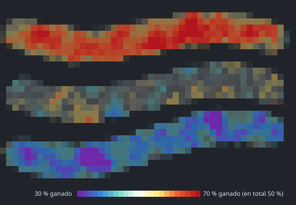

# Tasa de victoria: con qué frecuencia gana un lugar, una ruta o una jugada

Dónde se coloca un jugador, qué camino toma, dónde lanza sus granadas, y con qué frecuencia su lado gana después la ronda. El **mapa de tasa de victoria** colorea cada lugar según la proporción de las filas de ese lugar que pertenecen a rondas ganadas por el lado de la fila. La compara con la proporción sobre todo lo mostrado: cálido donde es mayor, frío donde es menor, nada donde es igual.

*La imagen muestra datos inventados: tres rutas en un nivel vacío, con el 68 %, el 50 % y el 33 % de sus filas en rondas ganadas.*

Necesita datos que digan quién ganó: las [columnas de resultado](data-formats.md#outcome-columns) (`won`, `matchWon`, `roundEndReason`). Los conversores de CS2 y War Thunder las escriben, y el conversor de Tacview para las campañas de un servidor de DCS ([Servidores de DCS](tacview-acmi.md#dcs-servers-who-won-and-how-each-sortie-ended)); cualquier archivo puede tenerlas.

## Pruébalo {#try-it}

1. Carga partidas con una columna de resultado y pulsa `2` (**Diferencia**).
2. En **División por diferencia**, pulsa **Tasa de victoria por ronda** (o **Tasa de victoria por partida**). Pone las rondas ganadas en **+** y las perdidas en **−**, y cambia el panel a **Proporción de +**.
3. Lee los colores. El panel indica la proporción global: *En total, 52,0 % de 1.200.000 filas están en +.*
4. Acótalo con los [filtros](filters.md): un lado (T o CT), un tipo de evento (*Posición* para dónde estaba la gente, *Disparo* o *Lanzamiento* para desde dónde dispararon o lanzaron), una compra, un mapa.

Un lugar cálido con filas de *Posición* es un lugar cuyos ocupantes solían ganar la ronda. Con filas de *Baja*, es un lugar donde las bajas conseguidas llevaron a rondas ganadas.

## Los ajustes {#the-settings}

| Ajuste | Qué hace | Por defecto |
|---|---|---|
| **Diferencia** / **Proporción de +** | la diferencia en sí, o la proporción del lado + entre las filas de ambos lados | Diferencia |
| **Color pleno a** | a qué distancia por encima o por debajo de la proporción global se muestra un lugar a color pleno, en puntos | ± 20 puntos |
| **Mínimo de filas para colorear un lugar** | un lugar con menos filas no se colorea; aparece gradualmente a partir de la mitad | 12 |
| **Atracción hacia la proporción global (filas)** | cada lugar empieza con este número de filas en la proporción global, para que un lugar con 3 filas, todas ganadas, no se muestre al 100 % | 12 |

Los tres actúan sobre la imagen terminada: moverlos nunca reinicia la acumulación.

La proporción sirve para cualquier división, no solo para victorias: *Proporción de +* con una división por lado muestra dónde los T eran la mayor parte de la presencia, y con una división por los archivos de dos mapas, dónde las filas de un archivo superan a las del otro.

## Filas, no rondas {#rows-not-rounds}

El mapa cuenta filas. Un jugador que se queda veinte segundos en un sitio añade una fila en cada muestra, todas de una sola ronda. Así que la evidencia en un lugar son las filas cercanas, no las rondas. Por eso el mínimo y la atracción están en filas, y por eso son mayores que lo que aporta una ronda.

Para las rondas en sí:

- **[Desglose](breakdown.md)** sobre un punto, la vista o un volumen: *Victorias %* cuenta la ronda de cada jugador una vez, atraída de la misma forma hacia la tasa global del lugar (4 rondas).
- Estadísticas de **[Volúmenes](volumes.md)**: *Tasa de victoria*, las rondas con un jugador dentro del volumen, cada una una vez, atraídas hacia la tasa sobre todo lo mostrado, con los recuentos.

## Filtros de resultado {#outcome-filters}

El panel [Filtros](filters.md) muestra las columnas de resultado justo después de las propias del visor: **Resultado de la ronda** y **Resultado de la partida** (*Todos*, *Ganada*, *Perdida*) y **Cómo terminó la ronda** (Eliminación, Bomba detonada, Bomba desactivada, Se acabó el tiempo, Rendición, Empate, Objetivo, Zonas mantenidas, Tickets perdidos, Todos los vehículos perdidos), en el idioma del visor.

## Para desarrolladores {#for-developers}

La pasada de calor escribe tres sumas en el destino de cuatro canales que usa el calor por equipo: el calor `R = Σ|v|`, el calor del lado + `P` y `S = Σ v²/w`, donde `w` es el peso de la pasada (peso de muestreo por ganancia de fotograma). La composición lee la proporción `P/R` (una media ponderada por el núcleo) y las filas en las que se apoya, `n = R²/S` (el tamaño de muestra efectivo de Kish). Atrae la proporción hacia la global, `p = (n·P/R + m·r0)/(n + m)`, y colorea `p - r0` sobre el intervalo con los degradados de la diferencia.

`n` elimina cualquier factor común a las filas de un píxel: la ganancia de fotograma, el peso de muestreo, el peso de área de un sprite limitado. Así la imagen es la misma con cualquier zoom y densidad de muestreo, y los fotogramas de una de cada k filas se unen al conjunto sin que los colores salten. La proporción global sale de los recuentos por lado de la CPU, con precisión de décimas de punto porcentual; nada se vuelve a leer de la GPU. El cálculo y sus comprobaciones: [`render/rateMap.ts`](https://github.com/Holdi601/3DHeat/blob/main/src/render/rateMap.ts) y su prueba.

Cuesta lo mismo que el calor por equipo: el destino de cuatro canales cuadruplica el ancho de banda de mezcla de la pasada de calor, solo mientras *Proporción de +* está activo.
