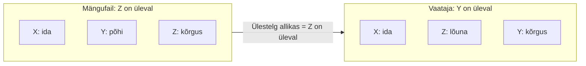

# Teljed, ühikud ja aeg

Mängud ja kaardid ei nõustu selles, mis suunas on üles, kui pikk on ühik või kuidas aega kirjutatakse. See leht näitab kolme seadet, mis panevad sinu andmed õigesti seisma, skaalale ja mängima.

Kui sinu kaart seisab nagu sein, mitte ei lamane nagu põrand, lülita **Ülestelg allikas**.

Vale **Ülestelje allika** korral seisab kaart nagu sein; õige korral lamab see nagu põrand.

## Maailm, mida vaataja joonistab {#the-world-the-viewer-draws-in}

Vaataja maailm on **Y-üles**: X ja Z on maapinna tasand, Y on kõrgus. Enamik mängumootoreid on **Z-üles**: neil on X ja Y maapinnaks ja Z on kõrgus. Mõned mootorid on ka peegelpildis (vasakukäelised). Kaardistus ütleb, kuidas faili teljed vaataja omadeks pöörata. (Tehniliselt on vaataja parempoolne, three.js konventsioon.)

### Ülestelg {#up-axis}

**Ülestelg allikas** [Veergude kaardistuses](column-mapping.md):

| Seade | Fail (x, y, z) muutub maailmaks (X, Y, Z) |
|---|---|
| *Z on üleval (enamik mängumootoreid)* - vaikimisi | (x, **z**, **y**): faili Z muutub kõrguseks ja faili Y muutub maailma Z-ks |
| *Y on üleval (graafikakonventsioon)* | (x, y, z) muutmata |

Z-üles andmete korral märgistatakse kolm massiivi ümber, selle asemel et neid kopeerida ([`remapAxesInPlace`](https://github.com/Holdi601/3DHeat/blob/main/src/data/ingest.ts)); see säästab suurte laadimiste korral sadu megabaite. Oletus tehakse proovist: üleval on see Y või Z veerg, millel on väiksem hajuvus.

### Pööramised {#flips}

**Pööra X**, **Pööra Y**, **Pööra Z** eitavad *faili* vastava nimega telge enne ümbermärgistamist - seega Z-üles korral eitab *Pööra Y* seda, mis lõpuks saab maailma Z-ks. Pööramine muudab laetud andmeid: [mõõdiku](measure.md), lõike ja kaamera asukoha koordinaadid on pööratud.

Et joonistada peegelpildis maailm õigesti **ilma andmeid muutmata**, kasuta selle asemel **Kaamera ja stseen → Pööra maailmatelg** ([Kaamera](camera.md#invert-world-axis)). See on parem valik mängudele, mille maailm on vasakukäeline, sest iga koordinaat, mida tööriistad näitavad, jääb mängu enda omaks.

### Ühikuskaala {#unit-scale}

**Ühikuskaala** korrutab iga positsiooni. *1 (m)* seab 1, *0,01 (cm→m)* seab 0,01 (Unreal Engine'i ühikud on sentimeetrid, seega kasuta 0,01; Source-mootori ühikud on tollid, seega kasuta 0,0254; kumbki ei ole meetrid), ja kast aktsepteerib mis tahes väärtust. Sisestatud 0 või väärtus, mis pole number, asendatakse 1-ga.

Vaataja märgib kaugusi meetrites (spraidi raadius, kärpimiskaugused, mõõdik, lennukiirus), mis on tõene ainult siis, kui skaalatud maailmaühik on meeter. Midagi ei katke, kui see nii ei ole; sildid lihtsalt loevad "m" sõltumata ühikust.

## Aeg {#time}

### Ajaühikud {#time-units}

Reegel: väärtused nagu 17000000000 (kümme või rohkem numbrit) on Unixi ajatempel; väärtused nagu 0, 0,25, 0,5 on sekundid algusest.

| Ajaühik (menüü silt) | Loetakse kui | Näidatakse kella aega |
|---|---|---|
| *Sekundid (suhteline)* | väärtus × 1 s | ei |
| *Millisekundid (suhteline)* | väärtus × 0,001 s | ei |
| *Mikrosekundid (suhteline)* | väärtus × 10^-6 s | ei |
| *Nanosekundid (suhteline)* | väärtus × 10^-9 s | ei |
| *Unixi ajatempel (s)* | sekundeid alates 1970-01-01 UTC | jah |
| *Unixi ajatempel (ms)* | millisekundeid alates 1970-01-01 UTC | jah |
| *ISO-8601 kuupäevastring* | tekst nagu `2026-03-14T18:02:11.250Z`, parsitud brauseri `Date.parse`-iga | jah |

Absoluutse ühiku korral (viimased kolm) säilitab andmekogum oma esimese rea kella hetke ja ajajoon näitab praegust UTC-kellaaega (`HH:MM:SSZ`) mängupea kõrval.

**Parquet `TIMESTAMP` ja `DATE` veerud** dekodeeritakse tegelikeks hetkedeks, seega nende ühikuseade ignoreeritakse ja paneel ütleb seda. `DATE` veerg on terve päev: iga päeva read jagavad ühte hetke ja taasesitus hüppab päeva kaupa, millest paneel hoiatab.

**ISO-8601 stringid töötavad nii CSV-s kui ka Parquet-is.** ISO-ühikuga tekstiveerg parsitakse üks kord iga eristuva stringi kohta; kui ükski ei parsi, ebaõnnestub laadimine teatega *No parseable ISO-8601 timestamps in the mapped time column.* (Kaardistatud aja veerus pole parsitavaid ISO-8601 ajatempleid.) - ja kaardistus juba keeldub alustamast, kui ükski proovitud väärtus ei parsi. Parquet `TIMESTAMP` veergu loetakse ajatemplina, olenemata ühikust, ning numbrilist Parquet veergu ISO-ühikuga loetakse Unixi millisekunditena. Numbrilise ühikuga tekstiveerg keeldutakse enne laadimist: iga väärtus loetaks NaN-ina.

### Kuidas aega salvestatakse {#how-time-is-stored}

Failide ühendamise ajal on ajad 64-bitised sekundid, nii et absoluutne epohh säilitab alamsekundilise detaili. Kui kõik failid on sees, muutub kogu valiku varaseim aeg 0-ks ja iga rida salvestab selle järgi 32-bitised sekundid. 32-bitisel ujukomal on 24 bitti mantissi: kuni umbes poolteise päeva pikkused ajavahemikud lahenevad paremini kui 1/100 s, pool aastat umbes sekundini. Rida, mille aeg puudub või pole number, paigutatakse 0-le, alguseks.

Read sorteeritakse seejärel aja järgi, mis teeb ajajoone odavaks: ajaakna leiab kahe binaarse otsinguga (vt [Valimid ja eelarved](sampling-and-budgets.md)).

### Möödunud aeg versus kellaaeg {#elapsed-time-versus-wall-clock}

Aja veerg nagu `match_time` või `round_time` loeb iga mängu enda algusest. Selle valimine paneb iga mängu ühele jagatud teljele - hea, et võrrelda, mis juhtub iga mängu 3. minutil - ja paneel juhib sellele tähelepanu. Kellaaja veerg näitab mänge tegelikus toimumisjärjekorras, kattudes seal, kus need kattusid.

## Vaatesuund {#look-direction}

Vaatesuunda kasutab ainult [kasti taasesitus](box-replay.md) (kiired igast kastist). See salvestatakse kahe nurgana, yaw ja pitch, radiaanides.

- **Yaw / pitch veerud** loetakse nii, nagu need on, teisendatult kraadidest, kui *Kraadid* on valitud. Neid ei kohandata ülestelje ega pööramiste järgi.
- **Suunavektori veerud** lähevad läbi samasuguse ümbermärgistamise ja pööramise nagu positsioonid ja muutuvad seejärel maailmatelgedel yaw = atan2(x, -z) ja pitch = atan2(y, √(x² + z²)) väärtusteks, nii et kiir osutab kohta, kuhu kast on suunatud ka peegelpildis allikamaailmas.

Kui yaw/pitch veerud osutavad pärast pööramist, suunavektorit või kohandatud nurki valesti, on parandus see.
