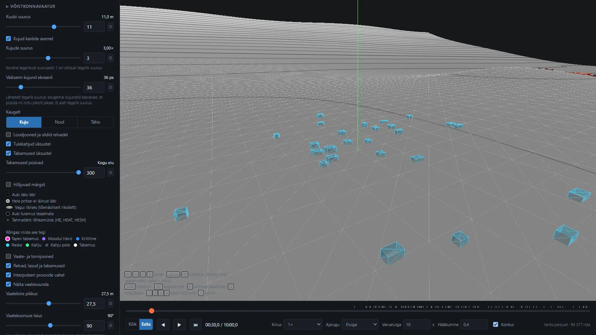

# Kujude ülekate (kastide taasesitus)

Väike film: üks kuju iga inimese kohta, mis liigub aja jooksul ja mille taga on jälg.

Režiimi nimetatakse ribal **Kujude ülekate**. See leht oli varem nimega "kastide taasesitus", sest enne kujusid oli iga inimene kast; "kujude taasesitus" ja "kastide taasesitus" tähendavad sama. **Kujude ülekattel** ei ole numbriklahvi: vali see režiimiribalt. See joonistab ühe kuju (või kasti) [inimese](glossary.md) kohta, liikudes mööda [ajajoont](timeline.md), valikuliste vaatekiirte ja jälgedega. See on taasesitus, mitte tihedus: *kes oli kus, millal*. See vajab isikuveergu; ilma aja veeruta joonistatakse kõik proovid korraga.

## Kuidas kasutada {#how-to-use-it}

1. Laadi andmed isikuveeru ja aja veeruga.
2. Vali režiimiribalt **Kujude ülekate**.
3. Lülita ajajoon režiimile **Esita** ja vajuta esitamist (`K`).
4. Ava **Võistkonnavaatur**, et muuta **Jälje pikkust**, kujude suurust või vaatekiiri.

Selles režiimis soojust ei joonistata ja kohanduv spraitieelarve on tühikäigul.

Vaikimisi joonistatakse iga inimene sellena, mis ta on, mitte kastina - vt [Kujud](figures.md), milline kuju üksus saab, ja [Mängu taasesitus](match-replay.md) siltide, jälgiva kaamera, kahe üksuse vahelise mõõtmise ja sündmuste loendi kohta.

## Võistkonnavaaturi paneel {#the-team-viewer-panel}

Selles režiimis näidatakse seda soojuspaneelide asemel.

| Juhtnupp | Vaikimisi | Vahemik (hüppamisega) | Tähendus |
|---|---|---|---|
| **Kujud kastide asemel** | sees | | Iga inimene sellena, mis ta on: jalgsi sõdur, tank või lennuk, mille andmed nimetavad. See, mille kohta andmed midagi ei ütle, jääb kastiks. |
| **Kujude suurus** | 1× | | 1× on tõeline suurus. |
| **Väikseim kujund ekraanil** | 36 px | 0 = alati tõeline suurus | Tõeline suurus lähedalt; kaugemal kasvavad kujud, et jääda selle arvu pikslitega pikkuseks. |
| **Relvad, lasud ja tabamused** | sees | | Lennus olevad relvad koos suitsu, jälgijate, mõjude, tabamuste ja tapmistega. Tabamusest tuletatud jälgijad on katkendjoonega. |
| **Kuubi suurus** | olemi suurus või ulatus / 500, laadimisel | 0,05-200 m, logaritmiline (5000) | Iga kasti servapikkus. Vt [olemi suurus](sessions-persons-groups.md#entity-size). |
| **Interpoleeri proovide vahel** | sees | | Ühe inimese kahe proovi vahel paigutatakse kast nende vahel proportsionaalselt. Kunagi mitte seansside piiri üle. |
| **Näita vaatesuunda** | sees | | Kiir igast kastist inimese vaatesuunas (vajab [vaatesuuna veerge](axes-units-and-time.md#look-direction)). |
| **Vaatekiire pikkus** | olemi suurus × 4, või ulatus / 200, laadimisel | 0,5-500 m, logaritmiline (20 000) | Näidatakse, kui vaatesuund on sees. |
| **Jälje pikkus** | 8 s | 0-300 s (86 400); 0 = väljas | Sekundid ajalugu, mis joonistatakse iga inimese taha. |
| **Joonista iga toorproov** | väljas | | Kast iga salvestatud proovi kohta aknas, mitte üks interpoleeritud kast inimese kohta. Alamvalitakse, et jääda interaktiivseks. |

Paneeli vihjed selgitavad, et interpoleerimine ja jäljed ühendavad proove ainult ühe seansi piires, ja kui laadimisel on [jagatud nimesid](sessions-persons-groups.md#names-worn-by-several-things-at-once), siis mitut nime joonistatakse üksikute proovidena.

## Mängitav seanss {#the-session-being-played}

Seansi veeru korral otsustab külgriba ülaosas olev **Seanss**-valik ([Seansid](sessions-persons-groups.md#the-session-picker)), milline mäng taasesitatakse. Laadimisel valitakse kõige hõivatum. Kastideks ja jälgedeks saavad ainult selle seansi read ja ajajoon jookseb selle seansi ulatuses, mitte kogu andmestiku ulatuses. *Kõik seansid* esitab kõik seansid korraga, ikka ilma proove seansside vahel ühendamata.

## Mis joonistatakse millal {#what-is-drawn-when}

[`TrackCursor`](https://github.com/Holdi601/3DHeat/blob/main/src/data/tracks.ts) järgi:

**Elavad kastid** (režiim Esita, toorproovid väljas). Iga nähtava inimese kohta tema viimane proov mängupea juures või enne seda:

- Kui inimesel on järgmine proov, see on samas seansis ja nimi pole jagatud, paigutatakse kast kahe proovi vahele proportsionaalselt ajaga, pööre (yaw) interpoleeritakse lühema tee kaudu ja kallak (pitch) lineaarselt (kui *Interpoleeri* on sees).
- Muidu jääb kast viimase proovi juurde ajajoone **varueluea** (vaikimisi 10 s) jooksul ja seejärel eemaldatakse, et kõrvaldatud mängijad ei jääks kummitama.

**Kõik režiim** ignoreerib mängupead ja joonistab iga vahemikus oleva proovi kastina.

**Toorproovid** joonistavad kasti iga salvestatud proovi kohta aknas: *ulatus* koos *Akna* ajalooga, muidu kõik kuni mängupeani. Kõige rohkem 65 536 kasti; kui proove on rohkem, joonistatakse iga *k*-s.

**Jäljed** (kui jälje pikkus on üle 0 ja toorproove ei joonistata): joon iga kahe järjestikuse proovi vahel inimese kohta viimase *jälje pikkuse* sekundi jooksul mängupeani, hääbudes vanusega 80% läbipaistvusest läbipaistmatuseni. Jälg lõpeb seansivahetusel ega joonistata jagatud nimede puhul. Kõige rohkem 131 072 tippu; kui neid on rohkem, jäetakse read ühtlaselt välja.

**Kes on nähtav:** inimene on peidetud, kui tema rühm on [Võistkondade loendis](teams-list.md) märkimata (rühm on tema esimese rea oma), kui rühmafilter ta välja jätab või kui [Olemid](entities.md) paneelil on valik, mis teda ei hõlma. [Veergude filtrid](filters.md) kastidele ei kehti.

## Värvid {#colours}

Üks toonipere rühma kohta ja üks varjund liikme kohta, nii et ühe pilguga näed, kummal poolel keegi on ([`teamMemberColor`](https://github.com/Holdi601/3DHeat/blob/main/src/render/colors.ts)). Rühmatoonid käivad läbi kindla kümne loendi - sinine, punane, roheline, merevaik, violetne, tsüaan, magenta, laim, oranž, indigo - ja rühma liikmed jaotuvad heleduse 42-76% ja küllastuse 90-65% vahel.

## Märkmed {#notes}

- Kujude ülekate ehitab oma kujud uuesti ainult siis, kui midagi muutub; tühikäigul kaader joonistab viimased uuesti.
- [Statistika kattekihi](performance-and-stats.md) rida *Kuubid* loeb ekraanil olevaid kaste.
- Kujude ülekate joonistab samas stseenis tasemega, seega [väljaulatuvus](camera.md#depth-of-field) hägustab kastid, aga mitte kunagi soojust.
