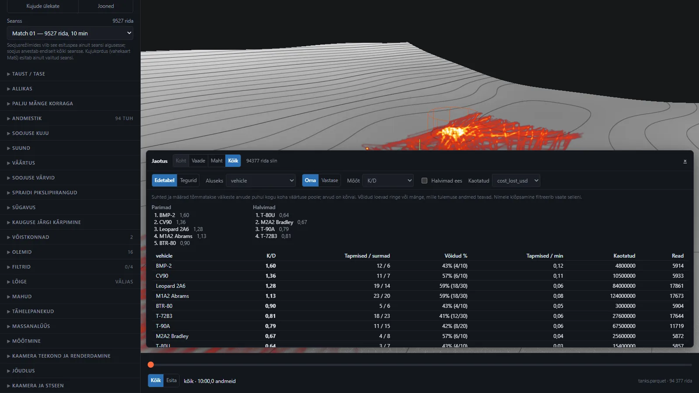
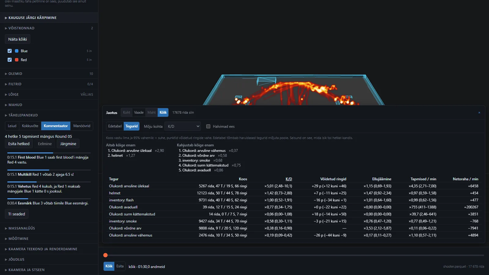

# Jaotus: kes ja mis toimib kus kõige paremini

**Jaotus** vastab ühele küsimusele: selles kohas, milline sõiduk, mängija või relv toimib kõige paremini? Kasuta seda, et leida sild, kus võidab tank, või näha, kas kiiver tõesti aitab.

See järjestab selles kohas toimuva (valitud punkt, vaade, maht või kõik näidatu) mis tahes kategooria järgi ja mõõdab iga olekutegurit: koos ja ilma.

## Proovi {#try-it}

1. Laadi mäng, kus on tapmised ja surmad, ja ava **Mahud**.
2. Joonista maht sinu jaoks olulise koha ümber ja vali see.
3. Vajuta statistika all **Jaotus…**.
4. Jaotises **Aluseks** vali *Sõiduk* ja mõõdik *K/D* (tapmised surma kohta).
5. Loe loendit, parimad ees. Vajuta **Halvimad ees**, et see ümber pöörata. Klõpsa nimel, et vaade sellele filtreeruks; klõpsa uuesti, et see vabastada.

## Ava {#open-it}

| Kust | Piirkond, millest alustatakse |
|---|---|
| **Jaotus…** jaotises [Mahud](volumes.md) (Statistika) | valitud maht |
| **Jaotus siin** punktikaardil pärast punkti klõpsamist | selle punkti ümber olev sfäär (**Raadius**, vaikimisi 3% andmete suurusest) |
| **Erinevuse** jaotuspaneel | vaade |

Päis vahetab piirkonda: **Koht**, **Vaade** (mida kaamera nägi viimasel loendamisel; pärast liigutamist **Loe uuesti**), **Maht** (vali üks) või **Kõik**. See loeb taustal; staatuserida ütleb, mitu rida on piirkonnas.

## Edetabel {#ranking}

Vali, mille järgi järjestada, ja mõõdik:

| Mõõdik | Mis see on |
|---|---|
| A, B | read erinevuskaardi kummalgi küljel, jaotatud nii, nagu soojus need jagab |
| A / B, A - B, A / (A + B) | kaks kihti üksteise vastu |
| K/D | tapmised versus surmad |
| Võit % | voorud (või mängud), mille andmed näitavad, kes võitis |
| Tapmised / min | tapmised minutis kohal (liikumisproovide vahed) |
| Teenitud, Kaotatud, Netoraha | veergude `earn_*` ja `cost_*` summad; valija valib valuuta |

Tapmised, surmad, kohalolu, võidud ja raha loevad iga rida, mida vaade selles kohas näitab, jagatud poole kummalgi küljel või ilma.

Suhted ja määrad tõmmatakse kohas tervikuna väärtuse poole, kui loendid on väikesed, nii et 2 tapmist ühe elu kohta ei tõuse tippu. Loendid on näha nende kõrval.

Saad järjestada rühmade, mängijate ja mängude järgi, mis tahes kategooriaveeru järgi (sõiduk, relv, pool, ostutüüp, agent või komplekt), mis tahes numbriveeru järgi vahemikes (soomus, varustuse väärtus), relvaveeru **klassi** järgi (vintpüss, snaiper, SMG, pistol ...) ja selle järgi, mitu **utiliidi** tükki loendiveerg, nagu `inventory`, sisaldab.

**Oma** järjestab rea enda väärtuse järgi. **Vastase oma** järjestab teise osapoole väärtuse järgi: tapmisel ohvri relva, surmal tapja oma (vajab veergu `other` / `victim`, mis neid nimetab).

## Olek sel ajal {#state-at-the-time}

Rea väärtus on tema enda, kui rida ei logi midagi (sündmuse rida ilma varustuseta) või kui see on surm (mille relvaveerg võib nimetada tapja relva); siis on see see, mida sama inimene viimati kandis mängu varasemas osas.

## Tegurid: koos vastu ilma {#factors-with-against-without}

Lülita **Edetabelist** **Teguritele**, vali **Mõju kohta** ja loe *Aitab kõige rohkem* ja *Kahjustab kõige rohkem*:

Iga teguri mõju K/D-le, võidetud voorudele, ellujäämisele (minuteid surma kohta), tapmistele minutis ja netorahale minutis, 95% usaldusvahemikuga: suhted x-na, võidetud voorud punktide erinevusena. Edetabel tõmbab iga hinnangu mõjuta olekule oma ebakindluse järgi, nii et haruldane tegur vajab kõrgele jõudmiseks selget mõju; näidatud vahemik on tõmbamata.

Andmed voorudega lisavad lähivõitluse **olukorrad** ([Lähivõitlus ja voorud](close-quarters.md)), mis arvutatakse üks kord andmekogumi kohta: *blinded* (rea `state_flashed`, või vaenlase välk 15 m piires viimase 3 s jooksul), *death traded* (surm vahetati), *opening duel* (avadueell), ning *man up*, *even numbers* või *man down* (rea poolel elus mängijad vaenlase vastu). Surm loetakse olukorda, milles ohver just enne seda oli.

Ühes käigus mõõdetakse kõige rohkem 256 tegurit.

## Arendajatele {#for-developers}

### Väikeste proovide tõmbamine {#pulling-small-samples}

Edetabeli väärtus on `(n + m*r0) / (d + m)`: `n` ja `d` on arvud, `r0` on kogu koha suhe ja `m` on selle eelarvamuse kaal.

### Konverteri autoritele: tegurite veergude nimetamine {#for-converter-authors-naming-factor-columns}

Konverter lisab teguri, nimetades oma veeru:

| Veerg | Tegur |
|---|---|
| `state_<name>` arv | sees, kui mitte-null (`state_scoped`, `state_suppressor`) |
| `state_<name>` kategooria | üks tegur väärtuse kohta (`state_ammo` = AP, HE...) |
| `active_<name>` | sama, asja jaoks, mis on sisse lülitatud või hiljuti kasutatud: võime, ultimate, vidin, bonus (`active_ult`, `active_stim`) |
| loendiveerg (`inventory`, `loadout`, `perks`, `abilities`, `attachments`, `modules`, `buffs`, `debuffs`, `upgrades`, või `state_`/`active_` nimi, mis lõpeb `s`-ga) | üks tegur `a\|b\|c` väärtuse iga üksuse kohta |
| juba tavalised varustuse lipud (`helmet`, `defuser`, `armor`, `scoped`, `airborne`, `duck`, `flashed`...) | sees, kui mitte-null |
| `ammoType`, `shellType`, `ammoName` | viimati tulistatud laskemoon |

Tulemused: 0/1 veerg `won` (rea pool võitis vooru või mängu) ja veerg `round` - [tulemuse veerud](data-formats.md#outcome-columns); kui failis on nii `won` kui ka `matchWon`, loeb *Võidud %* raunde. Raha: `earn_<currency>` ja `cost_<kind>_<currency>`; ainult liigi järgi sissetulek (`earn_round_cs2`, konverteri täpsed vooruauhinnad) asendab ainult selle liigi kulumudeli sissetuleku (`round` katab ka istutused ja lahtitegemised), ja mudel hindab ülejäänu.

Kaardistus laadib need veerud ise, faili enda loendi kõrval: iga `state_*`, `active_*`, `won`, `round` ja loendiveeru, välja arvatud need, mida Parquet-faili statistika näitab ühe väärtusega kogu ulatuses (iga laaditud veerg on 4 baiti rea kohta).
