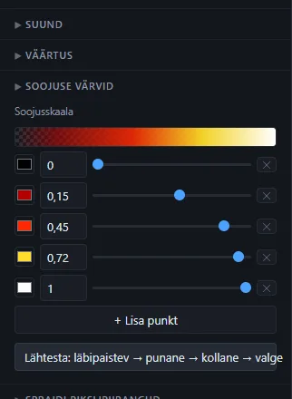

# Värv ja säritus

Need juhtnupud otsustavad, millise koguse soojus millise värvi saab. **Küllastuspunkt** on see, kui palju soojust loetakse valgeks kuumaks.

## Kiired parandused {#quick-fixes}

- Kõik on valge: tõsta **Küllastuspunkti** või vajuta **Automaatne säritus välja põhjal**.
- Midagi pole näha: langeta **Küllastuspunkti** või vajuta **Automaatne säritus välja põhjal**.
- Näha on vaid mõned üksikud punktid: keera üles **Minimaalne soojus**.

Selle lehe iga juhtnupp mõjub siis, kui soojus muudetakse värviks, seega kui neist ühte lohistad, joonistatakse kohe uuesti ega **taaskäivita kunagi akumulatsiooni**.

## Küllastuspunkt {#saturation-point}

**Küllastuspunkt** (jaotis Soojuse kuju): akumuleeritud soojus, mis vastab värviskaala tipule (lineaarse vastuse korral; teiste kohta vt allpool). Logaritmiline liugur 0,1-4000, käepidemega kuni 10 000 000, sest akumuleeritud soojus kasvab ridade arvuga. Vaikimisi 24; igal laadimisel esmalt **analüütiline hinnang**, seejärel **mõõdetud** pildilt.

Selle valesti saamine on vahe soojuskaardi ja tühja (või valge) ekraani vahel, ja seda ei saa usaldusväärselt tuletada: telemeetria koondub nii tugevalt - sünnikoht, uks, kitsaskoht - et tipu ja keskmise tiheduse suhe erineb andmekogumite ja kaamera nurkade vahel kümnekordselt.

## Automaatne säritus {#auto-exposure}

**Automaatne säritus välja põhjal** mõõdab välja, mille varjundaja tegelikult tootis. See ignoreerib tühje pikslid, võtab valgustatud piksliste 98. protsentiili ja paigutab selle 85% kaugusele küllastuspunktini, nii et skaala tipp jääb päris tippudele.

Paneel loeb siis *metered X% of the frame; 98th percentile R placed near the top of the ramp* (mõõdetud X% kaadrist; 98. protsentiil R paigutatud skaala tipu lähedale). *Küllastuva* vastuse korral läheb väärtus 85% küllastuspunktist umbes 69% kohale skaalal, mitte 85% kohale.

See töötab ka **automaatselt**:

- 8 renderdatud kaadrit pärast andmekogumi laadimist;
- 8 kaadrit pärast [filtrite](filters.md) muutmist (iga positsiooni filtreerimine sadaks sündmuseks muudab tihedust suurusjärkude võrra);
- 8 kaadrit pärast punktisoojuse ja [joonesoojuse](line-heat.md) vahetamist või joonesoojuse joonistatavate marsruutide muutmist, sest joon kannab ühe proovi kohta palju vähem soojust kui sprait.

Kui midagi pole valgustatud, jätab automaatne käivitus küllastuse puutumata; nupp taandub analüütilisele hinnangule ja ütleb *nothing lit to meter - used the analytic estimate* (pole midagi mõõta - kasutati analüütilist hinnangut).

### Järgi vaadet {#follow-the-view}

**Järgi vaadet** (jaotis Soojuse kuju, vaikimisi sees) mõõdab uuesti iga kord, kui kaamera peatub, nii et piirkond, millesse lendad, kasutab kogu värviskaalat, mitte kogu kaardi jaoks mõõdetud skaalat. Väikesed muutused ignoreeritakse ja skaala libiseb, mitte ei hüppa. See töötab nelja soojusrežiimi puhul, mitte kujude ülekattes.

Eemalda linnuke, et skaala lukustada ja võrrelda kohti ühel skaalal. Ka **Küllastuspunkti** käsitsi lohistamine lukustab selle.

## Tiheduse vastus {#density-response}

**Tiheduse vastus** - kuidas *k* (soojus / küllastus) kaardistub skaalale:

| Vastus | Valem | Kasutus |
|---|---|---|
| **Küllastuv** (vaikimisi) | t = 1 - e^(-k) | Läheneb skaala tipule asümptootiliselt, nagu kihistatud läbipaistvad spraidid. Midagi ei lõigata kunagi lamedaks valgeks, seega on see tundmatutel andmetel turvaline vaikeväärtus. |
| **Lineaarne** | t = k | Ainus kaardistus, kus võrdne värv tähendab võrdset arvu. Kasuta kahe andmekogumi või kahe ajaakna võrdlemiseks. |
| **Logaritmiline** | t = log₂(1 + 7k) / 3 | Surub kokku pika saba, nii et üks äärmuslik kuumkoht ei lama enam kõike muud skaala põhja. Tõstab hõredaid alasid. |

## Minimaalne soojus {#minimum-heat}

**Minimaalne soojus** (vaikimisi väljas, 0-100%): iga piksel, millel on üldse mingit soojust, tõstetakse vähemalt selle skaala punktini. Keera see üles ja spraidi raadius alla, et näha, *kus midagi kunagi juhtus* - üksikud andmepunktid muutuvad selgelt nähtavaks, selle asemel et jääda läbipaistvast veidi kõrgemale. Tiheduse hindamisel jäta see välja, sest see lamestab skaala põhja ehitusest. Lävi (k > 0,0001) hoiab päris tühjad pikslid tühjadena.

## Skaala redaktor {#the-ramp-editor}

Jaotises **Soojuse värvid**. Selle silt ütleb, milleks skaala on: *Heat ramp* (Soojusskaala) režiimides Soojus ja Jooned, *Positive (additive teams)* (Positiivne (liitvad võistkonnad)) režiimis Erinevus, *Opacity ramp (colour comes from the group)* (Läbipaistmatuse skaala (värv tuleb rühmalt)) režiimis [Võistkondade soojus](team-heat.md), kus kasutatakse ainult selle alfat.



Ülal olev riba näitab skaala eelvaadet. Selle all on iga punkti kohta üks rida:

| Osa | Tähendus |
|---|---|
| Värvinäidis | Punkti värv (brauseri värvivalija). |
| Number | Punkti asukoht skaalal, 0 kuni 1 (0 = soojust pole). |
| Liugur | Punkti läbipaistmatus, 0-100%. |
| ✕ | Eemaldab punkti; kui alles on vaid kaks, on keelatud. |

**+ Lisa punkt** lisab punkti kahe viimase punkti vahele, viimase punkti värvi ja läbipaistmatusega. **Lähtesta: läbipaistev → punane → kollane → valge** taastab vaikeväärtuse.

Punktid võib anda mis tahes järjekorras; need sorteeritakse skaala koostamisel. **Alfa** on see, mis segab soojuse stseeniga, ja just seetõttu on vaikeskaala nullotsas täiesti läbipaistev.

### Vaikeskaalad {#the-default-ramps}

| Asukoht | Positiivne (Soojus, Jooned, Erinevus +) | Negatiivne (Erinevus −) |
|---|---|---|
| 0,00 | must, alfa 0 | must, alfa 0 |
| 0,15 | rgb(180, 0, 0), alfa 0,55 | rgb(0, 170, 60), alfa 0,55 |
| 0,45 | rgb(255, 40, 0), alfa 0,85 | rgb(0, 190, 200), alfa 0,85 |
| 0,72 | rgb(255, 220, 40), alfa 0,95 | rgb(40, 80, 255), alfa 0,95 |
| 1,00 | valge, alfa 1 | rgb(170, 60, 255), alfa 1 |

## Kui kaamera liigub {#while-the-camera-moves}

Kui kaamera liigub, taaskäivitub akumulatsioon igal kaadril. Kui **Joonista igas kaadris kõik read** on sees (vaikimisi), on iga liikuv kaader ikka täpne; kui see on väljas, näitab liikuv kaader ühte proovitud hinnangut - heledamaid, kaaluga skaleeritud kobaraid -, mis koondub peatumisel sujuvamaks tõeliseks pildiks. See on oodatud; vt [Akumulatsioon](accumulation.md).

## Arendajatele {#for-developers}

### Koostamisläbik {#the-composite-pass}

Pärast soojuse akumuleerimist muudetakse iga piksli väärtus värviks ühes koostamisläbis ([`COMPOSITE_FS`](https://github.com/Holdi601/3DHeat/blob/main/src/render/webgl2/shaders.ts)). Sammud on:

```
k = |heat| / saturation point
t = response(k)                         clamped to 0..1
if minimum heat > 0 and k > 0.0001:  t = minimum + (1 - minimum) × t
colour, alpha = ramp(t)                  (the negative ramp when heat < 0, Difference only)
pixel = mix(scene, colour, alpha)
```

### Analüütiline hinnang {#the-analytic-estimate}

**Analüütiline hinnang** ([`estimateSaturation`](https://github.com/Holdi601/3DHeat/blob/main/src/data/calibrate.ts)) eeldab, et read on laiali andmete X-Z jalajäljel: keskmine soojus = ridade arv × (π r² / jalajälje pindala) × 1/3 × keskpunkti intensiivsus (1/3 on lineaarse skaala ketta keskmine), korrutatuna eeldatud tipu ja keskmise suhtega 25, piiratud 0,1-1 000 000-ga. See peab ainult olema suurusjärgu täpsusega õige.

### Mõõtmine {#metering}

[`exposure.ts`](https://github.com/Holdi601/3DHeat/blob/main/src/render/exposure.ts):

1. soojuse sihtmärk loetakse GPU-st tagasi, alamvalitud kuni 40 000 väärtuseni;
2. tühjad pikslid (soojus ≤ 0,0001) visatakse välja - suurem osa soojusväljast on tühi, ja nende keskmistamine alahindaks kõike, nagu kaameramõõtja mustale taustale suunatuna;
3. valgustatud pikslite 98. protsentiil on lähtepunkt;
4. küllastuspunktiks saab lähtepunkt / 0,85, nii et lähtepunkt asub 85% kaugusel küllastuspunktist ja skaala tipp jääb päris tippudele.

### Värvitabel {#the-colour-table}

Skaala küpsetatakse 256 × 2 RGBA tabelisse (positiivne skaala esimeses reas, negatiivne teises) ([`buildColorLut`](https://github.com/Holdi601/3DHeat/blob/main/src/render/colors.ts)). Värvid interpoleeritakse lineaarses valguses ja salvestatakse sRGB-na; läbipaistmatus interpoleeritakse lineaarselt.
