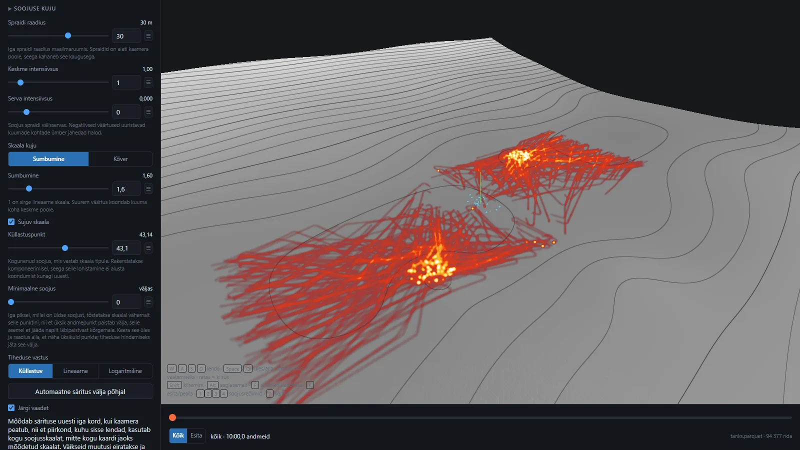
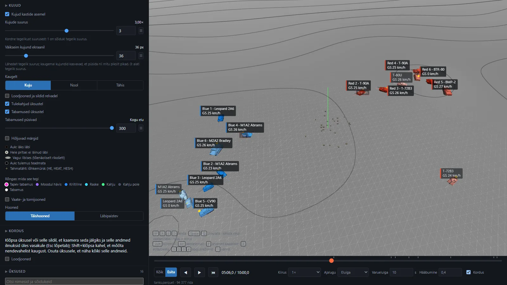

# Demoandmed: proovi vaatajat viie minutiga



Sul pole veel omi andmeid? Hoidla teeb need ise. Kõik selles on väljamõeldud: org, hoov ning kolme väljamõeldud mängustiili matšid, kus mängijate nimed on *Blue 1* või *Red 3*. Selle saidi pildid on kõik tehtud nende andmetega.

## Tee need {#make-it}

```bash
node tools/demo-data.mjs
```

See kirjutab kausta `tools/.shots/demo/`:

| Fail | Mis see on |
|---|---|
| `demo-valley.glb` | 12 km pikkune org kahe künka ja külaga, 3D tasemena |
| `demo-yard.glb` | 160 m pikkune müüritud hoov hoonetega, 3D tasemena |
| `tanks.parquet` | 10 tankimatši, 8 vastu 8: liikumine, lasud, tabamused kohaga kere peal, tulekahjud, surmad, purustused, torni sihtimine, võitjad |
| `tanks/match-NN.parquet` | samad matšid, igaüks eraldi failina, [palju matše korraga](many-matches.md) jaoks |
| `air.parquet` | 4 vastu 4 õhulahing raketite, soojuslõksude, tappude ja möödalaskmistega |
| `shooter.parquet` | 12 vooru 5 vastu 5 jalgsi: lasud, tapud, pommi paigaldamine, teenitud ja kulutatud raha, kiivrid ja abivahendid |
| `mass/` | kaust väikeste `.3dheat` matšidega [massanalüüsi](mass-analysis.md) jaoks |
| ringide komplekt | kahe ringi ühe auto omaga väljamõeldud rajal, [Sõiduanalüüsi](race-analysis.md) jaoks |

Iga tabel nimetab oma veerud oma jaluses, nii et ta laaditakse ilma seostamiseta.

## Proovi {#try-it}

1. Käivita vaatur (Windowsis `start.bat`, või mis tahes süsteemis üks kord `npm install` ja siis `npm run dev`) ning ava `http://127.0.0.1:5273/`.
2. **Taust / tase → 3D-mudel…** ja vali `demo-valley.glb`.
3. **Allikas → Failid…** ja vali `tanks.parquet`.
4. Vajuta `F`, et andmed kaadrisse tuua. Näed kümne matši [soojust](heat.md).
5. Proovi režiimiribal **Erinevus** (Blue vastu Red), **Võistkondade soojus** ja **Jooned**.
6. Ava **Tähelepanekud** (Soojuskaardi külgribal): see leiab kohad, kus tulistati, tabati ja hävitati palju rohkem kui mujal, kahe künka ümber.
7. Ava **Matš** vahekaart; jaotises **Korduse matšid** vali *Match 01*; vajuta ajajoonel **Esita**: [kordus](match-replay.md).



Shooteri jaoks laadi `demo-yard.glb` ja `shooter.parquet`; õhulahingu jaoks `air.parquet`. Kujud on selle juures paremini näha, kui **Kujude suurus** on 4 (liugur paneelil **Võistkonnavaatur** Soojuskaardi külgribal).

## Ekraanipildid {#the-screenshots}

Saidi pildid teeb skript nendest andmetest, vaaturi ükskõik millises keeles:

```bash
node tools/demo-data.mjs
HEAT3D_FIGURE_PACK=none npx vite --port 5321 --strictPort --host 127.0.0.1   # PowerShell: $env:HEAT3D_FIGURE_PACK="none"; npx vite ...
node tools/docs-shots.mjs --lang en
```

Ekraanipildi server töötab ilma kohaliku kujupakita, seega näidatakse ainult avalikku kujuluset. Pildid lähevad kausta `docs/assets/img/<lang>/`. Vaata [Dokumentatsiooni hooldamine](maintaining.md).
