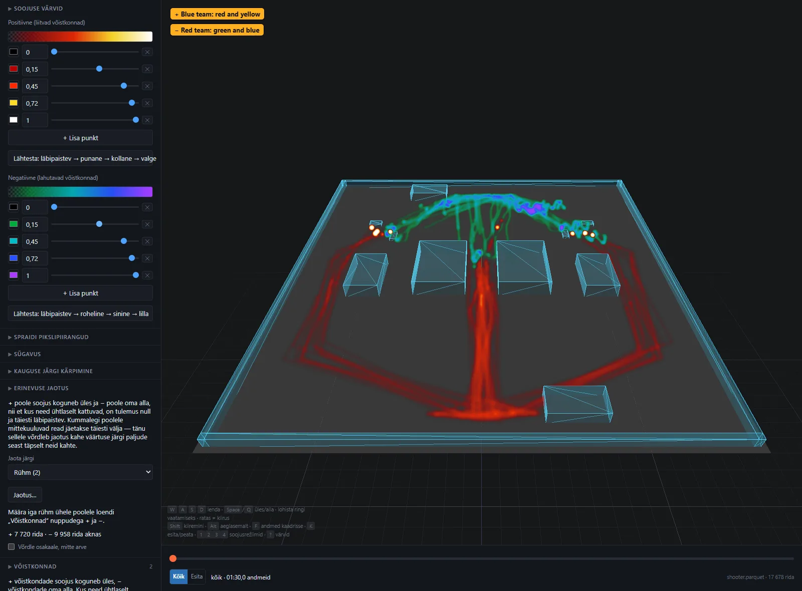

# Erinevus

Punane seal, kus meeskond A oli rohkem, roheline-sinine seal, kus meeskond B oli, ja midagi ei ole seal, kus nad olid võrdsed.

**Erinevus** (klahv 2) on märgiga soojus. Ühe populatsiooni read liidavad soojust; teise populatsiooni read lahutavad seda.
Kus need kaks kattuvad ühtlaselt, on tulemus null ja täiesti läbipaistev; kus üks domineerib, näitab see end selle poole
värvides - vaikimisi soojad (läbipaistev → punane → kollane → valge) **+** poolele ja jahedad (läbipaistev → roheline → sinine →
lilla) **−** poolele.

## Kuidas kasutada {#how-to-use-it}

1. Vajuta `2` (või vali **Erinevus** režiimiribal).
2. Ava külgribal **Erinevuse jaotus**.
3. Vali, mille järgi **Jaota järgi**: tavaliselt *Grupid*.
4. Pane üks grupp (või väärtus) **+** peale ja teine **−** peale.
5. Loe värve: soe tähendab + poolt, jahe tähendab − poolt. Paneel hoiatab, kui ühel poolel ei ole ridu (vt [Sõnumid, mida võid näha](#messages-you-may-see)).

*Millised* kaks populatsiooni on kogu küsimus, nii et jaotus võib olla mis tahes säilitatud veerg, mitte ainult grupid. Read, mis jäävad
**kummalegi** poolele, **jäetakse välja**, mitte ei loeta nulliks: see teeb jaotuse üle kahe paljust väärtusest võrdlemise täpselt nende kahe
vahel ja sobib [filtritega](filters.md) - filtreeri üheks kaardiks, siis jaota see järgu järgi.

Režiim vajab kahte poolt: grupiveergu vähemalt kahe grupiga või jaotust säilitatud filtriveeru järgi. Andmetel, kus on vähem kui kaks gruppi,
alustab laadimine veerujaotusega - mitme faili laadimisel esmalt veeru *Source file*, muidu esimene kategooriaveerg kahe väärtusega, muidu
esimene arvuline veerg ulatusega - nii et *võrdle kahte laadimist* töötab ka andmetel, millel gruppe ei ole. Režiim on kättesaamatu ainult
andmetel, millel pole kumbagi; samuti siis, kui veerujaotusel ühel poolel midagi ei ole.

## Paneel Erinevuse jaotus {#the-difference-split-panel}

Näidatakse erinevuse režiimis, soojuspaneelide all.

**Jaota järgi** pakub:

| Valik | Kuvatakse kujul | Jaotusreegel |
|---|---|---|
| Grupid | *Grupp (N)* (kui on grupiveerg) | Iga grupp kas +, − või kummalegi, seatud [Meeskondade loendis](teams-list.md) |
| Kategooriaveerg | *veerg (N väärtust)* | Väärtused +, − või kummalegi |
| Arvuline veerg | *veerg (arvuline)* | Väärtuste vahemik kummagi poole jaoks |
| Algfail | *Source file - compare two loads* (kui laaditi mitu faili) | Failid +, − või kummalegi |

Pakutakse ainult veerge, mis laadimisel jäeti alles *Säilita filtreerimiseks* all.

### Võrdle osakaale, mitte arve {#compare-shares-not-counts}

**Võrdle osakaale, mitte arve** (vaikimisi väljas) kaalub iga poolt ühe jagatud selle enda ridade arvuga, nii et pool, millel on viis korda rohkem ridu,
ei võida ainult arvude poolest. Värv näitab siis, kus iga pool on teisest proportsionaalselt sagedamini. Kasuta seda, kui kahel poolel on väga erinev
hulk andmeid, näiteks kaks eri pikkusega seanssi.

### Sõnumid, mida võid näha {#messages-you-may-see}

Paneel hoiatab, kui pilt ei ole päris erinevus:

| Sõnum | Tähendus |
|---|---|
| *N + / M −* (või *N + / M − / K kasutamata*) | Mitu väärtust on kummalgi poolel (ja kummalegi ei ole). |
| Aknas ei ole ühtegi rida **+** poolel | Joonistatakse ainult **−** pool. Liiguta ajajoone akent või muuda jaotust. |
| Aknas ei ole ühtegi rida **−** poolel | Joonistatakse ainult **+** pool. |
| Ühtegi väärtust ei ole kummalgi poolel | Erinevus ei joonista midagi. Pane vähemalt üks väärtus **+** või **−** peale. |
| *veerg* ei saa sel viisil jaotada | Valitud veerg ei sobi jaotusega. Vali veerg uuesti. |
| Jaotusveerg ei mahtunud N-st K tükist GPU mällu | Need read ei joonistu. Tõsta GPU eelarvet jaotises Jõudlus → Ressursieelarved või laadi vähem ridu. |

### Grupi järgi {#by-group}

Paneel viitab lihtsalt [Meeskondade loendile](teams-list.md), kus igal grupil on nupud **+** ja **−**. Igal laadimisel pannakse gruppide esimene pool
(ülespoole ümardatud) +-le, ülejäänud −-le; **Jaota võrdselt** Meeskondade loendis teeb sama uuesti. Grupp, mis on kummalgi pool, või mis on peidetud
oma märkeruuduga, ei anna midagi juurde.

### Kategooriaväärtuste järgi {#by-category-values}

| Osa | Tähendus |
|---|---|
| `a + / b − / c kasutamata` | Mitu väärtust on kummalgi poolel ja kummalegi ei ole. |
| **Tühjenda** | Paneb iga väärtuse kummalegi poolele mitte. |
| Väärtuste loend | Iga väärtus nupuga **+** ja **−** (aktiivse nupu uuesti vajutamine võtab selle sealt poolelt ära). Tühi väärtus on loetletud kui *(puudub)*. |
| Piirangu märkus | Loetletakse ainult esimesed 200 väärtust: *Näidatakse esimesi 200 väärtust N-st. Nii lai veerg on parem kõigepealt filtriga kitsendada või jaotada vahemiku järgi, kui selle väärtused on järjestatud.* |

Veeru valimine paneb selle esimese väärtuse +-le ja teise −-le. Kui kummalgi poolel ei ole ühtegi väärtust, langeb jaotus gruppidele, selle asemel et näidata
tühja raami. *Source file* töötab samamoodi, üks väärtus faili kohta - nii võrreldakse kahte eksporti, kahte testkäiku või kahte versiooni.

### Vahemiku järgi {#by-range}

| Osa | Tähendus |
|---|---|
| Vihje | Veeru miinimum ja maksimum. |
| **Positiivne vahemik (+)**, **alates** / **kuni** | Read, mille väärtus on selles vahemikus, mõlemad otsad kaasa arvatud, liidavad. |
| **Negatiivne vahemik (−)**, **alates** / **kuni** | Selle vahemiku read lahutavad. |
| **Jaota keskpunktist** | Seab + vahemikuks [miinimum, keskpunkt] ja − vahemikuks [keskpunkt, maksimum] - sama, mis veeru valimine teeb. |

Väärtus, mis on mõlemas vahemikus, loetakse +. Vahemikud ei pea katma veergu; väärtused, mis jäävad kummalegi vahemikule, jäetakse välja.
*Esimesed kaks minutit vs viimased kaks minutit* on aja-laadse veeru vahemikujaotus.

## + osakaal: võitude kaart {#share-of--the-win-rate-map}

**Erinevus** / **+ osakaal** paneeli ülaosas valib, mida joonistatakse. *+ osakaal* värvib iga koha + poole osakaalu järgi sealsetest mõlema poole ridadest, võrreldes selle osakaaluga kogu näidatu ulatuses: soe sellest kõrgemal, külm madalamal, mitte midagi, kus see on sama, ja mitte midagi, kus kohal on liiga vähe ridu. Kui võidetud raundid on + poolel ja kaotatud − poolel, on see võitude kaart; **Raundivõitude osakaal** ja **Mänguvõitude osakaal** seavad selle ühe vajutusega üles, kui andmetes on [tulemuse veerud](data-formats.md#outcome-columns). Vaata [Võitude osakaal](win-rate.md).

## Värvid {#colours}

Jaotis **Soojuse värvid** näitab selles režiimis kahte skaala redaktorit: **Positiivne (liitvad võistkonnad)** ja **Negatiivne (lahutavad võistkonnad)**,
igaühel oma lähtestusnupp (*Lähtesta läbipaistev → punane → kollane → valge*, *Lähtesta läbipaistev → roheline → sinine → lilla*). Kombineeritud pilt
võtab netosoojuse absoluutväärtuse läbi [küllastuspunkti ja vastuse](colour-and-exposure.md), ja valib negatiivse skaala seal, kus neto on alla nulli.
Vaata [Värv ja säritus](colour-and-exposure.md#the-ramp-editor).

Kasuta *Lineaarset* tiheduse vastust, kui erinevuse suurus on oluline: see on ainus vastus, kus sama värv tähendab sama arvu.

## Arendajatele {#for-developers}

Iga rida saab tipu-shaderis märgi +1, -1 või 0 ([`POINT_HEAT_VS`](https://github.com/Holdi601/3DHeat/blob/main/src/render/webgl2/shaders.ts)); 0 lükkab rea tagasi enne, kui ühtegi fragmenti joonistatakse.

- Grupi järgi tuleb märk 4096-kirjest grupitabelist, mida indekseerib rea grupi ID (grupi ID sõidab rea positsioonitekseli neljandas kanalis).
- Kategooria järgi tuleb märk teisest 4096-kirjest tabelist, mis täidetakse kategooriaväärtuse kaupa, ja rea väärtus loetakse veeru filtritekstuurist; tabeli lõpust
  väljaspool olev väärtus lükatakse tagasi mõlemal renderdajal.
- Vahemiku järgi võrreldakse rea väärtust kahe vahemikuga.

Jaotuse muutmine alustab kogumist uuesti.

**Peidetud grupid jäävad peidetuks iga jaotusega.** Veeru järgi jaotamisel ei kanna grupitabel enam märke; see hoiab 1 nähtava grupi ja 0 peidetud grupi
kohta ([`frameSignTables`](https://github.com/Holdi601/3DHeat/blob/main/src/render/filterTables.ts)), ja mõlemad tabelid jõuavad shaderisse koos - kaks rida ühes märgitekstuuris
WebGL2-l, kaks poolt ühes salvestuspuhvris WebGPU-l. Rida joonistatakse ainult siis, kui tema grupp on näidatud *ja* tema veeru väärtus on poolel. Seega grupp, mis on
[Meeskondade loendis](teams-list.md) välja märkimata, või mis jäeti välja matši vahekaardi poolefookusega, ei anna midagi, olenemata sellest, kuidas erinevust jaotatakse.
