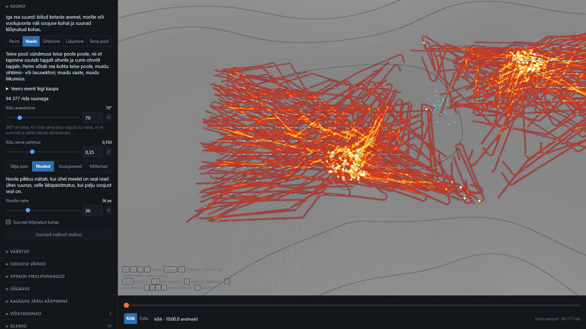

# Suunatud soojus

Tavaline soojus näitab **kus** asjad juhtuvad. Suunatud soojus näitab ka **mis suunas**: mis suunas inimesed vaatasid, sihtisid, liikusid või kus oli võitluse teine pool.

Tavaline sprait on täisketas (360 kraadi). **Kiilu avanemisega** 70 kraadi juures muutub sama sprait kitsaks kiiluks, mis osutab suunale, kuhu rida oli pööratud, ja lisab sama kogusoojuse.

## Kuidas kasutada {#how-to-use-it}

1. Laadi andmed, kus on suund sees (vt [Mis annab reale suuna](#what-gives-a-row-a-direction)).
2. Vali režiimiribalt **Soojus**, **Erinevus** või **Võistkondade soojus**.
3. Ava külgribal jaotis **Suund**.
4. Vali **allikas** (milline suund kasutada) ja lülita joonistamine sisse:
   - langeta **Kiilu avanemine** alla 360°, et joonistada iga rida kiilu, mis osutab oma suunale, mitte kettana;
   - vali **Väli**, et joonistada soojuse peale nooli või voolujooni;
   - märgi **Suunad klõpsatud kohas** ja klõpsa soojusel, et saada selle koha polaardiagramm.

Staatuserida ütleb, mitmel real on valitud allikast suund.

## Seaded {#settings}

| Seade | Vaikimisi | Mida see teeb |
|---|---|---|
| Allikas: **Parimad**, **Vaade**, **Sihtimine**, **Liikumine**, **Teine pool** | Parimad | Milline suund igale reale antakse. *Parimad* võtab rea kohta teise poole, muidu sihtimise, muidu vaate, muidu liikumise. |
| **Sündmuse liigi kaupa** | nagu ülal | Eri allikas iga sündmuse liigi jaoks, näiteks *Teine pool* tapmistele ja *Vaade* asukohtadele. Näidatakse, kui andmetes on sündmuse veerg kuni 40 väärtusega. |
| **Kiilu avanemine** | 360° | 360° on tavaline ketas (väljas). Väiksem on kitsam kiil. Kiil lisab sama palju soojust kui tema ketas, seega summad ja erinevused jäävad võrreldavaks. |
| **Kiilu serva pehmus** | 0,35 | 0 on terava servaga kiil, 1 pehme ventilaator. |
| **Väli**: Väli puudub, Nooled, Voolujooned, Mõlemad | Väli puudub | Nooled: noole pikkus on see, kui palju seal olevad read ühtiva suunas on, läbipaistmatus see, kui palju soojust seal on. Nooled näidatakse ainult seal, kus on soojust. |
| **Noolte vahe** | 28 px | Vahemaa noolte vahel ekraanil. |
| **Anima voolujooned** | sees | Voolujooned voolavad, kui see on sees. |
| **Suunad klõpsatud kohas** | väljas | Klõpsa soojusel, et näha seal olevaid suundi (allpool). |
| **Suunad valitud mahus** | | Sama diagramm kõigele valitud [mahu](volumes.md) sees. |

## Polaardiagramm kohas {#the-polar-chart-at-a-spot}

Kui **Suunad klõpsatud kohas** on sees, klõpsa soojusel. Selle punkti lähedal olevad read (1,5 spraidi raadiuse piires) koondatakse 15-kraadiste sektoritega rooside 24 sektoriks:

- **oranžid** kroonlehed: väljuvad suunad (kuhu read osutavad);
- **siniseid** kroonlehti: sisenevad suunad (kust nad tulid);
- kroonlehe **pindala** kasvab koos selle arvuga; nool näitab peamist suunda;
- diagrammi all olevad jooned annavad peamise suuna, kui tugevasti read ühtivad (R, 0 kuni 1), hajuvuse kraadides ja ridade arvu.

0° on diagrammil üleval, mis on maailma −Z (Tacview salvestistel põhi). Koht on märgitud ka 3D vaates noole ja rõngaga.

## Mis annab reale suuna {#what-gives-a-row-a-direction}

| Allikas | Vajab andmetes |
|---|---|
| Vaade | pöördeveerg (kaardistatud vaatesuunana): `yaw`, `heading`, `azimuth`, `view_yaw`, `rot_z` |
| Sihtimine | arvupaarid nagu `aim_x`/`aim_y`, `shot_x`/`shot_y`, `fire_x`/`fire_y`, `hit_dir_x`/`hit_dir_y` (valikuline `…_z`) |
| Liikumine | midagi lisaks: sama inimese eelmise proovi samm (kuni 10 s varem, sama seanss) |
| Teine pool | sündmuse teise poole nimetav veerg (`other`, `victim`, `target`, `killer`, `attacker`, `shooter`, `other_player` ...), mille väärtused on inimeste nimed; tapmine osutab tapjalt ohvrile, surm ohvrilt tapjale |

## Näpunäited {#tips}

- Kiilud vajavad ekraanil mingit suurust; alla mõne piksli joonistatakse need jälle kettana.
- Kasuta *Teine pool* tapmise ridadel, et näha, **kust** võitlused võideti, ja *Vaade* asukohtade ridadel, et näha, **kuhu inimesed vaatavad**.
- Valikuga **Erinevus** osutavad kahe poole kiilud omas suunas, nii et vaieldavad tulejooned paistavad silma.
