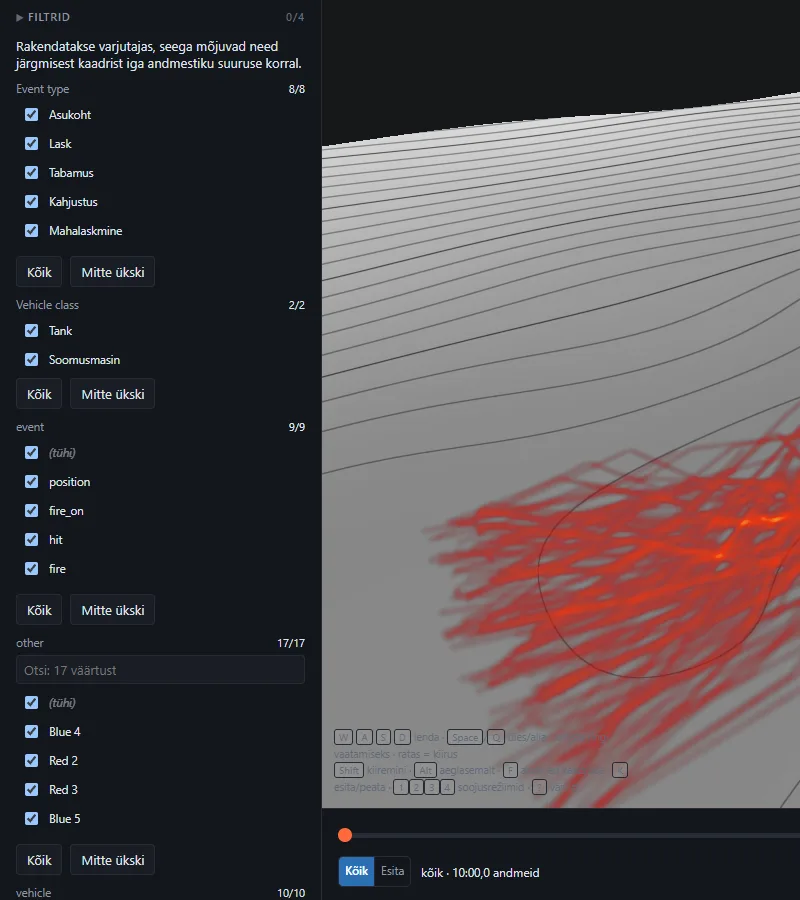
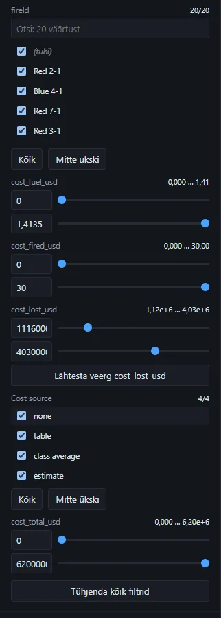

# Filtrid

**Filtrid** peidavad read, mis sind ei huvita, näiteks ühe sõidukiklassi või ühe sündmuse liigi, ja pilt uueneb kohe. Paneel loetleb veerud, mis laadimisel alles hoiti jaotises *Hoia filtreerimiseks* ([Veergude seostamine](column-mapping.md)), ning lisaks *Source file*, kui laeti mitu faili.

## Proovi {#try-it}

1. Laadi andmestik ja ava külgribal **Filtrid**.
2. Jaotises **Sõidukiklass** eemalda linnuke *Tank*. Pilt muutub kohe.
3. Tagasivõtmiseks vajuta **Tühjenda kõik filtrid**.

Esimesed read on vaaturi enda veerud (allpool). Neile järgnevad read tulevad sinu failist.

## Veerud, mida vaatur lisab {#columns-the-viewer-adds}

Laadimisel leiab vaatur neli oma veergu ja loetleb need **esimesena**, nimed ja väärtused sinu keeles, nii et sama filter töötab iga mängu ja andmeallika puhul:

| Veerg | Väärtused | Arvutatakse põhjal |
|---|---|---|
| **Sündmuse tüüp** | 23 liiki: Asukoht, Lask, Start (rakett, raketi- või pommi), Tabamus, Möödalask (relv lõppes ühegi sihtmärgi lähedal), Plahvatus, Kahju, Tapmine, Surm, Hävitamine, Kukkumine, Väljahüpe, Tekkimine, Kadumine, Õhkutõus, Maandumine, Maakontakt, Peatumine maal, Ümberrelvastus / tankimine, Vallutus / eesmärk, Lõks, Sõnum, Muu | veerg nimega `event`, `events`, `event_type` või `event_name`; iga mängu enda sõnad (`shot`, `burst`, `fired`, `struck`, `flare`, `plant` ...) seostatakse nende liikidega. Täielik tabel: [Sündmuste tüübid ja klassid](ref-event-types.md). |
| **Mängija või tehisintellekt** | Mängija, TI | veerg `ai`, `is_ai`, `bot` või `actor`; muidu `is_player` / `human`; muidu konto-id (`user_id`, `steam_id`; tühi või 0 on TI); Tacview salvestistel, kas objektil on piloot |
| **Sõidukiklass** | 17 klassi: Hävitaja, Rünnakulennuk, Pommitaja, Muu lennuk, Helikopter, Tank, Soomukk, Õhutõrje, Suurtükivägi, Veok / auto, Laev, Allveelaev, Jalavägi, Relv, Lõks, Ehitis, Muu | sõiduki või üksuse nimi (sobitatakse [kujude kataloogiga](figures.md)) ja tüübiveerud |
| **Sihtmärgi klass** | samad klassid | teise osapoole sõiduk (`other_vehicle`, `target_vehicle`, `victim_type` ...) |

Loetletakse ainult esinevad liigid. Väärtuste veerud (`cost_*`, `earn_*`, `net_*` ja *Kulu allikas*, vt [Väärtuskaalumine](value-weighting.md)) on filtreeritavad nagu iga arvveerg: näiteks eemalda linnuke *hinnang* jaotises *Kulu allikas*, et jätta alles ainult hinnastatud read.

Kategoorialoend, millel on rohkem kui 12 väärtust, saab otsingukasti (*Otsi n väärtust*) ja nupu **Ainult need**, mis lubab täpselt sobivad väärtused.

Millised veerud on filtreeritavad, otsustatakse laadimisel, sest need tuleb siis lugeda. Kui alles hoitud veerge pole, ütleb paneel seda ja suunab valikule *Hoia filtreerimiseks*.

## Arvveerud (vahemik) {#numeric-columns-range}

| Osa | Tähendus |
|---|---|
| Nimi ja `min ... max` | Veerg ja praegune vahemik (kogu veeru vahemik, kui filtrit pole seatud). |
| Esimene rida: arvukast ja liugur | Alumine piir. Liuguri lohistamine üle ülemise piiri lükkab ka ülemist piiri. |
| Teine rida: arvukast ja liugur | Ülemine piir. Lohistamine alla alumise piiri lükkab ka seda. |
| **Lähtesta *veerg*** | Eemaldab selle filtri. |

Liugurid katavad veeru miinimumi kuni maksimumi 1000 sammuga; arvukastid võtavad vastu mis tahes väärtuse. Rida läbib, kui tema väärtus on vahemikus, mõlemad otsad kaasa arvatud. Suured väärtused kuvatakse astendajaga (`1.23e6`).

## Kategooriaveerud {#category-columns}

| Osa | Tähendus |
|---|---|
| Nimi ja `lubatud/kokku` | Veerg ja mitu selle väärtust on lubatud. |
| Väärtuste loend | Märkeruut iga väärtuse juures; tühja väärtuse nimi on *(tühi)*. |
| **Kõik** / **Mitte ükski** | Luba iga väärtus / ei luba ühtegi. |

Kui lubatakse kõik väärtused, eemaldatakse filter.

## Reeglid {#rules}

- **Neli filtrit korraga.** Päises on `aktiivne/4`. Viiendat filtrit ei rakendata ja paneel ütleb seda. Valik jaotises [Üksused](entities.md) (või Matši vahekaardi mängijafookus) kasutab neist ühte. Filter, mis katab kogu veeru, ei kasuta ühtegi.
- **Kategooriaveerul on kuni 4096 väärtust**; laiemat ei hoita laadimisel alles.
- **Filtrid kombineeritakse JA-ga** ning koos nähtavuse, võistkondade nähtavuse, erinevuse jaotuse, ajaakna, kauguse eemaldamise ja [lõiguga](slice.md).
- **Filtri muutmine alustab akumulatsiooni uuesti ja mõõdab säritust mõne kaadri pärast uuesti**, sest filtreerimine võib tihedust palju muuta ([Värv ja säritus](colour-and-exposure.md#auto-exposure)).
- **Tühjenda kõik filtrid** eemaldab kõik veerufiltrid. Võistkondade nähtavus ja mujal seatud mängijavalikud jäävad alles.
- Veerufiltrid muudavad soojusrežiime. Need ei muuda [kujude kordusel](box-replay.md) kujusid, mis järgivad võistkondade nähtavust ja Üksuste valikut. Üksuste valik muudab mõlemat.
- [Joonsoojuses](line-heat.md) testitakse filtrit rea põhjal, kus iga lõik *lõpeb*.
- Igal uuel andmestikul tühjendatakse kõik filtrid.

## Arendajatele {#for-developers}

**Pesad.** Iga aktiivne filter võtab ühe neljast GPU pesast ([`MAX_FILTER_SLOTS`](https://github.com/Holdi601/3DHeat/blob/main/src/render/types.ts)), tekstuuri, mis on 4 baiti rea kohta. Pesad antakse filtritele selles järjekorras, milles neid viimati muudeti ([`filterSlots`](https://github.com/Holdi601/3DHeat/blob/main/src/render/filterTables.ts), mida jagavad varjutaja ja mõlemad paneelid). Neljast rohkem annab vea *Rakendatakse ainult esimesi 4 filtrit. Tühjenda üks - ülejäänuid ei rakendata, neid ei liideta vaikselt*, ning lisafiltrite nimed on *veerg (ei rakendata)*. Filtrid töötavad tippude varjutajas rea kaupa, nii et läviväärtuse muutmine ei nõua uuesti parsimist ega üleslaadimist.

**Paneelis mitte näidatavad filtrid.** Rakenduse olekus on veel kaks liiki ([`FilterSpec`](https://github.com/Holdi601/3DHeat/blob/main/src/state/types.ts)):

- **rühmade** filter, mille seab Matši vahekaart, kui fokuseerib ühele poolele. See peidab teised rühmad igas režiimis, sealhulgas veeru järgi jaotatud [erinevuse](difference.md) jaotuse.
- **isikute** filter, mille seab [Üksuste](entities.md) paneel ja Matši vahekaart, kui fokuseerib ühele mängijale. See piirab kujude kordust ja soojusrežiime. Soojuses on see kategooriafilter isikute id-de üle ja võtab ühe neljast pesast. Tema mask hoiab 65 536 id-d ([`FILTER_MASK_CAPACITY`](https://github.com/Holdi601/3DHeat/blob/main/src/render/types.ts)); selle piirist suurema isikut ei joonistata soojuses, kui filter on aktiivne, isegi kui ta on valitud. Kujude kordus näitab neid endiselt.
