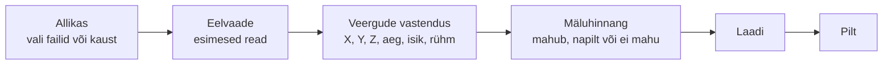

# Andmete sisselugemine

Enne kui 3DHeat saab midagi joonistada, vajab ta tabelit: iga rida ütleb, kus miski oli ja kui teada, siis millal ning kes. See jaotis näitab, kuidas fail saab pildiks. Pole veel andmeid? Proovi [demoandmeid](demo-data.md).

**Tee see kohe:**

1. Soojuskaardi külgribal ava **Allikas** ja vajuta **Failid…** (või lohista fail või kaust lohistusalale).
2. Vaata **Veergude vastendus**: kastid on tavaliselt juba täidetud.
3. Kontrolli, et **Mäluhinnang** ütleb *mahub*.
4. Vajuta **Laadi**.

Kõik, mida Soojuskaardi vahekaart näitab, tuleb ühest **andmestikust**: reatest, kus igal real on asukoht ja valikuliselt aeg, isik, rühm, sessioon, vaatesuund ning mis tahes arv lisaveerge filtreerimiseks. See jaotis selgitab, kuidas andmestik tehakse.

## Teekond failidest pildini {#the-path-from-files-to-picture}

1. **Vali failid** paneelil **Allikas**: üks fail, mitu, kaustapuu või lohistamine. Parquet, CSV, Tacview, GPS-jäljed ja muu on lubatud; täielik loend on lehel [Andmevormingud](data-formats.md#files). Vaata [Failide laadimine](loading-files.md).
2. **Eelvaade.** Valimi esimene fail avatakse: selle veergude nimed, esimesed 50 rida, millised veerud näivad arvulised ja (Parquetis) iga veeru loogiline tüüp ning faili enda lugemisjuhend, kirje `heat3d` footeris.
3. **Automaatne seostamine.** Veerud määratakse rollidele: X, Y, Z, aeg, isik, sessioon, rühm, vaatesuund, ning mõned hoitakse filtreerimiseks. Iga oletus on näha paneelil **Veergude vastendus** ja seda saab muuta. Vaata [Veergude seostamine](column-mapping.md) ja [Teljed, ühikud ja aeg](axes-units-and-time.md).
4. **Loendamine.** Iga faili ridade arv loetakse (Parquet täpselt footerist, CSV hinnanguliselt), nii et paneel saab enne laadimist öelda, kui palju mälu laadimine vajab ja kas see mahub. Kui ei mahu, pakub ta, et laaditakse iga *N*-es rida. Vaata [Mälu ja eelarved](memory-and-budgets.md).
5. **Laadi.** Taustatöötleja parsib iga faili ainult seostatud veerud, mitu faili korraga kuni [parsimislõimede](memory-and-budgets.md#parser-threads) eelarveni, ja ühendab need valiku järjekorras üheks andmestikuks: ühine isikute, rühmade ja sessioonide sõnastik kõigi failide peale, üks ühine ajanullpunkt ning kõik read aja järgi sorditud. Vaata [Sessioonid, isikud ja rühmad](sessions-persons-groups.md).
6. **Üleslaadimine.** Põhilõim teatab ühe kaadri jooksul "Laen N rida GPU-sse" ja pakib read GPU mällu GPU eelarve piires. Vaata [GPU mälu residentsus](gpu-memory.md).
7. **Esimene pilt.** Kaamera seab andmed kaadrisse, kujundi raadiuse ja küllastuse määrab andmete ulatus ja ridade arv ning pärast 8 renderdatud kaadrit mõõdetakse küllastus pildilt endalt ([Värv ja säritus](colour-and-exposure.md)).

## Nõuded, mida kontrollitakse enne laadimist {#requirements-checked-before-a-load}

| Vajadus | Mis juhtub ilma selleta |
|---|---|
| **Vähemalt kaks telge X / Y / Z-st** | Laadimine lükatakse tagasi. Kahe telje korral on kolmas telg 0 ja andmed joonistatakse 3D-stseenis lamedana tasandina, mida ülalt vaadatav kaardisoojus vajab. |
| Ajaveerg | Valikuline. Ilma selleta ajajoon on keelatud, vaade jääb režiimi **Kõik**, ja külgriba ütleb seda. |
| Isikuveerg | Valikuline. Vajalik [kujude ülekatteks](box-replay.md) (kuju iga isiku jaoks), [joonesoojuseks](line-heat.md) (iga isiku läbitud tee), interpolatsiooniks, jälgedeks ja ajaloole **Eluiga**. |
| Rühmaveerg | Valikuline. Vajalik [võistkondade soojuseks](team-heat.md) ja [erinevuse](difference.md) režiimiks (vähemalt kaks rühma). |

Režiim, mida laaditud andmed ei toeta, on režiimiribal hallina; kursori hoidmine selle peal ütleb põhjuse.

## Ilma oma andmeteta {#without-your-own-data}

Paneelil **Andmestik** (paneeli **Allikas** all) on [sünteetiline generaator](synthetic-generator.md), mis toodab mis tahes suurusega lahingu-royale'i kujuga andmestiku. See sobib vaaturi proovimiseks ja selleks, et testida, mida masin taluda suudab.

## Selle jaotise lehed {#pages-in-this-section}

- [Failide laadimine](loading-files.md) - valijad, kaustad, lohistamine, mitme faili ühendamine, liikumisfaili reegel, edenemine ja tühistamine
- [Veergude seostamine](column-mapping.md) - iga väli seostamise paneelil, kuidas automaatne seostamine oletab, `heat3d` vihjed
- [Teljed, ühikud ja aeg](axes-units-and-time.md) - ülestelg, pööramised, ühikute mastaap, ajaühikud, vaatesuund
- [Sessioonid, isikud ja rühmad](sessions-persons-groups.md) - mida iga üks teeb, piirangud, ühised nimed, üksuse suurus, paneel Andmestik
- [Sünteetiline generaator](synthetic-generator.md)
- [Mälu ja eelarved](memory-and-budgets.md) - mälumudel, mahutuskontroll, vähendamine, sorteerimise ülempiir, ressursieelarved
