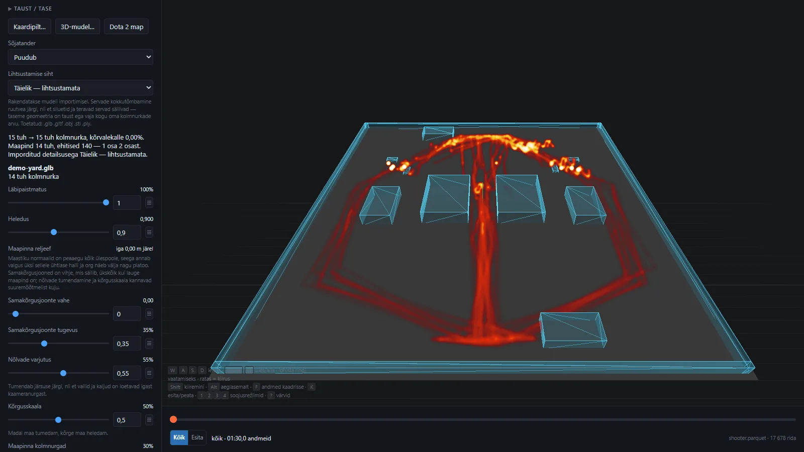
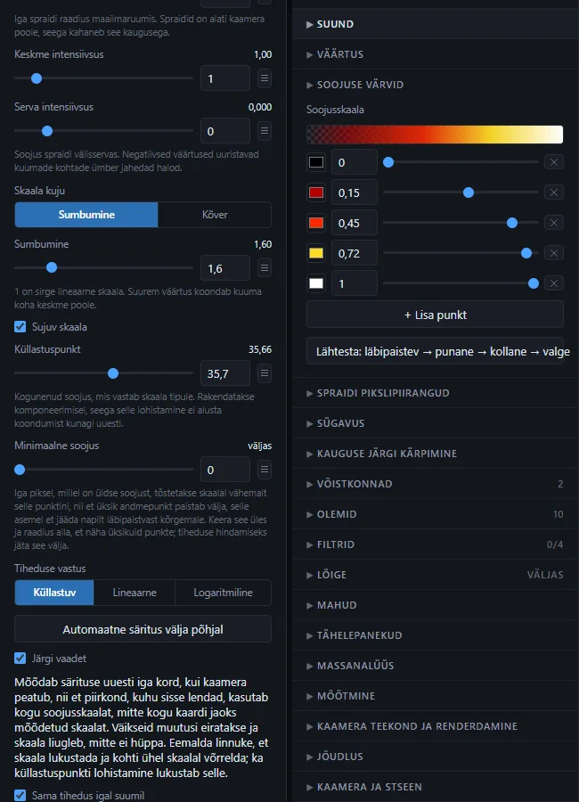

# Soojus

Soojus värvib kohad, kus juhtus palju asju: punane seal, kus juhtus veidi, valgelt kuum seal, kus juhtus palju. See vastab küsimusele "kus see juhtub ja kui palju".

**Soojus** (klahv 1) on vaikerežiim. Iga nähtav [rida](glossary.md) annab kaamera poole pööratud ümmarguse [spraidi](glossary.md); kattuvad spraidid liituvad ujukomapuhvris; summa suunatakse värviskaala kaudu - vaikimisi läbipaistev → punane → kollane → valge - ja joonistatakse stseeni peale.

Pilt näitab laskuri vooru soojust tasemel, kus on hooned: kuumad kohad asuvad ruumides ja trepil, mitte ainult maapinnal.

## Kuidas kasutada {#how-to-use-it}

1. Laadi andmed ja vajuta `1` (või vali režiimiribalt **Soojus**).
2. Kui kõik on valge või tühi, vajuta jaotises **Soojuse kuju** nuppu **Automaatne säritus välja põhjal**.
3. Muuda **Spraidi raadiust**, kuni kõrvuti olevad punktid ühinevad ribadeks: väiksem näitab üksikuid kohti, suurem näitab alasid.
4. Ava **Soojuse värvid**, et värve muuta, või **Sügavus**, et lasta künkadel ja seintel soojus enda taha peita.

Samad paneelid kujundavad [Erinevust](difference.md), [Võistkondade soojust](team-heat.md) ja [Joonesoojust](line-heat.md); need erinevad selle poolest, mida lisatakse (märgiga, värviga või mööda jooni), mitte selle poolest, kuidas.

## Paneelid ja nende vaikeväärtused {#the-panels-and-their-defaults}

Iga juhtnupp on selgitatud oma lehel; veerg Üksikasjad viitab sellele. Liugurite kõrval on kirjutatav kast ja lohistuskäepide (väike haarang paremal: lohista üles või alla, kaugemale on kiirem, Shift peenhäälestuseks); kui liuguri rada lõpeb enne päris piiri, võib käepide minna selle üle kuni siin antud *hüppamise lakini*. Väärtused märgitud *laadimisel* arvutatakse iga uue andmekogumi jaoks uuesti.

### Soojuse kuju (avatud) {#heat-shape-open}

| Juhtnupp | Vaikimisi | Vahemik (hüppamise lagi) | Üksikasjad |
|---|---|---|---|
| **Spraidi raadius** | 6 m; laadimisel ulatus / 120 | 0,05-2000 m, logaritmiline (50 000) | [Spraidi kuju](sprite-shape.md#sprite-radius) |
| **Keskme intensiivsus** | 1 | 0-10 (1000) | [Spraidi kuju](sprite-shape.md#centre-and-edge-intensity) |
| **Serva intensiivsus** | 0 | -2-10 (1000) | [Spraidi kuju](sprite-shape.md#centre-and-edge-intensity) |
| **Skaala kuju** | *Sumbumine* | *Sumbumine* / *Kõver* | [Spraidi kuju](sprite-shape.md#ramp-shape-falloff-or-curve) |
| **Sumbumine** (ainult Sumbumine) | 1,6 | 0,1-8 (64) | [Spraidi kuju](sprite-shape.md#falloff) |
| **Sujuv skaala** (ainult Sumbumine) | sees | | [Spraidi kuju](sprite-shape.md#falloff) |
| Kõvera redaktor (ainult Kõver) | eelseadistus *Sujuv* | | [Spraidi kuju](sprite-shape.md#the-curve-editor) |
| **Küllastuspunkt** | 24; laadimisel hinnang, seejärel mõõdetud | 0,1-4000, logaritmiline (10 000 000) | [Värv ja säritus](colour-and-exposure.md#saturation-point) |
| **Minimaalne soojus** | väljas (0) | 0-100% | [Värv ja säritus](colour-and-exposure.md#minimum-heat) |
| **Tiheduse vastus** | *Küllastuv* | *Küllastuv* / *Lineaarne* / *Logaritmiline* | [Värv ja säritus](colour-and-exposure.md#density-response) |
| **Automaatne säritus välja põhjal** | | nupp | [Värv ja säritus](colour-and-exposure.md#auto-exposure) |
| **Järgi vaadet** | sees | | Mõõdab särituse uuesti iga kord, kui kaamera peatub, nii et piirkond, millesse lendad, kasutab kogu värviskaalat. Väikesed muutused ignoreeritakse ja skaala libiseb. Eemalda linnuke või lohista **Küllastuspunkti**, et skaala lukustada ja võrrelda kohti ühel skaalal. [Värv ja säritus](colour-and-exposure.md#follow-the-view) |
| **Sama tihedus igal suumil** | sees | | Värv tähendab sama arvu ridu maa pindalaühiku kohta, olenemata sellest, kui lähedal oled. Pikslipiirangute poolt suurendatud (kaugel) või vähendatud (lähedal) spraid säilitab soojuse, mille tema tõeline suurus lisaks, nii et kaugelt särititud pilt ei hääbu, kui sisse lendad. Kui see on väljas, lisab piiratud spraid oma täiskaalu oma piiratud suuruses. [Spraidi kuju](sprite-shape.md#pixel-clamps) |
| **Lamenda maapinna tasandile** | väljas | | [Spraidi kuju](sprite-shape.md#flatten-onto-ground-plane) |

### Soojuse värvid (suletud) {#heat-colours-closed}

| Juhtnupp | Vaikimisi | Üksikasjad |
|---|---|---|
| Rühma värvinäidised ja **Värvide eraldus** (ainult Võistkondade soojus) | 1,4 | [Võistkondade soojus](team-heat.md) |
| **Soojusskaala** redaktor (*Positiivne (liitvad võistkonnad)* režiimis Erinevus, *Läbipaistmatuse skaala* režiimis Võistkondade soojus) | läbipaistev → punane → kollane → valge | [Värv ja säritus](colour-and-exposure.md#the-ramp-editor) |
| **Lähtesta: läbipaistev → punane → kollane → valge** | | |
| **Negatiivne (lahutavad võistkonnad)** skaala (ainult Erinevus) | läbipaistev → roheline → sinine → lilla | [Erinevus](difference.md#colours) |

### Spraidi pikslipiirangud (suletud) {#sprite-pixel-clamps-closed}

| Juhtnupp | Vaikimisi | Vahemik (hüppamise lagi) | Üksikasjad |
|---|---|---|---|
| **Min raadius pikslites** | 1 px | 0-16 (512) | [Spraidi kuju](sprite-shape.md#pixel-clamps) |
| **Max raadius pikslites** | 96 px | 2-1024, logaritmiline (8192) | [Spraidi kuju](sprite-shape.md#pixel-clamps) |

### Sügavus (avatud) {#depth-open}

| Juhtnupp | Vaikimisi | Üksikasjad |
|---|---|---|
| **Peida maastiku taha** | sees | [Sügavus ja kärpimine](depth-and-culling.md#hide-behind-terrain) |
| **Geomeetria taha peidetud** | 0,8 (*80% tuhmim*) | [Sügavus ja kärpimine](depth-and-culling.md#hidden-behind-geometry) |

### Kauguse järgi kärpimine (suletud) {#distance-culling-closed}

| Juhtnupp | Vaikimisi | Vahemik (hüppamise lagi) | Üksikasjad |
|---|---|---|---|
| **Lähedal** | väljas (0) | 0,5-5000 m, logaritmiline, raja alumine osa = väljas (200 000) | [Sügavus ja kärpimine](depth-and-culling.md#distance-culling) |
| **Kaugel** | väljas (0) | 1-200 000 m, logaritmiline, alumine osa = väljas (10 000 000) | [Sügavus ja kärpimine](depth-and-culling.md#distance-culling) |
| **Lõika tasandiga** | sees | | [Sügavus ja kärpimine](depth-and-culling.md#distance-culling) |
| **Lõika ka taset** | sees | | [Sügavus ja kärpimine](depth-and-culling.md#distance-culling) |

Klahvid: `[` ja `]` lükkavad kaugemat piiri sisse ja välja, `\` lülitab selle ([Sügavus ja kärpimine](depth-and-culling.md#keyboard)).

### Suund ja Väärtus {#direction-and-value}

Kaks rohkem jaotist on Soojuse kuju all. **Suund** joonistab iga rea kiilu ja lisab nooli: vt [Suunatud soojus](directional-heat.md). **Väärtus** kaalub soojust vastavalt sellele, mis iga rida maksis või teenis: vt [Väärtuse kaalumine](value-weighting.md).

## Mis salvestatakse {#what-is-saved}

Ülaltoodud soojuse seadeid ei salvestata seansside vahel: lehe uuesti laadimine taastab vaikeväärtused. Brauseris hoitakse kahte asja: viimane esituskiirus (`heat3d.speed`, vt [Ajajoon](timeline.md)) ja [kujude ülekatte](box-replay.md) kaugel olevate kujude seaded (tähiste stiil, suurus, tabamusmärgid jne). Samuti keel, [pööratud maailmatelg](camera.md#invert-world-axis), võidusõidu sakis meeldejäetud autode nimed ja [taseme raamatukogu](level-library.md). Täielik loend on lehel [Salvestatud seaded](ref-settings-storage.md).
