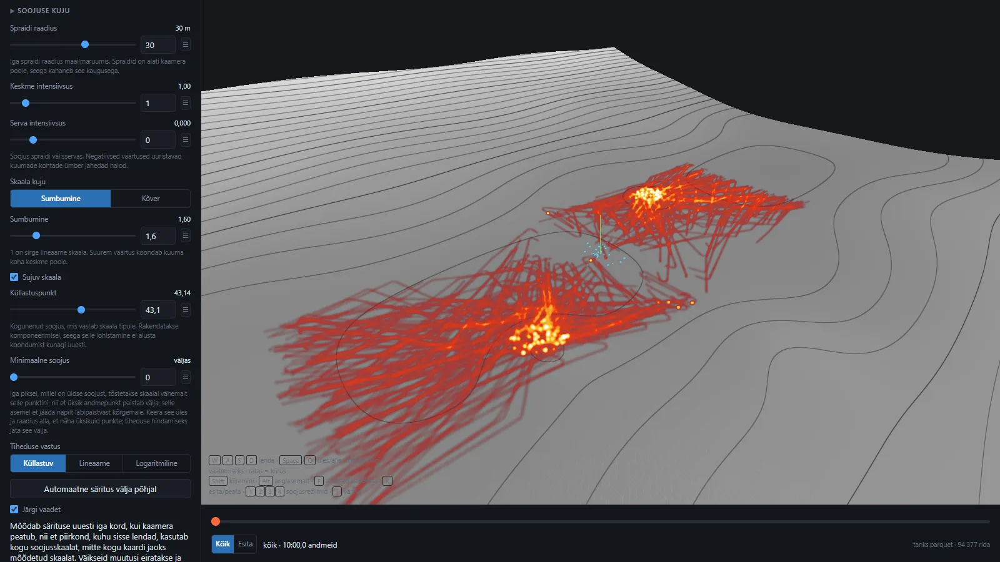
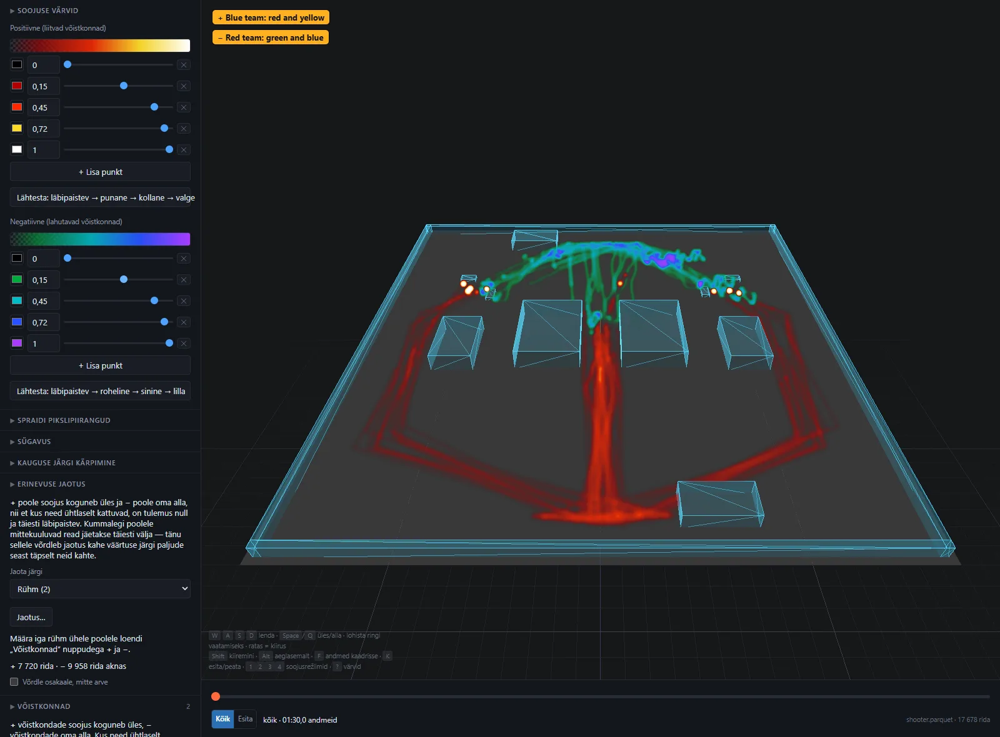
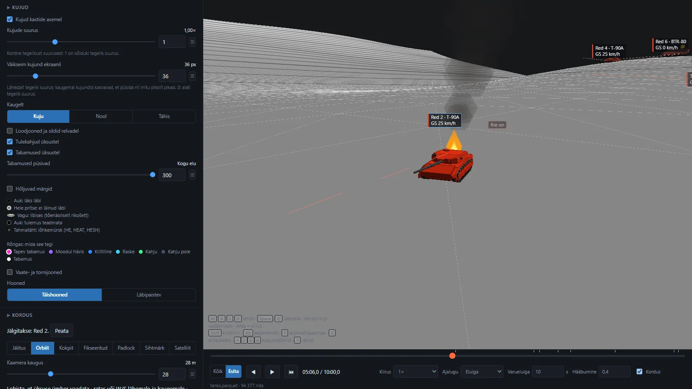
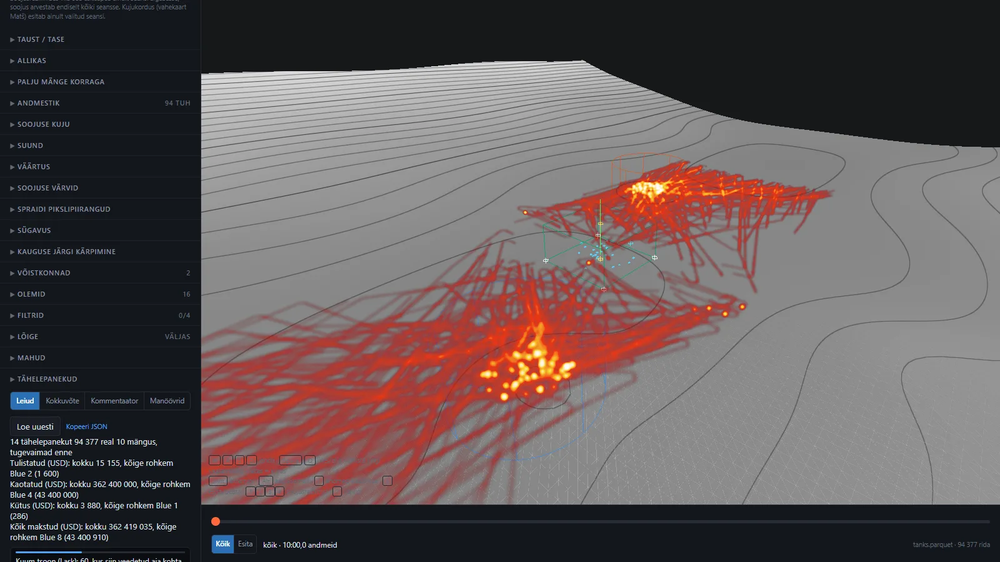
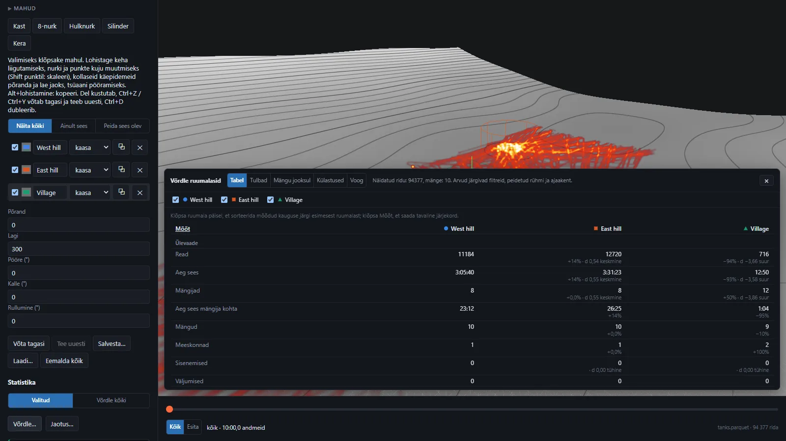
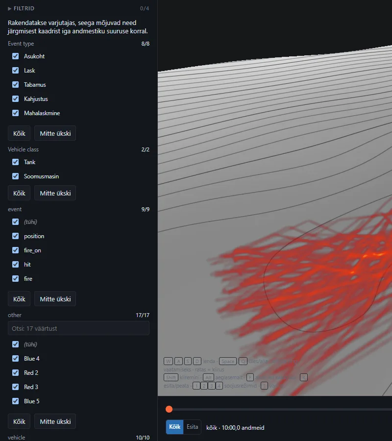
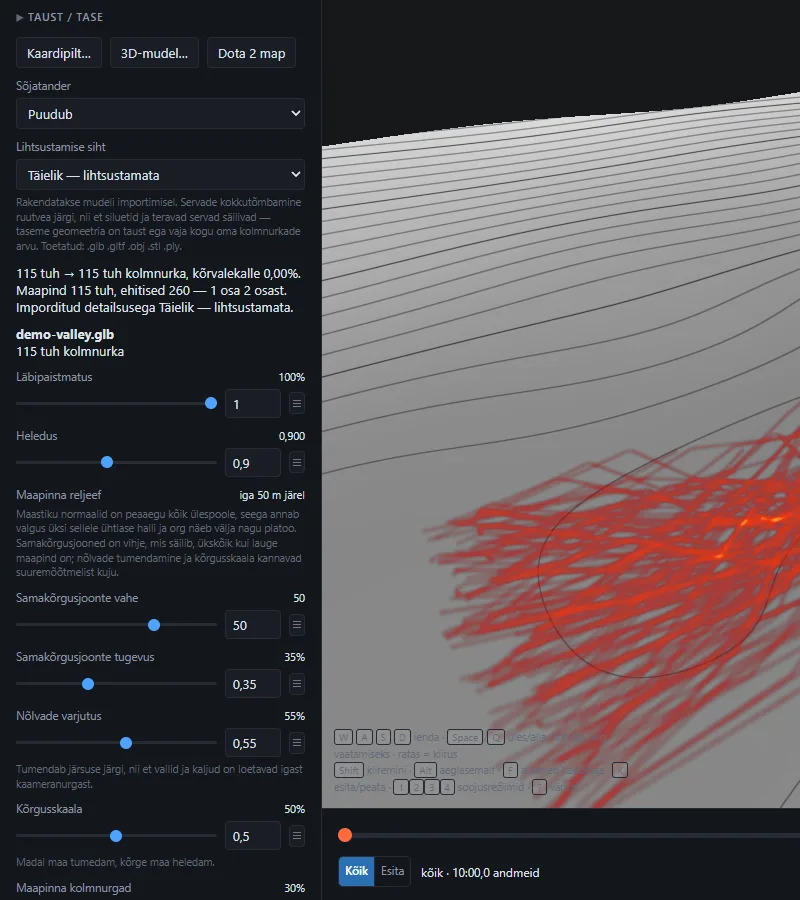

# 3DHeat

3DHeat näitab, kus asjad mängus juhtusid - kuhu mängijad läksid, kus nad võitlesid ja kukkusid - hõõguvate värvidena, millest saab lennata läbi, või väikeste 3D-kujudena, mis kordavad matši.

Laadi asukohad - CSV, Parquet, Tacview salvestised, konverteeritud kordused, üks fail, kaust või tuhanded matšid - ja vaata neid **soojuskaardina, millest saab lennata läbi**, **kujudena, mis kordavad matši**, joontena mööda marsruute, mida inimesed käisid, või ühe populatsioonina teise vastu. See leiab ise, mis silma paistab, ja töötab täielikult sinu brauseris: midagi ei laadita kuhugi üles. 3DHeat ja kõik selle tööriistad on tasuta ja avatud lähtekoodiga [MIT litsentsi](https://github.com/Holdi601/3DHeat/blob/main/LICENSE) all.



**Oled siin uus?** Tee [demoandmed](demo-data.md) ja järgi selle seitset sammu. Kõik sellel saidil olevad pildid on tehtud nende abil.

## Mida see teeb {#what-it-does}

| | |
|---|---|
|  | **[Soojusrežiimid](heat-modes.md)** - soojus, [erinevus](difference.md) (punane seal, kus üks pool oli rohkem, roheline-sinine seal, kus teine), [võistkondade soojus](team-heat.md), [joonesoojus](line-heat.md); [suunatud soojus](directional-heat.md) kiilude, noolevälja ja polaardiagrammidega; soojus [väärtuse järgi kaalutud](value-weighting.md): mis maksavad relvad, sõidukid ja kütus. |
|  | **[Matši kordus](match-replay.md)** - iga üksus [kujuna](figures.md) sellest, mis ta on, NATO- või vene sümbolid kaugel, raketid ja jäljed, tabamusmärgid, vrakid, tulekahjud, torned, eesmärgid, Tacview-laadsed kaamerad ja taktikaline kuva; [palju matše korraga](many-matches.md). |
|  | **[Tähelepanekud](insights.md)** - tugevad positsioonid, surmav maa, spawni lõksud, kitsaskohad ja silmapaistvad mängijad, leitud ja järjestatud koos tõenditega; kirjalik kokkuvõte, soovi korral mõne sinu valitud tehisintellekti poolt; kommentaator ühe matši jaoks; [teadmiste lääts](knowledge.md). |
|  | **[Mahud](volumes.md)** - joonista kaste, prisme, silindreid ja sfääre, filtreeri nende järgi, loenda, mis seal juhtub, ekspordi see ja võrdle kohti kõrvuti; [jaotus](breakdown.md), kes ja mis kohas kõige paremini toimib. |
|  | **[Filtrid](filters.md)** - sündmuse liigi, mängija või TI, sõidukiklassi, väärtuse, mis tahes veeru järgi, graafikakaardil mis tahes andmesuurusel. |
|  | **[Tasemed](levels.md)** - kaardipildid, 3D-tasemed, mis on tehtud [andmetööriistadega](#related-repositories), lihtsustamine, [maailmataust](world-backdrop.md) päris maastikuga lennuandmete jaoks. |

Lisaks: vahekaart [Sõiduanalüüs](race-analysis.md) võidusõidumängude ringide jaoks, vahekaart [Matš](match-analysis.md) Counter-Strike 2 kokkuvõteteks, [taktikatahvel](tactics-board.md) tasemel plaanide jaoks, [tabamuste analüüs](hit-analysis.md) sõiduki kaupa, [massanalüüs](mass-analysis.md) tuhandete matšide jaoks, [kaamerarajad ja video](camera-path-and-video.md), [40 keelt](languages.md), [meetermõõdustik või inglise ühikud](settings.md).

## Vahekaardid {#the-tabs}

Vahekaardid asuvad külgriba ülaosas nime, ühikute ja keelemenüü all.

| Vahekaart | Milleks ta on |
|---|---|
| **Soojuskaart** | Mis tahes positsioonitabel: soojusrežiimid, kujude ülekate, filtrid, mahud, tähelepanekud, tasemed, mõõtmine ja video. |
| **Sõiduanalüüs** | Kahe või enama ringi analüüs ühel rajal: kus aega kaotatakse, miks ja mida muuta. |
| **Matš** | Matši kujukordus ja Counter-Strike 2 matšikokkuvõtted. |
| **Taktika** | Plaanid tasemel: kujud, teed, visatav utiliit, alad ja märkmed sammudena, mis mängivad. |
| **Sõidukid** | Kus iga üksus tabati, kes ja millega. |

## Paigaldus ja käivitamine {#install-and-run}

3DHeat on vabalt kasutatav, muudetav ja jagatav (MIT litsents), samuti iga tööriist, mis on loetletud jaotises [Seotud hoidlad](#related-repositories).

### Windows, lihtne viis {#windows-the-easy-way}

Hoidla juur sisaldab kolme käsufaili.

| Fail | Mis see teeb |
|---|---|
| `start.bat` | Käivitab vaaturi. Leiab Node.js-i isegi siis, kui see ei ole `PATH`-is (vaatab kaustadest `%ProgramFiles%\nodejs`, `%ProgramFiles(x86)%\nodejs` ja `%LOCALAPPDATA%\Programs\nodejs`), ja kui Node.js puudub, pakub installida LTS-versiooni käsuga `winget install -e --id OpenJS.NodeJS.LTS`. Esimesel käivitamisel küsib enne sõltuvuste allalaadimist (umbes 300 MB kausta `node_modules\`, mitte süsteemi). Keeldub käivitamast, kui port 5273 on juba kasutusel, ja suunab `restart.bat` poole. Kui kaust on git-koopia ilma kohalike muudatusteta ja on uuem versioon, küsib, kas uuendada (Y/N; ilma vastuseta 60 s jääb see versioon); vt [Uuendused](updates.md). Seejärel käivitab arendusserveri aadressil `http://127.0.0.1:5273/` ja avab brauseri. **Aken on server**: jäta see lahti, sulge see või vajuta Ctrl+C, et peatada. |
| `restart.bat` | Käivitab `stop.bat quiet` ja seejärel `start.bat`. Vajalik ainult pärast `vite.config.ts` muutmist, sõltuvuse lisamist või kui server on kinni jooksnud - lähtekoodi muudatused laaditakse kuumalt uuesti. |
| `stop.bat` | Peatab pordil 5273 kuulava protsessi, leides selle protsessi-id `netstat`-i kaudu, mitte pildi nime järgi, nii et teised Node.js-i protsessid masinas jäävad rahule. Ootab umbes kaks sekundit, et pistik vabaneks. Argumendiga `quiet` ei peatu lõpus. |

### Käsitsi (mis tahes OS) {#by-hand-any-os}

```bash
git clone --recursive https://github.com/Holdi601/3DHeat.git
cd 3DHeat
npm install
npm run dev      # http://127.0.0.1:5273
```

Kaust `exporters/` sisaldab eraldi andmetööriistu git-alammoodulitena, igaüks oma hoidlana; pärast tavalist kloonimist käivita `git submodule update --init`. Vaatur ise ei vaja neid töötamiseks. Kaust `exporters/ext/` sisaldab valikulisi konverterid (War Thunder, World of Tanks, World of Warships, Squadi kordused; DCS- ja IL-2 kaardid), hoitud eraldi, et probleem ühega ei mõjutaks midagi muud.

Ükski mäng ei tule ühegi nende kaasas: tasemed, kaardid ja salvestised tehakse sinu enda arvutis tööriistadega, mängudest, mis on sinu omad.

### npm-skriptid {#npm-scripts}

| Skript | Mida ta käivitab |
|---|---|
| `npm run dev` | Vite arendusserver pordil 5273, seotud aadressiga `127.0.0.1`. |
| `npm run build` | Tüübikontroll (`tsc --noEmit`) ja tootmispakett kausta `dist/`. |
| `npm run preview` | Serveerib tootmispaketi. |
| `npm run typecheck` | Ainult tüübikontroll. |
| `npm test` / `npm run test:watch` | Ühiku- ja integratsioonitestid (vitest). |
| `npm run smoke` | Juhib päris rakendust peata Chromiumis ja kontrollib, et lõuendil on andmevärvilisi piksleid; ekraanipildid lähevad kausta `tools/.smoke/`. Eeldab, et arendusserver töötab. |
| `npm run smoke:f16` | Sama komplekt parameetriga `?heat=f16`, sundides pooltäpse akumulatsiooni tee (vt [Pooltäpne akumulatsioon](half-float-accumulation.md)). |
| `npm run bench` | Sisselugemise võrdlus, kirjutab faili `tools/.smoke/ingest-bench.json`. |
| `npm run test:heavy` | Testid, mis vajavad suuri päris andmefaile; need jäetakse ise vahele, kui faile pole. |
| `npm run inspect -- <file.parquet>` | Prindib Parquet-faili skeemi ja mõned read (`tools/inspect-parquet.mjs`). |

### Mida arendusserver lisab {#what-the-dev-server-adds}

Vaatur on staatiline veebileht, aga arendusserver (vt `vite.config.ts`) lisab kaks kohalikku marsruuti, mida staatilisel `dist/` paigutusel ei ole:

- `/__host/memory` teatab masina paigaldatud ja vaba RAM-i ning, kui see seda lugeda oskab, graafikakaardi mälu (`nvidia-smi`-st või Windowsis ekraanikaardi registrikirjest). See laseb [mälueelarvetel](memory-and-budgets.md) kasutada päris arve brauseri piiratud oletuste asemel.
- `/__heat3d/update` kontrollib, kas koopia on maha jäänud, ja saab selle kiire edasiliikumisega uuendada ([Uuendused](updates.md)).

Server seob end ainult aadressiga `127.0.0.1`, nii et kumbagi marsruuti ei jõua võrgust. Ava see aadressil `http://127.0.0.1:5273`: `localhost` võib lahendada IPv6 loopback'iks `::1`, kus ükski ei kuula. Ta ei saada cross-origin isolation päiseid (COOP/COEP): vaatur ei kasuta ühtegi `SharedArrayBuffer`-it, ja töötajad annavad oma andmed üle ülekandega, mis seda ei vaja.

## Brauseri ja GPU nõuded {#browser-and-gpu-requirements}

- **Brauser WebGPU või WebGL2 toega.** WebGPU proovitakse esimesena (Chrome ja Edge on selle juures); ilma selleta kasutatakse WebGL2 renderdajat. WebGL2 peab pakkuma `EXT_color_buffer_float` (renderdamine ujukomatekstuuridesse), muidu näitab vaatur "Renderdajat ei saa lähtestada." Vt [Kaks renderdajat](backends.md). Vaatur on arendatud ja testitud Chromiumis; teised brauserid pole kontrollitud.
- **Riistvaraline kiirendus sisse lülitatud.** Kui brauser joonistab protsessoril (SwiftShader, llvmpipe, Microsofti põhiline renderdusdraiver jt), näitab külgriba ülaosas punane riba seda ja ütleb, kuidas parandada. Vt [Tarkvaralise renderduse tuvastamine](software-rendering.md).
- **Eraldi GPU aitab, aga pole nõutav.** Mõlemad renderdajad küsivad suure jõudlusega adapterit. Andmemahu, mida GPU-l hoida saab, on eelarve, mida näed ja muudad ([Mälu ja eelarved](memory-and-budgets.md)).
- **Valikulised funktsioonid** kasutavad veel brauseri API-sid: videorenderdus vajab WebCodecs `VideoEncoder`-it VP9 või VP8-ga ([Kaamerarada ja video](camera-path-and-video.md)); tasemete võrgu lihtsustamine vajab WebAssembly-t; kaustade lohistamine kasutab File and Directory Entries API-t; tasemete raamatukogu kasutab IndexedDB-d; mängupultid kasutavad Gamepad API-t.

## Dokumentatsiooni kaart {#documentation-map}

**Alustamine**: [Demoandmed](demo-data.md) · [Andmete sisselugemine](getting-data-in.md) ([failide laadimine](loading-files.md), [veergude seostamine](column-mapping.md), [teljed, ühikud ja aeg](axes-units-and-time.md), [sessioonid, isikud ja rühmad](sessions-persons-groups.md), [Tacview](tacview-acmi.md), [konverterid](converters.md), [.3dheat](container.md), [mälu ja eelarved](memory-and-budgets.md))

**Vaata**: [Soojusrežiimid](heat-modes.md) ([soojus](heat.md), [kujundi kuju](sprite-shape.md), [värv ja säritus](colour-and-exposure.md), [sügavus ja eemaldamine](depth-and-culling.md), [erinevus](difference.md), [võistkondade soojus](team-heat.md), [joonesoojus](line-heat.md), [kasti kordus](box-replay.md), [suunatud soojus](directional-heat.md), [väärtuskaalumine](value-weighting.md)) · [Ajajoon](timeline.md) · [Tasemed](levels.md) ([kaardipildid](map-images.md), [3D-tasemed](model-levels.md), [välimus](level-appearance.md), [teek](level-library.md), [maailmataust](world-backdrop.md), [selle allikad](world-backdrop-sources.md)) · [Kaamera](camera.md) ([mängupult](gamepad.md), [klahvid](keyboard-reference.md)) · [Kaamerarada ja video](camera-path-and-video.md)

**Analüüsi**: [Filtrid ja tööriistad](filters-and-tools.md) ([filtrid](filters.md), [võistkonnad](teams-list.md), [üksused](entities.md), [lõik](slice.md), [mõõtmine](measure.md), [mahud](volumes.md), [jaotus](breakdown.md)) · [Tähelepanekud](insights.md) ([teadmiste lääts](knowledge.md)) · [Massanalüüs](mass-analysis.md)

**Kordus**: [Matši kordus](match-replay.md) · [Palju matše korraga](many-matches.md) · [Kujud](figures.md) ([kujude ülekattes](figure-replay.md), [autorlus](figure-credits.md)) · [Tacview tasemel](tacview-parity.md) · [Tabamuste analüüs](hit-analysis.md)

**Muud vahekaardid**: [Sõiduanalüüs](race-analysis.md) ([meetod](race-analytics.md), [muud mängud](other-games.md)) · [Matšianalüüs](match-analysis.md) · [Taktikatahvel](tactics-board.md) ([kiirused](tactics-speeds.md))

**Vaatur**: [Sõnastik](glossary.md) · [Seaded, ühikud ja klahvid](settings.md) · [Keeled](languages.md) · [Uuendused](updates.md) · [Renderdamise sisemine tööpõhimõte](rendering-internals.md) ([renderdajad](backends.md), [akumulatsioon](accumulation.md), [valimi võtmine ja eelarved](sampling-and-budgets.md), [pooltäpne](half-float-accumulation.md), [GPU mälu](gpu-memory.md), [tarkvaraline renderdus](software-rendering.md), [jõudlus ja statistika](performance-and-stats.md)) · [Andmevormingud](data-formats.md) · [Viide](reference.md) · [Dokumentatsiooni hooldamine](maintaining.md)

## Seotud hoidlad {#related-repositories}

Vaatur loeb andmeid; need tööriistad teevad need. Igaüks on oma avalik hoidla (MIT) oma dokumentatsiooniga. Ükski neist ei anna kaasa mängu andmeid: tasemed, kaardid ja salvestised tehakse sinu enda arvutis, mängudest, mis on sinu omad.

| Hoidla | Mida ta teeb | Kasulik | Dokumentatsioon |
|---|---|---|---|
| [3DHeat-GameFiles](https://github.com/Holdi601/3DHeat-GameFiles) | Loeb rajad ja tasemed välja arhiividest, mida mängud kaasa toovad (Forza Horizon, BeamNG, Assetto Corsa Rally; Unreal, Unity, Frostbite ja Source 2 lugejad) glTF-ina | 3D-tase sinu soojuse või kordusel alla | [sait](https://holdi601.github.io/3DHeat-GameFiles/) |
| [3DHeat-GameCapture](https://github.com/Holdi601/3DHeat-GameCapture) | Salvestab ringitelemeetria, mida võidusõidumängud avaldavad, ja ehitab tasemed mängu videost | ringid Sõiduanalüüsi jaoks; tase kohas, kus failisid lugeda ei saa | [sait](https://holdi601.github.io/3DHeat-GameCapture/) |
| [3DHeat-UnrealExporter](https://github.com/Holdi601/3DHeat-UnrealExporter) | Unreal Editori plugin, mis ekspordib taseme ühe glTF-failina | sinu enda Unreal-projektide tasemed | [sait](https://holdi601.github.io/3DHeat-UnrealExporter/) |
| [3DHeat-CS2](https://github.com/Holdi601/3DHeat-CS2) | Counter-Strike 2 demod soojustabeliteks ja matšikokkuvõteteks, CS2 kaardid geomeetriaks | CS2 soojus, kordused ja Matši vahekaart | [sait](https://holdi601.github.io/3DHeat-CS2/) |
| [3DHeat-Watcher](https://github.com/Holdi601/3DHeat-Watcher) | Salvestab sinu mängu taustal sellest, mida mängud avaldavad: telemeetria, mängu oleku integratsioonid, logid, kordused | sinu enda statistika ilma käsitsi tegemata | [sait](https://holdi601.github.io/3DHeat-Watcher/) |
| [3DHeat-Ext-WarThunder](https://github.com/Holdi601/3DHeat-Ext-WarThunder) | War Thunderi kordused (`.wrpl`) tabeliteks: õhu- ja maismaajäljed, lasud, tabamused, tapmised, torned, eesmärgid | War Thunderi kordused, tabamusmärgid ja tähelepanekud | [sait](https://holdi601.github.io/3DHeat-Ext-WarThunder/) |
| [3DHeat-Ext-WoT](https://github.com/Holdi601/3DHeat-Ext-WoT) | World of Tanksi kordused tabeliteks: iga sõiduki asukoht, surmad ja tapmised | World of Tanksi soojus ja kordused | [sait](https://holdi601.github.io/3DHeat-Ext-WoT/) |
| [3DHeat-Ext-WoWs](https://github.com/Holdi601/3DHeat-Ext-WoWs) | World of Warshipsi kordused tabeliteks: iga laeva asukoht ja uppumised | World of Warshipsi soojus ja kordused | [sait](https://holdi601.github.io/3DHeat-Ext-WoWs/) |
| [3DHeat-Ext-Squad](https://github.com/Holdi601/3DHeat-Ext-Squad) | Squadi serveri demod tabeliteks: iga mängija asukoht, meeskond ja salk | Squadi soojus ja kordused | [sait](https://holdi601.github.io/3DHeat-Ext-Squad/) |
| [3DHeat-Ext-DCS](https://github.com/Holdi601/3DHeat-Ext-DCS) | DCS World'i maastikud sinu enda installist tasemeteks: maapind, teed, linnad, lennuväljad, väljad, vesi | DCS ja Tacview salvestised nende päris maastikul | [sait](https://holdi601.github.io/3DHeat-Ext-DCS/) |
| [3DHeat-Ext-IL2](https://github.com/Holdi601/3DHeat-Ext-IL2) | IL-2 Great Battlesi kaardid tasemeteks | IL-2 salvestised nende kaardil | [sait](https://holdi601.github.io/3DHeat-Ext-IL2/) |

## Lähtekoodi paigutus lühidalt {#source-layout-briefly}

| Kaust | Sisu |
|---|---|
| [`src/data/`](https://github.com/Holdi601/3DHeat/tree/main/src/data) | Failide valimine, CSV- ja Parquet-sisselugemine, automaatne seostamine, valideerimine, mälumudel, andmestiku koostaja, mudelite parsimine, klassifitseerimine, lihtsustamine, tasemeteek |
| [`src/render/`](https://github.com/Holdi601/3DHeat/tree/main/src/render) | Kaadriahel (`engine.ts`), valimi võtmine, mõlemad renderdajad, kaamera, mängupult, mõõtmine, kaamerarada, videosalvestus |
| [`src/state/`](https://github.com/Holdi601/3DHeat/tree/main/src/state) | Rakenduse olek (`store.ts`) koos kõigi vaikeväärtustega, domeenitüübid (`types.ts`), kujundi kõver |
| [`src/ui/`](https://github.com/Holdi601/3DHeat/tree/main/src/ui) | Külgriba paneelid, ajajoon, ülekatted |
| [`src/race/`](https://github.com/Holdi601/3DHeat/tree/main/src/race), [`src/match/`](https://github.com/Holdi601/3DHeat/tree/main/src/match) | Sõiduanalüüsi ja Matši vahekaardid |
| [`src/i18n/`](https://github.com/Holdi601/3DHeat/tree/main/src/i18n) | Tõlked |
| [`src/insights/`](https://github.com/Holdi601/3DHeat/tree/main/src/insights) | Tähelepanekud: detektorid, kokkuvõte, kommentaator, TI teenusepakkujad, teadmiste lääts |
| [`src/mass/`](https://github.com/Holdi601/3DHeat/tree/main/src/mass) | Massanalüüs paljude matšide üle |
| [`src/volumes/`](https://github.com/Holdi601/3DHeat/tree/main/src/volumes) | Mahud, nende statistika, eksport ja võrdlus |
| [`src/breakdown/`](https://github.com/Holdi601/3DHeat/tree/main/src/breakdown) | Jaotus ja tegurid |
| [`src/overlay/`](https://github.com/Holdi601/3DHeat/tree/main/src/overlay) | Palju-matšide ülekate |
| [`src/figures/`](https://github.com/Holdi601/3DHeat/tree/main/src/figures) | Kujude kataloog ja selle ehitaja |
| [`src/vehicle/`](https://github.com/Holdi601/3DHeat/tree/main/src/vehicle) | Tabamuste analüüs (vahekaart Sõidukid) |
| [`src/tactics/`](https://github.com/Holdi601/3DHeat/tree/main/src/tactics) | Taktikatahvel |
| [`src/world/`](https://github.com/Holdi601/3DHeat/tree/main/src/world) | Maailmataust |
| [`src/units/`](https://github.com/Holdi601/3DHeat/tree/main/src/units) | Mõõtühikud |
