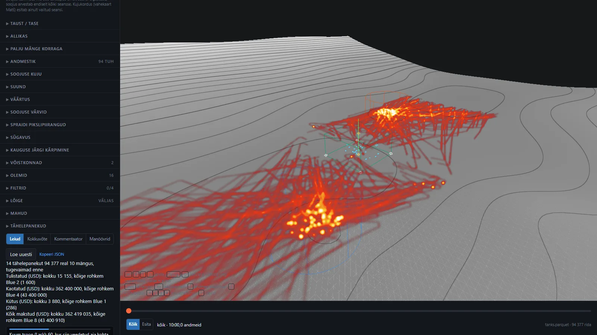
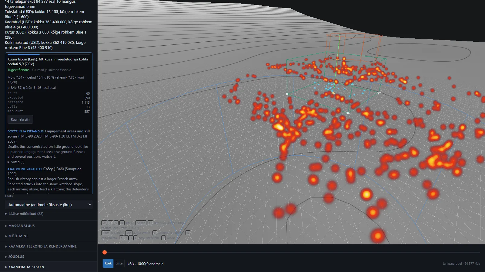
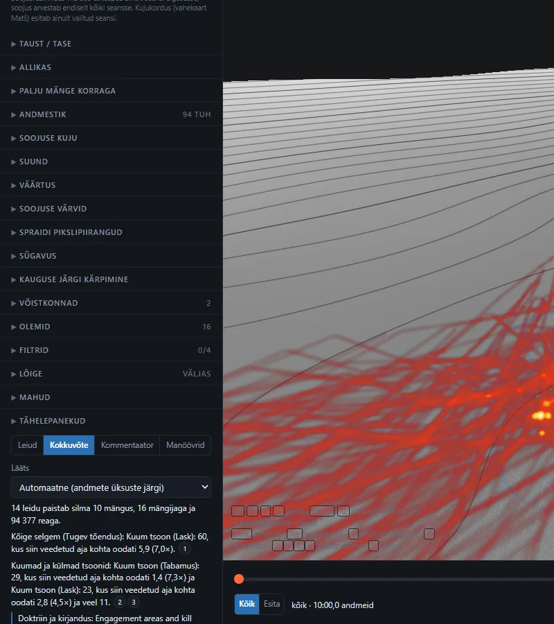
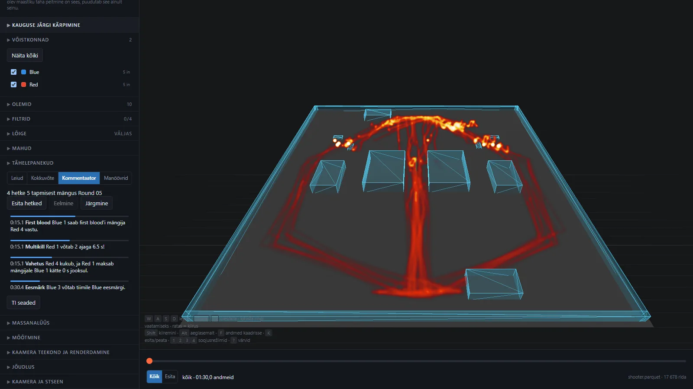

# Tähelepanekud

**Tähelepanekud** vaatab laetud andmetest läbi, mis silma paistab - tugevad positsioonid, surmav maa, spawni lõksud, kitsaskohad, mängijad, kes on kaaslastest kaugelt ees - ning ütleb sulle tugevaimad esimesena koos tõenditega. Kasuta seda, et minuti jooksul õppida, kus matš võideti või kaotati. Seejärel saab ta kirjutada kokkuvõtte, ja ühes kordusega võib ta toimida kommentaatorina, mis hüppab suurte hetkede juurde.

Kõik loetakse sinu brauseris. Midagi ei lahku sinu arvutist, kui sa ei lülita sisse välist tehisintellekti (vt [Väline tehisintellekt](#external-ai)).

Jaotis **Tähelepanekud** asub Soojuskaardi ja Matši vahekaartide külgribal. Sellel on kolm vahekaarti: **Leiud**, **Kokkuvõte** ja **Kommentaator**.

## Leiud {#findings}

1. Laadi andmed ja ava **Tähelepanekud**. Vajuta **Leia tähelepanekuid** ("Loendan… n%" näitab edenemist).
2. Loe loetelu. Igal leiul on tugevusriba, lause, tõendite kvaliteet (*Tugevad tõendid*, *Head tõendid* või *Mõningad tõendid*), detektor, mis selle leidis, ja sõidukiklass, kui see on oluline.
3. **Klõpsa leiul**: vaatur rakendab selle filtrid, lendab kaameraga kohale, hüppab sellele ajale ja avab üksikasjad: mõju koos 95% usaldusvahemikuga, p- ja q-väärtused, loetud tõendid ja **Ruumala siin**, mis joonistab koha ümber [mahu](volumes.md).
4. **Taasta filtrid** paneb sinu filtrid tagasi. **Kopeeri JSON** kopeerib kogu aruande.

Loendamine kasutab praegusi filtreid, peidetud rühmi ja valitud matši kogu ajavahemiku üle. Kui pärast seda filtreid muudad, ütleb märkus seda; vajuta **Loe uuesti**.

Loetelu ülaosa read (näiteks rahasummad) kokkuvõtavad kogu andmeid enne leide.

### Detektorid {#the-detectors}

| Detektor | Mida ta leiab | Vajab andmetes |
|---|---|---|
| **Võimupositsioonid** | Kohad, kus tapmise ja surma suhe on kaardi teistest kohtadest palju parem, ja *turvaline maa*, kus vähe surevad aja kohta, mis seal veedetakse | tapmis- ja surmasündmusi |
| **Kuumad ja külmad tsoonid** | Kohad, kus sündmuse liik (lasud, tabamused, vallutused ...) esineb palju sagedamini või harvemini, kui seal veedetud aeg ennustab | sündmuste veergu |
| **Lage maa ja kate** | Surmad lagedal lähedal asuva tasemegeomeetria juures ning aeglasus kiire liikumise vastu | surmu; 3D-taset geomeetria osa jaoks |
| **Spawnid** | Tugevad spawnid, spawni lõksud, turvalised spawnid, aeg esimese kokkupuuteni | aega ja isikuid |
| **Klass koha järgi** | Sõidukiklass või mängijad TI vastu, kes teevad piirkonnas palju paremini või halvemini | tapmisi pluss sõidukiklassi või mängija/TI veergu |
| **Mängijad** | Mängijad, kes tapavad või surevad palju rohkem või vähem kui teised samas klassis | isikuid ja tapmisi |
| **Kitsaskohad ja tiivad** | Kitsaskohad (palju rohkem ületusi kui ümbritsevas maas) ja tiivateed (harva kasutatud, aga viivad tapmisteni) | isikuid |
| **Väärtus** | *Kulukas maa* ja *Teenistav maa* | [väärtuste veerud](value-weighting.md) |
| **Mis otsustas voorud** | Mis lahutas võidetud voorud kaotatutest, ja mängijad, kes lisasid või maksid kõige rohkem võidutõenäosust (vt [Kes võitis](#who-won-what-decided-the-rounds)) | voorud, tapmised ja surmad ning [tulemuse veerud](data-formats.md#outcome-columns) (`won`) |

Detektorid, mida andmed ei võimalda käivitada, on loetletud allservas koos põhjusega.

### Kuidas leide järjestatakse {#how-findings-are-ranked}

Iga koht või rühm testitakse võrreldes kogu ülejäänud kaardiga (täpsed binoomi- või määrade testid). Valede avastuste määr hoitakse 5% juures (Benjamini-Hochberg). Juhus võib välja näida nagu muster; see hoiab valehäired madalal: näidatud leidude seas on eeldatavasti kuni umbes üks kahekümnest juhuslik. Vähestest sündmustest tulenevad mõjud tõmmatakse enne järjestamist "mõju puudumise" poole. Loetelus on kuni 60 leidu ja iga detektor saab mõne koha tippude hulgas.

### Kes võitis {#who-won-what-decided-the-rounds}

Kui matšid ütlevad, kes iga vooru võitis ([tulemuse veerg](data-formats.md#outcome-columns) `won`), on tulemus omaette sihtmärk:

- **Kohad: võiduprotsent.** Iga poole jaoks tema voorude osa kohas, mille ta võitis, võrreldes osaga, mille ta võitis samas matšis ükskõik kus – nii on kaardi, poole ja matši enda tasakaal baasjoon, ja silma paistavad ainult kohad, mille hoidjad võidavad rohkem (või vähem) oma voorudest. Väljamõeldud näide: *„Dust: pool T võidab siin olles rohkem oma voorudest: 61% 412-st võidetud, võrreldes 49%-ga, mida oodatakse tema enda määra järgi samades matšides (šansid 1,6x; hoitud 31/48 matšis).“* Sama valeavastuste määr ja stabiilsuskontrollid nagu igal kohal; **Laadi** laadib matšid, kus kohta hoiti, ja näitab selle poole asukohti.
- **Nišid: vooruvõit.** Tabelis **Voorud** on iga elu voor: kaart, pool, matši osa (voorud 1–4, 5–8, ...), sõiduk (operaator, agent), kõige rohkem kasutatud relv, kõige kauem hoitud koht, ostud (eco, force, full) ja kas tema pool tegi esimese tapmise. Rühma hinnatakse selle järgi, mida tema pool samades matšides võitis, nii et *T Dustil AWP-ga* on niš ainult siis, kui need voorud võideti sagedamini kui T teised voorud neis matšides. Väljamõeldud näide: *„m1 · T · AWP: võidab 80% 320 voorust, võrreldes 62%-ga, mida oodatakse samadelt pooltelt samades matšides (šansid 2,3x; 40 matši).“* Järjestatud tõusu ja toe korrutise järgi; **Laadi** laadib matšid, mille voorudes see kõige rohkem ilmneb.

Mõlemad vajavad versiooni 2 kokkuvõtteid (vt [Kokkuvõtete saamine](#getting-the-summaries)): vanemad arvutatakse uuesti.

## Kokkuvõte {#debrief}

Vahekaart **Kokkuvõte** kirjutab leiud kokku lühikeseks tekstiks: juhtlause, selgeim leid, üks taktika kohta, üks tasakaalustamise kohta, siis - kui andmed ütlevad, kes võitis - mis otsustas voorud, ülejäänud detektorite kaupa rühmitatuna ning mitu neist põhineb nõrgematel tõenditel.

Mis otsustas voorud, tuleb neljas lõigus: seis ja kust võidutõenäosused tulevad; tugevaimad tegurid koos arvude, vahemiku ja q-ga (kui ükski ei läbi valeavastuste määra, ütleb tekst *miski pole veel kindel* ja nimetab siiski tugevaima); kolm suurimat pöördepunkti; ning mängijad, kes lisasid ja maksid kõige rohkem võidutõenäosust, koos kohtadega, mis võitsid kõige rohkem. Väljamõeldud näide:

> T võitis 23 ja CT võitis 17 vooru 40-st teadaoleva tulemusega voorust (T: 58%, 95% 42% kuni 72%). Võidutõenäosused tulevad nendele voorudele sobitatud mudelist.
>
> Mis lahutas võidetud voorud kaotatutest: T võitis 79% neist 19 voorust, kus ta hoidis Midi, võrreldes 24%-ga 21 voorust ilma selleta (55 protsendipunkti, 95% 26 kuni 74) (q 0,004), ...
>
> Pöördepunktid: voor 17 ajal 48 s, CT tapmine B site'is muutis tema võimalust 31%-lt 58%-le, ja ta võitis vooru, ... Igal lõigul on nummerdatud nupud, mis näitavad selle leide. **Kopeeri tekst** kopeerib selle.

Sisseehitatud jutustaja töötab võrguühenduseta, sinu keeles. Selle kohal olev valija **Lääts** (vt [Teadmiste lääts](knowledge.md)) otsustab, millist kirjandust lõigud tsiteerivad.

### Väline tehisintellekt {#external-ai}

**TI seaded** laseb kirjutada kokkuvõtte mõne sinu valitud tehisintellekti mudeliga:

| Seade | Tähendus |
|---|---|
| **Teenusepakkuja** | Anthropic (Claude), OpenAI (ChatGPT), OpenRouter, Ollama (kohalik), LM Studio (kohalik), llama.cpp server (kohalik) või mis tahes OpenAI-ühilduv lõpp-punkt |
| **Baas-URL**, **Mudel** | Teenusepakkuja täidab; **Loetle mudelid** küsib serverilt |
| **API võti** | Saadetakse ainult baas-URL-ile. Ei logita kunagi, ei salvestata vaadetes, eksportides ega `.3dheat` failides. Enamik kohalikke servereid ei vaja ühtegi. |
| **Jäta võti selles brauseris meelde** | Vaikimisi väljas: võti unustatakse, kui leht suletakse |
| **Kasuta välist tehisintellekti** | Vaikimisi väljas |
| **Saada mängijate nimed** | Vaikimisi väljas: mängijad saadetakse kui P1, P2 ... |

Seejärel kirjuta soovi korral küsimus ja vajuta **Kirjuta TI-ga**. Saadetakse ainult leiud ja nende arvud - mitte kunagi sinu andmete read. Vastus voolab sisse; viidatud leiud muutuvad nuppudeks. Kui andmed ütlevad, kes võitis, kästakse mudelil alustada sellest, mis otsustas voorud, iga arvu vahemiku ja q-ga, ning öelda, kui tegur põhineb vähestel voorudel või võidutõenäosused tulevad priormudelist.

## Kommentaator {#caster}

**Ühe matši** jaoks (vali üks, kui on laetud mitu) leiab **Kommentaator** hetked, mis on jälgimist väärt: esimene veri, mitmiktapmised, vahetused, kriitilised lahingud, eesmärgi muutused, tagasitulekud, silmapaistvad mängijad, pikad lasud ja **pöördepunktid** - tapmised, mis muutsid poole võimalust vooru võita kõige rohkem (kummalgi poolel elus olevate mängijate järgi, voorudes ilma taassünnita).

Kui andmed ütlevad, kes iga vooru võitis, ütleb iga hetk seda: *„Anna võtab Beni maha: T võimalus vooru võita tõuseb 38%-lt 62%-le - ja nad võidavad vooru.“* Lõpuks võitnud poole hetk loeb rohkem, kui kommentaator valib, milliseid hoida, ja tagasitulek loetakse võidetud voorudes.

- Klõpsa hetkel: vaade lülitub kordusele, hüppab just enne seda, lendab sinna ja jälgib mängijat.
- **Esita hetked** mängib iga hetke lõpuni ja liigub edasi; **Eelmine** / **Järgmine** liiguvad hetkede vahel.
- Kui väline tehisintellekt on sisse lülitatud, kirjutab **TI kommentaar** hetkede loetelust kommentaari (liigid, ajad, nimed või pseudonüümid, meeskonnad, klassid, kaugused).

Vajab isikuid ja tapmis-/surmasündmusi (või vallutusi); `other`/`victim` veerg teeb võimalikuks vahetused ja pikad lasud.

## Teadmiste lääts {#knowledge-lens}

Leidu saab lugeda läbi **läätse** tuntud teadmistest: sõjadoktriin, õhu- ja merelahingud, linnaoperatsioonid, mänguarendus ja e-spordi (või *Automaatne*, mille valivad andmete üksused). Avatud leid näitab siis lähimat **doktriini ja kirjanduse** kirjet ja **ajaloolist paralleeli** viidetega ning **Läätse mõõdikud** arvutab kirjandusest pärinevad mõõdikud andmetel (Lanchesteri sobitused, vahetussuhted, jõusuhted, tulealad, võtmemaastik, vahetused, algatusvõime). Kokkuvõte ja TI viip sisaldavad neid. Kõik selle kohta: [Teadmiste lääts](knowledge.md).

Läätse mõõdikud mõõdavad ka seda, kuidas mängijad käituvad rahvamassina ja rühmana - joondumine ja ringlemine, teekonna karjatamine, rajad ja jäljed, tihedus, juhid ja järgijad, mahajääjad, murdepunkt kaotuste korral, risk pärast kaotatud elu, seeriad, ostude kokkulangevus ja reaktsioon sissetulevale tulele - igaüks oma nullmudeli vastu: [Kollektiivne käitumine](collective-behaviour.md).

## Andmed, mis teevad tähelepanekud toimivaks {#data-that-makes-insights-work}

- asukohad koos **ajaga**, **isiku** ja **meeskonna** veeruga;
- **sündmuse** veerg tapmiste ja surmadega (`kill`, `death`) ning teised (`hit`, `fire`, `capture` ...);
- **teise osapoole** veerg (`other`, `victim`) vahetuste ja suundade jaoks;
- **sõiduki** või **tüübi** veerg klasside jaoks; `ai` veerg mängijate vastu TI-ga;
- **seansi** / **matši** / **vooru** veerg, kui matše on mitu.

[Demoandmetel](demo-data.md) on need kõik.
