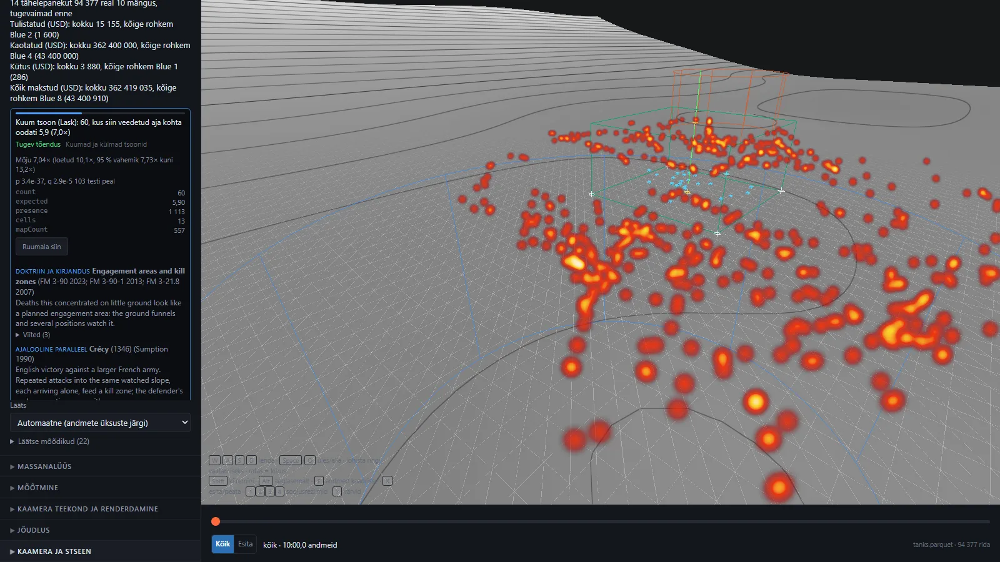

# Teadmiste lääts

Kui [Tähelepanekud](insights.md) leiab midagi, selgitab see osa seda ideedega sõjaajaloost, mängudisainist ja spordianalüüsist ning nimetab raamatu
või artikli, kust see pärineb. Kasuta seda selleks, et õppida *miks* muster on oluline, mitte ainult et ta on olemas.

## Proovi {#try-it}

1. Laadi andmed ja ava **Tähelepanekud**, seejärel vajuta **Leia tähelepanekuid**.
2. Klõpsa leiul, et seda avada.
3. Loe **Doktriin ja kirjandus** ja **Ajalooline paralleel**; täielikud viited on all kokku volditud.
4. Muuda **Läätse** (näiteks *Sõjadoktriin*), et lugeda sama leidu teise kirjanduse kaudu.

## Kuidas see töötab {#how-it-works}

Tähelepanekute paneel hindab oma leide nii, nagu seda teeks professionaalne analüütik: sõjadoktriini ja operatsioonianalüüsi,
ajalooliste lahingute ning mängu-, taseme- ja analüütikakirjanduse kaudu. Ta teeb seda võrguühenduseta, vaaturis olevast
hoolikalt koostatud teadmusbaasist, ja annab sama materjali välisele mudelile, kui see kirjutab kokkuvõtte.

## Mida paneel näitab {#what-the-panel-shows}

- **Lääts** valib kirjanduse, mille kaudu leide loetakse: *Auto* (valitakse andmetes olevate üksuste liikide järgi: lennukid, laevad, maismaasõidukid, jalavägi), *Sõjadoktriin*, *Õhulahing*, *Merevägi*, *Linn*, *Mängudisain ja tasakaal*, *Esport*. Valitud läätsest väljapool olevad kirjed jäetakse välja.
- Iga avatud leid näitab oma lähimat **doktriini ja kirjanduse** kirjet ja oma lähimat **ajaloolist paralleeli**, täielike viidetega all kokku volditud.
- **Läätse mõõdikud** loetleb samadel ridadel arvutatud operatsioonianalüüsi mõõdikud (allpool), igaühega, mida see tähendab, ja selle kirjandusega.
- **Kokkuvõte** lisab read juhtivate leidude ja läätse mõõdikute kohta: "Doktriin ja kirjandus: ..." ja "Ajalooline paralleel: ...", igaühel autor-aasta tsitaadid ja viited selle all kokku volditud.
- **Kirjuta TI-ga** saadab kõige asjakohasemad kirjed (kokkuvõte, õppetund, nendega seotud leiud, täielikud viited) aruandega ja palub mudelil tsiteerida neid id järgi - `{concept.lanchester-square}` - ning mitte kasutada muid allikaid.

Sildid on tõlgitud; teadmised ise on inglise keeles.

## Läätse mõõdikud {#lens-metrics}

Arvutatakse tähelepanekute töötajas, samal läbimisel ridade üle, mis detektorid (`src/insights/lensMetrics.ts`). Iga jäetakse välja, kui andmed seda ei kanna.

| Mõõdik | Mida see mõõdab | Vajab |
|---|---|---|
| Lanchesteri sobitus | Iga poole kaotused 20 s kohta, regresseeritud mõlema poole elusjõu järgi (Poisson, kvaasi-tõepäraseid vigu); astendajad vaenlase ja oma jõu järgi, kontrollitud ruutseaduse (sihitud tuli) ja lineaarse seaduse (ala tuli) vastu | aeg, meeskonnad, tapmised ja surmad |
| Vahetussuhe | Tapmised surma kohta poole ja koha järgi; surmade osa kõige surmavamal maal, mis hõivab 5% ajast, võrreldes osaga, mille ainuke juhus annab nii paljude surmade korral; Gini surmadest ajas; Morani I surmamääradest | tapmised ja surmad |
| Kohalik jõusuhe | Sõbralikud ja vaenlase üksused elus iga tapmise kaasamise ulatuses (ulatus andmetest: kaks korda mediaan kaugus lähima vaenlaseni); kohalikult üleoleva poole osa tapmistest ja tema ületus, mida ainult arvud ennustavad | aeg, meeskonnad, isikud |
| Tulevälja | Kõige hõivatumate tapmiskohtade nähtavuskaared 2,5D takistuspinnal (taseme geomeetria kuni seina kõrguseni või läbitud maa) võrreldes keskmise kohaga, ja vaate ning tapmisosa järjestuskorrelatsioon | positsioonid; laaditud tase teeb selle teravamaks; mitte õhus |
| Energiaseisund | Erienergia (kõrgus pluss kõrgus, mille kiirus võiks osta) õhus tapjatel ja õhus ohvritel, võrreldud Mann-Whitney statistikuga | lennuki klassid, aeg, kõrgus |
| Võtmemaastik | Kui sageli on iga koht matši kolme hõivatuma tapmiskoha seas | mitu matši |
| Vastastikune toetus (vahetused) | Surmad, millele vastas kaaslase tapmine tulekahju ulatuses ja 5 s jooksul | aeg, meeskonnad |
| Esimene löök | Kokkupõrked - tapmised rühmitatud matši järgi, 20 s vaikuse järgi ja kolme kaasamisulatuse järgi kauguses - mille võitis pool, kes esimesena punkti sai | aeg, meeskonnad |
| Salvo mudel | Hughes'i salvovõrrand sobitatud 20 s perioodidele kontaktis olevate laevadega: rünnakulaeva kohta välja löödud laevad ja kaitsva laeva kohta päästetud laevad; Lanchesteri sobitus ainult laevadel | laevaklassid, aeg, meeskonnad |
| Lahingutõhusus | Iga poole tapmised lahinguüksuse tunni kohta ja kahe suurima suhe (lahingutõhususe väärtus Dupuy mõttes) koos 95% intervalliga, ja iga poole osa tapmistest ühtlastel kohalikel arvudel | aeg, meeskonnad |
| Kaasamise ulatused | Lähima vaenlaseni kaugus tapmistel, käivitustel ja iga elu esimesel laskmisel (avastamisest kaasamiseni), üksuse liigi kaupa | aeg, meeskonnad; käivitused, kui andmetes on need |
| Tapmisahel | Sekundid viimasest käivitusest tapjal kuni tapmiseni ja tema esimesest lasust lahingus kuni tapmiseni | aeg; käivitused või tulesündmused |
| Koondumine või hajumine | Igas 20 s perioodis kahe suurima poole laialivalgumine ja tapmiste osa, mille võttis tihedam | aeg, meeskonnad |
| Väljasõidud | Poole kohta: väljasõidud (õhkutõusud või lennukite tekkimised), maandumised, kaotatud lennukid ja tapmised lennukiga; kaotusemäär ja tapmised väljasõidu kohta | lennukiklassid; õhkutõusud või tekkimised |

Andmed ringidega lisavad lähivõitluse ja esporti puudutavad mõõdikud - voorus võidu tõenäosuse, tegevuste väärtuse, avadueldid,
vahetused, kiigutaja vs hoidja, sihtimise, ristlasu, abivahendid, meeste eelise, kliutšid, seadistused, pärast paigaldamist, surmavad
lehtrid ja mängija mõju: vaata [Lähivõitlus ja voorud](close-quarters.md).

Rajad ja meeskonnad lisavad kollektiivse käitumise mõõdikud rahvahulga teadusest, kollektiivsest liikumisest, käitumisökonoomikast ja sõjapsühholoogiast -
joondumine ja ringi liikumine, marsruudi karjatamine, rajad ja jäljed, tihedus, juhid ja järgijad, mahajääjad, murdepunkt, risk pärast kaotusi,
seeriad, ostukokkulepe ja surumine, igaüks oma nullmudeli vastu: vaata [Kollektiivne käitumine](collective-behaviour.md).

Relvi, meelitajaid ja hooneid ei loeta üksusteks. Kui relvarread nimetavad oma käivitava üksuse (veerg `Shooter` või `Launcher`, nagu Tacview-tuletatud andmetel),
kantakse käivitus sellele üksusele, sobitatuna tema nime või objekti ID järgi.

## Kuidas leiud kirjandusega kohtuvad {#how-findings-meet-the-literature}

Kirjed ja leiud kohtuvad **mustrite taksonoomia** kaudu (`src/insights/knowledge/patterns.ts`): kontsentratsioon, kohalik ülekaal, sihitud ja ala tuli, kitsaskohad, tapmistsoonid, tulevälja, pöördenõlv, külgrünnak, vastastikune toetus, energiaeelis, sünnisurve, tasakaal ja nii edasi. Iga detektori liik ja iga läätse mõõdik ütleb, milliseid mustreid tema arvud näitavad (`src/insights/lens.ts`); iga teadmuskirje ütleb, milliste mustritega ta tegeleb, koos kaaluga. Kirje asjakohasus leiule on kaalutud kattuvus, skaleeritud sellega, kui hästi kirje valdkond (maa, õhk, meri, linn) sobib andmetega, ja leiu enda tugevusega. Näidatud põhjendus on leiu arvud ühes lauses, millele järgneb kirje õppetund.

## Kataloog {#catalogue}

Iga muster, mõiste, meetod, ajalooline juhtum, disainipõhimõte ja uuring koos bibliograafiaga: vaata [Teadmiste kataloogi](knowledge-catalogue.md).

## Arendajatele {#for-developers}

### Kirjete lisamine {#adding-entries}

1. Vali fail tüübi järgi: `concepts.ts` ja `concepts-more.ts`, `methods.ts`, `cases.ts`, `cases-land.ts`, `cases-air-sea.ts`, `cases-esports.ts`, `design.ts` (disainipõhimõtted) või `studies.ts` kaustas `src/insights/knowledge/`.
2. Anna sellele uus id `<tüüp>.<slug>` (ära kunagi kasuta uuesti), selle läätsed, valdkonnad ja mustrid, millega tegeletakse, kaaludega 0..1. Lisa muster faili `patterns.ts` ainult siis, kui leid suudab seda näidata, ja seosta see leiu või mõõdikuga failis `lens.ts`.
3. Kirjuta kokkuvõte ja õppetund **oma sõnadega**. Tsitaadid ainult avalikult kasutatavatest teostest (`pd: true` viites) ja lühikesed.
4. Tsiteeri: lisa iga uus teos faili `refs.ts` autorite, aasta, pealkirja ja kirjastajaga (ajakiri koos köite ja lehekülgedega); URL või DOI, kui on avalik kirje.
5. Käivita `npx vitest run src/insights/lens.test.ts` (ainulaadsed id-d, tuntud mustrid, lahenduvad viited, avalikult kasutatavad tsitaadid, juhtumid kuupäeva ja tulemusega) ja `node tools/knowledge-doc.mjs`, et uuendada [kataloogi](knowledge-catalogue.md).
