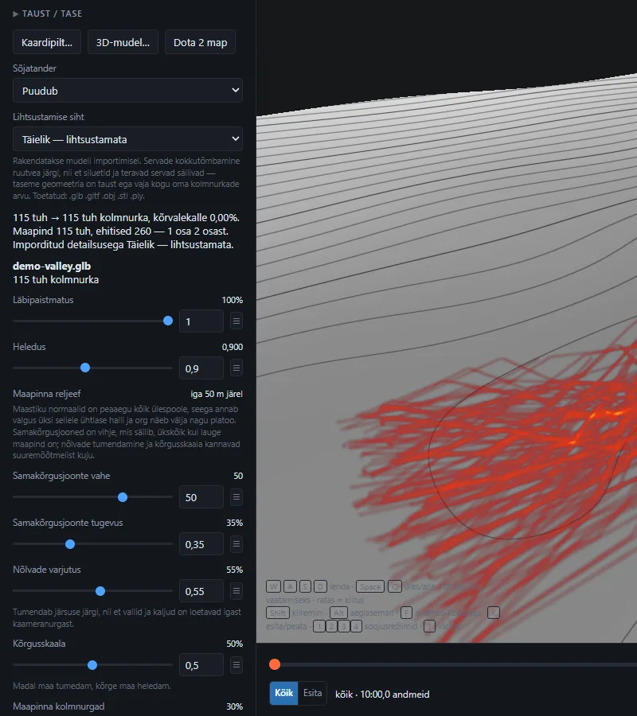

# Tasemed ja taustgeomeetria

Tase on 3D-koht, kus mäng toimus - kaart, linn, rada. Pane see oma andmete taha ja näed, *kus* soojus on. Paneel **Taust / tase** (vt [Sõnastik](glossary.md) mõiste "tase" kohta) annab kolme liiki konteksti:

- **kaardipilt**, mis on georefereeritud kahe ankruga - vt [Kaardipildid](map-images.md);
- **3D-tase** - `.glb`, `.gltf`, `.obj`, `.stl` või `.ply` - jaotatud maapinnaks, ehitisteks ja veeks ning lihtsustatud importimisel - vt [3D-tasemed](model-levels.md) ja [Taseme välimus](level-appearance.md);
- **maailmataust** - salvestisele, mis ütleb, kus maakeral see asub (Tacview ACMI fail): päris maastik, teed, vesi, lennuväljad ja hooned avatud andmetest allalaaditult - vt [Maailmataust](world-backdrop.md).

Kui midagi pole laaditud, on stseen tume ruudustiku ja värviliste telgedega (**Ruudustik** ja **Teljed** jaotises [Kaamera ja stseen](camera.md)) ning paneel ütleb: *Pole midagi laaditud - stseen näitab ruudustikku ja telgi. Lisa kaardipilt või taseme võrk, et soojusele kontekst anda.*

Tase on jagatud kõigi kolme vahekaardi vahel: Sõiduanalüüsi vahekaardil laetud rada on sama tase, mida soojuskaart näitab.

## Aseta tase oma andmete taha {#put-a-level-behind-your-data}

1. Laadi kõigepealt oma andmed ([Andmete sisselugemine](getting-data-in.md)), et tase sobituks nendega.
2. Ava külgribal **Taust / tase**.
3. Vajuta **Kaardipilt…** pildi või **3D-mudel…** 3D-taseme jaoks ja vali fail. Päris maailma salvestise jaoks kasuta hoopis **Päris maailm taustaks** või **Sõjatander**.
4. Oota, kuni edenemisrida lõpeb. Suur mudel lihtsustatakse esmalt (vt allpool **Lihtsustamise siht**).
5. Vajuta vaates **F**, et kadreerida kõik. Kasuta **Läbipaistmatust** ja **Heledust**, kuni soojus paistab taseme seast välja.
6. Vajuta **Salvesta teeki**, kui kasutad taset uuesti ([Tasemete raamatukogu](level-library.md)).

## Mida tase soojuse jaoks teeb {#what-a-level-does-for-the-heat}

- See **varjab**: andmepunktid selle taga on pinnati tuhmistatud ja maapinna taga peidetud andmepunktid ([Sügavus ja eemaldamine](depth-and-culling.md)). Taseme puudumisel varjamist pole.
- See on **lõigatud** [Lõigu](slice.md) poolt ja, kui on märgitud *Lõika ka taset*, [kauguse eemaldamise](depth-and-culling.md#distance-culling) poolt koos soojusega.
- See on ainus, mida [väljaulatuvussügavus](camera.md#depth-of-field) hägustab, peale ruudustiku ja kastide.
- 3D-tase **laiendab kaamera kaugtasandit**, kui see on suurem kui andmed: lähi- ja kaugtasand kalibreeritakse andmestiku järgi, ja eksporditud kaart mitme kilomeetri laiuselt jääks muidu täielikult kaugtasandi taha ning vaade jääks tühjaks. Kaugtasand muutub 3 × taseme horisontaalsest ulatusest, kui see on suurem, lähitasand liigub sellega kaasa (vähemalt kaugus / 100 000), et säilitada sügavuse täpsus, millest varjamine sõltub, ja lendamise kiirus tõuseb vähemalt ulatus / 12-ni. Seda ainult laiendatakse, mitte kunagi kitsendata.

## Paneel ülevalt alla {#the-panel-top-to-bottom}

| Osa | Üksikasjad |
|---|---|
| **Kaardipilt…**, **3D-mudel…** | Laadi üks; see asendab praeguse taseme. |
| **Päris maailm taustaks**, **Unusta kaardipaanid** | Ainult andmestikule, millel on geograafiline viide: ehita selle all olev päris koht tasemeks või kustuta allalaaditud paanid. [Maailmataust](world-backdrop.md) |
| **Lihtsustamise siht** | Kolmnurkade eelarve järgmiseks mudeli importimiseks: *Täis - ilma lihtsustamiseta* (vaikimisi), *Kõrge - 8M*, *Keskmine - 3M*, *Madal - 800k*, *Siluett - 100k*. [3D-tasemed](model-levels.md#simplification) |
| Edenemine ja **Tühista** | Dekodeerimise või importimise ajal. |
| Impordi märkus | Kolmnurgad enne ja pärast, maapinna / ehitiste / vee jaotus, kasutatud detailsustase. |
| Nimi ja suurus | `laius×kõrgus px · x × z m/px` pildi puhul, `N kolmnurka (M-st)` mudeli puhul. |
| **Läbipaistmatus**, **Heledus** | Mõlemat liiki. |
| Pildi juhtnupud | **Vähenda küllastust**, **Pööra põhi/lõuna**, **Paigutus** (kaks ankrut), **Sobita andmete piiridega**, **Kõrgus**. [Kaardipildid](map-images.md) |
| Mudeli juhtnupud | Maapinna reljeef, vesi, maapinna kolmnurgad, traatraam, tekstuur, jäädvustatud värv, ehitised, osade klassifitseerimine. [Taseme välimus](level-appearance.md) |
| **Salvesta teeki**, **Eemalda** | [Tasemete raamatukogu](level-library.md); Eemalda laadib taseme maha. |
| **Teek** | Selles brauseris salvestatud tasemed. [Tasemete raamatukogu](level-library.md) |

## Selle jaotise lehed {#pages-in-this-section}

- [Kaardipildid](map-images.md)
- [3D-tasemed](model-levels.md) - vormingud, osad, klassifitseerimine, lihtsustamine, tekstuurid
- [Taseme välimus](level-appearance.md) - iga juhtnupp 3D-taseme jaoks
- [Tasemete raamatukogu](level-library.md)
- [Maailmataust](world-backdrop.md) - päris maailm salvestise all, avatud andmetest

Kuidas tasemeid mängudest ja mootoritest välja saada, on eraldi eksporditööriistade asi (vt hoidla [README](https://github.com/Holdi601/3DHeat/blob/main/README.md)); kirjutatav liides on kokku võetud lehel [3D-tasemed](model-levels.md#the-exporter-contract).
