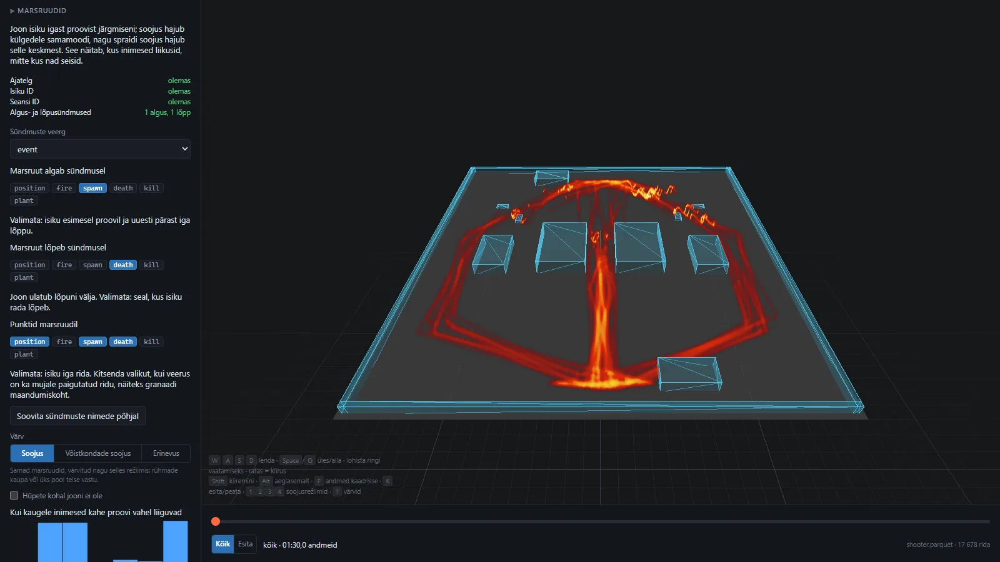

# Joonesoojus

Soojus näitab, kus inimesed seisid. Jooned näitavad radu, mida nad käisid.

**Jooned** (klahv 4) on joonesoojus: joon igalt [isikult](glossary.md) proovilt tema järgmise proovini,
hajutatud sama langusega, mis [osakesel](glossary.md) on - joone üle, mitte punkti ümber. See näitab,
kuhu inimesed *läksid*, mitte kus nad seisid: koridori, mida läbiti üks kord, on sama hästi näha kui
ruumi, kus laagriti, ja kiire mängija hõredad proovid ühinevad pideva marsruudiks, mitte punktiirjäljeks.
Vaja on isiku veergu ja ajaveergu.

## Kuidas kasutada {#how-to-use-it}

1. Vajuta `4` (või vali **Jooned** režiimiribal).
2. Ava **Marsruudid** ja kontrolli rohelist nimekirja: ajatelg ja isiku ID peavad olema olemas.
3. Vajuta **Soovita sündmuste nimede põhjal**, et täita, kus marsruudid algavad ja lõpevad.
4. Loe statistikarida: "N marsruuti, neist M jõudis lõpuni".
5. Kui jooned hüppavad üle kaardi, reguleeri **Pikim samm** (vt [Hüppe piir](#the-jump-limit)).

Joon on mõttekas ainult alguse ja lõpu vahel, nii et paneel **Marsruudid** ütleb, mis marsruuti piirab.
Kõik alates [Marsruudi reeglitest](#the-rules-of-a-route) on üksikasi, mille võib vahele jätta.

## Marsruudi paneel {#the-routes-panel}

Näidatakse soojuspaneelide kohal joonerežiimis.

### Mida andmetel on {#what-the-data-has}

Kontrollnimekiri: roheline, kui olemas, kollane, kui mitte:

| Rida | Olekud |
|---|---|
| **Ajatelg** | *olemas* / *puudub - vajalik* |
| **Isiku ID** | *olemas* / *puudub - vajalik* |
| **Seansi ID** | *olemas* / *puudub - kõik read on üks seanss* |
| **Algus- ja lõpusündmused** | *N algust, M lõppu* / *ei ole valitud - terved rajad* (roheline ainult sündmuste veeru ja vähemalt ühe alguse ja ühe lõpu korral) |

### Juhtnupud {#controls}

| Juhtnupp | Tähendus |
|---|---|
| **Sündmuste veerg** | Kategooriaveerg, mille väärtused on sündmused (tekkimine, surm, positsioon, ...). *Puudub - terved rajad*: iga isiku rada igas seansis on üks marsruut, katkestatud seal, kus rajal on lünk. Pakutakse ainult veerge, mis jäeti laadimisel filtritele. |
| **Marsruut algab sündmusel** | Sündmuste väärtused, mis alustavad marsruuti (tekkimine, uuesti tekkimine, maandumine). Ühtegi valitud: marsruut algab isiku esimesest proovist ja jälle pärast iga lõppu. |
| **Marsruut lõpeb sündmusel** | Sündmuste väärtused, mis lõpetavad marsruudi (surm, väljatõmbamine, teleport). Joon käib kuni lõpu reani endani. Ühtegi valitud: marsruut lõpeb seal, kus isiku rada lõpeb. |
| **Punktid marsruudil** | Sündmuste väärtused, mille read asuvad marsruudil. Ühtegi valitud: iga isiku iga rida. Kitsenda, kui veerg hoiab ka ridu, mis on mujal, näiteks kohas, kuhu granaat maandus. |
| **Soovita sündmuste nimede põhjal** | Täidab kolm loendit väärtuste nimede järgi (allpool). |
| **Värv** | *Soojus*, *Meeskonna soojus* või *Vahe*. Samad marsruudid selle režiimi värvides: iga grupp oma toonis või üks pool teise vastu, grupi loend, jaotus ja skaalad töötavad nagu neis režiimides. Vaikimisi *Soojus*. Meeskonna soojus ja vahe vajavad grupiveergu. |
| **Hüpete kohal jooni ei ole** / **Pikim samm** | Isiku järgmine proov, mis on sellest kaugemal, on tekkimine, teleport või kukkumine, mitte koht, kuhu nad läksid, nii et kahe vahele joont ei tõmbata. Täidetakse laadimisel, kui andmed näitavad selget lünka (allpool), ja on välja lülitatud, kui ei näita. Töötab sündmuste veeru kaasa või ilma. |
| Statistikarida | `N marsruuti, M neist jõudis lõpuni, K lõiku`, uueneb mitu korda sekundis. |

Iga loend on rida lülitavaid kiipe, üks iga väärtuse kohta, kõige sagedasem esimesena; kiibi peale hõljudes
näed selle ridade arvu. Pakutakse kuni 120 väärtust (*N veel väärtust ei näidata*).

Teise sündmuste veeru valimine rakendab soovitust, kui soovitus valib just selle veeru, ja muidu algab tühjade loenditega.

### Soovitus {#the-suggestion}

Igal laadimisel ja nupu **Soovita sündmuste nimede põhjal** vajutamisel ([`suggestLineSettings`](https://github.com/Holdi601/3DHeat/blob/main/src/data/lines.ts)):

- **Sündmuste veerg:** esimene säilitatud kategooriaveerg nimega `event`, `eventname` või `eventtype`; siis `kind`, `type` või `action`; siis ükskõik milline, mis sisaldab *event*, *kind*, *action* või *type*.
- **Algused:** väärtused, mis sisaldavad *spawn, deploy, join, enter, start, begin, respawn, revive, land/landed/landing, drop* - välja arvatud juhul, kui nad sobivad ka lõpusõnaga.
- **Lõpud:** väärtused, mis sisaldavad *death, died, dead, kill/killed, eliminat…, extract, evac, teleport, leave, left, disconnect, quit, exit, end, finish, downed* - välja arvatud väärtused `kill` ja `kills` (tapmine on see, mida tapja teeb, mitte tema marsruudi lõpp).
- **Punktid:** väärtused, mis on täpselt *position, location, player location, move, movement, tick, sample* või *pos*; kui mõni leitakse, lisatakse algused ja lõpud ka punktidele. Kui ühtegi ei leita, jäävad punktid tühjaks (iga rida).

### Hüppe piir {#the-jump-limit}

Kus inimesed hüppavad, jagunevad sammude pikkused kaheks rühmaks, nende vahel peaaegu tühjus: see, mida isik
läbib kahe proovi vahel, ja kaardi laius. Laadimisel ([`suggestMaxJump`](https://github.com/Holdi601/3DHeat/blob/main/src/data/lines.ts))
loetakse sammud iga ruutpikkuse kahekordistumise kohta, kuni 16 miljonit, ja piir pannakse esimese vahemiku
keskele pärast mediaani, mis on vähemalt ühe pikkuse kahekordistumise lai, hoiab alla 0,02% sammudest iga
klassi kohta ja millel on samme sellest kaugemal. Kui sellist vahemikku ei ole, ei lõigata midagi, sest hüpet
ei saaks eristada kiirest autost; piiri käsitsi sisselülitamisel algab ta andmete diagonaali kümnendikust.

Graafik piiri kohal näitab, kui pikad sammud tegelikult on, piiri joonega: sellest paremal olevaid tulpi ei
joonistata. Mõlemad teljed on logaritmilised, sest hüpped võivad olla sammude sajandik ja tuhat korda pikemad.
Tulba peale hõljudes näed selle vahemikku ja osa; graafikule klõpsates pannakse piir sinna. Selle all on
samme piirist suuremaid osa.

## Marsruudi reeglid {#the-rules-of-a-route}

Read käiakse läbi ajalises järjekorras, isikute kaupa ([`buildLines`](https://github.com/Holdi601/3DHeat/blob/main/src/data/lines.ts)):

1. Read [jagatud nimega](sessions-persons-groups.md#names-worn-by-several-things-at-once) jäetakse täielikult vahele.
2. Kui punktid on valitud, jäetakse vahele rida, mis ei ole alguseks, lõpuks ega punktiks.
3. Ridu jälgitakse isiku ja seansi kaupa, nii et isik, kelle seansid lõikuvad ajaliselt, on igas seansis üks marsruut. Marsruut suletakse, kui eelmisel real ei olnud järgmist (tema [eluiga](sessions-persons-groups.md#person) on "puudub") - marsruut ei ületa kunagi seansipiiri ega lünka, mille laadimine otsustas, et järgmist proovi ei ole. Millisel marsruudil rida on, arvutatakse üks kord ja hoitakse alles, 4 baiti rea kohta, nii et pikima sammu muutmine ei korda seda osa.
4. **Algus**-rida sulgeb kõik avatud marsruudid ja avab seal uue.
5. Kui on valitud algused, ignoreeritakse marsruudivälist rida. Ilma alguseta avab iga marsruudivälja mittelõpprida ühe.
6. Iga muu marsruudisisene rida lisab **lõigu** marsruudi eelmisest reast selle reani.
7. **Lõpp**-rida, mis marsruuti pikendab, sulgeb selle pärast oma lõiku; see marsruut loetakse *jõudnuks lõpuni*.
8. Samm, mis on pikem kui **Pikim samm**, sulgeb marsruudi seal, kus ta oli, ja uus marsruut algab kaugemas otsas, kui see rida ei ole lõpp. Selle üle ei tõmmata joont ja statistikarida loeb selle.

Iga lõik salvestatakse oma **lõpu**-ritta, nii et lõigud jäävad ajalisse järjekorda, ning [ajajoone](timeline.md) aken,
proovivõtja, [filtrid](filters.md), grupi nähtavus ja vahe märk töötavad nendega nagu punktidega. Filter kehtib
seega reale, kuhu lõik lõpeb.

## Taasesitus {#playback}

Režiimis **Kõik** joonistatakse iga marsruut tervena. Režiimis **Esita** on iga isik punkt, mis liigub oma proovide
vahel ja joonistab oma marsruudi enda taha:

- lõik, mis algab pärast mängupead, ei joonistu;
- lõik, milles isik parajasti on, joonistatakse kuni tema interpoleeritud asukohani, pea otsas lõpupiiriga;
- soojus kahaneb **sabas**: ajaloo *Kumulatiivne* korral on saba piiramatu ja kogu seni läbitud marsruut jääb;
  *Aken* korral kahaneb see *Ulatuse* (vaikimisi 30 s) jooksul nulli. *Eluiga* korral on saba samuti *Ulatus* ja
  joonerežiimis näitab ajajoon selle ajaloo jaoks *Ulatuse* kasti (asemel *Varuelu* ja *Hääbumine*, mida joonesoojus ei kasuta).

Taasesitamisel joonistatakse iga kaader tervena, mitte ei koguneta, sest pead liiguvad igal kaadril ja liikuv
keskmine venitaks iga pea jooneks.

## Arendajatele {#for-developers}

### Mälu {#memory}

Marsruudid ehitatakse põhilõimel joonerežiimi sisenemisel (või marsruudi seadete muutumisel) ja vabastatakse
lahkumisel: 5 baiti rea kohta mälus ja 8 baiti rea kohta GPU-l (iga lõigu algusasend, kvantitud 16 bitti teljel
andmete piirkasti piires, ja tema lipud).

### Kuidas joont joonistatakse {#how-a-line-is-drawn}

Mõlemad renderdajad joonistavad iga lõigu oma lõpureast **18 tipuna** ([`lineHeatVs`](https://github.com/Holdi601/3DHeat/blob/main/src/render/webgl2/shaders.ts) ja tema WGSL-kaksik):

- Poolelaius igas otsas on [osakese raadius](sprite-shape.md#sprite-radius) selle otsa kauguse juures, pikslipiirangutega.
  Joon, mis on kitsam kui 2,5 px, joonistatakse 2,5 px laiusena, kusjuures tema soojus skaleeritakse sellega
  vastavalt, nii et õhukesed jooned ei kao ega heleda.
- Soojus kahaneb joone **üle** sama skaala järgi nagu osakesel - langus või kõver, keskme ja serva intensiivsus.
- Ümarad otsad joonistatakse **ainult** seal, kus marsruut algab või lõpeb, nii et järjestikuste lõikude liitekohad
  ei muutu helmesteks.
- Geomeetria ehitatakse ekraaniruumis ja interpoleeritakse seal lineaarselt, nii et langus jääb joone keskele, olgu
  see sügavusse kuidas tahes; lähitasandit ületav lõik lõigatakse seal, mitte ei jäeta välja.

Punktsoojus ja joonesoojus paigutavad rea kohta väga erinevad kogused soojust, seega mõõdetakse küllastust uuesti,
kui nende vahel vahetad ([Värv ja säritus](colour-and-exposure.md#auto-exposure)).
