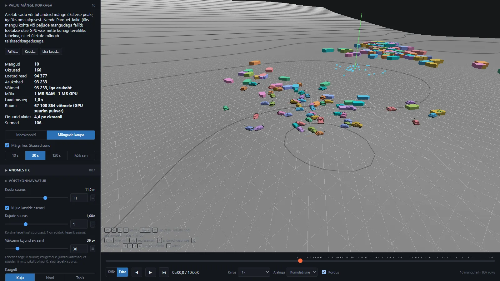

# Palju mänge korraga

**Palju mänge korraga** mängib paljusid mänge üksteise peal, nii et näed, kuhu iga mängu mängijad tavaliselt lähevad. Kasuta seda, et võrrelda sadu või tuhandeid mänge ühel pildil.

Iga mäng algab oma algusest ja selle üksused liiguvad kujudena. Failid lähevad otse graafikakaardile ja täielikku tabelit ei ehitata, nii et see mängib sujuvalt seal, kus tavaline laadimine mälu otsa saaks.

## Kuidas seda kasutada {#how-to-use-it}

1. Ava külgribal **Palju mänge korraga**.
2. Vajuta **Failid…** (vali palju faile), **Kaust…** (kaust ja selle alamkaustad) või **Lisa kaust…** (lisa juba laaditule).
3. Vaataja lülitub kujude ülekattele ja alustab algusest. Vajuta **Esita**.

Iga fail on üks mäng (või sisaldab mitut). Töötavad Parquet-failid ja [`.3dheat`](container.md) konteinerid. Fail vajab asukoha, aja ja üksuse veergu; nime, tüübi ja poole veerud jäetakse alles. Teised failid ja konverterite kõrvalfailid (lend, sõnumid, sündmused, vestlus, eesmärgid) jäetakse vahele. Tavalise tabeli kohta vt [Andmete sisselugemine](getting-data-in.md).

## Seaded {#settings}

| Seade | Mida see teeb |
|---|---|
| **Meeskonniti** / **Mängude kaupa** | Värvi poole järgi või iga mängu oma värviga. |
| **Märgi, kus üksused surid** | Märk, kus iga üksus suri, 10 s, 30 s, 120 s või kõik seni. |

Paneel näitab, mitu mängu, üksust, rida ja asukohta loeti, kasutatud mälu ja laadimisaega. *Ruumi* on, mitu veel asukohta graafikakaart veel vastu võtta jaksab. *Kujud alates* on suurus ekraanil, millest allpool joonistatakse üksus väikese noolena, mitte oma kujuna.

Kujude välimus kasutab samu juhtnuppe nagu [Matši kordus](match-replay.md#figures): **Kujude suurus**, **Väikseim kujund ekraanil** ja **Kaugelt**.

## Nipid {#tips}

- Kui kõik ei mahuks mällu, hõrendatakse asukohti (alles jäetakse ainult asukoht iga mõne meetri järel) ja paneel ütleb seda.
- Soojusrežiimid töötavad ka ülekatte andmetega.
- Statistika kohta tuhandete mängude üle ilma neid joonistamata vt [Massanalüüs](mass-analysis.md).
