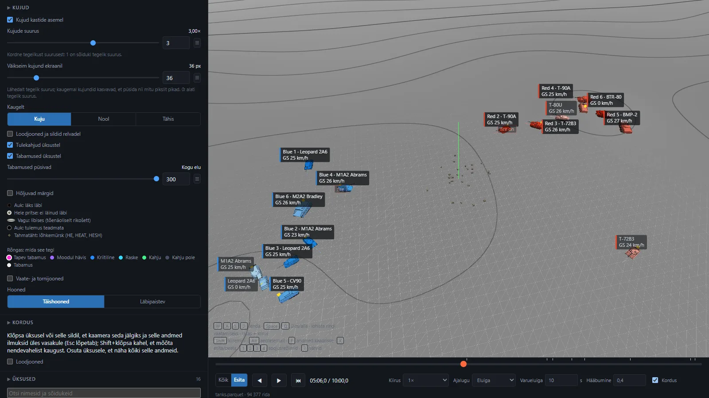
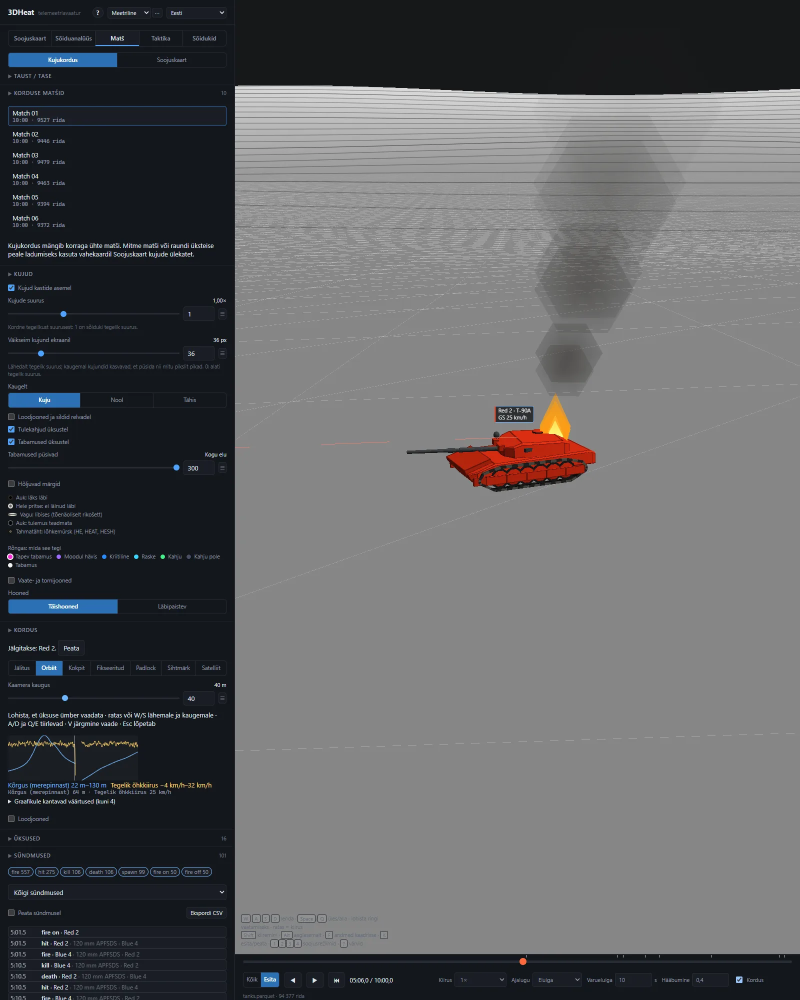
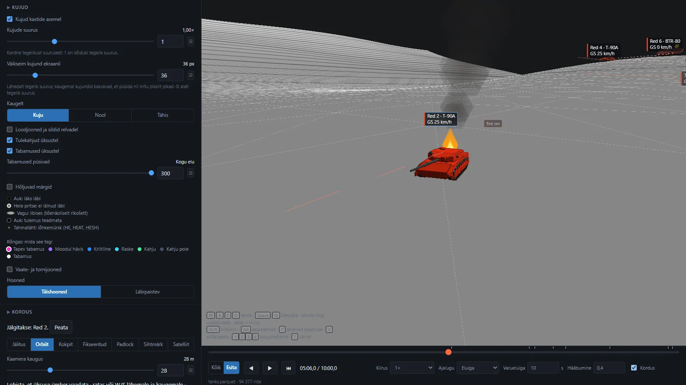
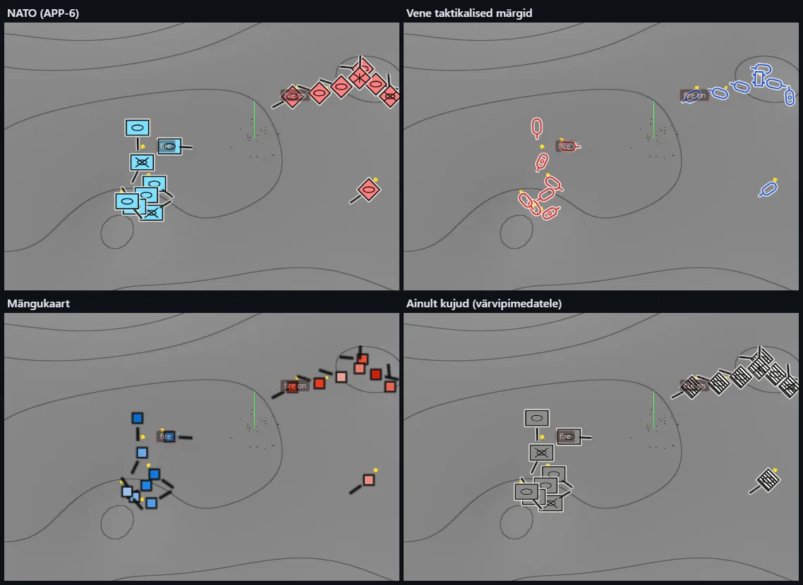
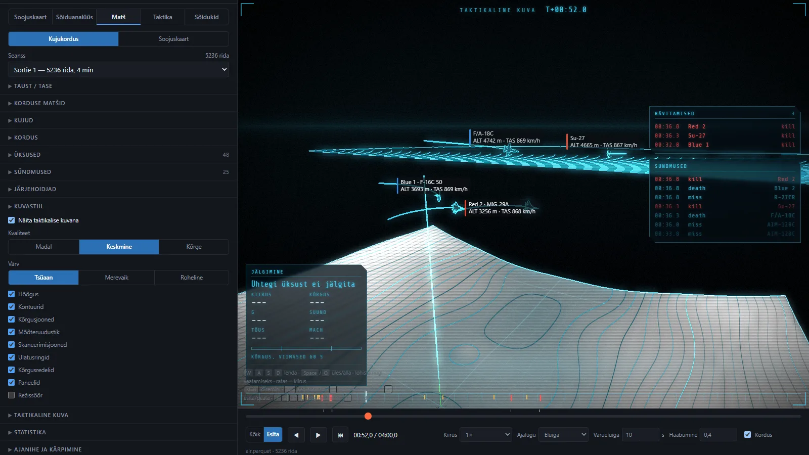
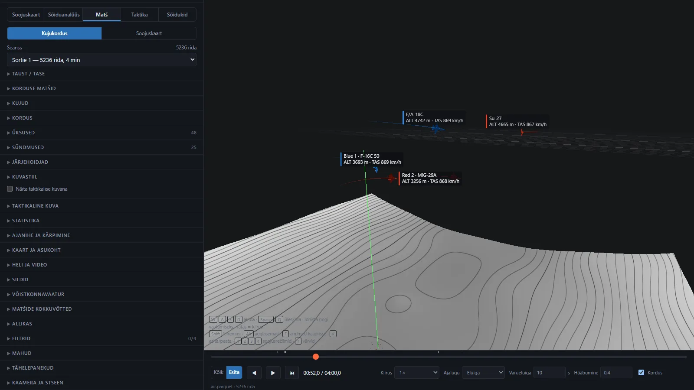

# Mängu taasesitus

Taasesitus on mängu film, kus iga mängija on joonistatud selle asjana, mida ta juhtis. Kasuta seda, et vaadata võitlust uuesti, jälgida ühte üksust ja näha, kes keda tabas.

Lasud, tabamused, tulekahjud ja hukkunud sõidukid joonistatakse üksustele ja eesmärkidele tasemel. Kaamerad, sildid ja taktikaline kuva aitavad võitlust lugeda. Kas tead Tacviewd? [Tacview'ga sarnasus](tacview-parity.md) näitab, kus on iga tema tööriist.

## Alusta taasesitust {#start-a-replay}

1. Laadi salvestis valikuga **Allikas → Failid…** või lohistades selle allika paneelile (mis tahes tabel **isiku** ja **aja** veeruga, Tacview fail, konverteeritud taasesitus, [`.3dheat`](container.md) matš). Vt [Andmete sisestamine](getting-data-in.md).
2. Ava **Mäng** sakk ja vali **Kujukordus** või vali soojuse sakis režiimiribalt **Kujude ülekate**.
3. Jaotises **Korduse matšid** vali üks matš, kõik korraga või mitu.
4. Vajuta ajajoonel **Esita** (või `K`). Lohista ajajoont, et hüpata.

Kujud asendavad kastid iga üksuse puhul, mille nimi või tüüp on teada (vt [Kujud](figures.md)). Andmed ilma nime- või tüübiveeruta joonistatakse sõduritena.

## Kujud {#figures}

| Seade (jaotis **Kujud**) | Vaikimisi | Mida see teeb |
|---|---|---|
| **Kujud kastide asemel** | sees | Väljas joonistab tavalised kastid. |
| **Kujude suurus** (kordne tõelisest suurusest) | 1 | 1 on tõeline suurus; 0,25 kuni 20 korda (logaritmiline skaala). Suurem aitab kaugelt. |
| **Väikseim kujund ekraanil** | 36 px | Kaugel olevad kujud kasvavad, et jääda sama pikaks, 0 kuni 200 px; 0 säilitab tõelise suuruse. |
| **Kaugelt**: Kuju, Nool, Tähis | Kuju | Mis saab kaugel olevast üksusest. |
| **Tähised** | NATO (APP-6) | NATO (APP-6), Venemaa taktikalised märgid, **Mängukaardi** ikoonid või **Ainult kujud (värvipimedatele)**. |
| **Tähise suurus**, **Minu pool**, **Vaenulik / Neutraalne**, **Kursikriipsud** | 28 px (12 kuni 64), automaatne, vaenulik, sees | Kuidas tähised näevad välja ja milline pool on sõbralik. |
| **Loodjooned** | sees | Joon igast üksusest otse maapinnale, nii et kõrgused loetakse 3D-s. |
| **Loodjooned ja sildid relvadel** | väljas | Jooned maapinnale ja sildid rakettidel ja pommidel. |
| **Tulekahjud üksustel** | sees | Leegid sellest hetkest, kui üksus süttib, kuni see kustutatakse. |
| **Tabamused üksustel** | sees | Märgid, kuhu lasud tabasid (allpool). **Tabamused püsivad**: 1 kuni 300 sekundit või **Kogu elu**. **Hõljuvad märgid**: pinnast kõrgemal joonistatud märgid. |
| **Vaate- ja tornijooned** | väljas | Katkendlik: kuhu mängija vaatab; pidev: kuhu püss suunatud on. |
| **Hooned** | tahke | Tahked või läbipaistvad hooned, kui tase neid värvib. |

### Tähised kaugel {#symbols-at-a-distance}

Kui üksus oleks väiksem kui **Väikseim kujund ekraanil**, võib see muutuda tähiseks, mis jääb loetavaks. Kuju ütleb liigi (nt soomuki puhul ümarnurkne kast rööbastee märgiga); värv ütleb poole. Ava menüü **Tähised**, et stiili muuta.

### Tabamusmärgid, hukkunud sõidukid ja tulekahjud {#hit-marks-wrecks-and-fires}

- **Tabamusmärgid** asuvad pinnal, mida lask tabas, kujust lähtuvas mõõtkavas. Nende välimus ütleb, mis juhtus: auk (läbis), hele pritsmed (ei läbinud), sisselõige (põrkas kõrvale), tahma täht (plahvatusohtlik mürsk). Värviline rõngas ütleb, mida see tegi: tappev lask, moodul hävitatud, kriitiline, raske, kahju, kahjustust pole, tabamus. Hõlju märgi kohal, et näha vooru nime.
- Hävitatud üksus joonistatakse **põlenud** vrakina alates surmast, kuni see taastub või eemaldatakse; selle tähis on läbi kriipsutatud.
- **Tulekahjud** põlevad üksusel sellest hetkest, kui see süttib, kuni see kustutatakse.
- **Tornid** pöörduvad sinna, kuhu andmed ütlevad püssi suunatuks (või kui neid pole, siis sinna, kuhu mängija vaatab).

### Relvad, petteobjektid ja jäljed {#weapons-decoys-and-tracers}

Kui **Relvad, lasud ja tabamused** on sees (Võistkonnavaaturi jaotis): raketid, rakettmürsud, pommid ja torpeedod lendavad oma kujudena suitsujäljega; kuulid ja mürsud on jäljed; tabamused ja plahvatused välgatavad. Jälg, mis on joonistatud **katkendjoonena**, arvutati tabamusest, sest andmetes polnud lasku. Sähvatused ja kaff joonistatakse petteobjektidena; need on üksuste loendis peidetud, kui *Petteobjektid ja mürsud* pole märgitud.

## Kaamerad {#cameras}

Klõpsa üksusel või selle sildil, et seda **jälgida**; jaotis **Kordus** pakub **Jälitus**, **Orbiit**, **Kokpit** (peavaate kuvaga, `H`), **Fikseeritud**, **Padlock**, **Sihtmärk** ja **Satelliit**. `V` vahetab neid, **Kaamera kaugus** määrab kaugust. Esc peatab.

- **Kahe üksuse vaade**: vali **Sihtmärk** (või Ctrl/Alt-klõps üksusel), et vaadata seda jälgitavalt üksuselt; **Vaheta** vahetab need.
- **Mõõt**: Shift-klõps kahel üksusel näitab nendevahelist laagrit, kaugust ja kõrguste vahet.
- **2D-kaart** (`M`): nurk või täisvaade, jälgede ja nimedega.
- **Järjehoidjad** (`B`): salvesta hetk ja kaamera; salvestise enda tapmised, surmad ja märgid on samuti loetletud.
- **Sündmused**: iga sündmus ajajärjekorras; klõps hüppab sinna. `Page Up` / `Page Down` hüppavad sündmuste vahel; **Peata sündmusel** peatab igal sündmusel.

## Taktikaline kuva {#tactical-display}

Jaotis **Taktikaline kuva** joonistab ilma üksuseta valitud, kõik või ühe liigi (lennukid, maismaa, laevad, relvad): kiirusvektorid ja edasine tee, nina- ja tõstejooned, radarikoonid, lukustused, andmeside, kaasamistsoonid ja -jooned, vaatejooned, kuhu mängijad vaatavad (vaatekoonused), tornide sihtimine ja salvestatud kaamera.

### Kuva stiil {#display-style}

`T` (või lüliti **Näita taktikalise kuvana**) lülitab vaate radarikuvastiili: hõõgumine, piirjooned, kontuurjooned, mõõdustikuvõrk, skaneerimisjooned, ulatusrõngad, kõrgusredelid, tapmiste ja sündmustega paneelid ning **Režissöör**, mis liigutab kaamerat sündmuste juurde ise.

## Eesmärgid {#objectives}

Kui matšiga tulevad kaasa selle eesmärgid, joonistab jaotis **Eesmärgid** need tasemele: vallutustsoonid (koos omaniku ja vallutamise edenemisega), spawnid, lennuväljad, alad ja pommitamise sihtmärgid, iga kiht lülitatav, siltidega. Need on nähtavad läbi maapinna. Kui on laaditud mitu mängurežiimi, filtreerib **Režiim** matše režiimi järgi. Eesmärgid tulevad salvestise kõrval olevast konverteri matšifailist või [`.3dheat`](container.md) konteinerist.

## Sildid ja statistika {#labels-and-statistics}

- **Sildid**: reeglid liigi kaupa (**Valitud**, **Õhusõidukid**, **Maismaa**, **Laevad**, **Relvad**, **TI**): kas näidatakse, milliseid väärtusi ja **Prioriteet**, kes saab ruumi, kui sildid kattuvad. **Hoia silte lahus** viib sildi kõrvale oma üksusele, kui see katab teist, ja jätab välja, kui ruumi pole. **Siltide suurus** on 60 kuni 250%. **Tagasi nimele, sõidukile, kõrgusele ja kiirusele** lähtestab reeglid.
  - Maismaaüksused algavad nime, sõiduki ja kiirusega.
  - Õhusõidukid algavad nime, sõiduki, kõrguse ja kiirusega.
  - Laevad algavad nime, sõiduki, kiiruse ja suunaga.
  - Hõlju üksusel, et näha kõiki selle väärtusi.
- **Statistika**: meeskonna ja üksuse kaupa: tapmised, surmad, lasud, tabamused, tabamuste suhe, õhkutõusud, maandumised, õhus oldud aeg, tippkiirus, kõrgus ja G, kaugus. CSV-eksport.
- **Diagrammid**: üksuse väärtused aja jooksul, kaks üksust võrdluses või üks väärtus teise vastu.

## Paljud matšid korraga {#many-matches-at-once}

Sadade või tuhandete matšide üksteise peale paigutamiseks vt [Paljud matšid korraga](many-matches.md). Kujude üksikasjad (suits, tuli ja muud ajastatud efektid): [Kujud kujude ülekattes](figure-replay.md). Tacview funktsioonide loend: [Tacview'ga sarnasus](tacview-parity.md), selle lehe alamlehekülg.
