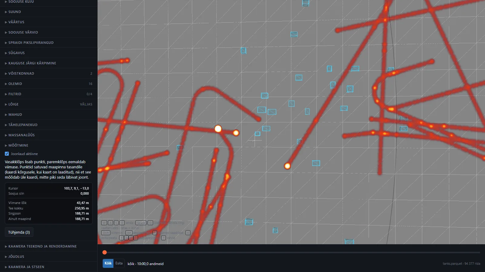

# Mõõtmine

**Mõõt** muudab hiire joonlauaks ja ütleb sulle, kui hõivatud on koht kursori all. Kasuta seda, et teada saada, kui kaugel kaks kohta teineteisest asuvad, või kui palju liiklust ühes kohas on.

## Proovi {#try-it}

1. Ava külgribal **Mõõt** ja märgi **Joonlaud aktiivne**.
2. Klõpsa vasaku nupuga kaardil kolmel kohal. Iga klõps paneb punkti.
3. Loe **Tee kokku** (kogu tee pikkus) ja **Viimane lõik** (viimane osa).
4. Parema nupuga klõpsates eemaldad viimase punkti, või vajuta **Tühjenda (3)**, et eemaldada kõik.

| Toiming | Mõju |
|---|---|
| Vasak klõps | Paneb punkti kohta, kus kursor kohtub maapinna tasandiga. Klõps, mis liikus vajutuse ja vabastuse vahel rohkem kui 4 pikslit, on kaamera lohistamine, mitte punkt. |
| Parem klõps | Eemaldab viimase punkti. |
| Liikumine | Kursori asukoht ja selle all olev soojus uuenevad elavalt. |

Kaamera töötab joonlaua ajal edasi: lohistamine vaatab ringi, klahvid lennutavad endiselt. Kui joonlaud on sees, võtab see iga klõpsu, seega ootab [klõpsuga valimine](camera.md#click-to-pick), kuni see on välja lülitatud.

**Maapinna tasand** on [kaardipildi](map-images.md) kõrgus, kui kaardipilt on laaditud. Muidu on see andmestiku madalaim Y (ilma selleta 0). Punktid asetuvad sellele, nii et joonlaud mõõdab üle kaardi, mitte mööda joont läbi selle. 3D tasemega on tasand ikka andmestiku madalaim Y, mitte taseme pind. Päris pinna punkti jaoks lülita joonlaud välja ja klõpsa sellel ([klõpsuga valimine](camera.md#click-to-pick)), mis loeb koordinaadid taseme enda kolmnurkadest.

## Näidud {#readouts}

| Rida | Tähendus |
|---|---|
| **Kursor** | Maailma X, Y, Z punkti kohta tasandil kursori all. |
| **Soojus siin** | Kui palju soojust on kursori pikslil. Suurem number tähendab rohkem liiklust selles kohas. See on väärtus, mis antakse värviskaalale enne, kui küllastuspunkt seda jagab, nii et saad seda võrrelda [küllastuspunktiga](colour-and-exposure.md#saturation-point). |
| **Viimane lõik** | Kaugus viimasest punktist kursorini (või kahe viimase punkti vahel). |
| **Tee kokku** | Iga punkti ja kursori läbiva joonahela pikkus. |
| **Sirgjoon** | 3D kaugus esimesest punktist kursorini (või viimasest punktist). |
| **Ainult maapind** | Sama, ainult X ja Z telgedel. |
| **Tühjenda (N)** | Eemaldab kõik punktid. |

Kaugused näidatakse sentimeetrites alla 1 ühiku, meetrites alla 1000 ja kilomeetrites üle selle. See eeldab, et üks maailma ühik on meeter ([Teljed, ühikud ja aeg](axes-units-and-time.md#unit-scale)). Koordinaadid on maailma koordinaadid, sealhulgas siis, kui telg on [kuvamiseks pööratud](camera.md#invert-world-axis).

Punktid ja nendevaheline joon joonistatakse vaates ülekattena, suuruse võtab ruudustiku samm. Joonlaua punkte vaadetes ei salvestata; need jäävad alles, kui laadid teisi andmeid.

## Arendajatele {#for-developers}

**Soojus siin** loetakse GPU-lt kõige sagedamini iga 120 ms järel, sest ühe pikseli tagasilugemine peatab torujuhtme. See kasutab sama teed nagu `engine.readHeatProbe()`: jagatakse kaadri kirjutamisel kasutatud võimendusega. Seega on pooltäpse akumulatsiooni teel (`?heat=f16`) see samades ühikutes kui 32-bitisel sihtmärgil ([Pooltäpne akumulatsioon](half-float-accumulation.md)).
