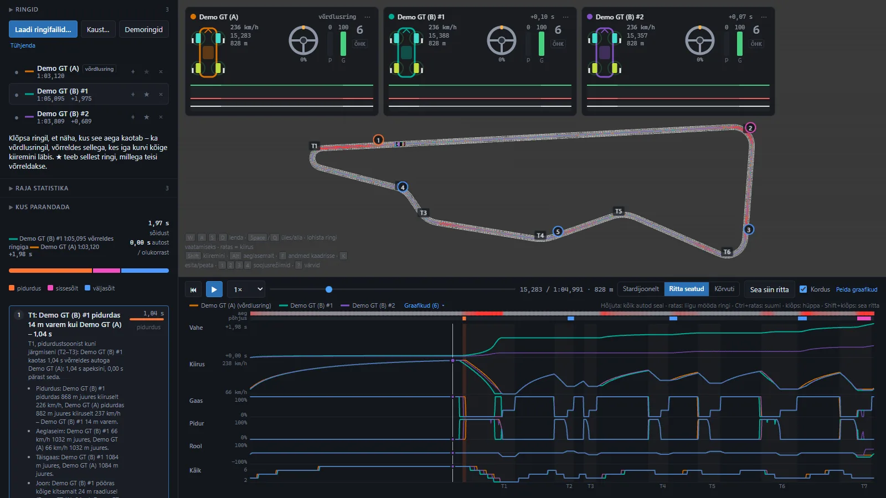

# Sõiduanalüüs

Sa sõitsid sama raja kaks korda. Vahekaart **Sõiduanalüüs** mängib mõlemad sõidud koos 3D-s, näitab, kus üks ring oli
aeglasem, ja ütleb, miks. Ringe veel ei ole? Vajuta **Demoringid**.

Vahekaart võrdleb kahte või enamat ringi ühelt rajalt. See jagab lõuendit, kaamerat ja laaditud raja mudelit
(**Taust / tase**) soojuskaardiga; kõik muu on tal oma: oma külgriba ja oma riba vaate all. Sõnad nagu *ring*, *etalon* ja
*tipp* on [sõnastikus](glossary.md).

See lehekülg on vahekaardi kaart. Igal osal on oma lehekülg:

| Lehekülg | Mida see katab |
|---|---|
| [Ringide laadimine](race-loading-laps.md) | iga failivorming, kaustad ja rajad, autode nimed, demoringid, ringide loend, etalon ja fokus |
| [Replay ja 3D-stseen](race-replay-and-scene.md) | edasiliikumisriba, kolm replay-režiimi, autode joondamine, jälitauskaamera, jooned, kaardid, autod, sildid, peegeldatud maailmad |
| [Graafikud ja HUD](race-charts-and-hud.md) | distantsigraafikud, graafikuvalija, hõljutus ja suum, autokaardid, kanalitabel |
| [Auto valitsemise sündmused](race-control-events.md) | blokeerumised, rataste libisemine, ülestüür, pöörlemised, alatüür, põrked, kokkupõrked, ABS/TC, käsipidur, õhk - kuidas iga tuvastatakse, kõigi lävenditega |
| [Kurv-kurvilt analüüs](race-corner-analysis.md) | joondamine distantsi järgi, kurvid ja lõigud, kurvi ajakonto, iga põhjus ja järjekord, milles neid proovitakse, joone kuju ja nõuanne |
| [Auto profiilid ja võrdlus](race-car-profiles.md) | mida iga auto suudab, mõõdetuna tema ringidest; *Autode võrdlus*; mida auto otsustab igas kurvis |
| [Raja statistika](race-course-statistics.md) | palju ringe ühelt rajalt: vead kurvi kohta ja liigi kaupa, vigade kaart, soojuskaardi eksport, jõudluse piirid |
| [Sõidu analüütika: meetod](race-analytics.md) | reeglite taga olev uurimistöö koos allikatega |
| [Muud võidusõidumängud](other-games.md) | mida vaatur teeb igast mängust pärit ringidega: libisemine ja triiv arvutatakse seal, kus mäng neid ei saada, peegeldatud maailmad, lisakanalid |

## Ekraan {#the-screen}

**Külgriba**, ülevalt alla (jaotisi saab kokku voltida):

1. **Ringid** - laadimine, loend, näitamine/peitmine, etalon, fokus, jälitamine.
   Vaata [Ringide laadimine](race-loading-laps.md).
2. **Raja statistika** - alates kolmest laaditud ringist.
   Vaata [Raja statistika](race-course-statistics.md).
3. **Kus parandada** - fokusseeritud ringi leiud, kurv kurvi haaval.
   Vaata [Kurv-kurvilt analüüs](race-corner-analysis.md).
4. **Kurv kurvi haaval** (või *Kurv kurvi haaval - klass X*, kui on mitu klassi) - kiireim ring igast kurvist ja tema joon.
   Näidatakse kahe või enama ringiga.
5. **Auto valitsemine** - fokusseeritud ringi lukud, libisemised, ülestüürid ja põrked.
   Vaata [Auto valitsemise sündmused](race-control-events.md).
6. **Autode võrdlus** (või **Auto**, kui on üks auto) - vaata
   [Auto profiilid ja võrdlus](race-car-profiles.md).
7. **Vaade** - milline kaart on rajale maalitud ja mis on joonistatud.
   Vaata [Replay ja 3D-stseen](race-replay-and-scene.md).
8. Jagatud **Tase** ja **Kaamera ja stseen** paneelid (raja mudel, teljepööramine, kaamera) - dokumenteeritud koos soojuskaardiga ja [kaameraga](camera.md).

**Vaade** näitab rada, sõidetud jooni, kaarti, autosid, rajale kinnitatud silte ja kuni kuut autokaarti vasakul ülal (vt
[Graafikud ja HUD](race-charts-and-hud.md)). Kui ühtegi ringi ei ole laaditud, ütleb ta: "Ringe ei ole laaditud - lohista siia
kaks või enam ringifaili või laadi demoringid külgribalt."

**Vaate all olev riba** hoiab replay edasiliikumist ja, kui see pole peidetud, distantsigraafikuid.

## Kiire algus {#quick-start}

1. Ava vahekaart **Sõiduanalüüs** (kõrvuti **Soojuskaardiga** külgriba ülaosas).
2. Too ringid sisse. Vajuta **Demoringid**, et näha, mida vahekaart teeb kolme väljamõeldud ringiga. Oma ringide jaoks salvesta need
   kõigepealt ([failivormingud ja salvestajad](race-loading-laps.md#file-formats)), siis vajuta **Laadi ringifailid…** või **Kaust…**, või
   lohista failid või kaustad vaatele.
3. Kiireim täielik ring saab etaloniks; aeglaseim teine ring on fokusseeritud. Klõpsa loendis mis tahes ringil, et seda fokusseerida;
   ★ teeb ringist etaloni.
4. Loe **Kus parandada**. Klõpsa leiul: autod joondatakse 40 m enne seda, kaamera kaadrib selle, replay mängib selle läbi ja mõõtmised avanevad.
5. Hõlju graafikutel, et viia iga auto sellele meetrile; Shift+klõps joondab nad sinna.

## Klaviatuur {#keyboard}

Kui Sõidu vahekaart on avatud:

| Klahv | Teeb |
|---|---|
| **K** | replay esitamine / paus |
| **Home** | tagasi replay algusse |
| numbriklahvid | ei midagi (soojuskaardil vahetavad režiime) |

Tekstiväljale või rippmenüüsse kirjutatud klahvid ignoreeritakse. Kaamera klahvid töötavad nagu soojuskaardil (**W A S D**, **Tühik** üles, **Q** alla,
**Shift** kiiremini, **Alt** aeglasemalt, hiirega vaatamine; kõik [Kaamerast](camera.md)); **F** kaadrib laaditud ringid (nagu ringide
laadimine teeb).

## Palju ringe {#many-laps}

- Kõik laaditud ringid analüüsitakse ja loetakse; kümned võtavad sekundi või kaks.
- Üle **8** ringi (`SHOW_ALL_UP_TO`) joonistatakse lisatud ringid ainult siis, kui need on etalon, fokusseeritud ring või fokusseeritud ringi klassi parim ring.
  Lülitavad *Näita kõiki* / *Ainult vaadeldavad*.
- Üle **10** nähtava auto (`PLAIN_PAST`) joonistatakse vaatamata jäänud ringid (mitte fookus, jälitatav auto ega etalon) joontega, mis on
  õhenenud punktini iga 6 m tagant 1,5 m asemel, ja lihtsate autodena.
- Graafikud joonistavad kõige rohkem **8** ringi; HUD näitab kõige rohkem **6** kaarti.
- Raja statistika ilmub alates **3** ringist.

Üksikasjad: [Raja statistika](race-course-statistics.md#performance-with-many-laps).

## Vaikimisi vaate seaded {#default-view-settings}

| Seade | Vaikimisi |
|---|---|
| Kaart | Ajakaart |
| Sõidetud jooned, Autod, Rehvid ja vedrustus, Sildid, Rada ringidest | sees |
| Kõik väärtused kaartidel | väljas |
| Auto suurus | 1× |
| Graafikud | näidatud |
| Replay režiim | Joonest |
| Replay kiirus | 1× |
| Kordus | sees |

Ühtegi neist ei salvestata; lehe laadimine algab vaikeseadetest. Brauseris jäetakse meelde: keel ja ringifailidest
õpitud autode nimed (vt [Ringide laadimine](race-loading-laps.md#car-names)).

## Arendajatele {#for-developers}

### Mis juhtub, kui ringid laaditakse {#what-happens-when-laps-are-loaded}

Iga kord, kui ringide komplekt, etalon või keel muutub, tehakse kogu analüüs uuesti (`analyse` failis
[`src/race/analysis.ts`](https://github.com/Holdi601/3DHeat/blob/main/src/race/analysis.ts)):

1. Tuletatud kanalid lisatakse igale ringile seal, kus mäng neid ei saada: triivinurk, rataste libisemine rattakiirustest, õhus, lahtine pind,
   pöörlemiskiirus ([`derive.ts`](https://github.com/Holdi601/3DHeat/blob/main/src/race/derive.ts)).
2. Etalon valitakse ja iga ring projitseeritakse oma rajale ning reasammutatakse iga 2 m tagant ([`align.ts`](https://github.com/Holdi601/3DHeat/blob/main/src/race/align.ts)).
3. Ringidest arvutatakse, kas mängu maailm on peegeldatud ([`handedness.ts`](https://github.com/Holdi601/3DHeat/blob/main/src/race/handedness.ts)).
4. Kurvid leitakse etaloni järgi ja rühmitatakse lõikudeks ühest pidurdustsoonist järgmiseni ([`segments.ts`](https://github.com/Holdi601/3DHeat/blob/main/src/race/segments.ts)).
5. Iga auto kohta: tema ümbrik (haarde-, pidurdus- ja tõmbejõud kiiruse järgi), tema profiil, tema rehvikõverad
   ([`envelope.ts`](https://github.com/Holdi601/3DHeat/blob/main/src/race/envelope.ts),
   [`profile.ts`](https://github.com/Holdi601/3DHeat/blob/main/src/race/profile.ts),
   [`control.ts`](https://github.com/Holdi601/3DHeat/blob/main/src/race/control.ts)).
6. Iga ringi ja lõigu kohta: mida ta tegi (pidurduspunkt, aeglaseim punkt, täisgaas, ...) ja joon, mida ta sõitis ([`line.ts`](https://github.com/Holdi601/3DHeat/blob/main/src/race/line.ts)).
7. Iga ringi kohta: tema auto valitsemise sündmused, igaüks pandud kõrvale ringiga, millega teda seal võrreldakse.
8. Iga ringi ja lõigu kohta: ajakonto võrdlusringi suhtes ja leid sõnadena.
9. Iga ringi kohta ajakaart ja põhjuste kaart.

Tekstid tehakse praeguses keeles; keele vahetamine käivitab analüüsi uuesti (ja nimetab demoringid ümber). Analüüsi viga
näidatakse nuppude **Ringid** all veana ja ringid jäävad laaditud.

### Lähtefailid {#source-files}

| Fail | Roll |
|---|---|
| `src/race/adapters.ts`, `ibt.ts` | ringifailide lugemine |
| `src/race/lap.ts`, `carNames.ts`, `synthetic.ts` | ringi tüüp, nimetamine, demoringid |
| `src/race/derive.ts`, `handedness.ts` | tuletatud kanalid, peegeldatud maailmad |
| `src/race/align.ts`, `segments.ts`, `line.ts` | distantsitelg, kurvid, jooned |
| `src/race/analysis.ts` | võrreldud kurvid, põhjused, leiud |
| `src/race/envelope.ts`, `profile.ts` | mida auto suudab |
| `src/race/control.ts`, `impacts.ts` | auto valitsemine, löögid ja kokkupõrked |
| `src/race/stats.ts` | palju ringe |
| `src/race/replay.ts`, `scene.ts`, `glyph.ts`, `geometry.ts` | replay ja joonistamine |
| `src/race/schema.ts`, `graphs.ts` | kanalitabel, graafikute read |
| `src/ui/race/*` | külgriba, graafikud, HUD, sildid |
| `src/state/raceStore.ts` | vahekaardi olek ja replay kell |
