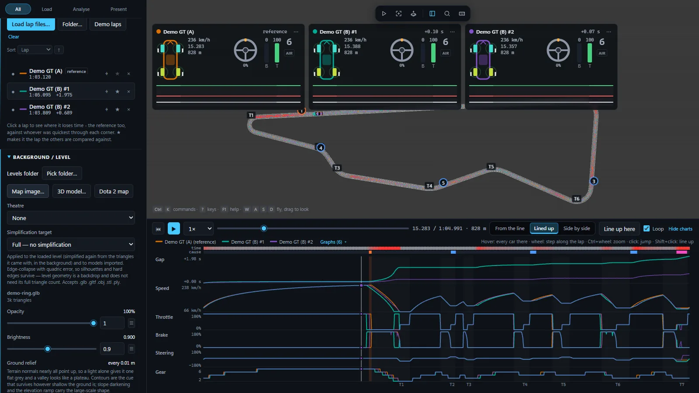

# Sõiduanalüüs

Sõitsid sama raja kaks korda. Vahekaart **Sõiduanalüüs** mängib mõlemad sõidud koos 3D-s, näitab, kus üks ring oli aeglasem, ja ütleb, miks. Pole veel ringe? Vajuta **Demoringid**.

Vahekaart võrdleb kahte või enamat ringi ühel rajal. Ta jagab lõuendit, kaamerat ja laetud raja mudelit (**Taust / tase**) soojuskaardiga; kõik muu on tema oma: oma külgriba ja oma riba vaate all. Sõnad nagu *ring*, *võrdlusring* ja *tipp* on [sõnastikus](glossary.md).

See lehekülg on vahekaardi kaart. Igal osal on oma lehekülg:

| Lehekülg | Mida ta katab |
|---|---|
| [Ringide laadimine](race-loading-laps.md) | iga failivorming, kaustad ja rajad, autode nimed, demoringid, ringide nimekiri, võrdlusring ja fookus |
| [Kordus ja 3D-stseen](race-replay-and-scene.md) | ülekanderiba, kolm kordusrežiimi, autode joondamine, jälitauskaamera, jooned, kaardid, autod, sildid, peegelpildis maailmad |
| [Graafikud ja HUD](race-charts-and-hud.md) | vahemaa graafikud, graafikute valija, kursor ja suum, autokaardid, kanalite tabel |
| [Auto valitsemise sündmused](race-control-events.md) | lukustumised, rattaspinn, ülestüür, pöörlemised, alatüür, tabamused, kokkupõrked, ABS/TC, käsipidur, õhk - kuidas iga tuvastatakse, kõigi lävedega |
| [Kurv-kurvilt analüüs](race-corner-analysis.md) | joondamine vahemaa järgi, kurvid ja lõigud, kurvi ajaarvestus, iga põhjus ja järjekord, milles neid proovitakse, joone kuju ja nõuanne |
| [Sõidukiprofiilid ja võrdlus](race-car-profiles.md) | mida iga auto suudab, mõõdetud tema ringidest; *Autode võrdlus*; mida auto otsustab igas kurvis |
| [Raja statistika](race-course-statistics.md) | palju ringe ühel rajal: vead kurvi kaupa ja liigi kaupa, veakaart, soojuskaardi eksport, jõudluspiirangud |
| [Sõidu analüütika: meetod](race-analytics.md) | reeglite taga olev uurimistöö koos allikatega |
| [Muud võidusõidumängud](other-games.md) | mida vaatur teeb igast mängust pärit ringidega: libisemine ja triiv, kus mäng neid ei saada, peegelpildis maailmad, lisakanalid |

## Ekraan {#the-screen}

**Külgriba**, ülevalt alla (jaotisi saab kokku voltida):

1. **Ringid** - laadimine, nimekiri, näita/peida, võrdlus, fookus, jälitamine.
   Vt [Ringide laadimine](race-loading-laps.md).
2. **Raja statistika** - ainult kolmest laetud ringist alates.
   Vt [Raja statistika](race-course-statistics.md).
3. **Kus parandada** - fokuseeritud ringi leiud, kurv kurvi haaval.
   Vt [Kurv-kurvilt analüüs](race-corner-analysis.md).
4. **Kurv kurvi haaval** (või *Kurv kurvi haaval - klass X*, kui klasse on mitu) - kiireim ring igast kurvist ja selle joon.
   Näidatakse kahe või enama ringi korral.
5. **Auto valitsemine** - fokuseeritud ringi lukustused, libisemised, ülestüürid ja tabamused.
   Vt [Auto valitsemise sündmused](race-control-events.md).
6. **Autode võrdlus** (või **Auto**, ühe auto korral) - vt [Sõidukiprofiilid ja võrdlus](race-car-profiles.md).
7. **Vaade** - milline kaart rajale maalitakse ja mis joonistatakse.
   Vt [Kordus ja 3D-stseen](race-replay-and-scene.md).
8. Jagatud paneelid **Taust / tase** ja **Kaamera ja stseen** (raja mudel, telgede pööramine, kaamera) - dokumenteeritud soojuskaardi ja [Kaamera](camera.md) juures.

**Vaade** näitab rada, sõidetud jooni, kaarti, autosid, rajale kinnitatud silte ning kuni kuut autokaarti vasakul ülal (vt [Graafikud ja HUD](race-charts-and-hud.md)). Kui ringe pole laaditud, ütleb ta: "Ringe pole laaditud - lohista siia kaks või enam ringifaili või laadi külgribalt demoringid."

**Riba vaate all** sisaldab kordusriba ja, kui pole peidetud, vahemaa graafikuid.

## Kiire algus {#quick-start}

1. Ava vahekaart **Sõiduanalüüs** (kõrval **Soojuskaart** külgriba ülaosas).
2. Too ringid sisse. Vajuta **Demoringid**, et näha, mida vahekaart kolme väljamõeldud ringiga teeb. Oma ringide jaoks salvesta need kõigepealt
   ([failivormingud ja salvestajad](race-loading-laps.md#file-formats)), seejärel vajuta
   **Laadi ringifailid…** või **Kaust…**, või lohista failid või kaustad vaatele.
3. Kiireim täielik ring saab võrdlusringiks; aeglaseim teine ring on fookuses. Klõpsa nimekirjas mis tahes ringil, et see fookusesse võtta; ★ teeb ringist võrdlusringi.
4. Loe **Kus parandada**. Klõpsa leiul: autod joondatakse 40 m enne seda, kaamera kadreerib selle, kordus mängib selle läbi ja mõõtmised avanevad.
5. Hoia graafikute kohal hiirt, et viia kõik autod selle meetri juurde; Shift+klõps joondab need sinna.

## Klahvid {#keyboard}

Kui Sõiduanalüüsi vahekaart on avatud:

| Klahv | Teeb |
|---|---|
| **K** | kordus esitab / peatab |
| **Home** | tagasi kordus algusesse |
| numbriklahvid | mitte midagi (soojuskaardil vahetavad need režiime) |

Tekstiväljale või rippmenüüsse kirjutatud klahvid jäetakse arvesse võtmata. Kaameraklahvid töötavad nagu soojuskaardil (**W A S D**, **Tühik** üles, **Q** alla, **Shift** kiiremini, **Alt** aeglasemalt, hiir vaatamiseks; kõik jaotises [Kaamera](camera.md)); **F** kadreerib laetud ringid (nagu ringide laadimine teeb).

## Palju ringe {#many-laps}

- Kõik laetud ringid analüüsitakse ja loetakse; kümned võtavad sekund või kaks.
- Üle **8** ringi (`SHOW_ALL_UP_TO`) joonistatakse lisatud ringid ainult siis, kui nad on võrdlusring, fookusringi või fookusringi klassi parim ring. Lülitid *Näita kõiki* / *Ainult vaadatud*.
- Üle **10** nähtava auto (`PLAIN_PAST`) joonistatakse ringid, mida ei vaadata (mitte fookus, jälitatav auto ega võrdlusring), joontega, mis on hõrendatud punktini iga 6 m tagant 1,5 m asemel, ja lihtsate autodena.
- Graafikud joonistavad kuni **8** ringi; HUD näitab kuni **6** kaarti.
- Raja statistika ilmub alates **3** ringist.

Üksikasjad: [Raja statistika](race-course-statistics.md#performance-with-many-laps).

## Vaate vaikeseaded {#default-view-settings}

| Seade | Vaikimisi |
|---|---|
| Kaart | Ajakaart |
| Sõidetud jooned, Autod, Rattad ja vedrustus, Sildid, Rada ringidest | sees |
| Kõik väärtused kaartidel | väljas |
| Auto suurus | 1× |
| Graafikud | näidatud |
| Kordusrežiim | Joonest |
| Kordusekiirus | 1× |
| Kordus | sees |

Ükski neist ei salvestu; lehe laadimine alustab vaikeväärtustega. Brauseris jääb meelde: keel ja ringifailidest õpitud autonimed (vt [Ringide laadimine](race-loading-laps.md#car-names)).

## Arendajatele {#for-developers}

### Mis juhtub, kui ringid laaditakse {#what-happens-when-laps-are-loaded}

Iga kord, kui ringide hulk, võrdlusring või keel muutub, tehakse kogu analüüs uuesti (`analyse` failis
[`src/race/analysis.ts`](https://github.com/Holdi601/3DHeat/blob/main/src/race/analysis.ts)):

1. Igale ringile lisatakse tuletatud kanalid, kus mäng neid ei saada: triivinurk, rattalibisemine rattakiirustest, õhus, lahtine maapind, pöörlemiskiirus
   ([`derive.ts`](https://github.com/Holdi601/3DHeat/blob/main/src/race/derive.ts)).
2. Võrdlusring valitakse ja iga ring projitseeritakse oma teele ning resambeldakse iga 2 m tagant
   ([`align.ts`](https://github.com/Holdi601/3DHeat/blob/main/src/race/align.ts)).
3. Ringidest tuletatakse, kas mängu maailm on peegelpildis
   ([`handedness.ts`](https://github.com/Holdi601/3DHeat/blob/main/src/race/handedness.ts)).
4. Kurvid leitakse võrdlusringilt ja rühmitatakse lõikudeks ühest pidurdustsoonist järgmiseni
   ([`segments.ts`](https://github.com/Holdi601/3DHeat/blob/main/src/race/segments.ts)).
5. Igale autole: tema ümbrik (haardumine, pidurdus, väljund kiiruse järgi), profiil, rehvikõverad
   ([`envelope.ts`](https://github.com/Holdi601/3DHeat/blob/main/src/race/envelope.ts),
   [`profile.ts`](https://github.com/Holdi601/3DHeat/blob/main/src/race/profile.ts),
   [`control.ts`](https://github.com/Holdi601/3DHeat/blob/main/src/race/control.ts)).
6. Igale ringile ja lõigule: mida ta tegi (pidurdluspunkt, aeglaseim punkt, täisgaas jne) ja joon, mida ta sõitis
   ([`line.ts`](https://github.com/Holdi601/3DHeat/blob/main/src/race/line.ts)).
7. Igale ringile: selle auto valitsemise sündmused, igaüks asetatud selle ringi kõrvale, millega seda seal võrreldakse.
8. Igale ringile ja lõigule: ajaarvestus võrdlusringi vastu ja leid sõnades.
9. Ringi ajakaart ja põhjusekaart.

Tekstid luuakse praeguses keeles; keele vahetamine käivitab analüüsi uuesti (ja nimetab demoringid ümber). Analüüsi tõrge näidatakse nuppude **Ringid** all veana ja ringid jäävad laetuks.

### Lähtefailid {#source-files}

| Fail | Roll |
|---|---|
| `src/race/adapters.ts`, `ibt.ts` | ringifailide lugemine |
| `src/race/lap.ts`, `carNames.ts`, `synthetic.ts` | ringi tüüp, nimetamine, demoringid |
| `src/race/derive.ts`, `handedness.ts` | tuletatud kanalid, peegelpildis maailmad |
| `src/race/align.ts`, `segments.ts`, `line.ts` | vahemaa telg, kurvid, jooned |
| `src/race/analysis.ts` | võrreldud kurvid, põhjused, leiud |
| `src/race/envelope.ts`, `profile.ts` | mida auto suudab |
| `src/race/control.ts`, `impacts.ts` | auto valitsemine, tabamused ja kokkupõrked |
| `src/race/stats.ts` | palju ringe |
| `src/race/replay.ts`, `scene.ts`, `glyph.ts`, `geometry.ts` | kordus ja joonistamine |
| `src/race/schema.ts`, `graphs.ts` | kanalitabel, graafikute read |
| `src/ui/race/*` | külgriba, graafikud, HUD, sildid |
| `src/state/raceStore.ts` | vahekaardi olek ja kordusekell |
