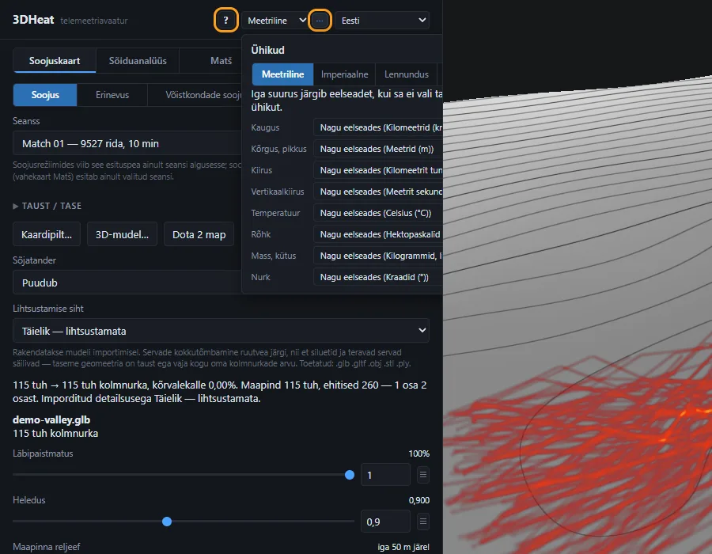
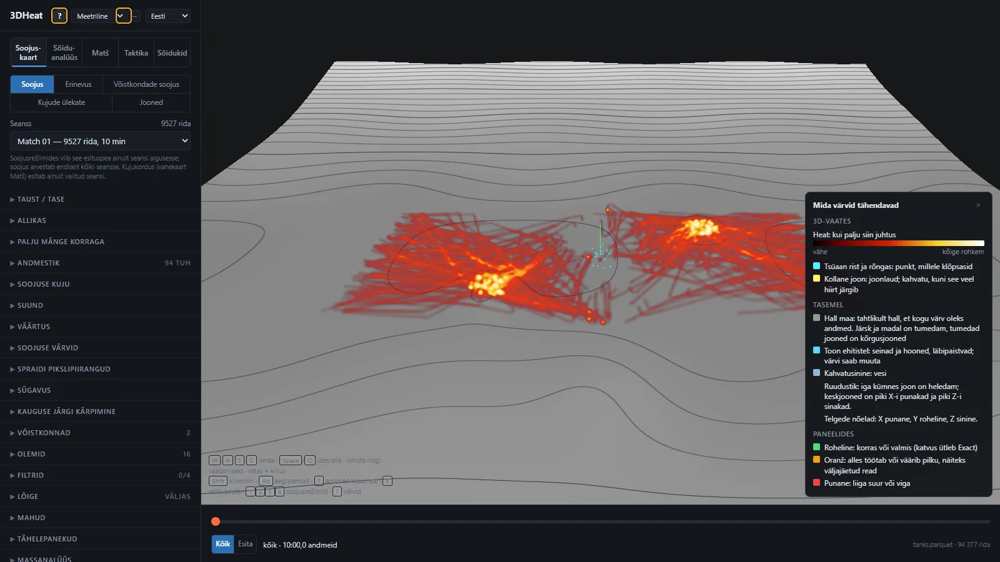

# Seaded, ühikud ja klahvid

Külgriba ülaosas olevad väikesed juhtnupud muudavad seda, kuidas vaatur sinuga räägib: keelt, ühikuid (meetrid või jalad, km/h või sõlmed) ja abirežiimi, mis selgitab värve. Sinu valikud jäävad brauserisse meelde.

## Päis {#the-header}

Külgriba ülaosas:

| Juhtnupp | Mis see teeb |
|---|---|
| **?** | Abirežiim: mida iga värv tähendab (samuti `?` või `F1`) |
| menüü **Üksused** | Meetriline, Imperiaalne, Lennundus või Merendus |
| nupp **...** nupu **Üksused** kõrval | Avab "Vali igale suurusele ühik": üks rippmenüü iga suuruse kohta |
| menüü **Keel** | Vaaturi keel: [40 keelt](languages.md) või brauseri oma |

Kasti sisestatud numbrites võib kasutada nii punkti kui koma (`0.35` või `0,35`). Vaatur loeb mõlemad ja näitab numbreid nii, nagu vaaturi keel neid kirjutab.

## Ühikud {#units}

1. Vali eelseadistus menüüst **Üksused**. Kõik suurused lülituvad koos.
2. Ühe suuruse muutmiseks klõpsa selle kõrval olevat nuppu **...** ja vali selle suuruse ühik. Menüüs ilmub pärast eelseadistust `*`.
3. Suurus, mida sa ei ole seadnud, järgib eelseadistust. Vali "Nagu eelseades", et tagasi minna.

| Suurus | Meetriline (vaikimisi) | Imperiaalne | Lennundus | Merendus |
|---|---|---|---|---|
| Kaugus | km | mi | NM | NM |
| Kõrgus, pikkus | m | ft | ft | m |
| Kiirus | km/h | mph | kt | kt |
| Tõusu-/laskumiskiirus | m/s | ft/min | ft/min | m/s |
| Temperatuur | °C | °F | °C | °C |
| Rõhk | hPa | inHg | hPa | hPa |
| Mass, kütus | kg, l | lb, gal | lb, gal | t, m³ |
| Nurk | kraadid | kraadid | kraadid | kraadid |

Muud ühikud, mida võib ühe suuruse jaoks valida: kaugus km, mi, NM; kiirus km/h, m/s, kt, mph; tõusu-/laskumiskiirus m/s, ft/min, m/min; temperatuur °C, °F, K; rõhk hPa, inHg, mmHg, psi; mass kg, lb, t; nurk kraadid või NATO mil'id (6400 ringi kohta). Ühikud on vaaturis kõikjal ühesugused: sildid, kaardid, graafikud, statistika.

## Abirežiim {#help-mode}

Vajuta `?` või `F1` või klõpsa nuppu **?**. Ilmub *Mida värvid tähendavad*: legendid 3D-vaate, soojusskaalade, võistkondade värvide, taseme värvide, paneelide olekuvärvide, matši paneeli ja võidusõidu vaate jaoks. See jääb sisse, kuni sa selle välja lülitad. Matši vahekaardil selgitab see ka matši paneeli värve.

## Mida brauser meelde jätab {#what-the-browser-remembers}

Need seaded jäävad sinu brauserisse külastuste vahel (midagi ei saadeta kuhugi):

- keel, ühikud ja abirežiim;
- kordusel kujude, tähiste, siltide, kaamera ja taktikalise kuva seaded;
- esitluskiirus ja peegeldamine;
- järjehoidjad salvestuse kohta, mahud andmestiku kohta, objektikihid;
- välise tehisintellekti seaded (võti ainult siis, kui linnukese *Jäta meelde* märgid).

Soojuse seaded, filtrid ja režiim algavad iga laadimisega uuesti. Täielik, genereeritud loend: [Salvestatud seaded](ref-settings-storage.md).

## Klahvid, mida vaatur hoiab brauserist {#keys-the-viewer-keeps-from-the-browser}

Suure andmestikuga seanss laadib aega, seega hoiab vaatur brauserit juhusliku kaotamise eest:

- `Ctrl`/`Cmd` + tähed, mis trükiksid, salvestaksid, avaksid, laadiksid uuesti, sulgeksid või avaksid uusi aknaid, ei tee midagi väljaspool tekstikaste; `F1`, `F3`, `F5`, `F6` ja `F7` ei tee midagi.
- Vahekaardi sulgemine või uuesti laadimine, kui andmed või tase on laaditud, küsib enne.
- Täisekraanil lukustab vaatur oma kasutatavad klahvid (W, T, N, S, R, P, Q, Esc), et brauser neid ei võtaks.

Täielik loend: [Brauseri klahvid](ref-browser-keys.md). Kõik vaaturi enda klahvid: [Klaviatuuri ja hiire viide](keyboard-reference.md).
