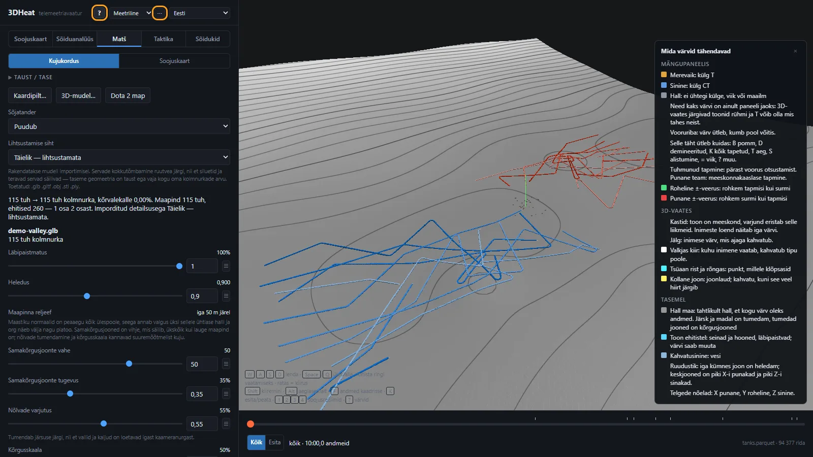

# Seaded, ühikud ja klahvid

Külgriba ülaosas olevad väikesed juhtnupud muudavad seda, kuidas vaataja sinuga räägib: keelt, ühikuid (meetrid või jalad, km/h või sõlmed) ning abirežiimi, mis selgitab värve. Sinu valikud jäetakse meelde brauserisse.

## Päis {#the-header}

Külgriba ülaosas:

| Juhtelement | Mida see teeb |
|---|---|
| **?** | Abirežiim: mida iga värv tähendab (samuti `?` või `F1`) |
| Menüü **Ühikud** | Meetriline, Impeerium, Lennundus või Meremiil |
| Nupp **...** nupu **Ühikud** kõrval | Avab "Vali ühik igale suurusele": üks rippmenüü iga suuruse kohta |
| Menüü **Keel** | Vaataja keel: [40 keelt](languages.md) või brauseri oma |

Kasti sisestatud arvud võivad kasutada kas punkti või koma (`0.35` või `0,35`). Vaataja loeb mõlemat ja näitab arve nii, nagu vaataja keel neid kirjutab.

## Ühikud {#units}

1. Vali eelseadistus menüüst **Ühikud**. Kõik suurused vahetuvad koos.
2. Ühe suuruse muutmiseks klõpsa selle kõrval olevat nuppu **...** ja vali sellele ühik. Menüü näitab siis pärast eelseadistust `*`.
3. Suurus, mida sa ei seadnud, järgib eelseadistust. Vali "Eelseadistuse järgi", et naasta.

| Suurus | Meetriline (vaikimisi) | Impeerium | Lennundus | Meremiil |
|---|---|---|---|---|
| Kaugus | km | mi | NM | NM |
| Kõrgus, pikkus | m | ft | ft | m |
| Kiirus | km/h | mph | kt | kt |
| Vertikaalkiirus | m/s | ft/min | ft/min | m/s |
| Temperatuur | °C | °F | °C | °C |
| Rõhk | hPa | inHg | hPa | hPa |
| Mass, kütus | kg, l | lb, gal | lb, gal | t, m³ |
| Nurk | kraadid | kraadid | kraadid | kraadid |

Teised ühikud, mida saab ühe suuruse jaoks valida: kaugus km, mi, NM; kiirus km/h, m/s, kt, mph; vertikaalkiirus m/s, ft/min, m/min; temperatuur °C, °F, K; rõhk hPa, inHg, mmHg, psi; mass kg, lb, t; nurk kraadid või NATO milli (6400 ringi kohta). Ühikud on vaatajas kõikjal ühesugused: sildid, kaardid, graafikud, statistika.

## Abirežiim {#help-mode}

Vajuta `?` või `F1` või klõpsa nuppu **?**. See näitab *Mida värvid tähendavad*: legendid 3D vaatele, soojuse skaalad, võistkondade värvid, taseme värvid, paneelide olekuvärvid, vahekaardi Matš paneel ja sõidu vaade. See jääb sisse, kuni lülitad selle välja. Vahekaardil Matš selgitab see ka mängupaneeli värve.

## Mida brauser mäletab {#what-the-browser-remembers}

Need seaded jäetakse sinu brauserisse külastuste vahel (midagi ei saadeta kuhugi):

- keel, ühikud ja abirežiim;
- kordusvaate kujude, sümbolite, siltide, kaamera ja taktikalise kuvamise seaded;
- taasesituse kiirus ja peegeldus;
- järjehoidjad salvestise kohta, helitugevused andmestiku kohta, eesmärgikihid;
- välise tehisintellekti seaded (võti ainult siis, kui märgid *Jäta meelde*).

Soojuse seaded, filtrid ja režiim alustavad igal laadimisel uuesti. Täielik genereeritud loend: [Salvestatud seaded](ref-settings-storage.md).

## Klahvid, mida vaataja hoiab brauserist {#keys-the-viewer-keeps-from-the-browser}

Suurte andmetega seanss laaditakse aega, seega hoiab vaataja brauserit selle kogemata ära viskamast:

- `Ctrl`/`Cmd` + tähed, mis trükiksid, salvestaksid, avaksid, laadiksid uuesti, sulgeksid või avaksid uusi aknaid, ei tee midagi väljaspool tekstikaste; `F1`, `F3`, `F5`, `F6` ja `F7` ei tee midagi.
- Andmete või taseme laadimisega kaardi sulgemine või uuesti laadimine küsib kõigepealt.
- Täisekraanil lukustab vaataja klahvid, mida ta kasutab (W, T, N, S, R, P, Q, Esc), nii et brauser neid ei võta.

Täpne loend: [Brauseri klahvid](ref-browser-keys.md). Kõik vaataja enda klahvid: [Klaviatuuri ja hiire viide](keyboard-reference.md).
