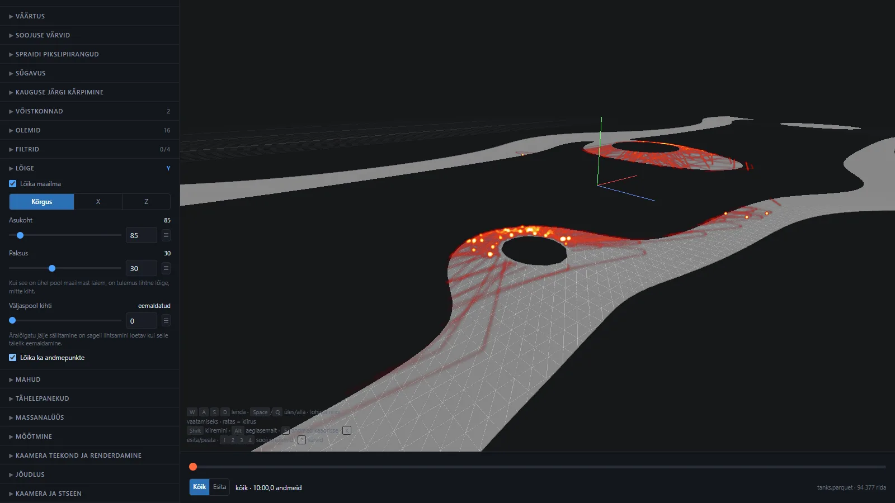

# Lõige

**Lõige** lõikab maailma nagu koogitüki, nii et näed hoonete sisse. Kasuta seda, kui seinad peidavad huvitava soojuse, näiteks et näha ühte hoone korrust.

## Proovi {#try-it}

1. Laadi tase ja mõned andmed ning ava **Lõige**.
2. Märgi **Lõika maailma**. Telg on **Kõrgus**.
3. Lohista **Asukoht** üles ja alla: kiht liigub läbi taseme.
4. Tee **Paksus** õhukeseks korruseplaani jaoks või laiaks, et näha "kõike siit allpool".
5. Hoia **Väljaspool kihti** väärtusel 0, et eemaldada ülejäänu, või tõsta see, et jätta nõrk jälg.



Kiht lõikab **taseme geomeetriat ja andmepunkte koos**. Ainult taseme lõikamine jätaks soojuse õhku, kus oli hoone. See on [sügavuse varjamise](depth-and-culling.md) vastand: kui tase peidab õigesti selle, mis on tema taga, on peidetud ka hoone sisemus. Paneel kuvatakse siis, kui on midagi lõigata (andmestik või 3D tase); päis näitab sisselülitatud olekus telge, muidu *väljas*.

```
külgvaade         Asukoht = kus kiht asub
 ----------       Paksus = kui kõrge kiht on
 | korrus 3 |
 |=========|  <--- kiht (alles)
 | korrus 2 |  <--- väljaspool: eemaldatud (või nõrk)
 | korrus 1 |
 ----------
```

## Juhtnupud {#controls}

| Juhtelement | Vaikimisi | Tähendus |
|---|---|---|
| **Lõika maailma** | väljas | Lülitab kihi sisse. Kui asukoht on veel algväärtusel 0 ja paksus algväärtusel 500, viib sisselülitamine need telje keskele ja 15% telje ulatusest. |
| Telg | **Kõrgus** | *Kõrgus* (Y), *X* või *Z*. Telje vahetamine viib kihi uue telje keskele. |
| **Asukoht** | keskel | Kihi keskpunkt maailma ühikutes, üle telje ulatuse (500 sammu). |
| **Paksus** | 15% ulatusest | Alates 1/500 ulatusest kuni kaks korda ulatus, logaritmilistes sammudes. Loeb *üle maailma*, kui see on sama lai kui ulatus: siis ulatub üks külg üle maailma ja see on lihtne lõige, mitte kiht. |
| **Väljaspool kihti** | 0, *eemaldatud* | Kui palju sellest, mis jääb kihi väljale, jääb nähtavaks, 0–100%. Lõigatud osa nõrk jälg on sageli lihtsam lugeda kui täielik eemaldamine. |
| **Lõika ka andmepunkte** | sees | Väljas jätab soojuse tervena, nii et see paistab läbi lõike. See on kasulik, et näha, mis on kihi kohal ja all. |

Telje ulatus on 3D taseme oma, kui see on laaditud, muidu andmestiku oma.

Lõige on sõltumatu [kauguse eemaldamisest](depth-and-culling.md#distance-culling), mis lõikab piki vaatesuunda, mitte maailma telge. Need kaks kombineeruvad. Iga lõike seade muutmine taaskäivitab soojuse akumulatsiooni.

## Arendajatele {#for-developers}

Kiht testitakse iga rea maailma asukohal tipu-shaderis. Rea, mis jääb kihist välja, panus korrutatakse väärtusega *Väljaspool*. Nii et 0 korral lükatakse see tagasi enne, kui ühtegi fragmenti joonistatakse. Taseme shaderid rakendavad sama testi maapinna, struktuuride ja vee igale fragmendile.
