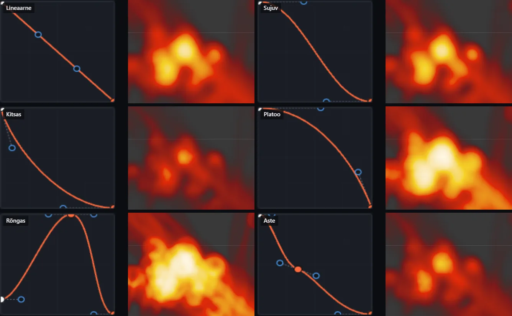

# Spraidi kuju

Iga rida joonistatakse ümarana spraidina, mis on alati kaamera poole. Selle suurus ja profiil selle keskmest servani - **skaala** - määravad, kas kuumkoht loetakse kitsa punktina, pehme pilvena, kettana või rõngana. Need juhtnupud on külgriba jaotistes **Soojuse kuju** ja **Spraidi pikslipiirangud** ning kehtivad [Soojusele](heat.md), [Erinevusele](difference.md), [Võistkondade soojusele](team-heat.md) ja joone poolelaiusena [Joonesoojusele](line-heat.md).

Mõne neist muutmine taaskäivitab akumulatsiooni (väli tuleb uue kujuga uuesti joonistada).

Mõtle iga punktist kui pehmest valgusläikest. Väike läige näitab üksikuid kohti; suur läige ühendab naabrid pilveks. Kuju otsustab, kui pehme on serv.



## Spraidi raadius {#sprite-radius}

Spraidi raadius **maailma ühikutes** (märgitud meetrites). Vaikimisi 6, ja igal laadimisel andmete horisontaalne ulatus / 120 - piisavalt suur, et kõrvuti olevad proovid raja järgi ühinevad ribaks, mitte ei loe juuksekarvana. Logaritmiline liugur 0,05-2000, käepide kuni 50 000.


Kaugel olevad asjad näevad väiksemad, seega kahaneb spraidi ekraanil kauguse järgi. Paralleelprojektsiooni all on see igal pool sama, mis on osaliselt põhjuseks, miks paralleelvaade on õige kuumkohtade võrdlemiseks ([Kaamera](camera.md#projection)).

## Pikslipiirangud {#pixel-clamps}

**Spraidi pikslipiirangud** (vaikimisi suletud) piiravad ekraanil oleva raadiuse pärast ülaltoodud teisendust.

| Juhtnupp | Vaikimisi | Vahemik (hüppamisega) | Miks |
|---|---|---|---|
| **Min raadius pikslites** | 1 px | 0-16 (512) | Hoiab kaugeid andmeid kadumast alla ühe piksli. |
| **Max raadius pikslites** | 96 px | 2-1024, logaritmiline (8192) | Ülejoonistamise kaitse. N pikslit katva spraidi maksumus on N segamisoperatsiooni, seega piiramata raadius kaamera lähedal teebki kiire kaadri aeglaseks. Üle vaateakna kõrguse ei piira see enam midagi. |

**Sama tihedus igal suumil** (jaotises Soojuse kuju, vaikimisi sees) töötab piirangutega. Spraidi, mida piirang teeb suuremaks (kaugel) või väiksemaks (lähedal), säilitab soojuse, mille tema tõeline suurus lisaks, nii et värv tähendab sama arvu ridu maa pindalaühiku kohta igal suumil. Kui see on väljas, lisab piiratud spraidi täiskaalu oma piiratud suuruses ja pilt muutub, kui sa sisse lendad.

## Keskme ja serva intensiivsus {#centre-and-edge-intensity}

Soojus, mille spraid lisab oma täpsel keskmel (**Keskme intensiivsus**, vaikimisi 1, 0-10, hüppamisega 1000) ja oma servas (**Serva intensiivsus**, vaikimisi 0, -2 kuni 10, hüppamisega 1000). Skaala väärtus *t* (1 keskmel, 0 servas, kujundatud sumbumise või kõvera järgi allpool) segab need kokku (valem on jaotises [Arendajatele](#for-developers)).

**Negatiivne serva intensiivsus** muudab serva lahutavaks, mis lõikab iga kuumkoha ümber jahedat halo't ja teritab klastreid üksteise vastu. Nähtavus hõlmab [katmist](depth-and-culling.md) ja [lõiget](slice.md); hääbumine on [Eluea](timeline.md#history) hääbumine; märk on ±1 jaotises [Erinevus](difference.md).

## Skaala kuju: sumbumine või kõver {#ramp-shape-falloff-or-curve}

**Skaala kuju** lülitab kahe viisi vahel, kuidas *t* spraidi üle kujundatakse. *d* on kaugus keskmest (0) servani (1):

### Sumbumine {#falloff}

Näidatakse, kui on valitud *Sumbumine* (vaikimisi).

- **Sumbumine** (vaikimisi 1,6, 0,1-8, hüppamisega 64): `t = (1 - d) ^ falloff`. 1 on sirge lineaarne skaala; kõrgem tõmbab soojuse keskme poole ja kitsendab kuumkoha; alla 1 lamestab selle kettaks.
- **Sujuv skaala** (vaikimisi sees): rakendab *t*-le smoothstep S-kõverat, nii et spraid hääbub servas, selle asemel et lõppeda nähtava äärega.

### Kõvera redaktor {#the-curve-editor}

Näidatakse, kui on valitud *Kõver*. Spraidi otsene ristlõige: kaugus keskmest üle (*keskus* vasakul, *serv* paremal), soojus üles. Kõver on tükkhaaval kuupiline Bézier'i kõver juhtpunktide kaudu, igaühel kaks käepidet.

| Toiming | Mõju |
|---|---|
| Topeltklõps graafikul | Lisab punkti sellele kaugusele (hoitakse 0,02 ja 0,98 vahel), kõveral ja kõvera kaldega seal, nii et lisamine ei muuda midagi, kuni seda lohistad. |
| Punkti lohistamine | Liigutab seda. Kõrgused hoitakse 0 ja 1 vahel. |
| Väikese ringi lohistamine | Painutab selle kõrval oleva lõigu (liigutab seda käepidet). |
| Alt-klõps või parem klõps punktil | Eemaldab selle. Kahte lõpp-punkti ei saa eemaldada. |
| Eelseadistuse nupp | Asendab kõvera eelseadistusega. |

Lõpp-punktid on fikseeritud keskme ja serva juures; nende kõrgus on siiski sinu valida.

**Eelseadistused** ([`curve.ts`](https://github.com/Holdi601/3DHeat/blob/main/src/state/curve.ts)):

| Eelseadistus | Kuju | Kasutus |
|---|---|---|
| **Lineaarne** | Sirge 1-st 0-ni | Identne *Sumbumisega* 1 ja *Sujuv skaala* väljas. |
| **Sujuv** | S-kõver | Vaikimisi kõver; see, mida *Sujuv skaala* annab sumbumisel 1. |
| **Kitsas** | Järsk tuum, pikk nõrk hõlm | Hõre andmestik. |
| **Platoo** | Lame, seejärel kiire langus | Loetakse kettana, mitte läiketa. |
| **Rõngas** | 0,15 keskmel, 1 raadiuse 62% juures, 0 servas | Õõnes spraid: näitab, kus rajad läbivad, mitte kus need lõpevad. |
| **Aste** | Kahefaasiline sumbumine, 0,45 juures 35% | Eraldab tiheda tuuma ümbrusest. |

## Lamenda maapinna tasandile {#flatten-onto-ground-plane}

**Lamenda maapinna tasandile** (vaikimisi väljas) ignoreerib iga rea kõrgust ja joonistab kogu soojuse ühel kõrgusel - andmete madalaim Y - klassikalise 2D kaardisoojuse. Kui see on sees, on sügavuskatmine ja *Peida maastiku taha* väljas (iga punkt asuks täpselt pinnal, mille vastu teda testitakse), ja sügavuse jaotis ütleb seda.

## Arendajatele {#for-developers}

### Valemid {#formulas}

Ekraanil oleva raadius pikslites: `radius × P[1][1] / w × viewport height / 2`, kus `P` on projektsioonimaatriks ja `w` on punkti vaatesügavus.

Soojus, mille spraid lisab:

```
heat added = mix(edge, centre, t) × sample weight × sign × fade × visibility
```

### Kõver {#the-curve}

Käepidemed on horisontaalselt piiratud oma lõiguga, seega on kõver alati kauguse funktsioon: käepideme lohistamine kaugele järgmisest punktist lamestub selle vastu, selle asemel et kõverat tagasi voltida, mis muudaks tulemuse sõltuvaks sellest, millise juure lahendaja leidis.

### Kuidas kõver joonistatakse {#how-the-curve-is-drawn}

Kõver küpsetatakse 256-kirjelisse tabelisse iga kord, kui see muutub, laaditakse 16-bitise ujukomatekstuurina ja proovitakse iga fragmendi kohta lineaarse filtriga ning poolteksli nihkega, nii et mõlemad otsad jäävad täpseks. Bézier'i lahendamine x jaoks vajab iteratsiooni, mis ei sobi programmi kõige kuumemasse varjundisse, ja tabeli päring on odavam kui `pow()`, mida sumbumine kasutab. 16-bitine, mitte 8-bitine, sest 8 bitti näitab triipe, kui tuhanded spraidid on kokku liidetud; 16-bitine pool-ujukoma on filtreeritav tuumiku WebGL2-s, kus 32-bitine vajab laiendust.
