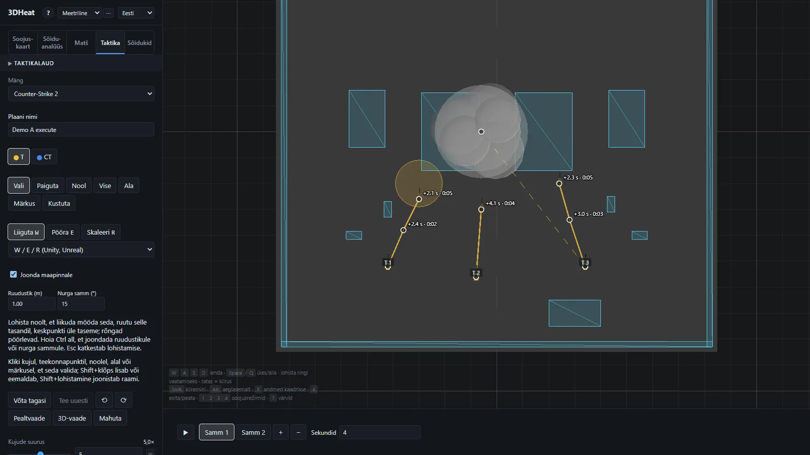

# Taktikatahvel

Vahekaart **Taktika** on joonistuslaud meeskonnaplaani jaoks: paned kaardile väikesed kujud, joonistad nooled, kuhu nad lähevad, ja vajutad mängimist, et näha, kuidas see välja tuleb. Kasuta seda, et planeerida ring või rünnak enne mängimist. See jagab lõuendit, kaamerat ja [taset](levels.md) ainult teiste vahekaartidega, muud mitte; plaan ei ole andmed ega joonista soojust.

## Esimene plaan {#your-first-plan}

1. Ava vahekaart **Taktika**. Vali **Mäng** (näiteks Counter-Strike 2) ja Valorantile vajuta **Laadi Valoranti kaardid** ning vali **Kaart**. Või laadi enne [tase](levels.md).
2. Vali **Pool** (see määrab värvi) ja vajuta **Pealtvaade**.
3. Vali **Koht**, vali kuju jaotisest **Kujud** (leidmiseks kasuta **Otsi kujusid**) ja klõpsa kaardil. Pane kaks või kolm.
4. Vali **Nool**, klõpsa kujul, klõpsa mööda teed, kuhu see peaks minema, ja vajuta **Enter**, et nool lõpetada.
5. Vajuta vaate all **+**, et lisada samm 2. Iga kuju algab sealt, kus tema nool lõppes. Joonista seal veel nooli.
6. Vajuta **▶** (või `K`), et mängida plaan näidatud sammust lõpuni.
7. Nimeta plaan väljal **Plaani nimi** ja vajuta **Salvesta**.

## Plaani alustamine {#starting-a-plan}

| Juhtnupp | Mida see teeb |
|---|---|
| **Mäng** | Valib pooled ja kujud, mida paletis pakutakse: Counter-Strike 2 (T, CT; mängijad ja abivahendid), Valorant (Rünnak, Kaitse; mängijad ja üldised võimed), Battlefield, Squad, Arma (jalavägi, maismaasõidukid, lennukid, paadid), DCS / War Thunder / IL-2 (reaktiivlennukid, propellerlennukid, helikopterid, õhutõrje, maa, laevad, relvad) ja Muu. Plaan, millel juba on kujud, säilitab oma pooled, kui mäng muutub. |
| **Plaani nimi** | Nimi, mille all plaan salvestatakse. |
| **Kaart**, **Laadi Valoranti kaardid** | Kui on valitud Valorant: **Laadi Valoranti kaardid** toob kaartide loendi saidilt [valorant-api.com](https://valorant-api.com); **Kaart** paneb valitud kaardi miniaatüüri tasemeks, kaadrituna ülevalt. Pilt laaditakse valikul ja seda ei saadeta kaasa. Riot'i teade kuvatakse, kui see ekraanil on (vt allpool). |
| **Pool** | Pool, kuhu kuulub järgmine kuju, nool või ala; see saab poole värvi. |

Ilma tasemeta on tahvel tasane maapind. Laadi tase jaotises **Tase**, et planeerida
päris kaardil: CS2 tööriistaga eksporditud CS2 kaart, raamatukogu tase või kaardipilt.

## Tööriistad {#tools}

| Tööriist | Klõps | Märkused |
|---|---|---|
| **Vali** | Kuju, teepunkt, nool, ala või märkus valib selle. | Shift+klõps lisab või eemaldab; Shift+lohistus joonistab kasti selle ümber, mida lisada. Valikul on teisendus-gizmo (vt allpool); `Delete` või `Backspace` eemaldab selle. `M` viib valitud kuju järgmise klõpsuni. |
| **Koht** | Paneb valitud kuju maha. | Kuju valitakse jaotise **Kujud** paletist (koos **Otsi kujusid**). Kui ei ole midagi valitud, pöörab `R` järgmist kuju 15° enne paigutamist (`Shift+R` vastupidi). |
| **Nool** | Iga klõps lisab punkti; Enter, topeltklõps või parempoolne klõps lõpetab, Esc loobub. | **Liigu**, **Rünnak** (laiem ots) või **Jälgi** (õhuke joon silmade kõrgusel). Kujult alustatud nool on selle kuju marsruut sel sammul: esitamisel kuju käib seda mööda ja järgmine samm algab sealt, kus see lõppes. |
| **Visata** | Viskaja, siis koht, kuhu see maandub. | Katkendlik kaar ühest teise ja valitud abivahend (suits, välk, molotov, ...) ilmub sinna, kuhu see maandub, ja jääb sellest sammust alates. |
| **Ala** | Keskpunkt, siis serv. | Ketas poole värvis. |
| **Märkus** | Koht, kuhu märkus läheb; küsib selle teksti. | Näidatakse nõelana, ja selle tekst on selle kohal. |
| **Kustuta** | Kuju, nool, ala või märkus. | Eemaldab selle sellest sammust alates; esimesel sammul eemaldab selle täielikult. |

**Võta tagasi** ja **Tee uuesti** (`Ctrl+Z`; `Ctrl+Y` või `Ctrl+Shift+Z`) käivad läbi iga muudatuse. Joon plaani all näitab, mitu kuju, nooli ja sammu sel on. **Pealtvaade** vaatab otse alla (ortograafiline), **3D-vaade** läheb tagasi perspektiivi, **Kaader** sobitab plaani või, kui plaan on tühi, taseme.

**Kujude suurus** muudab kõigi lauale pandud kujude suurust; 1× on tegelik suurus, mis kõrgelt vaadates on inimesel mõni piksel.

## Liigutamine, pööramine ja skaleerimine {#moving-turning-and-scaling}

Kõike laual saab liigutada nagu 3D-redaktoris: kujusid, abivahendeid, markereid, üksikuid teepunkte ja terveid nooli, alasid ja märkusi. Valitud asja keskmes on gizmo:

| Režiim | Klahvid | Käepidemed |
|---|---|---|
| **Liigu** | W (või G) | Nool igale teljele (X punane, Y roheline ja üles, Z sinine) liigub mööda seda; ruut liigub üle oma tasandi; keskpunkt liigub kursori all oleva taseme kohal. |
| **Pööra** | E (või R) | Rõngas igal teljel pöörleb selle ümber. Ühe kuju rõngad on tema enda kursi, kalde ja rulli; grupp pöörleb ümber maailma telgede oma keskpunkti ümber. |
| **Skaleeri** | R (või S) | Laiali või kokku laotab valiku oma keskpunktist mööda telge või igas suunas; ala raadius kasvab koos sellega. |

**Klahvid** vahetab W / E / R (Unity, Unreal) ja G / R / S (Blender) vahel; klahvid valivad režiimi ainult siis, kui midagi on valitud, muidu lendavad kaameraga. Seega `R` tähendab W / E / R klahvidega **Skaleeri** ja G / R / S klahvidega **Pööra**, kui midagi on valitud, ning pöörab järgmist paigutatavat kuju, kui midagi ei ole valitud. Kõik tahvli klahvid on loetletud [klahvistiku juhendis](keyboard-reference.md#tactics-board). Lohistades hoia all **Ctrl**, et liigutus joonduks **Ruudustikule** (meetrites) või pööre **Nurgasammule**. **Joonda maapinnale** (vaikimisi sees) paneb liigutatud inimesed, sõidukid, markerid, teepunktid ja alad taseme pinnale; lennukid ja helikopterid hoiavad oma kõrgust ning lohistus mööda Y noolt ei joonda kunagi. Käepideme lohistamine ei liiguta kaamerat. **Esc** katkestab lohistamise ja iga muudatus on üks samm Võta tagasi.

Teepunktid näevad välja punktidena näidatud sammu noolte peal: klõpsa ühel, et see valida, lohista see liigutamiseks, Delete eemaldab selle. Jaotis **Valitud** näitab valiku asukohta meetrites, kuju kurssi, kallet ja rulli kraadides ning ala raadiust, igaüks sisestatav.

## Ajastus {#timing}

Kuju marsruut on ajastatud: iga lõik võtab aega oma pikkuse järgi üle taseme - mõõdetuna maapinnal iga paari meetri tagant, nii et kumm või trepp kahe punkti vahel loeb - kiirusel selle kuju liikumisrežiimi **järgi** sel mängul, pluss mis tahes **ootamine** teepunktis. Jalavägi roomab, kükitab, kõnnib (vaikselt), jookseb või sprindib; sõidukid ja paadid roomavad, sõidavad ettevaatlikult, tavaliselt või kiirustavad; lennukid ja helikopterid lendavad aeglaselt, kruiisikiirusel, lahingukiirusel või maksimumil. Režiim, mida mängul ei ole (CS2-l pole sprinti), võtab lähima, mis tal on. Kuidas nõlv aeglustab, sõltub mängust: CS2-s ja Valorantis loetakse ainult horisontaalset vahemaad, nagu mängudes; mil-sim'id aeglustavad jalaväge mäkke (Toboleri matkafunktsioon) ja sõidukeid kalde järgi.

Kiirused tulevad mänguspetsiifilistest tabelitest koos nende allikatega (vt [Liikumiskiirused](tactics-speeds.md)): CS2 hoitava relva järgi mängu relvamääratlustest; Valorant relva järgi; Battlefield, Squad, Arma ja õhumängud sõiduki tüübi ja klassi järgi. **Liigub nagu** valib kuju profiili (relv, sõiduki tüüp); **Oma (m/s)** ületab mis tahes režiimi selle kuju jaoks. Režiimid on nimetatud nii, nagu tahvel need näitab: *Roomamine*, *Kükitamine*, *Kõndimine (vaikselt)*, *Jooksmine*, *Sprint*; *Ettevaatlikult*, *Tavaliselt*, *Kiirustades*; *Aeglaselt*, *Kruiis*, *Lahing*, *Maksimum*.

Iga teepunkt näitab aega eelmisest ja aega plaani algusest ("+3,9 s · 0:12"). Valitud kuju marsruut loetleb iga lõigu koos režiimi, pikkuse ja ajaga, ootamise ja saabumise. **Saabumised** jaotises **Ajastus** paneb iga marsruudiga kuju ühele ajajoonele, esimene saabuja üleval. Režiimiga **Mängi reaalajas** (vaikimisi sees) kestab samm, kuni kõige aeglasem marsruut saabub, ja iga kuju liigub oma kiirusel; **Sekundid** on siis sammu vähim pikkus. **Taseme ühikut meetri kohta** ütleb, mis ühikutes tase on: 39,37 CS2 kaartidele (mängu ühikud), 1 meetri kaartidele.

## Võrdlus matšiandmetega {#compare-with-match-data}

**Laadi matšifailid…** loeb kaardi CS2 matšitabeleid (CS2 tööriista Parquet-failid, kui palju soovid; ainult vajalikud veerud, taustal); **Kasuta laaditud andmeid** võtab vaaturisse laaditud andmed. Seejärel:

- **Varaseim saabumine kaardil** värvib kaardi ajaga, mis möödus ringi algusest, kui mängija esimest korda jõudis igasse kohta - nupp **Kiireim** näitab kiireimat kõigis ringides, **Tüüpiline (mediaan)** keskmist ringi - roheline varakult kuni punane hilja, ühe või mõlema poole kohta. See näitab, mis on võimalik, millal.
- Valitud marsruuti võrreldakse sellega, mida mängijad saavutasid selle algusest (või ringi algusest) lõpuni, iga lõpp on määratud raadiusega ketas: "Nähtud kiireim 14,2 s, p10 15,0 s, mediaan 18,3 s 41 sõidu peale; sinu plaan 15,1 s".
- Kiirused, millega mängijad tegelikult liikusid - jooksmine, kõndimine, kükitamine, tabelite kõndimise ja kükitamise veergudest - m/s.

## Sammud {#steps}

Vaate all olev riba hoiab samme. Plaan algab ühega; **+** lisab ühe ja iga kuju algab sealt, kus tema marsruut viimases sammus lõppes; **−** eemaldab näidatud sammu. **Sekundid** on, kui kaua näidatud samm kestab, kui seda mängitakse. **▶** (K) mängib näidatud sammust lõpuni: marsruudiga kujud käivad seda mööda, järgmises sammus uude kohta liigutatud kujud libisevad sinna, ülejäänud seisavad. Kui samm on näidatud, joonistatakse iga kuju koht järgmises sammus hõreda kummituspildina ja viimase sammu nooled nõrgalt selle sammu all.

## Salvestamine {#saving}

Jaotis **Fail** sisaldab **Salvesta**, **Ava** ja **Tühjenda**. **Salvesta** kirjutab plaani failina `<nimi>.h3dplan.json` (lihtne JSON: pooled, sammud, kujud koha kohta igas sammus, nooled, alad, märkused); **Ava** loeb ühe tagasi. Teist versiooni fail või fail, mis ei ole plaan, lükatakse tagasi koos põhjusega. **Tühjenda** tühjendab plaani; Võta tagasi toob selle tagasi.

## Kujud {#figures}

Iga kuju ehitab vaatur ise: lihtsad kujundid tüübi avaldatud suuruses, koos tunnustega, mis eristavad neid naabritest - tanki teerattad ja torn, õhutõrjesõiduki relvad, raketid ja radarid, lennuki tiiva plaan, saba ja mootorid, helikopteri rootorid ja lühikesed tiivad. Midagi ei võeta mängust. Mängu leiutatud disain näidatakse oma klassi üldise kujuna. Vaata, kuidas andmed oma kuju leiavad: [Kujud](figures.md#which-figure-a-unit-gets).

## Riot'i teade {#riots-notice}

Valorandi kaarte näidatakse Riot Gamesi poliitika "Legal Jibber Jabber" alusel, mis lubab neid tasuta kogukonnaprojektides kasutada ja nõuab seda teadet kõikjal, kus need ilmuvad: *3DHeat on loodud Riot Gamesi poliitika "Legal Jibber Jabber" alusel, kasutades Riot Gamesile kuuluvaid varasid. Riot Games ei toeta ega sponsoreeri seda projekti.* Tahvli võimed on üldised kujundid, mitte Riot'i kunst.
