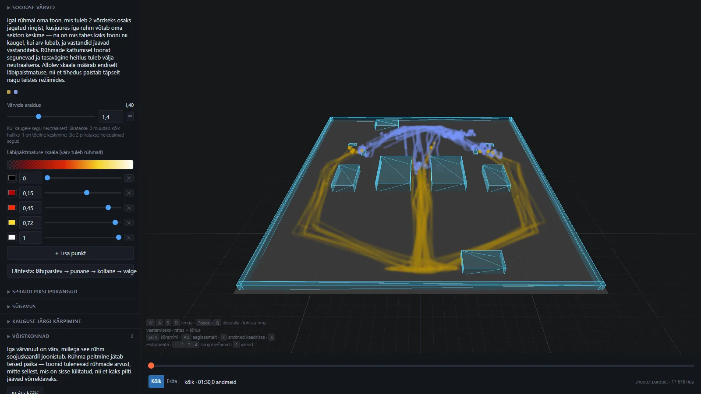

# Võistkondade soojus

Võistkondade soojus näitab, kus iga võistkond oli, igaüks oma värvis. Kus võistkonnad kattuvad, segunevad värvid.

**Võistkondade soojus** (klahv 3) on [Soojuse](heat.md) tihedusväli, kus igale [grupile](glossary.md) on antud oma toon. Kus grupid kattuvad, segunevad nende toonid; võrdne võitlus tuleb neutraalne. Läbipaistmatus kannab tihedust ikka täpselt nagu teistes režiimides, nii et pilt vastab korraga *kui palju* ja *kelle*. See vajab grupiveergu.

See ei ole [kujude ülekate](box-replay.md): see joonistab ühe kuju isiku kohta, siin on soojusväli, mida värvib sama veerg.

## Kuidas seda kasutada {#how-to-use-it}

1. Vajuta `3` (või vali režiimiribal **Võistkondade soojus**).
2. Ava **Soojuse värvid**. Värvitükid näitavad iga grupi värvi; värvitüki kohal hoides näed võistkonna nime.
3. Kui kõik paistab hall, tõsta **Värvide eraldus**.
4. Eemalda grupp [Võistkondade loendist](teams-list.md), et see välja jätta; teiste värvid jäävad oma kohale.

## Juhtnupud {#controls}

Jaotises **Soojuse värvid**:

| Juhtelement | Vaikimisi | Tähendus |
|---|---|---|
| Värvitükid | | Iga grupi värv esimese 12 grupi jaoks, seejärel *+N veel*. Hoia kohal, et näha grupi nime ja värvi. |
| **Värvide eraldus** | 1,4 | Kui kaugele segu surutakse neutraalsest, 0–4. 0 teeb kõik halliks; 1 on tõeline keskmine; umbes 2 kohal lähevad heledaimad segud kuvatavast ulatusest välja ja need piiratakse kanaliti, mis nihutab nende tooni. |
| **Läbipaistmatuse skaala (värv tuleb rühmalt)** | vaikimisi soojuse skaala | Siin kasutatakse ainult skaala **alfat**: läbipaistev seal, kus midagi ei ole, ja läbipaistmatu tipus. Selle värve eiratakse. |

Grupp, mille silt tähendab "gruppi ei ole" (`0`, tühi, `none`, `unknown`, `null` või `-1`), joonistatakse halliga.

Kõik teised soojuse juhtnupud (kuju, küllastus, vastus, minimaalne soojus, sügavus, eemaldamine) töötavad nagu lehel [Soojus](heat.md).

[Võistkondade loend](teams-list.md) näitab selles režiimis iga grupi võistkondade soojuse värvi oma värvitükina. Grupi peitmine jätab iga teise grupi värvi oma kohale: toonid tulevad grupi koguarvust, mitte sellest, mis on sisse lülitatud, nii et kaks pilti jäävad võrreldavaks.

## Arendajatele {#for-developers}

### Paletti {#the-palette}

Failist [`colors.ts`](https://github.com/Holdi601/3DHeat/blob/main/src/render/colors.ts):

- Värvid elavad **Oklab**i värvitasandil fikseeritud heledusel (0,7) ja kroomal (0,115), nii et iga grupp on võrdselt hele ja punane grupp ei paista soojemana kui sinine.
- *n* grupi korral jagatakse toonide ring *n* võrdseks osaks ja grupp *i* võtab oma osa **keskme**, `(i + 0,5) / n` pöördest. Kaks suvalist gruppi on nii kaugel, kuidas arv lubab, ja vastandid jäävad vastanditeks, olenemata arvust.
- Kasutatakse kuni **16** erinevat tooni. Rohkemate gruppide korral paigutatakse ID-d korduva poolitamisega (bitipööratud ID-d: 0, ½, ¼, ¾, ⅛, …), nii et naaberid ei jaga tooni; grupid üle 16 jagavad paratamatult.
- Grupp, mille silt tähendab "gruppi ei ole" (`0`, tühi, `none`, `unknown`, `null` või `-1`, suurtähtedest hoolimata), joonistatakse **neutraalse hallina**, selle asemel et võtta ringist tükk. Ainult esimest sellist silti grupi loendis käsitletakse nii.

Vaikimisi eraldus on 1,4, mitte 1, sest väärtusel 1 on viie ühtlaselt jaotatud tooni segu *hall*: õige, aga loetamatu. Natuke üle 1 hoiab viigid ausad ja teeb nähtavaks 60/40 jaotuse.

### Kuidas see töötab {#how-it-works}

Soojussihtmärgil on selles režiimis neli kanalit. Iga spraidi lisab oma tiheduse *v* esimesele kanalile ja *v* × grupi Oklab-koordinaatide *a* ja *b* teisele ning kolmandale kanalile. Komposiidi ajal on piksli segu tiheduskaaluga keskmine: *a* = G / R, *b* = B / R, mida skaleeritakse eralduse järgi ja teisendatakse sRGB-ks paleti heledusel. Jagamine kogutud tihedusega hoiab tooni sõltumatuna sellest, kui palju andmeid on, ja sellepärast mõjutab iga tiheduse juhtnupp ainult läbipaistmatust.

Neljakanalise sihtmärgi GPU mälu on sama lahutuse juures neli korda suurem kui ühekanalise soojussihtmärgi oma.
