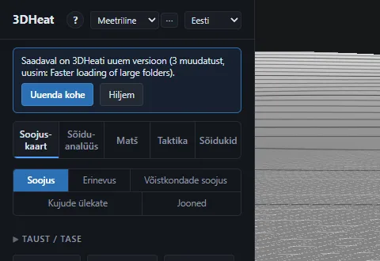

# Uuendused

Vaatur teatab sulle, kui on olemas uuem versioon, ja uuendab end ainult siis, kui sa ütled jah. Sinu arvutis ei muudeta midagi ilma sinu vastuseta.

## Vaaturi uuendamine {#update-the-viewer}

1. **Lehel.** Kui on olemas uuem versioon, ilmub kast nime alla külgriba ülaosas: "3DHeati uuem versioon on saadaval". Klõpsa **Uuenda kohe**. Leht laaditakse ise uuesti, kui see on valmis. **Hiljem** peidab kasti kuni lehe uuesti laadimiseni.
2. **Kui seal öeldakse, et käivita restart.bat**, sulge serveriaken (must aken, mille `start.bat` avas) ja topeldi `restart.bat`.
3. **Vaaturi käivitamisel.** `start.bat` kontrollib ka. Kui on uuem versioon, küsib ta **Uuenda kohe? [Y/N]**. Vajuta `Y`, et uuendada. Vajuta `N` või oota 60 sekundit ilma vastamata, et käivitada versioon, mis sul on.



Koopiat, millel on sinu enda muudatused, ei uuendata sinu eest kunagi; kast ütleb ainult, et uuendus ootab, ja palub muudatused commit'ida või stash'ida ning käivitada `git pull`. Koopia, mis ei ole installitud gitiga (näiteks zip-fail), ei näita midagi.

Kontrolli toimimine samm-sammult:

```
leht ---(4 s pärast, siis iga 6 h)---> arendusserver ---> git fetch
   maha jäänud?  ei  -> midagi ei näidata
                 jah -> sinu muudatused või commit'id?  jah -> ainult teatab
                                                       ei  -> [Uuenda kohe] -> git pull
                                                              -> uuesti laadimine või "käivita restart.bat"
```

## Ohutusreeglid {#the-safety-rules}

- **Ainult kiire edasiliikumine** (`git pull --ff-only`): uuendus ei ühenda,
  ei rebase'i ega kirjuta midagi üle.
- **Kohalikke muudatusi pole**: koopiat, millel on jälgimata muudatused jälgitud
  failides (`git status --porcelain --untracked-files=no` ei ole tühi), ei uuendata
  kunagi automaatselt - kellegi enda töö pole uuenduse kirjutada. Sellele ainult
  öeldakse, et uuendus ootab. Jälgimata failid (andmed, eksportid) muudatusi ei loe.
- **Kohalikke commit'e pole**: koopiat, millel on commit'id, mida ülesvoolul ei ole
  ("lahknenud"), ei uuendata - kiire edasiliikumine ei saa seda viia kaasa, ja
  ühendamine on käsitsi `git pull` jaoks. Leht ja `start.bat` ütlevad seda samade
  sõnadega ning `start.bat` käivitab seal oleva versiooni.
- **Ainult lehelt endalt**: arendusserveri uuendamispäring peab kandma kohandatud
  päist ja, kui brauser saadab `Origin`-i, tulema serveri enda hostilt (allpool).
- Uuendatakse ainult git-koopiat, millel on ülesvoolu haru; kõike muud (koopia ilma
  `.git`-ita, gitita arvuti, staatiline ehitis) jäetakse rahule ja ei öelda midagi.

## Mida start.bat teeb {#what-startbat-does}

`start.bat` (topelt-klõps; aken on server) teeb järjekorras:

1. Leiab Node.js-i - `PATH`-ist või kaustadest `%ProgramFiles%\nodejs`,
   `%ProgramFiles(x86)%\nodejs` või `%LOCALAPPDATA%\Programs\nodejs` - ja pakub
   selle paigaldamist käsuga `winget install -e --id OpenJS.NodeJS.LTS`, kui seda pole
   (küsitakse, Y/N; pärast tuleb aken uuesti avada, et Windows näeks uut `PATH`-i).
2. **Uuendused**, kui git on paigaldatud ja kaustas on `.git`:
   - `git fetch --quiet` (võrku pole või ülesvoolu pole: vaikselt vahele jäetud);
   - loeb `git rev-list --count HEAD..@{u}`; maha pole jäänud: midagi ei öelda;
   - kohalikud muudatused: "Uuem versioon 3DHeatist on saadaval (N muudatust), aga selles koopias on kohalikke muudatusi, seega seda ei uuendata. Commit'i või stash'i need, seejärel käivita git pull." - ja käivitab oleva versiooni;
   - enda commit'id (`git rev-list --count @{u}..HEAD` pole 0): "Uuem versioon 3DHeatist on saadaval (N muudatust), aga selles koopias on enda commit'id, mida uusimal versioonil pole, seega seda ei uuendata. Uuenda see käsuga git pull." - ja käivitab oleva versiooni;
   - muidu "Uuem versioon 3DHeatist on saadaval (N muudatust)." ja küsimus **Uuenda kohe? [Y/N]**. `N` või vastuseta 60 sekundit trükib "Ei uuendatud; käivitan versiooni, mis sul on." ja käivitab oleva versiooni. Vastusel `Y`: "Uuendan...", teatab, kas `package.json` või `package-lock.json` muutuvad,
     käivitab `git pull --ff-only` (kui see ikka ebaõnnestub - näiteks võrgu tõttu:
     "Uuendus ei õnnestunud; käivitan versiooni, mis sul on."), seejärel `git submodule update --init`
     (kinnitatud tööriistad, vt [Dokumentatsiooni hooldamine](maintaining.md#the-tools-under-exporters)), siis `npm install`, kui paketifailid muutusid ja
     `node_modules` on olemas, ning "Uuendatud."
3. Keeldub käivitamast teist serverit: kui port **5273** on juba kasutusel, ütleb ta seda ja suunab `restart.bat` / `stop.bat` poole.
4. Esimesel käivitamisel (`node_modules` puudub) küsib enne sõltuvuste allalaadimist (umbes 300 MB kausta `node_modules\`, mitte süsteemi).
5. Käivitab arendusserveri `127.0.0.1:5273` peal (`--strictPort`) ja avab brauseri, kui see on valmis.

`restart.bat` peatab serveri (pordi järgi) ja käivitab `start.bat` uuesti, nii et see küsib sama küsimuse. `stop.bat` ainult peatab.

## Arendajatele {#for-developers}

### Töötamise ajal: uuendamise marsruut {#while-it-runs-the-update-route}

Arendusserver (Vite-plugin `heat3d-self-update` failis `vite.config.ts`) pakub marsruuti `/__heat3d/update`. See on olemas ainult arendusserveris - mitte staatilises ehituses ega `vite preview` režiimis.

**`GET /__heat3d/update`** vastab, kas koopia on maha jäänud:

```json
{ "checkout": true, "upstream": "origin/main", "behind": 3, "ahead": 0, "dirty": false, "latest": "uusima commit'i pealkiri" }
```

- `checkout: false`, kui kaust ei ole git-koopia;
- käivitab `git fetch --quiet` **kõige rohkem kord 30 minuti jooksul** (vahepealsed päringud vastavad viimati toodud andmetele);
- `behind` / `ahead` tulevad käskudest `git rev-list --count HEAD..@{u}` / `@{u}..HEAD`, `dirty` käsust `git status --porcelain --untracked-files=no`, `latest` ülesvoolu uusima commit'i pealkirjast;
- ülesvoolu harua pole, siis `upstream: null` ja `behind: 0`.

**`POST /__heat3d/update/apply`** toob koopia ajakohaseks:

1. Keeldutakse vastusega `403 { ok: false, reason: "forbidden" }`, kui päringul pole päist `X-Heat3d-Update: 1` ja - kui kaasas on `Origin` - kui selle origini host ei ole päringu `Host`. Saidiülene vorm ei saa saata kohandatud päist ilma CORS-eelkontrollita, mida see server ei anna kunagi.
2. Pole midagi teha (pole git-koopia, ülesvoolu pole, maha pole jäänud): `{ ok: true, updated: false }`.
3. Kohalikud muudatused: `{ ok: false, reason: "dirty" }`; kohalikud commit'id: `{ ok: false, reason: "diverged" }`.
4. Muidu: märgib muutuvad failid (`git diff --name-only HEAD @{u}`), käivitab `git pull --ff-only` (2 min ajapiirang), `git submodule update --init` (viga ignoreeritakse), `npm install`, kui `package.json` või `package-lock.json` muutusid (15 min ajapiirang), ning vastab `{ ok: true, updated: true, restart }` - `restart` ütleb, miks käimasolev server ei saa uuendust kasutusele võtta: `"dependencies"`, kui sõltuvused paigaldati uuesti, `"config"`, kui muutus ainult `vite.config` fail, `false`, kui taaskäivitust pole vaja.
5. Ebaõnnestunud git- või npm-käsk vastab `{ ok: false, reason: "<viga, kuni 300 tähemärki>" }`.

Vastused on JSON-kujul koos päisega `Cache-Control: no-store`. Server kuulab ainult aadressi `127.0.0.1`, nii et marsruut ei ole võrgust kättesaadav.

### Teade lehel {#the-notice-in-the-page}

`UpdateBanner`, nime all külgriba ülaosas:

- Ta küsib marsruudilt **4 sekundit** pärast lehe laadimist (mitte esimestel sekunditel: lehel on andmestik laadimata ja GPU käivitamata) ning uuesti **iga 6 tunni** järel, kui leht jääb lahti.
- Ta ei näita **mitte midagi**, kui marsruuti pole (staatiline ehitis), kaust ei ole koopia või midagi pole uuem - teade igal käivitusel on selline, millele inimesed õpivad tähelepanu mitte pöörama.
- Maas, ilma kohalike muudatusteta: "Uuem versioon 3DHeatist on saadaval (N muudatust, uusim: <pealkiri>)." ning nupud **Uuenda kohe** ja **Hiljem** (*Hiljem* peidab selle, kuni leht uuesti laetakse).
- Maas, kohalike muudatustega: sama lause ja "Selles koopias on kohalikke muudatusi, seega seda ei uuendata automaatselt; commit'i või stash'i need, seejärel käivita git pull." - nuppu pole.
- **Uuenda kohe** saadab päringu aadressile `/apply` ("Uuendan..."). Seejärel:
  - "Uuendatud. Leht laaditakse uuesti." - ja leht laaditakse 1,5 s hiljem uuesti (server pakub juba uusi faile);
  - kui sõltuvused paigaldati uuesti: "Uuendatud. Sõltuvused muutusid: sulge serveriaken ja käivita **restart.bat**, et lõpetada.";
  - kui muutusid ainult serveri seaded: "Uuendatud. Serveri seaded muutusid: sulge serveriaken ja käivita **restart.bat**, et lõpetada.";
  - lõpuks pole midagi tuua (`updated: false` - koopia on vahepeal juba ajakohastatud, näiteks `start.bat` poolt): "Uuendada pole midagi: see koopia on juba uusim versioon." - ja lehte ei laadita uuesti;
  - keeldutud: kohalike muudatuste lause, või "Selles koopias on enda commit'e, mida uusim versioon ei sisalda; uuenda see käsuga git pull.", või "Uuendus ei õnnestunud: <põhjus>".
