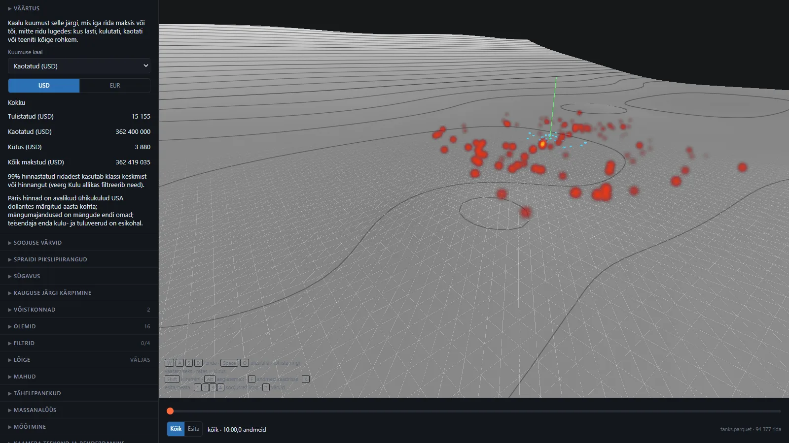

# Väärtuse kaalumine

Iga tulistus, moon, kaotatud sõiduk ja liiter kütust on hinnaga. Vaataja arvutab, mis iga rida maksis või teenis, ja saab soojust selle järgi kaaluda. Nii näitab kaart **kuhu raha läks**, mitte seda, kus read asuvad.

## Kuidas seda kasutada {#how-to-use-it}

1. Laadi andmed sündmustega (tulistused, tapmised, surmad) ning sõidukite või relvade nimedega.
2. Ava soojuse külgribal **Väärtus**.
3. Vali **Kuumuse kaal**, näiteks *Kaotatud (USD)*. Soojus liidab nüüd iga rea hinna 1 asemel.
4. Loe **Kokku**: iga väärtuse veeru summa sellele, mis on näidatud (kehtivad filtrid ja ajaaken).
5. Kui hinnad on päris raha, ilmub lüliti **USD / EUR**.

Menüü esimese tühja valiku valimine loeb read uuesti.

## Mida saab kaaluda {#what-can-be-weighed}

Väärtuse veerud lisatakse laadimisel, üks iga liigi ja valuuta kohta:

| Liik | Read, millele see langeb | Kuidas hinnatakse |
|---|---|---|
| **Tulistatud** | tulistused ja käivitused | relv, muidu selle laskemoona liigi keskmine |
| **Kulutatud** | ostmine, tekitamine | mängu rahaveerud (näiteks laskuri ostumenüü) |
| **Kaotatud** | surmad, hävitatud | oma sõiduk, muidu tema klassi keskmine |
| **Hävitatud** | tapmised | sihtmärgi sõiduk |
| **Tekitatud kahju** | tabamused | osa sihtmärgi väärtusest |
| **Kütus** | asukohad | kulutatud kütus kütuseveerust või hinnatuna klassi ja aja järgi |
| **Kõik makstud** | | tulistatud + kulutatud + kaotatud + kütus |
| **Teenitud** | auhinnad | mängu enda auhinnaveerud (`earn_…`) |
| **Neto** | | teenitud miinus makstud; joonistatakse märgiga soojusena (positiivne skaala seal, kus rohkem teeniti, negatiivne seal, kus rohkem maksti) |

Veergude nimed on `cost_<liik>_<valuuta>`, `earn_<valuuta>` ja `net_<valuuta>`. Konverter, mis tunneb mängu enda valuutat (näiteks taasesituse konverter, mis kirjutab mängusiseseid krediite), võidab sisseehitatud hinnatabelid.

## Hinnatabelid {#the-price-tables}

| Tabel | Valuuta |
|---|---|
| Reaalne sõjavägi: raketid, pommid, laskemoon, vastumeetmed, lennukid, helikopterid, maismaasõidukid, laevad, kütus | USD (EUR = USD × 0,92, fikseeritud `EUR_PER_USD` failis [`cost.ts`](https://github.com/Holdi601/3DHeat/blob/main/src/data/cost.ts); see ei ole reaalajas kurss) |
| Laskurite ostumenüüd ja tapmisauhinnad | mängu krediidid |
| Tanki- ja laevamängud | mängu krediidid |
| Strateegiamängud (mitu ressurssi) | üks veerg iga ressursi kohta ja üks ühine veerg |
| Sõjamängud | punktid |

Mäng tuvastatakse andmete nimedest. Reaalse maailma hinnad pärinevad avalikest allikatest (eelarvedokumendid, entsüklopeediad) või on märgitud hinnanguteks. Neid ei korrigeerita inflatsiooni järgi. Genereeritud tabelite loend on lehel [Väärtustabelid](ref-value-tables.md).

## Hinnangud {#estimates}

Lisakategooriaveerg **Hinna allikas** ütleb, kuidas iga rida hinnati: `table`, `class average`, `estimate` või `none`. Jaotis Väärtus näitab, milline osa hinnatud ridadest on keskmised või hinnangud. Et hoida alles ainult täpselt hinnatud read, eemalda linnukesed *estimate* ja *class average* jaotisest **Hinna allikas** lehel [Filtrid](filters.md).

## Kus veel väärtus näitub {#where-else-value-shows}

- [Tähelepanekud](insights.md): leiud *Kulukas maapind* ja *Teenistuslik maapind*.
- [Jaotus](breakdown.md): Teenitud, Kaotatud ja Neto raha meeskonna, mängija või relva kohta.
- [Mahud ja võrdlus](volumes.md): väärtuse veerud statistikas ja võrdluses.
