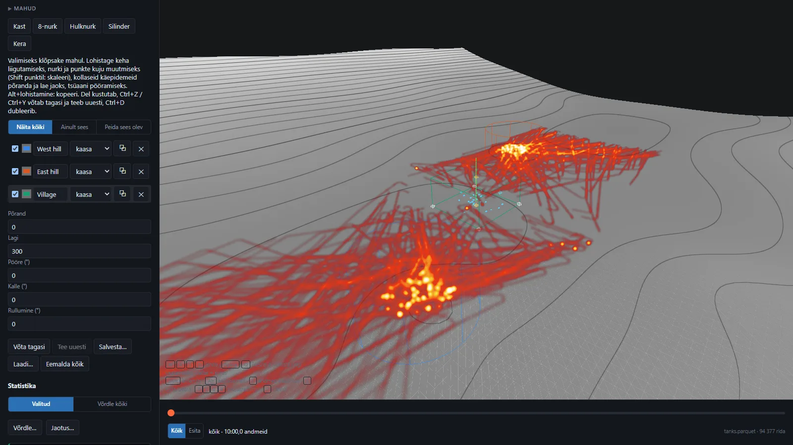
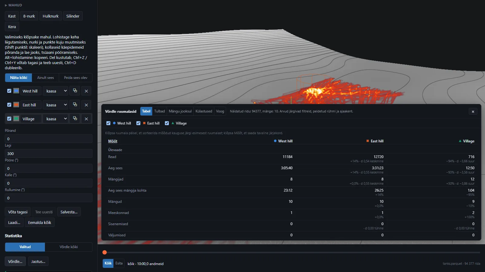
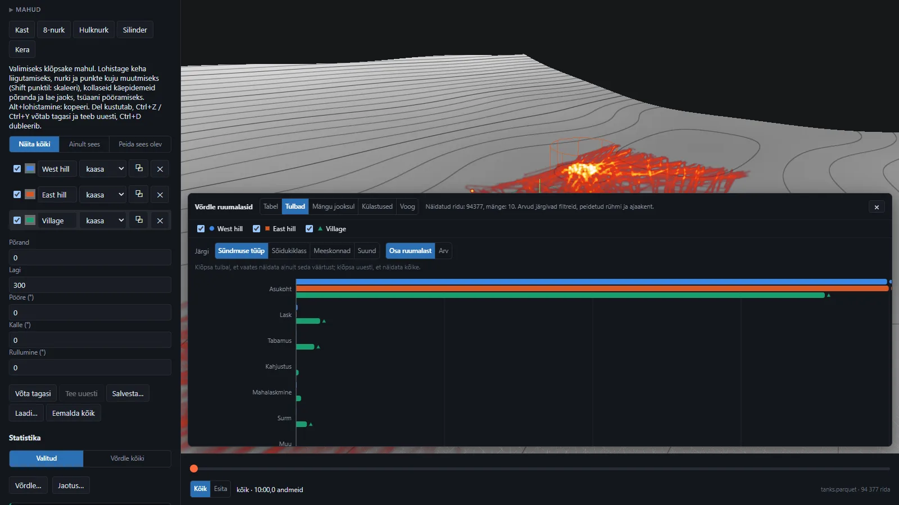

# Mahud ja võrdlus

**Maht** on nähtamatu kast (või silinder, või sfäär), mille joonistad kohale ümber, et küsida: mis siin juhtus? Kasuta seda, et lugeda tappe sillal, võrrelda kahte künka või näidata ainult tegevust ühes piirkonnas.

```
 pealtvaade              Joonistad kuju ->  vaatur loeb,
 +------------+          mis selle sees on:
 |   ( A )    |          read, mängijad, tapud, aeg ...
 |        [B] |          Võrdle A-d B-ga kõrvuti.
 +------------+
```



Mahud mõõdavad, mis nende sees juhtub, filtreerivad vaate nende järgi, ekspordivad oma read ja neid saab võrrelda kõrvuti. Vaata ka [sõnastikku](glossary.md) mõistete rida, isik ja matš kohta.

## Joonista maht {#draw-a-volume}

1. Ava külgribal **Mahud**.
2. Vali tööriist ja joonista 3D-vaates või 2D-kaardil. Põrand ja lagi lähtuvad allolevatest andmetest. Esc tühistab.
3. Klõpsa mahul, et see valida; selle **Statistika** ilmub.

| Tööriist | Kuidas joonistada |
|---|---|
| **Kast** | Lohista ristkülik (Shift: ruut). Klõps paneb vaikekasti. |
| **n-nurk** | Lohista keskpunktist (Shift hoiab korrapärasena). *Nurgad* määrab n-i, 3 kuni 64 (vaikimisi 8, nii et nupp näitab **8-nurk**). |
| **Hulknurk** | Klõpsa nurgad; sulge topeltklõpsuga, Enteriga või klõpsuga esimesel nurgal. Backspace eemaldab viimase nurga. |
| **Silinder** | Lohista raadiust. |
| **Kera** | Lohista raadiust; ta toetub maapinnale. |

## Redigeeri {#edit}

- Klõpsa mahul, et see valida. Lohista keha, et seda liigutada, nurki, et kuju muuta (nurga peal Shift skaleerib).
- **Kollased** käepidemed määravad põranda ja laed, **tsüaanne** käepide pöörab seda.
- Alt+lohistus kopeerib, Del eemaldab, Ctrl+Z / Ctrl+Y tühistab ja taastab, Ctrl+D dubleerib. **Eemalda kõik** kustutab kõik mahud.
- Täpsed väärtused: Põrand, Lagi, Pööre / Kallak / Rull (kastid), Raadius (sfäärid, silindrid).

Iga mahu rida on näitamise märkeruut, värv, nimi, **kaasa** või **välista**, dubleerimine ja kustutamine. Mahud salvestatakse brauseris iga andmestiku kohta ning **Salvesta...** / **Laadi...** kirjutavad ja loevad faili `volumes.json`.

## Filtreeri vaadet {#filter-the-view}

| Filter | Mõju |
|---|---|
| **Näita kõiki** (vaikimisi) | Mahud ainult mõõdavad. |
| **Ainult sees** | Soojus, kordus ja [tabamuste analüüs](hit-analysis.md) joonistavad ainult selle, mis on kaasatud mahtude sees ja välistatud mahtude väljas. |
| **Peida sees olev** | Vastupidi. |

GPU filter võtab kuni 8 mahtu, kokku 64 äärejoone punktiga; "!" tähistab mahtu, mis ületab selle. Statistika ja eksport loevad seda endiselt.

## Statistika {#statistics}

Ala **Statistika** järgib filtreid, ajaakent ja peidetud rühmi. *Valitud* näitab valitud mahtu, *Võrdle kõiki* paneb kõik mahud kõrvuti. Ta näitab:

- **Ridu sees (näidatud)** ja **Ridu sees (kõik andmed)**, **Mängijad**, **Meeskonnad**, **Mängud**, **Aeg sees**, **Sisenemised / väljumised**, **Soojuse tipp**, **Keskmine soojus**, **Maht / jalajälg** ning **Millal** histogrammi;
- **Võitude osakaal**, kui andmed ütlevad, kes võitis ([tulemuse veerud](data-formats.md#outcome-columns)): raundidest, kus mängija oli sees, iga mängija raund loetud üks kord, osakaal, mille tema pool võitis - tõmmatuna kogu näidatu osakaalu poole 4 raundiga, nagu [jaotus](breakdown.md) teeb - koos võidetud ja mängitud raundide ning üldise osakaaluga;
- veeru kaupa: kategooriad koos **suhtarvuga** (osakaal sees jagatud osakaaluga kõigis näidatud andmetes) ning arvud koos vahemiku, mediaani ja 5.-95. protsentiiliga.

**Statistika CSV / JSON-ina** salvestab need. **Ekspordi sees olevad andmed** kirjutab sees olevad read CSV või Parquet kujul (*Ainult näidatud read* on vaikimisi sees), ühe mahu või kõik, veeruga, mis ütleb, millises mahus iga rida on.

## Võrdle mahte {#compare-volumes}

Kahe või enama nähtava mahu korral vajuta **Võrdle...**.

1. Joonista kolm mahtu, näiteks Läänekünk, Idakünk ja Küla.
2. Vajuta **Võrdle...** jaotise Statistika all.
3. Vaates **Tabel** loe iga väärtuse erinevust esimesest mahust.
4. Lülitu **Tulpadele**, et näha osakaale tulpadena.



| Vaade | Näitab |
|---|---|
| **Tabel** | Read, aeg sees, mängijad, mängud, meeskonnad, sisenemised, väljumised, külastused, külastuse pikkus, tapud, surmad, tapud surma kohta, tapud minuti kohta, aeg mängija kohta, väärtuse veerud; grupeeritud sündmuste, sõidukiklassi, mängija või TI, meeskonna ja suuna järgi. Iga väärtus näitab oma erinevust esimesest mahust ja efektisuurust (tühine, väike, keskmine, suur). Klõpsa mahu pealkirjal, et sorteerida kauguse järgi esimesest. |
| **Tulbad** | Arvud või osakaalud sündmuse, klassi, osaleja, meeskonna või suuna järgi. Klõps tulbal filtreerib vaate selle järgi. |
| **Mängu jooksul** | Üks graafik mahu kohta mängu minutite üle: kohalolek, read või tapud. Klõps viib sinna. |
| **Külastused** | Kasti- ja viiulidiagrammid selle kohta, kui kaua külastused kestavad (logaritmiline skaala). |
| **Voog** | Kuhu jäljed pärast iga mahu jätmist lähevad: siirdemaatriks või voovöödid. |



## Nipid {#tips}

- Alusta leiust: [Tähelepanekutes](insights.md) lisab **Ruumala siin** leiu koha ümber silindri.
- **Jaotus...** avab valitud mahu [Jaotuse](breakdown.md): kes ja mis seal kõige paremini toimib.
- [Suunatud soojus](directional-heat.md) võib joonistada valitud mahu sees olevate suundade graafiku.
- [Sõidukite vahekaart](hit-analysis.md#restrict-to-an-area) kasutab samu mahtusid oma alafiltrina.
