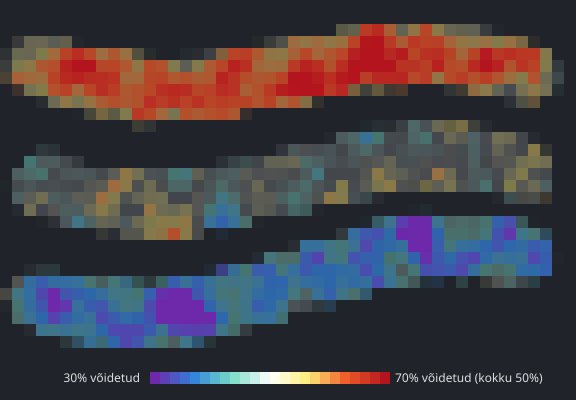

# Võitude osakaal: kui tihti koht, marsruut või käik võidab

Kus mängija seisab, kuhu ta liigub, kuhu ta oma abivahendeid viskab - ja kui tihti tema pool siis raundi võidab. **Võitude kaart** värvib iga koha selle järgi, kui suur osa sealsetest ridadest kuulub raundidesse, mille rea pool võitis, võrreldes osakaaluga kogu näidatu ulatuses: soe, kus see on suurem, külm, kus see on väiksem, mitte midagi, kus see on sama.

*Pilt on väljamõeldud andmed: kolm marsruuti tühjal tasemel, nende ridadest 68%, 50% ja 33% võidetud raundides.*

Selleks on vaja andmeid, mis ütlevad, kes võitis: [tulemuse veerge](data-formats.md#outcome-columns) (`won`, `matchWon`, `roundEndReason`). CS2 ja War Thunderi konverterid kirjutavad need; need võivad olla igas failis.

## Proovi {#try-it}

1. Laadi tulemuse veeruga mängud ja vajuta `2` (**Erinevus**).
2. Vajuta jaotises **Erinevuse jaotus** nuppu **Raundivõitude osakaal** (või **Mänguvõitude osakaal**). See paneb võidetud raundid **+** poolele ja kaotatud **−** poolele ning lülitab paneeli režiimi **+ osakaal**.
3. Loe värve. Paneel ütleb üldise osakaalu: *Kokku on 52,0% 1 200 000 reast + poolel.*
4. Kitsenda seda [filtritega](filters.md): üks pool (T või CT), üks sündmuse tüüp (*Asukoht* selle jaoks, kus inimesed seisid, *Lask* või *Välja laskmine* selle jaoks, kust nad tulistasid või viskasid), üks ost, üks kaart.

Koht, mis on *Asukoht*-ridadega soe, on koht, mille hoidjad kippusid raundi võitma. *Mahalaskmine*-ridadega on see koht, kus tehtud mahalaskmised viisid võidetud raundideni.

## Seaded {#the-settings}

| Seade | Mida see teeb | Vaikimisi |
|---|---|---|
| **Erinevus** / **+ osakaal** | erinevus ise või + poole osakaal mõlema poole ridadest | Erinevus |
| **Täisvärv kohal** | kui kaugel üle või alla üldise osakaalu kohta täisvärvis näidatakse, protsendipunktides | ± 20 protsendipunkti |
| **Vähim ridu koha värvimiseks** | vähemate ridadega kohta ei värvita; värv ilmub järk-järgult alates poolest sellest | 12 |
| **Tõmme üldise osakaalu poole (read)** | iga koht alustab nii mitme reaga üldisel osakaalul, nii et 3 reaga koht, kõik võidetud, ei paista 100% | 12 |

Kõik kolm mõjuvad valmis pildile: nende lohistamine ei käivita kogumist kunagi uuesti.

Osakaal kehtib iga jaotuse kohta, mitte ainult võitude: *+ osakaal* poolte kaupa jaotusega näitab, kus T-pool oli suurem osa kohalolust, ja kahe kaardi failide kaupa jaotusega, kus ühe faili read kaaluvad teise omadest rohkem.

## Read, mitte raundid {#rows-not-rounds}

Kaart loeb ridu. Mängija, kes seisab ühes kohas kakskümmend sekundit, lisab iga proovi kohta rea, kõik ühest raundist, nii et tõendid kohas on selle lähedal olevad read, mitte raundid. Seepärast on miinimum ja tõmme ridades ning seepärast on need suuremad kui ühe raundi jagu.

Raundide endi jaoks:

- **[Jaotus](breakdown.md)** punktis, vaates või mahus: *Võidud %* loeb iga mängija raundi üks kord, tõmmatuna koha üldise osakaalu poole samamoodi (4 raundi).
- **[Mahud](volumes.md)**-statistika: *Võitude osakaal* - raundid, kus mängija oli mahu sees, igaüks üks kord, tõmmatuna kogu näidatu osakaalu poole, koos arvudega.

## Tulemuse filtrid {#outcome-filters}

Paneel [Filtrid](filters.md) loetleb tulemuse veerud kohe pärast vaataja enda veerge: **Raundi tulemus** ja **Mängu tulemus** (*Mis tahes*, *Võidetud*, *Kaotatud*) ning **Kuidas raund lõppes** (Elimineerimine, Pomm plahvatas, Pomm desarmeeritud, Aeg sai otsa, Alistumine, Viik, Eesmärk, Tsoonid hoitud, Piletid kaotatud, Kõik sõidukid kaotatud), vaataja keeles.

## Arendajatele {#for-developers}

Soojuskäik kirjutab kolm summat neljakanalilisse sihtmärki, mida meeskonnasoojus kasutab: soojuse `R = Σ|v|`, + poole soojuse `P` ja `S = Σ v²/w`, kus `w` on käigu kaal (valimikaal korda kaadri võimendus). Liitmine loeb osakaalu `P/R` (tuumaga kaalutud keskmine) ja read, millele see toetub, `n = R²/S` (Kishi efektiivne valimi suurus), tõmbab osakaalu üldise poole, `p = (n·P/R + m·r0)/(n + m)`, ja värvib `p - r0` vahemiku ulatuses erinevuse skaaladel.

`n` jagab välja iga teguri, mis on piksli juures olevatel ridadel ühine - kaadri võimenduse, valimikaalu, kärbitud sprite'i pindalakaalu - nii et pilt on sama igal suumil ja valimitihedusel ning iga k-nda rea kaadrid sulavad tervikuks ilma, et värvid hüppaksid. Üldine osakaal tuleb protsessori poolte loendustest, protsendi kümnendiku täpsusega; graafikaprotsessorist ei loeta midagi tagasi. Arvutus ja selle kontrollid: [`render/rateMap.ts`](https://github.com/Holdi601/3DHeat/blob/main/src/render/rateMap.ts) ja selle test.

See maksab sama palju kui meeskonnasoojus: neljakanaliline sihtmärk neljakordistab soojuskäigu segamise ribalaiust, ainult siis, kui *+ osakaal* on sees.
