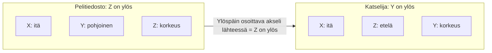

# Akselit, yksiköt ja aika

Pelit ja kartat eivät ole yhtä mieltä siitä, mikä suunta on ylös, kuinka pitkä yksikkö on tai miten aika kirjoitetaan. Tämä sivu näyttää kolme asetusta, joilla datasi seisoo, on oikean kokoinen ja toistuu oikein.

Jos karttasi seisoo seinän lailla eikä makaa lattian lailla, käännä **Ylöspäin osoittava akseli lähteessä**.

Väärällä **Ylöspäin osoittava akseli lähteessä** -asetuksella kartta seisoo seinän lailla; oikealla se makaa lattian lailla.

## Maailma, jossa katselija piirtää {#the-world-the-viewer-draws-in}

Katselijan maailma on **Y ylös**: X ja Z ovat maatasossa, Y on korkeus. Useimmat pelimoottorit ovat **Z ylös**: niille X ja Y ovat maata ja Z on korkeus. Osa moottoreista on myös peilattuja (vasenkätisiä). Kuvaus kertoo, miten tiedoston akselit käännetään katselijan akseleiksi. (Teknisesti katselija on oikeakätinen, three.js-tavan mukaan.)

### Ylös-akseli {#up-axis}

**Ylöspäin osoittava akseli lähteessä** kohdassa [Sarakemääritys](column-mapping.md):

| Asetus | Tiedosto (x, y, z) muuttuu maailmaksi (X, Y, Z) |
|---|---|
| *Z on ylös (useimmat pelimoottorit)* – oletus | (x, **z**, **y**): tiedoston Z tulee korkeudeksi ja tiedoston Y tulee maailman Z:ksi |
| *Y on ylös (grafiikkakäytäntö)* | (x, y, z) ennallaan |

Z-ylös-datalle kolme taulukkoa nimetään uudelleen eikä kopioida ([`remapAxesInPlace`](https://github.com/Holdi601/3DHeat/blob/main/src/data/ingest.ts)), mikä säästää satoja megatavuja suurissa latauksissa. Arvaus tehdään näytteestä: se Y- tai Z-sarake, jonka hajonta on pienempi, on ylös.

### Käännökset {#flips}

**Käännä X**, **Käännä Y** ja **Käännä Z** kääntävät *tiedoston* akselin, jolla on se nimi, ennen uudelleennimeämistä – joten Z-ylös-tilassa *Käännä Y* kääntää sen, mistä tulee maailman Z. Käännös muuttaa ladattua dataa: [mittaviivaimen](measure.md), viipaleen ja kameran asennon näyttämät koordinaatit ovat käännettyjä.

Jos haluat piirtää peilatun maailman oikein päin **muuttamatta** dataa, käytä sen sijaan **Kamera ja kohtaus → Käännä maailman akseli** -toimintoa ([Kamera](camera.md#invert-world-axis)). Se on parempi valinta peleille, joiden maailma on vasenkätinen, koska jokainen työkalujen näyttämä koordinaatti pysyy pelin omana.

### Yksikön mittakaava {#unit-scale}

**Yksikön mittakaava** kertoo jokaisen sijainnin. *1 (m)* asettaa arvoksi 1, *0,01 (cm→m)* asettaa arvoksi 0,01 (Unreal Enginen yksiköt ovat senttimetrejä, joten käytä 0,01; Source-moottorin yksiköt ovat tuumia, joten käytä 0,0254; kumpikaan ei ole metrejä), ja laatikko hyväksyy minkä tahansa arvon. Kirjoitettu 0 tai arvo, joka ei ole luku, korvataan arvolla 1.

Katselija merkitsee etäisyydet metreiksi (spriten säde, rajausetäisyydet, viivain, lentonopeus), mikä pitää paikkansa vain, kun skaalattu maailmayksikkö on metri. Mikään ei hajoa, jos se ei ole; nimiöt vain lukevat "m" yksikölle, joka on mikä tahansa.

## Aika {#time}

### Aikayksiköt {#time-units}

Nyrkkisääntö: arvot kuten 17000000000 (kymmen tai useampi numero) ovat Unix-aikaleimoja; arvot kuten 0, 0,25, 0,5 ovat sekunteja alusta.

| Aikayksikkö (valikon nimi) | Luetaan | Seinäkello näytetään |
|---|---|---|
| *Sekunnit (suhteellinen)* | arvo × 1 s | ei |
| *Millisekunnit (suhteellinen)* | arvo × 0,001 s | ei |
| *Mikrosekunnit (suhteellinen)* | arvo × 10^-6 s | ei |
| *Nanosekunnit (suhteellinen)* | arvo × 10^-9 s | ei |
| *Unix-aikaleima (s)* | sekunteja 1.1.1970 UTC:stä | kyllä |
| *Unix-aikaleima (ms)* | millisekunteja 1.1.1970 UTC:stä | kyllä |
| *ISO-8601-päiväysmerkkijono* | teksti, kuten `2026-03-14T18:02:11.250Z`, jäsennettynä selaimen `Date.parse`-funktiolla | kyllä |

Absoluuttisella yksiköllä (kolme viimeistä) aineisto säilyttää aikaisimman rivinsä seinäkellon hetken, ja aikajana näyttää nykyisen UTC-kellonajan (`HH:MM:SSZ`) toiston kohdan vieressä.

**Parquet-sarakkeet `TIMESTAMP` ja `DATE`** muuttuvat oikeiksi hetkiksi, joten niiden yksikköasetus jätetään huomiotta ja paneeli kertoo siitä. `DATE`-sarake on koko päivä: kaikki päivän rivit jakavat yhden hetken, ja toisto hyppää päivän kerrallaan, mistä paneeli varoittaa.

**ISO-8601-merkkijonot toimivat sekä CSV:ssä että Parquetissa.** Tekstimuotoinen aikasarake, jossa on ISO-yksikkö, jäsennetään kerran jokaiselle erilliselle merkkijonolle; jos yksikään ei jäsenny, lataus epäonnistuu viestillä *No parseable ISO-8601 timestamps in the mapped time column.* – ja sarakemääritys kieltäytyy käynnistymästä jo silloin, kun yksikään näytearvo ei jäsenny. Parquet-sarake `TIMESTAMP` luetaan aikaleimana yksiköstä riippumatta, ja numeerinen Parquet-sarake ISO-yksiköllä luetaan Unix-millisekunteina. Tekstimuotoinen aikasarake numeerisella yksiköllä hylätään ennen latausta: jokainen arvo lukeutuisi NaN:ksi.

### Miten aika tallennetaan {#how-time-is-stored}

Tiedostoja yhdistettäessä ajat ovat 64-bittisiä sekunteja, joten absoluuttinen aikakausi säilyttää alle sekunnin yksityiskohdat. Kun kaikki tiedostot ovat mukana, koko valinnan aikaisin hetki tulee arvoksi 0, ja jokainen rivi tallentaa 32-bittiset sekunnit siitä. 32-bittisessä liukuluvussa on 24 bittiä mantissaa: jopa noin puolentoista päivän jaksot erottuvat paremmin kuin 1/100 s, puolen vuoden jaksot noin sekunnin tarkkuudella. Rivi, jonka aika puuttuu tai ei ole luku, sijoitetaan kohtaan 0, eli alkuun.

Rivit lajitellaan sitten ajan mukaan, ja siksi aikajana on halpa: aikaikkuna löytyy kahdella binäärihaulla (katso [Näytteenotto ja budjetit](sampling-and-budgets.md)).

### Kulunut aika ja seinäkello {#elapsed-time-versus-wall-clock}

Aikasarake, kuten `match_time` tai `round_time`, laskee kunkin ottelun omasta alusta. Sen valitseminen asettaa jokaisen ottelun yhteiselle akselille – hyvä vertailuun siitä, mitä tapahtuu minuutin 3 kohdalla jokaisessa ottelussa – ja paneeli huomauttaa tästä. Seinäkellosarake näyttää ottelut siinä järjestyksessä, jossa ne todella tapahtuivat, ja ne menevät päällekkäin siellä, missä ne olivat päällekkäin.

## Katselusuunta {#look-direction}

Katselusuuntaa käyttää vain [laatikkotoisto](box-replay.md) (säteet kustakin laatikosta). Se tallennetaan kahtena kulmana, kiertokulmana (yaw) ja nyökkäyskulmana (pitch), radiaaneina.

- **Kiertokulma- / nyökkäyskulmasarakkeet** luetaan sellaisinaan, ja ne muunnetaan asteista, kun *Asteet* on valittu. Niitä ei soviteta ylös-akselille tai käännöksille.
- **Suuntavektorisarakkeet** kulkevat samoja uudelleennimeämisiä ja käännöksiä kuin sijainnit, ja sitten niistä tulee kiertokulma = atan2(x, -z) ja nyökkäyskulma = atan2(y, √(x² + z²)) maailman akseleissa; näin säde osoittaa minne laatikko katsoo myös peilatussa lähdemaailmassa.

Jos kiertokulma- tai nyökkäyssarakkeet osoittavat väärään suuntaan käännöksen, suuntavektorin tai sovitettujen kulmien jälkeen, korjaus on tässä.
